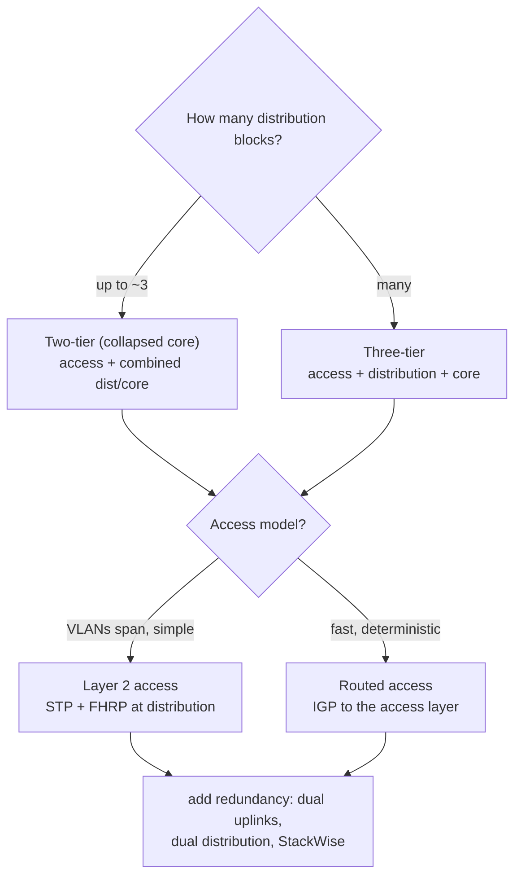
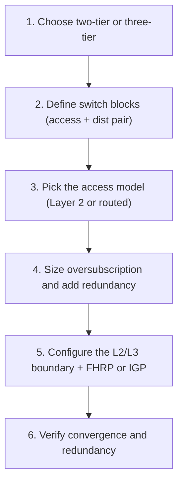
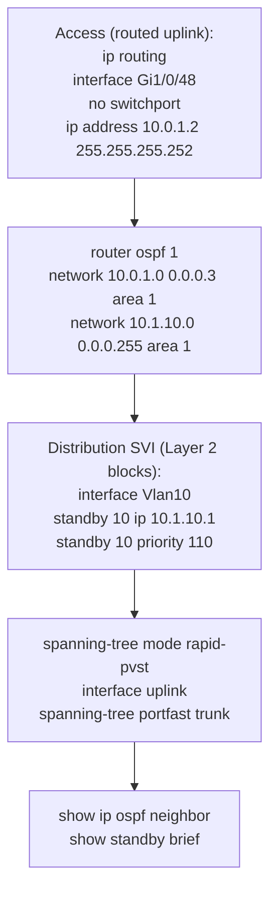

---
categories:
  - "[[Networking]]"
topic@networking:
  - "[[Networking General]]"
tags:
  - category/networking/networking_general
icon: FasNetworkWired
iconColor:
last_update:
---
Campus design is how the enterprise LAN is structured so that it scales, stays resilient, and remains manageable as it grows. Cisco's approach is hierarchical and modular: split the network into functional layers with clear jobs, build it from repeatable blocks, and add redundancy where failures would hurt. This note covers the design principles, the three hierarchical layers, the two- and three-tier models, the switch block, access-layer options, the spine-leaf fabric, and capacity planning. It is the traditional foundation that [[SD-Access#What SD-Access Is|SD-Access]] later automates and evolves. The high-availability techniques that make each layer redundant — first-hop redundancy, stateful switchover, and the like — are covered in the [[High Availability#Redundancy Fundamentals|High Availability]] note.

## Design Principles

_Four principles underpin the whole model: hierarchy, modularity, resiliency, and flexibility._

Hierarchy divides the network into layers so each has a single, well-understood role, which keeps complexity local and makes behavior predictable. Modularity builds the network from repeatable blocks so it can grow by adding blocks rather than redesigning. Resiliency adds redundancy — dual devices, dual links, fast reconvergence — so a single failure does not take down a fault domain. Flexibility keeps the design adaptable to new services and technologies without a forklift rebuild. These principles are the reasoning behind every structural choice that follows.

## Hierarchical Layers

_The campus is organized into three functional layers, each with a distinct job._

### Access Layer

Where endpoints connect — users, phones, access points, printers, IoT. Its concerns are edge features: Power over Ethernet, access VLANs, port security, 802.1X, and QoS classification and trust at the point where traffic enters the network. It is the largest layer by port count and the first place policy is applied.

### Distribution Layer

Aggregates the access switches and is usually the boundary between Layer 2 and Layer 3. It routes between VLANs, hosts the first-hop gateway for endpoints, applies policy such as ACLs and QoS, and provides redundancy toward both the access and the core. Isolating faults and summarizing routes here keeps churn from propagating.

### Core Layer

The high-speed backbone that interconnects [[#The Switch Block|distribution blocks]] and ties in the data center and WAN edge. Its single job is to switch large volumes of traffic as fast and simply as possible, so it carries minimal policy — every added feature is a potential bottleneck or failure point in the part of the network that can least afford one.

|Layer|Primary job|Typical features|
|---|---|---|
|Access|Connect endpoints|PoE, access VLANs, port security, 802.1X, QoS trust/marking|
|Distribution|Aggregate access, apply policy, Layer 3 boundary|Inter-VLAN routing, first-hop gateway redundancy, ACL/QoS, route summarization|
|Core|High-speed backbone|Fast, simple Layer 3 transport; connects blocks, data center, WAN|

```
                     Core
                  ╱    │    ╲
            Dist      Dist      Dist        distribution blocks
            ╱  ╲      ╱  ╲      ╱  ╲
         Acc  Acc  Acc  Acc  Acc  Acc       access switches
          │    │    │    │    │    │
              endpoints ...
```

## Two-Tier and Three-Tier Models

_How many layers to build depends on the size of the campus._



### Three-Tier Design

Keeps the access, distribution, and core as separate layers. It suits large campuses with many distribution blocks, where a dedicated core is needed to interconnect them without every block having to mesh with every other.

### Two-Tier Collapsed Core

Combines the core and distribution into one layer, so only two tiers remain. It fits small-to-medium campuses — roughly up to three distribution blocks — where a separate core would add cost and complexity without benefit. If the network later grows past what the collapsed layer can interconnect cleanly, a dedicated core is added.

```
Three-tier                        Two-tier (collapsed core)
        Core                          Core + Distribution
      ╱      ╲                          ╱     │     ╲
  Dist        Dist                   Acc     Acc     Acc
   │ ╲        ╱ │                      │       │       │
  Acc Acc  Acc Acc                  endpoints ...
```

|Model|Layers|Best for|
|---|---|---|
|Three-tier|Access + Distribution + Core|Large campuses, many distribution blocks|
|Two-tier (collapsed core)|Access + combined Distribution/Core|Small-to-medium sites, up to roughly three blocks|

## The Switch Block

_The access-and-distribution building block that makes the design modular._

A switch block is a set of access switches plus the redundant [[#Distribution Layer|distribution]] pair that aggregates them — one self-contained module with its own Layer 3 boundary. The [[#Core Layer|core]] simply interconnects blocks. Because each block is a fault domain, a problem such as a spanning-tree issue or a broadcast storm is contained within it rather than spreading across the campus, and the network grows by adding blocks rather than redesigning.

```
                 Core
               ╱      ╲
        ┌──────────────────┐
        │  Dist1     Dist2  │   redundant distribution pair
        │     ╲      ╱      │   = the block's Layer 3 boundary
        │     Acc  Acc      │   access switches
        └──────────────────┘
             one switch block
```

## Access-Layer Design

_The key structural choice is where the Layer 3 boundary sits: at the distribution layer, or pushed down to the access layer._

### Layer 2 Access

The classic model: access switches are Layer 2, and the [[#Distribution Layer|distribution]] layer is the Layer 2/Layer 3 boundary. Spanning tree prevents loops on the access uplinks and a [[High Availability#First-Hop Redundancy Protocols|first-hop redundancy protocol]] provides a redundant default gateway. VLANs can span multiple access switches, which is flexible but keeps a spanning-tree control plane in the forwarding path.

### Routed Access

Pushes Layer 3 all the way to the access switch, so the access-to-distribution links are routed. Spanning tree is no longer needed on the uplinks, an interior gateway protocol handles reconvergence with equal-cost paths, and convergence is faster and more deterministic. The tradeoff is that a VLAN can no longer span access switches, since each is its own routed boundary.

### Looped and Loop-Free Topologies

Whether VLANs span the distribution pair determines the topology. A looped design (VLANs spanning both distribution switches) relies on spanning tree to block a redundant path, leaving some links idle. A loop-free design confines each VLAN to a single access switch so no uplink is blocked and all links forward. Routed access is inherently loop-free on the uplinks.

|Aspect|Layer 2 access|Routed access|
|---|---|---|
|Layer 3 boundary|Distribution|Access|
|Loop protection|Spanning tree on uplinks|Not needed — uplinks are routed|
|Gateway redundancy|First-hop redundancy protocol|Interior gateway protocol / ECMP|
|Convergence|Slower|Faster, more deterministic|
|VLAN spanning access switches|Possible|Not possible|

## Spine-Leaf Fabric

_A flat, non-blocking topology built for predictable east-west performance rather than the north-south flows of the hierarchy._

In a spine-leaf fabric every leaf switch connects to every spine switch, and there are no leaf-to-leaf or spine-to-spine links. Any endpoint is therefore exactly two hops from any other — leaf, spine, leaf — so latency is consistent, and traffic spreads across all spines through equal-cost multipath. Capacity scales horizontally: add a spine for more bandwidth, add a leaf for more ports. This topology dominates the data center, where server-to-server (east-west) traffic outweighs the client-to-server (north-south) pattern the hierarchy was built for, and it is the usual underlay for an [[SD-Access#Underlay and Overlay|SD-Access]] fabric.

```
    Spine1            Spine2
      │  ╲            ╱  │
      │    ╲        ╱    │
      │      ╲    ╱      │          every leaf ↔ every spine
      │        ╳         │          no leaf-leaf, no spine-spine
      │      ╱    ╲      │
    Leaf1        Leaf2        Leaf3
      │            │            │
    hosts        hosts        hosts
```

## Capacity Planning

_Sizing uplinks and redundancy so the network degrades gracefully instead of collapsing under load._

Access ports almost always sum to more bandwidth than their uplinks, so some oversubscription is expected and designed for. Common planning figures are around 20:1 from access to distribution and around 4:1 from distribution to core. The point is not the exact number but the discipline: know the ratio, and know that a higher one raises the chance of transient congestion when many devices burst at the same time. Planning also covers redundancy (dual uplinks and dual distribution switches so no single failure isolates a block) and fault-domain sizing (keeping each block small enough that a failure has limited blast radius).

> [!note] Oversubscription is a deliberate tradeoff
> Building for full non-blocking throughput everywhere is rarely economical. The design goal is a ratio the traffic profile can tolerate, with enough headroom that normal bursts do not cause loss — not the elimination of oversubscription.

## Relationship to SD-Access

_The hierarchical model is the classic campus; SD-Access is its automated, fabric-based evolution._

Everything above describes a network that is configured device by device, where reach is defined by VLANs and subnets and redundancy is built from spanning tree and first-hop protocols. [[SD-Access#What SD-Access Is|SD-Access]] keeps the same physical hierarchy — often a [[#Spine-Leaf Fabric|spine-leaf]] underlay — but overlays a VXLAN fabric that is provisioned by a controller and enforces policy by identity rather than by address. The two coexist during migration: a traditional campus can interoperate with an SD-Access fabric through the border, so blocks can be converted incrementally rather than all at once.

## Configuration

_Design the tiers and blocks, choose the access model, size the uplinks, then configure the Layer 3 boundary with an IGP or FHRP._

### High-Level Workflow



### CLI Companion

_Routed access with OSPF, plus an HSRP gateway where Layer 2 access remains (Cisco IOS-XE)._


