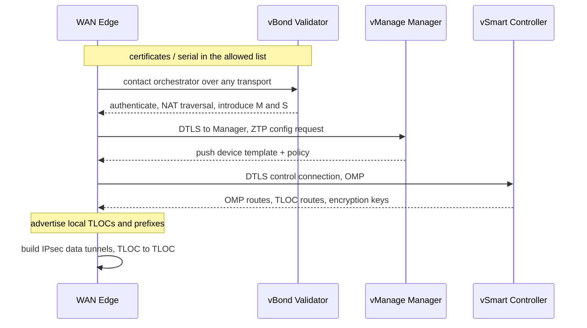
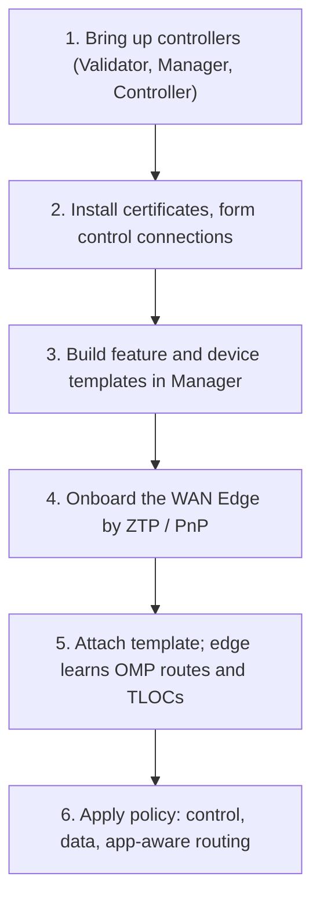
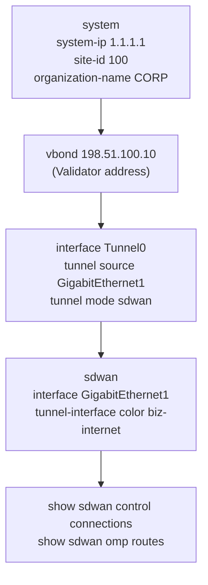

---
categories:
  - "[[Networking]]"
topic@networking:
  - "[[Networking General]]"
tags:
  - category/networking/networking_general
icon: FasNetworkWired
iconColor:
last_update:
---
Cisco Catalyst SD-WAN, formerly Viptela and then Cisco SD-WAN, is a software-defined approach to the wide-area network. It separates the WAN into four planes and builds a transport-independent, encrypted overlay that rides on top of any underlying transport — MPLS, broadband internet, or cellular — while being managed centrally and driven by policy. Instead of configuring each branch router by hand and locking the design to one carrier, an operator defines intent in a controller and the fabric of edge routers is provisioned to match. This note covers the four planes and their components, the overlay routing protocol and its locators, the split between control and data connections, policy and application-aware routing, onboarding, and how the whole thing compares to a traditional WAN. It is the WAN sibling of [[SD-Access#What SD-Access Is|SD-Access]]: the same separation of control from data, applied to the WAN instead of the campus.

## Traditional WAN versus SD-WAN

_The WAN moved from router-by-router and transport-locked to centrally managed and transport-independent._

A traditional WAN is configured device by device, usually built around MPLS, and tends to backhaul internet-bound traffic to a central hub for inspection. Policy, QoS, and access lists live on each router, so change is slow and error-prone. SD-WAN centralizes the design in a controller and manager, treats every transport as interchangeable, allows direct internet access at the branch, and steers traffic by application rather than by static routing metrics — all over an overlay that is encrypted by default.

|Aspect|Traditional WAN|Catalyst SD-WAN|
|---|---|---|
|Configuration|Per-router CLI|Centralized templates and policy on the Manager|
|Transport|MPLS-centric, transport-locked|Transport-independent — MPLS, internet, cellular|
|Internet traffic|Backhauled to a hub|Direct internet access at the branch|
|Path selection|Routing metrics|Application-aware, by measured SLA|
|Security|Configured per device|Encrypted overlay by default|
|Change speed|Slow and manual|Automated and fast|

## The Four Planes

_SD-WAN separates management, control, orchestration, and data, and each plane is a distinct component._

```
        ┌───────────────── vManage — Manager ─────────────────┐   management
        │       GUI / API, templates, policy, monitoring        │
        └───────────────────────────────────────────────────────┘
   vBond — Validator                       vSmart — Controller
   orchestration:                          control: OMP distributes
   authenticate, NAT traversal,            routes, TLOCs, policy, keys
   introduce edges                                  │
        └────────────── DTLS/TLS control connections ───────────┐
                                                                 │
      WAN Edge ═══════════ IPsec data tunnels ═══════════ WAN Edge
     (cEdge / vEdge)      over any transport            (cEdge / vEdge)
```

|Plane|Component (current name)|Formerly|Role|
|---|---|---|---|
|Management|SD-WAN Manager|vManage|GUI and API, templates, policy authoring, monitoring|
|Control|SD-WAN Controller|vSmart|Runs OMP; distributes routes, TLOCs, policy, and keys|
|Orchestration|SD-WAN Validator|vBond|Authenticates devices, NAT traversal, introduces them|
|Data|WAN Edge routers|vEdge / cEdge|Form the fabric, build the IPsec overlay, enforce data policy|

> [!note] Know both names
> Cisco rebranded the controllers — Manager, Controller, and Validator are the current names for vManage, vSmart, and vBond. Exam material and the CLI still use the v-names heavily, so keep both in mind.

### Management Plane — vManage

The single pane of glass. vManage (SD-WAN Manager) is the centralized dashboard and API for the whole fabric: device onboarding, configuration templates, policy authoring, monitoring, and troubleshooting. It is where operators express intent; it does not sit in the traffic path.

### Control Plane — vSmart

The brain. vSmart (SD-WAN Controller) runs the [[#OMP — Overlay Management Protocol|Overlay Management Protocol]] and distributes routing information, [[#TLOC — Transport Locator|TLOCs]], policy, and encryption keys to the edges — much like a route reflector for the overlay. It makes the topology and policy decisions but never carries user data.

### Orchestration Plane — vBond

The introducer. vBond (SD-WAN Validator) is the first point of contact for any device joining the fabric: it authenticates the edge, performs NAT traversal so devices behind NAT can be reached, and introduces the edge to the Manager and Controllers. It is the one component that must be reachable from the public internet.

### Data Plane — WAN Edge

The routers at each site that actually forward traffic. A cEdge runs Cisco IOS-XE (ISR, ASR, and Catalyst 8000 platforms); a vEdge runs the original Viptela OS. Edges build the [[#Control and Data Connections|IPsec data tunnels]] between sites, encapsulate user traffic across whatever transport is available, and enforce the data policies pushed down to them.

## The Overlay

_How edges learn about each other and decide where to build tunnels._

### OMP — Overlay Management Protocol

OMP is the routing protocol of the overlay, running between each edge and the [[#Control Plane — vSmart|vSmart controllers]] inside the control connections. It unifies routing, policy, security, and service information into one protocol, advertising OMP routes (the actual prefixes reachable at each site), TLOC routes (the transport attachment points), service routes, and the encryption keys that let edges bring up data tunnels. Conceptually it is to SD-WAN what BGP is to a traditional network, but purpose-built for the overlay.

### TLOC — Transport Locator

A TLOC is the point where an edge attaches to a transport, identified by a three-tuple: the edge's system IP, a [[#Color|color]], and an encapsulation (IPsec or GRE). Edges advertise their TLOCs to vSmart through OMP, vSmart distributes them to the other edges, and each edge uses that information to build data tunnels TLOC-to-TLOC. The TLOC is the SD-WAN equivalent of a locator — it answers where an edge can be reached on the underlay.

```
TLOC = system-IP + color + encapsulation

  Edge-A  1.1.1.1 : mpls : ipsec ═══════════ Edge-B  2.2.2.2 : mpls : ipsec
  Edge-A  1.1.1.1 : biz-internet ═══════════ Edge-B  2.2.2.2 : biz-internet
             tunnels form between matching transports
```

### Color

A color is a label that identifies a transport. Public colors (such as biz-internet, public-internet, lte, and 3g) sit on public networks and may be behind NAT; private colors (such as mpls, metro-ethernet, and private1/2) sit on private networks. The color tells the fabric how to treat a TLOC — whether to use public or private addressing when forming tunnels — and controllers use it to decide which routes are relevant to which devices.

## Control and Data Connections

_Two kinds of tunnels: control connections to the controllers, and data tunnels between the edges._

The two are strictly separated. Control connections are DTLS or TLS tunnels from every edge to vBond, vSmart, and vManage; they carry OMP and management traffic only, never user data. The data plane is a set of IPsec tunnels built directly between WAN edges, TLOC to TLOC, carrying user traffic across the underlay. The controllers are deliberately kept out of the data path.

```
Control connections (DTLS / TLS):  Edge ─── vBond / vSmart / vManage
   carry OMP + management only — never user traffic

Data plane (IPsec):  Edge ═══════════════ Edge
   TLOC-to-TLOC tunnels over MPLS / internet / cellular — user traffic only
```

> [!important] Controllers out of the data path
> Because vSmart and vManage never forward user traffic, the data plane scales and survives independently of the controllers. Edges keep forwarding over established IPsec tunnels even if they temporarily lose their control connections.

## Policy and Application-Aware Routing

_Central policy shapes the topology and steers traffic; application-aware routing picks paths by measured performance._

### Centralized Policy

Authored on vManage and enforced by vSmart. Control policy shapes the overlay itself — building hub-and-spoke or full-mesh topologies, filtering TLOCs, and inserting services. Data policy steers user traffic on the edges, for example forcing a category of traffic down a particular transport.

### Localized Policy

Configuration applied on the edge itself rather than through the controller — route policy, access lists, and QoS acting on the device's own interfaces.

### Application-Aware Routing

The headline capability. The fabric continuously measures each tunnel's loss, latency, and jitter with BFD probes and steers each application to a path that meets its service-level agreement. Voice, for instance, can be kept off a lossy broadband link and pinned to a path within its SLA, while bulk traffic uses whatever is cheapest — all automatically, and re-evaluated as conditions change.

## Onboarding and Transport Independence

_Zero-touch provisioning brings edges up automatically, and the overlay abstracts whatever transport lies beneath._



A new edge needs almost no manual setup: it contacts vBond, is authenticated and introduced to the controllers, and downloads its configuration from vManage through zero-touch provisioning. Because the fabric is an encrypted overlay, the transport underneath is just plumbing — MPLS, broadband, and cellular are interchangeable, and adding or swapping a circuit does not change the overlay design. Direct internet access lets a branch send internet and [[Cloud#Software as a Service (SaaS)|SaaS]] traffic straight out locally instead of backhauling it to a hub.

## Relationship to SD-Access

_Two Cisco software-defined fabrics with the same philosophy applied to different domains._

[[SD-Access#What SD-Access Is|SD-Access]] is the campus fabric and Catalyst SD-WAN is the WAN fabric. Both separate a control plane from a transport-independent data-plane overlay and manage everything centrally, and they interconnect: an SD-Access fabric's [[SD-Access#Multi-Site — Fabric Domains and Transit|inter-site transit]] can run across an SD-WAN network, carrying the campus segmentation between sites.

|Aspect|SD-Access|Catalyst SD-WAN|
|---|---|---|
|Domain|Campus|Wide-area network|
|Control plane|LISP|OMP|
|Data plane|VXLAN|IPsec overlay|
|Policy|TrustSec security groups|Centralized vSmart policy and application-aware routing|
|Manager|Catalyst Center|SD-WAN Manager (vManage)|

## Configuration

_Bring up the controllers, template the edges in Manager, onboard by zero-touch, then layer on policy — most of it is driven from vManage, not device CLI._

### High-Level Workflow



### CLI Companion

_Representative device side on IOS-XE SD-WAN (normally rendered from a vManage template)._


