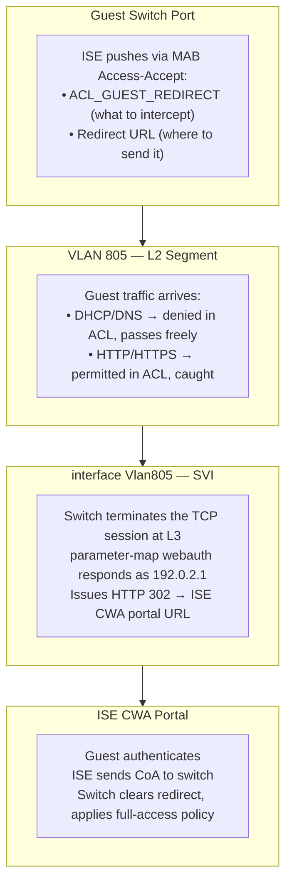

---
categories:
  - "[[Networking]]"
  - "[[Security]]"
topic@networking:
  - "[[Networking General]]"
topic@security:
  - "[[Security General]]"
tags:
  - project
  - nac
  - cisco
  - scor/sise
  - ccnp
  - tech_doc
icon: SiCisco
iconColor: "#1BA0D7"
aliases:
  - Identity Service Engine
  - Cisco Identity Service Engine
  - ISE
---
Cisco <strong>Identity Service Engine</strong> (ISE) is a <strong>Network Access Control</strong> solution that manages access to network ensuring only authenticated, authorized, and compliant users and devices can connect. 

An ISE-based network access control solution has four components: <mark style="background: #FFB86CA6;"><strong>endpoints</strong></mark>, <mark style="background: #FFB8EBA6;"><strong>network access devices (NAD)</strong></mark>, <mark style="background: #ABF7F7A6;"><strong>Cisco ISE</strong></mark>, and <mark style="background: #FFF3A3A6;"><strong>external services</strong></mark>.
<strong>Endpoints</strong> need <mark style="background: #BBFABBA6;">network access</mark> and the <strong>network access devices (NAD)</strong> provide network access to endpoints, based on instructions from <strong>ISE</strong>. 
ISE can leverage <strong>external services</strong> to understand more about the corresponding endpoints for policy decisions.

<mark style="background: #FFB8EBA6;">The server ISE acts as the core, it's where the policies are defined</mark>. <mark style="background: #FF5582A6;">The network devices acts as the authenticator</mark> and <strong>enforce</strong> the policies from the server ISE. <mark style="background: #FFF3A3A6;">The endpoint receives the response</mark> <mark style="background: #FFB86CA6;">given by the server ISE</mark> <mark style="background: #BBFABBA6;">from the network access device</mark>. Most of the high level host endpoint have <mark style="background: #ABF7F7A6;">supplicants that allow them to communicate with the authenticator or NAD</mark>.  <mark style="background: #D2B3FFA6;">The server ISE can use external services</mark>, such as the <strong>Microsoft Active Directory</strong>, <mark style="background: #D2B3FFA6;">to get knowledge about the users</mark>. 
# ISE Server
Cisco Identity Services Engine (ISE) is an <strong>identity-based network access control</strong> and <strong>policy enforcement system</strong>. It functions as a common policy engine that enables <mark style="background: #FFF3A3A6;">endpoint access control </mark>and <mark style="background: #BBFABBA6;">network device administration</mark> for enterprises.
## Identity Management
Identity Management managed all identities for ISE, from ISE GUI admins to users that have to authenticate to ISE.

![[Pasted image 20260508100508.png]]
### Identities 
Cisco ISE has a built-in internal user database that can be used for a limited number of user accounts, referred to as internal users, also as network access users.
In identities it's possible to configure local users, they can be identities that are used to log in the ISE GUI or identities used for network access. 

This internal identity store can be used to authenticate and authorize a preconfigured account for a contractor or other temporary worker to access the wireless network, without adding them to the company’s main identity store.

Any internal user accounts configured can then be associated with a defined user identity group that sets the type of internal account being created.

![[Pasted image 20260508105029.png]]

![[Pasted image 20260508105040.png]]

### Groups 
Endpoint and User Groups, they can be used as attributes in Policy Sets.

![[Pasted image 20260508105117.png]]

#### Endpoint Identity Groups

![[Pasted image 20260513164133.png]]

Endpoint Identity Groups stores information about all the endpoint devices that connect to the network infrastructure or they can be filled through an CSV import.
It's possible to create groups to use as attributes in Policy Sets.

![[Pasted image 20260508105729.png]]

![[Pasted image 20260508105738.png]]

For new CSV import template use the <strong>Generate a Template</strong> function else use this template:
```csv
MACAddress,EndPointPolicy,IdentityGroup,PortalUser.GuestType,Description,PortalUser.Location,PortalUser.GuestStatus,StaticAssignment,User-Name,DeviceRegistrationStatus,PortalUser.CreationType,AUPAccepted,PortalUser.EmailAddress,PortalUser.PhoneNumber,FirstName,ip,Device Type,host-name,StaticGroupAssignment,MDMEnrolled,MDMOSVersion,PortalUser.LastName,PortalUser.GuestSponsor,EmailAddress,PortalUser,PortalUser.FirstName,BYODRegistration,MDMServerName,LastName,MDMServerID,Location

60:18:95:30:CA:DB,,Printers,,,,,,,,,,,,,,,,,,,,,,,,,,,,
```

##### PBA_Blacklist
All MAC Address that must be denied access to the network. 
##### PBA_Printers
All Printers MAC Addresses, there are child groups that distribute the MAC Addresses by location. 
The Printers MAC Addresses can be get from the ARP table in the core switches/routers, and they and be imported with the CSV.
##### PBA_Whitelist
MAC Addresses that must be whitelisted. Used in the MAB Access.
#### User Identity Groups

![[Pasted image 20260508110112.png]]

The User Identity Group accept only Internal Users. 
### External Identity Sources 
External Identity Sources can leverage existing external identity store for network authentication. 

![[Pasted image 20260508100508.png]]

#### External Identity Sources - Certificate Authentication Profile 
This is an important setting for certificate based authentication. 
See [[#Certificate Authentication Profile certificates|Link]].
#### External Identity Sources  - Active Directory 
Microsoft’s Active Directory (AD) is a highly available distributed database deployments. 

![[Example AD Forest.png]]

It follows the X.500 structure, like the DNS does, the AD is very tightly coupled with DNS and requires DNS for AD to function normally.

AD leverages AD domains, which are groupings of users and machine accounts, permissions, and policies.

AD domains belong to an AD forest, which is a collection of domains with trust relationships between them.

---

To join Cisco ISE to an AD domain, the ISE machine account used need to have the permissions: 
- to Search AD (to see if the ISE machine account already exists)
- to add Workstation to Domain (if it does not already exist)
- to set Attributes on the New Machine Account

To join an AD Domain go to <strong>Administration > Identity Management > External Identity Sources > Active Directory</strong>, add the domain and use a domain admin account to join. 

![[Pasted image 20260508113216.png]]

Allowed Domains set the scope for identity extraction, here it's set to everything is allowed. 

![[Pasted image 20260508113401.png]]

In this section it's possible to retrieve groups from Active Directory and use them as attributes for Policy Sets
![[Pasted image 20260508113546.png]]

### Identity Source Sequences
Identity Source Sequences (ISS) checks a series of identity sources from top to bottom, enabling a single authentication rule to check several identity sources instead of just one. It includes the selection of Certificate Authentication Profile. 

![[Pasted image 20260508113927.png]]

In the Publiacqua deployment the ISS is Publiacqua_ISS which have [[#External Identity Sources - Certificate Authentication Profile|EAP_PBA]] as CAP and only [[#External Identity Sources - Active Directory|Publiacqua_AD]] in its list. 

![[Pasted image 20260508113958.png]]

## Admin Access 
In Admin Access are configured ISE GUI permissions for each group or type of users. 

![[Pasted image 20260508114440.png]]
### Admin Access - Authorization
#### Admin Access - Authorization - Permissions
##### Menu Access
Menu Access List is used to set which menu section is allowed and which is not.

If you want to allow only a specific section of the submenu like showing only <strong>Groups</strong> while hiding the <strong>Identities</strong>, <strong>External Identity Source</strong>, and others under the menu <strong>Identity Management</strong>. You have to show <strong>Identity Management</strong>, save, then go back and hide the not allowed menu section manually.

![[Pasted image 20260508114835.png]]
##### Data Access
The Data Access List is used to configure which data a user is allowed to see or to modify. 
These changes impact the type of log one can see, so if you want to limit data access It's best put them in Read Only instead of No Access.

![[Pasted image 20260508115415.png]]

#### Admin Access - Authorization - RBAC Policy
In this section you use the permissions set in Menu Access and Data Access to configure the RBAC policy for Admin Groups. 

![[Pasted image 20260511145530.png]]
### Admin Access - Administrators
#### Admin Access - Administrators - Admin Groups
In Admin Groups, you can configure the groups for which you can build a RBAC Policy around. 

![[Pasted image 20260511145958.png]]

![[Pasted image 20260511150013.png]]

## Network Resources
In <strong>Network Resources</strong> are managed <strong>Network Access Devices</strong> (<strong>NAD</strong>), they are the point of access for an endpoint and the main enforcement point of policies set by the server ISE.
Common NAD types include the following:
- Wired Ethernet switch
- Wireless LAN controller (WLC)
- Cisco Adaptive Security Appliance (ASA)
- Cisco Firepower device
- Load balancer
- Software application that uses ISE for AAA
### Network Devices Profiles
ISE supports third-party NADs through the use of network device profiles. The NAD profiles are configured to define the capabilities and attributes of these third-party devices.

![[Pasted image 20260505104543.png]]

![[Pasted image 20260505104601.png]]

In a Cisco dominant environment the default network device profile for Cisco is enough.
#### Authentication/Authorization

![[Pasted image 20260505110156.png]]

![[Pasted image 20260505110209.png]]

It’s possible to set the conditions for which, based on the attributes received on the header, the packet is considered a Wired, Wireless, MAB, or 802.1X connection.
##### Flow Type Conditions
Enter the <strong>attributes</strong> and <strong>values</strong> that your device vendor uses for the network flows types in the <strong>Flow Type Conditions</strong>: 
- Wired MAB
- Wireless MAB
- Wired 802.1x
- Wireless 802.1x
- Wired Web Authentication
- Wireless Web Authentication

This is necessary for ISE to detect the right flow type for your device according to the attributes it uses.
###### Cisco

![[Pasted image 20260513100654.png]]

Cisco uses the <strong>attribute</strong> and <strong>value</strong> pair:

Radius:NAS-Port-Type = <strong>Ethernet</strong> for wired flows
Radius:NAS-Port-Type = <strong>Wireless - IEEE 802.11</strong> for wireless flows

Radius:Service-Type = <strong>Call Check</strong> for MAB access
Radius:Service-Type = <strong>Framed</strong> for 802.1X access
Radius:Service-Type = <strong>Login</strong> for Web Portal access
###### ArubaWireless

![[Pasted image 20260513105840.png]]

<strong>Aruba Networks</strong> views all wireless access as a user initiating a standard data session. Because of this, the Aruba controller sends the exact same generic `Service-Type` for both authentication methods.

Radius:NAS-Port-Type = <strong>Wireless - IEEE 802.11</strong> for wireless flows

Radius:User-Name = <strong>Radius:Calling-Station-ID</strong> for MAB access

Radius:Service-Type = <strong>Login</strong> for all wireless 
##### Attribute Aliasing
<mark style="background: #FF5582A6;"><strong>Attribute Aliasing</strong> allows a <strong>NAD Profile</strong> to map vendor-specific attributes to a common attribute so that policy rules can use the friendly name</mark>. 
It simplifies attribute selection, reduces the number of authentication/authorization policy rules required for different vendor devices, and is potentially less error prone. 
<mark style="background: #ADCCFFA6;">For example, the Wireless SSID involved in a flow could be included in the <strong>Airespace-Wlan-ID</strong>, <strong>Aruba-ESSID-Name</strong>, or <strong>Called-Station-ID</strong> depending on the type of NAD involved</mark>. They can all be aliased to <strong>SSID</strong>.
##### Host Lookup
<strong>Host Lookup</strong> allows you to define which attributes and protocols your device uses for MAB.
Different (non-Cisco) vendors populate the RADIUS Calling-Station-ID and password attributes differently while doing a MAB authentication. For Cisco NADs doing MAB, enabling the Process Host Lookup option is sufficient.
#### Permissions

![[Pasted image 20260505111657.png]]

This section defines which <mark style="background: #FFB86CA6;">attributes your device uses for setting a VLAN or ACL</mark>. 
<mark style="background: #FFF3A3A6;">They may be IETF standard attributes or vendor specific</mark>. These are usually published in your device’s Admin Guide.

For the VLAN permission, you can specify a single RADIUS attribute (e.g. Aruba-User-VLAN).

For the ACL permission, you can specify a single RADIUS attribute, to be used for setting a named ACL on NADs relevant to the current NAD profile.
#### Change of Authorization (CoA)

![[Pasted image 20260505112153.png]]

This section allows you to define what CoA capabilities your device has. 
Refer to your device documentation for information – look for references to terms like “<strong>RFC 5176</strong>”, “<strong>Change of Authorization</strong>” or “<strong>CoA</strong>”. 

Most non-Cisco devices with RFC 5176 support will support “Push” and “Disconnect”, but not Re-authenticate, so if unsure try enabling the two checkboxes marked “RFC 5176”.

<mark style="background: #ABF7F7A6;">While RFC 5176 defines the types of CoA requests, the required attributes in the requests vary from device to device</mark>. Some devices are very particular about attributes sent in the CoA request.

If your CoA requests are getting a CoA ‘NAK’ back from the device, check some of the following tips:
- Some require the RADIUS User-Name attribute from the access-request to be included in CoA requests
- Some do not accept both Calling-Station-ID and Acct-Session-ID sent in the same request (send one)
- Some do not accept other vendors VSAs in a request
- Some devices can be configured to expect (or not) Event-Timestamp and the CoA configuration above must match
#### URL Redirect
This section defines the device’s URL Redirect capabilities. 
URL redirection is necessary for complex flows like Guest, BYOD and Posture. It needs to be capable of redirecting to an ISE portal, i.e. local web auth is not sufficient.

There are two general types of URL redirect found on devices; <strong>static</strong> and <strong>dynamic</strong>. 

Static means a URL has to be configured into the device (manually). It does not support being told where to redirect dynamically via a RADIUS attribute. Typically, you copy and paste the ISE portal URL into the device’s configuration.

The other type is <strong>dynamic URL</strong> – this is where <mark style="background: #FF5582A6;">ISE can use a RADIUS attribute to tell the device where to redirect to dynamically</mark>. It is not necessary to manually configure the device. 

The <strong>Parameter Names</strong> are arguments passed by the device in the redirect URL. ISE needs to be told the names of these parameters so it can extract them correctly from the URL. <mark style="background: #BBFABBA6;">It uses them to identify the client and session, as well as the original URL the client was trying to get to so that it can redirect it</mark>.

### Network Devices Groups 

![[Pasted image 20260505125347.png]]

Network Device Groups can be set to define NAD attributes that will be used in policy sets, they can be whatever you want to. Here there are Device Types and Locations. 
### Network Devices

![[Pasted image 20260505125643.png]]

To add a NAD, navigate to <strong>Administration > Network Resources > Network Devices</strong> and click <strong>Add</strong>. 

They can be configured with Network Device Profile, Model Name, Software Version or with the attributes set in the Network Device Groups. 

The network device is added to ISE as an object.

The object has a shared secret key for RADIUS, TACACS authentication settings, SNMP community strings, and TrustSec configuration. The RADIUS shared secret key must match the configured key on the NAD exactly.

Each NAD object must be configured with one or more IP addresses. Each NAD can be assigned to one NDG of each type: one Location group, one Device Type group, and one of each manually created top-level NDGs.

![[Pasted image 20260505125842.png]]

The SNMP Settings section is where the SNMP community for the NAD is configured, the ISE will use this to query the NAD for profiling attributes such as CDP and LLDP cache information. The SNMP setting should be configured only for device that do not use the device sensor to send ISE profiling data within RADIUS accounting packets.

The NADs can be imported with a CSV. 
## Policy 
In Policy section are defined the Policy Sets, Dictionaries, Conditions and Results. 
### Dictionaries
Cisco ISE dictionary attributes are pre-defined or custom RADIUS and system-level parameters used to create policy conditions, such as device type, user group, or location, for authentication and authorization. 

These parameters are built on System and Vendor-Specific Attributes:
- <strong>IETF RADIUS Attributes:</strong> The default base, defined by the Internet Engineering Task Force.
- <strong>System-Defined Dictionaries:</strong> Read-only dictionaries populated during installation, covering core system data and network protocols.
- <strong>Vendor-Specific Attributes (VSAs):</strong> Dictionaries for specific hardware vendors, which can be imported or created, often used to define RADIUS Vendor-Specific Attributes.
- <strong>External Identity Sources:</strong> Dictionaries generated by LDAP or Active Directory, allowing ISE to use directory groups and attributes in policy creation.
- <strong>User-Defined Dictionaries:</strong> Custom attributes managed via the GUI, often used for profiling or specific endpoint data

These attributes, found in <strong>Policy > Policy Elements > Dictionaries</strong>, allow network admins to build granular policies.
#### Radius Dictionary

![[Pasted image 20260513115115.png]]

##### NAS-Port-Type

![[Pasted image 20260513115848.png]]

Radius Attribute that indicates the port type. 
Common values are:
- <strong>Wireless - IEEE 802.11 (Value 19):</strong> Sent by Wireless LAN Controllers (WLCs) when a user connects via Wi-Fi.
- <strong>Ethernet (Value 15):</strong> Sent by a network switch when a user plugs directly into a physical wall port.
- <strong>Virtual (Value 5):</strong> Typically indicates an incoming VPN connection or an administrator initiating an SSH session.
- <strong>Async (Value 0):</strong> Used almost exclusively when an administrator connects directly to a switch via a physical Console port.
##### Service - Type

![[Pasted image 20260513120458.png]]
Service-Type is a RADIUS attribute (Attribute 6) that defines the nature of the network access request being made, allowing ISE to understand how a user or device is trying to connect.

Common Service-Type values:
- <strong>Framed (Value: 2)</strong>: Indicates standard network access control (NAC) sessions, such as Wired or Wireless 802.1X and VPN connections.
- <strong>Login / Executive (Value: 1)</strong>: Indicates terminal/shell access. It is typically present when an administrator attempts to log into the Command Line Interface (CLI) of a switch, router, or firewall.
- <strong>Call Check (Value: 10)</strong>: Used specifically for MAC Authentication Bypass (MAB). It informs ISE that the device is authenticating strictly via its hardware MAC address without user credentials.
- <strong>Outbound (Value: 5)</strong>: Used during certain tunneling or secondary authentication handshakes.

For the switch to send this data it needs to be configured with `radius-server attribute 6 on-for-login-auth

##### Called-Station-ID

![[Pasted image 20260513121704.png]]

This attribute identifies the <strong>infrastructure access point</strong> or <strong>port where the endpoint is physically or logically connecting</strong>.

The contents change drastically depending on whether the connection is <strong>Wired</strong> or <strong>Wireless</strong>:

1. On Wireless Networks (Sent by WLCs)

It transmits the MAC address of the Access Point's radio (BSSID) combined with the name of the Wi-Fi network (SSID).

- <strong>Format:</strong> `AA-BB-CC-DD-EE-FF:Corporate-Wi-Fi` or `Corporate-Wi-Fi` (depending on configuration).
- <strong>Why it is notable in ISE:</strong> This allows you to write specific rules based on the Wi-Fi network name. You can create a policy rule stating: _If `Radius.Called-Station-ID ENDS_WITH :Guest-Wi-Fi`, push the Guest web-portal redirect._

2. On Wired Networks (Sent by Switches)

It traditionally transmits the MAC address of the physical switch chassis or the specific VLAN/port identifier where the Ethernet cable is plugged in.

- <strong>Format:</strong> Typically the MAC address of the switch interface or the bridge group ID.

##### Calling-Station-ID

![[Pasted image 20260513121938.png]]

This attribute identifies the <strong>endpoint device</strong> that is requesting access to the network.

- <strong>What it contains:</strong> In almost all modern enterprise networks (Wired, Wireless, and VPN), it transmits the <strong>MAC address</strong> of the client machine, smartphone, or IoT device.
- <strong>Format:</strong> The format depends on the brand of your network switch or wireless controller. Common formats include:
    - `aa-bb-cc-dd-ee-ff`
    - `aabb.ccdd.eeff`
    - `AA:BB:CC:DD:EE:FF`
- <strong>Why it is notable in ISE:</strong>
    - <strong>MAC Authentication Bypass (MAB):</strong> For headless devices like printers or security cameras, ISE copies the MAC address from this attribute and checks it against the internal endpoint database.
    - <strong>Device Profiling:</strong> The ISE Profiler evaluates this MAC address vendor prefix (OUI) to help determine if the device is an Apple iPhone, a Windows workstation, or an IP phone.
##### Dynamic VLAN Assignment Attributes

For a network switch to accept a dynamic VLAN assignment from Cisco ISE, it must receive three IETF helper attributes in the [[#Authorization Profiles|Authorization Profile]].

<strong>`Tunnel-Private-Group-ID` (RADIUS Attribute 81)</strong> is a standard IETF attribute used as an <strong>Authorization Result</strong> to dynamically assign a user or device to a specific <strong>VLAN</strong> upon successful authentication.

![[Pasted image 20260513152509.png]]

<strong>`Tunnel-Type` (RADIUS Attribute 64)</strong> is an industry-standard IETF attribute used during the authorization phase to specify the <strong>tunneling protocol or virtualization method</strong> that a network device must apply to a user's session.
<strong>VLAN (Value: 13)</strong> is  By far the most common value used in Cisco ISE. It instructs the switch to dynamically shift the physical access port into a specific VLAN ID.

![[Pasted image 20260513153658.png]]

<strong>`Tunnel-Medium-Type` (RADIUS Attribute 65)</strong> is an industry-standard IETF attribute used during authorization to tell the network device the <strong>specific transport medium protocol</strong> running over the virtual tunnel.
<strong>802 (Value: 6)</strong> is the most heavily used value in modern enterprise deployments. It indicates standard IEEE 802 networks, which includes all campus Ethernet switches (802.3) and enterprise Wireless LANs (802.11). 
<strong>IPv4 (Value: 1):</strong> Used in Layer 3 tunneling architectures where packets travel natively over an IP backbone.

![[Pasted image 20260513153903.png]]

#### Cisco Dictionary

![[Pasted image 20260513115229.png]]

##### cisco-av-pair

![[Pasted image 20260513122119.png]]

In Cisco ISE, <strong>`cisco-avpair`</strong> is a Vendor-Specific Attribute (VSA) classified under the <strong>RADIUS > Cisco</strong> dictionary (Vendor ID: `9`, Sub-ID: `1`)

The syntax always follows a strict string format: `protocol:attribute=value`.

Common uses:

<strong>Central Web Authentication (CWA)</strong> and Guest Portals: When an unknown device connects to the network, ISE uses two specific AV pairs to tell the switch to intercept the user's web browser traffic and redirect them to a login portal:

 - <strong>url-redirect</strong>: Tells the switch exactly where the ISE Guest or Hotspot portal is hosted. 
 ```cisco-av-pair = url-redirect=https://guestportal1.publiacqua.it:port/portal/gateway?sessionId=SessionIdValue&portal=4f145223-7d12-411b-a511-92abfafef0d8&action=cwa```

- <strong>url-redirect-acl</strong>: Specifies the name of the local Access Control List (ACL) pre-configured on the switch that defines what traffic should be redirected versus allowed (e.g., allow DNS and DHCP, but redirect HTTP).
```cisco-av-pair = url-redirect-acl=ACL_GUEST_REDIRECT```

<strong>Network Controller Access Control (Role-Based Access)</strong>: When managing logins to Cisco fabric platforms like Cisco DNA Center (Catalyst Center) or Cisco APIC (ACI) via RADIUS, ISE passes the exact user roles through an AV pair:

Cisco DNA Center / Catalyst Center Login:
```cisco-av-pair = ROLE=SUPER-ADMIN-ROLE```

Cisco APIC / ACI Fabric Login:
```cisco-avpair=shell:domains=all/admin/```

<strong>Administrative Privilege Levels</strong> (Switch CLI via RADIUS): If you are using RADIUS (instead of TACACS+) to secure administrative command-line access to Cisco switches and firewalls, you must use an AV pair to drop the administrator directly into the privileged executive mode (`enable`):
<strong>shell:priv-lvl</strong>: Grants immediate execution privileges.
```cisco-av-pair = shell:priv-lvl=15```
#### Network Access Dictionary
##### UseCase

![[Pasted image 20260514153230.png]]

`NetworkAccess:UseCase` is an internal system enumeration attribute used to track the contextual state of an endpoint's session.

When this attribute evaluates to `Guest Flow` (formatted as `NetworkAccess:UseCase = GuestFlow`), it explicitly means that <strong>the endpoint has successfully completed web authentication (WebAuth) via an ISE guest portal and is now executing a post-portal network re-authorization</strong>.

### Conditions
Cisco ISE policy conditions are rule-based elements (attributes, operators, values) used to define network access, profiling, posture, and guest services. They enable granular control, allowing policies based on user identity, device type, location, or time. Conditions can be Simple (one attribute) or Compound (combined using AND/OR) and are managed within the Conditions Studio
#### Library Conditions
Cisco ISE <strong>library conditions</strong> are pre-configured, reusable policy elements found under <strong>Policy > Policy Elements > Conditions</strong>. They allow administrators to define complex logic once (e.g., specific device types, time ranges, or location attributes) and reuse them across multiple authorization policies, simplifying policy management and reducing errors.

![[Pasted image 20260512150602.png]]

##### EAPs
The EAPs condition check the if the client request is using one of these [[#Allowed Protocols|EAP protocols]].
The EAP protocols inside the conditions are PEAP, EAP-TLS and TEAP, the admin should be using one of these protocols. 

![[Pasted image 20260514110551.png]]

##### ID_Admin_User
Users in the AD group [[#External Identity Sources - Active Directory|InfrastructureAdmin]].

![[Pasted image 20260514112106.png]]

##### ID_Domain_User
Check if the user is in the AD group [[#External Identity Sources - Active Directory|Utenti_Publiacqua]].

![[Pasted image 20260514111525.png]]

##### Blacklist 
MAC Addresses in [[#PBA_Blacklist|PBA_Blacklist]].

![[Pasted image 20260514114124.png]]

##### Whitelist
MAC Addresses in [[#PBA_Whitelist|PBA_Whitelist]].

##### Authentication Passed
Check if the AuthenticationStatus is a Passed

![[Pasted image 20260514110848.png]]
##### Authentication Failed
Check if the AuthenticationStatus is a Failed

![[Pasted image 20260514111110.png]]
##### TEAP_Machine
This condition will match if the client using TEAP protocol have the [[#Domain Computer Certificate|machine certificate]] pass the authentication but fail the [[#Domain Users Certificate|user certificate]] authentication. 

![[Pasted image 20260514111237.png]]

##### Not_TEAP
This condition is used if you want to get a computer certificate but you don't want the computer certificate to pass from TEAP EAP protocol.

![[Pasted image 20260514113635.png]]
##### Client Authorizations
Client Authorizations conditions check if the client user is [[#ID_Domain_User]] and if the EAP protocol they use is PEAP or TEAP. The domain users should use only TEAP and PEAP in rare occasions.

![[Pasted image 20260514140414.png]]

##### Guest_Flow
Condition is hit if the client request packet has attribute [[#UseCase|NetworkAccess:UserCase]].

When this attribute evaluates to `Guest Flow` (formatted as `NetworkAccess:UseCase = GuestFlow`), it explicitly means that <strong>the endpoint has successfully completed web authentication (WebAuth) via an ISE guest portal and is now executing a post-portal network re-authorization</strong>.

![[Pasted image 20260514155208.png]]

#### Smart Conditions
Cisco ISE smart conditions are pre-defined, intelligent policy building blocks designed to simplify policy rule creation by abstracting complex RADIUS attribute-value pairs into human-readable, usable logic. 

These RADIUS attribute-value pairs are mapped from [[#Authentication/Authorization|Network Device Profiles]] 

![[Pasted image 20260512145913.png]]

![[Pasted image 20260512150521.png]]

### Policy Sets

![[Pasted image 20260512103918.png]]

<strong>Policy Sets</strong> are high-level containers that group authentication and authorization rules into manageable logical buckets. 
Instead of managing one giant list of rules, policy sets allow you to organize network access by use case, such as separating Wired, Wireless, VPN, or Guest access.

Each policy set functions as a "rule book" evaluated from the top down. Once a request matches a policy set's top-level conditions, ISE evaluates the internal policies in this order: 
- <strong>Top-Level Condition</strong>: The "gatekeeper" that determines if a request belongs in that specific set. If the request is Wireless, Wired, from a specific location, time ecc.
- <strong>[[#Allowed Protocols|Allowed Protocols]]</strong>: Defines which protocols (like PAP, CHAP, or EAP-TLS) are permitted for the initial connection.
- <strong>Authentication Policy</strong>: Verifies the identity of the user or device using identity sources like Active Directory or internal databases.
- <strong>Authorization Policy</strong>: Grants specific permissions—such as VLAN assignment, Security Group Tags (SGTs), or Downloadable ACLs (dACLs)—based on the user's role or device posture.

The Top-Level Condition in this deployment are <strong>Wired</strong>, <strong>Wired_Monitor</strong>, <strong>Wireless</strong> and <strong>DNAC</strong>, they distribute the client requests based on the type of connection (Wired or Wireless) and if the Device Type is a DNAC-server. 

![[Pasted image 20260512152559.png]]

The <strong>Wired_Monitor</strong> Top-Level Condition is used temporarily in Cisco ISE monitoring deployments alongside the <strong>Network Access Device</strong> command `no access-session closed` to gather visibility data without restricting network access. 

In this deployment model, the system only generates ACCEPT or DENY responses, and all DENY requests are ignored to ensure clients maintain uninterrupted connectivity. 

Because Cisco ISE functions strictly as an information-gathering tool in this phase, authorization profiles must not apply Downloadable ACLs or VLAN changes, as these active policies cannot be ignored and will directly disrupt user network access.

The active deployment logic is:
- Top Rule Condition = Wired, Wireless or DNAC
- Allowed Protocol
- Authentication Policy
	- Condition = MAB or 802.1X
	- Identity Store = [[#Endpoint Identity Groups|Internal Endpoint]] for MAB or [[#Publiacqua_ISS]] for 802.1X.
- Authorization Policy
	- Is computer in Blacklist?
	- Is user an Admin?
	- Is User not logged on?
	- Is Client a normal Domain User with Domain Computer?
	- Is the Client a PC that must be always accessible in RDP?
	- Is the computer in Whitelist?
	- Guest Redirect
#### Authentication Policy

![[Pasted image 20260512154735.png]]

An authentication policy is a set of rules and criteria used to verify the identity of a user or device before they are allowed access to a system. 
In Cisco ISE, it specifically determines how a connection request should be identified and where to look up their credentials (like [[#External Identity Sources - Active Directory|Active Directory]] or an [[#User Identity Groups|internal database]])

There are three predefined policies:
##### MAB (MAC Authentication Bypass)
<strong>MAC Authentication Bypass (MAB)</strong> is a fallback network access control method that uses a device's <strong>MAC address</strong> to grant or deny access. It is primarily used for "headless" devices that cannot run an 802.1X supplicant, such as printers, IP phones, cameras, and IoT equipment.

When a device connects to a switch port configured for 802.1X/MAB, the following process typically occurs:
1. <strong>Detection</strong>: The switch initially tries to authenticate the device via 802.1X.
2. <strong>Fallback</strong>: If the device fails to respond to 802.1X requests (usually after a timeout), the switch "falls back" to MAB.
3. <strong>RADIUS Request</strong>: The switch sends a RADIUS Access-Request to Cisco ISE, using the device's MAC address as both the username and password.
4. <strong>ISE Decision</strong>: ISE checks the MAC address against all MAC addresses in the [[#Endpoint Identity Groups|Internal Endpoints]] database or performs <strong>Profiling</strong> to identify the device type.
5. <strong>Authorization</strong>: Based on your configured <strong>Policy Sets</strong>, ISE sends back a RADIUS Access-Accept with specific permissions, such as a VLAN assignment or a Downloadable ACL (dACL).

In the current deployment even if the MAB check fails, the server ISE allow the authentication request to continue to the authorization policies, where they will be met with [[#Guest Redirect|Guest Redirect]] Authorization Policy. 

The conditions for MAB is the [[#Flow Type Conditions|predefined Wired_Mab]].
##### Dot1X (802.1X)
Dot1X (802.1X) should be the most used/default authentication policy. 

It's the authentication policy where the client has a supplicant ([[#Group Policy Management|Windows Native Supplicant]]) that uses an [[#Extensible Authentication Protocols|EAP]] protocol to authenticate itself to the ISE server.

The condition for the request to hit this authentication policy is the predefined [[#Smart Conditions|Wired_802.1X]] and it check the user identity in the Identity Store [[#Identity Source Sequences|Publiacqua_ISS]].
If the user is found in the ISS then it is authenticated and the request is passed for authorization policy check. 
If it's not found in the Identity Store, it is also passed for authorization policy check, though it will probably hit the [[#Guest Redirect]] policy.
##### Default
The Default authentication policy is a catch all type of policy, set to deny all request.
It's usually used for requests that the policies before this one could not catch. 
In this deployment it's shouldn't be hit at all. 
#### Authorization Policy
Authorization Policies decides which [[#Authorization Profiles]] does the client get.

![[Pasted image 20260514115226.png]]

The authorization policies order is first match, the client get authorization profile of the fist authorization policy it hits.
##### Deny Access
The fist authorization policy is to check if the client computer is on the [[#PBA_Blacklist|Blacklist]], if the MAC address is found on the [[#PBA_Blacklist|Endpoint Identity Group]] they will reject the client request, if it's not found then the policy is not hit and ISE will check the following policy. 
##### Admin Access
Admin Access allows all users in the admin AD group to get the authorization profile for the VLAN Admin, which is set to VLAN 850. The authorization profile is configured in the same way as the one for [[#Vlan_802_Lan_Client|VLAN 802]] except for the VLAN ID.

The condition to hit this policy is that [[#EAPs|the client must use an EAP protocol]], [[#ID_Admin_User|the user must be in the Admin group]] and [[#Authentication Passed|the authentication result is a pass]].

The authorization profile is configured to give only the VLAN Admin while the admin permissions are provided by the network and security configuration for VLAN Admin.
##### Machine Access
The Machine Access an authorization protocol created for situations where the [[#Domain Users Certificate|User Certificate]] is not available: 
- User is not logged-on the domain computer
- New user needs to access a domain computer
- Problems with user certificate
In these case the Machine Access policy provides the client with Internet access and connection to Domain Controller and the Certificate Authority Server. 

The conditions to hit Machine Access are [[#TEAP_Machine]] and [[#Authentication Passed]]. 
The authorization profiles it provides is [[#Pre-Auth-profile]].
##### Client Access
The Client Access is the default policy for Publiacqua Domain Users, when this policy is hit the user get access to VLAN 802 which is the LAN Client. 

The conditions to hit this policy is [[#Client Authorizations]] and [[#Authentication Passed]]. 

The Authorization Profiles is [[#Vlan_802_Lan_Client]].
##### RDP Access
The RDP Access authorization policy is used for computer that for most of the time must be accessible through RDP but are not servers. 
The Machine Access DACL is too limited, so there is a specific policy that gives access to VLAN 802.

The hit conditions are EAP-TLS machine certificate, [[#Not_TEAP]], and [[#Authentication Passed]].

The Authorization Profiles is [[#Vlan_802_Lan_Client]].
##### MAB Access
MAB Access is for computer or devices that for reasons don't have a supplicant to send 802.1X authentication packets. At the moment the authorization profiles for this access is also VLAN 802

The hit conditions are [[#Smart Conditions|Wired_MAB]], [[#PBA_Whitelist|Whitelist]] and [[#Authentication Passed]]. 

The Authorization Profiles is [[#Vlan_802_Lan_Client]]. 
##### Guest Access
The Guest Access is used together with [[#Guest Redirect]] and it will be hit only if the client user authenticate to [[#Guest Redirect]]. 

The hit condition is [[#Guest_Flow]].
The Authorization Profiles is VLAN Guest which is VLAN 805. It has the same configuration of [[#Vlan_802_Lan_Client|VLAN 802]] except for the VLAN ID.
##### Guest Redirect
The Guest Redirect authorization protocol is the catch all for all devices and users not authorized/authenticated and for guest users. 

The hit condition is all [[#Authentication Failed]], [[#Smart Conditions|Wired_MAB]] or [[#Smart Conditions|Wired_802.1X]]. 
The Authorization Profiles is [[#Redirect_Guest_Wired]], if the Guest Authentication is a success it will hit the default [[#UseCase|Guest Flow]] condition of [[#Guest Access]], and the client will have Internet access. 
### Results
#### Policy - Results - Authentication
Authentication Results are results from authentication policy checks, if the top rule authentication policy is passed, the server ISE will check the Allowed Protocols.
##### Allowed Protocols
After the conditions are matched in a top-level rule,  ISE determines what authentication protocols are permitted for that policy set. If the user send a authentication request that is not in the allowed protocol, the request is denied.

<strong>Policy > Policy Elements > Results > Authentication > Allowed Protocols</strong>

In the current deployment:

![[Screenshot 2026-05-12 at 11-06-37 Identity Services Engine.png]]
- Process Host Lookup for MAB Access
- EAP-TLS for Admin Users who uses MacOs and for RDP Access
- PEAP MSCHAPv2 for occasional clients
- PEAP EAP-TLS for Admin Users with non domain computers
- TEAP for default Domain Users

The allowed protocols definition:
###### Extensible Authentication Protocols 
- <strong>PAP</strong>: With <strong>Password Authentication Protocol</strong> (<strong>PAP</strong>), the username is sent in plaintext, and the password is optionally encrypted.
  
- <strong>CHAP</strong>: With <strong>Challenge Handshake Authentication Protocol</strong> (<strong>CHAP</strong>), the username and password are encrypted using a challenge sent from the server. CHAP is not often used with network access.
  
- <strong>Extensible Authentication Protocol (EAP) types</strong>: <strong>EAP</strong> is an authentication framework that provides for the transport and use of identity credentials. EAP encapsulates the usernames, passwords, and certificates that a client is sending for purposes of authentication. There are many different EAP types, each with benefits and downsides. (802.1X defines EAP over LAN.)
    - <strong>EAP-MD5</strong>: EAP-MD5 uses a Message Digest algorithm to hide the credentials in a hash. The hash is sent to the server, where it is compared to a local hash to see if the credentials are accurate. EAP-MD5 does not have a mechanism for mutual authentication. This means the server is validating the client, but the client does not authenticate the server. EAP-MD5 is common on some IP phones, and it is also possible for some switches to send MAB requests within EAP-MD5.
    - <strong>EAP-TLS</strong>: This EAP type uses TLS (Transport Layer Security) to provide secure identity transactions. EAP-TLS is considered universally supported across many different operating systems and mobile devices. EAP-TLS uses X.509 certificates and provides the ability to support mutual authentication, where the client must trust the server’s certificate and vice versa. It is considered among the most secure EAP types because password capture is not an option; the endpoint must have the private key.
- <strong>Tunneled EAP types</strong>: The previous EAP types transmit credentials immediately. These following EAP types of form encrypted secure tunnels first and then transmit the credentials within the tunnel
    - <strong>PEAP</strong>: <strong>Protected EAP</strong> (<strong>PEAP</strong>), is an EAP tunnel type. PEAP forms a potentially encrypted TLS tunnel between the clients and server using the X.509 certificate on the server in much the same way an SSL tunnel is established between a web browser and a secure website. After the tunnel has been formed, PEAP uses another EAP type as an “inner method” to authenticate the client using EAP within the outer tunnel. PEAP supports the following inner methods:
        - <strong>EAP MSCHAPv2</strong>: Using this inner method, the client’s credentials are sent to the server encrypted within an MS-CHAPv2 session. It allows for simple transmission of username and password or even computer name and computer password to the RADIUS server, which authenticates them to Active Directory.
        - <strong>EAP-GTC</strong>: <strong>EAP-Generic Token Card</strong> (<strong>GTC</strong>) is an inner method created by Cisco as an alternative to MS-CHAPv2 that allows generic authentications to virtually any identity store, including one-time-password (OTP) token servers, LDAP, Novell eDirectory, and more.
        - <strong>EAP-TLS</strong>: PEAP is capable of using EAP-TLS as an inner method. EAP-TLS adds an additional layer of security by tunneling the EAP authentication.
    - <strong>EAP-FAST</strong>: <strong>Flexible Authentication via Secure Tunneling (FAST)</strong> is very similar to PEAP. Cisco created FAST as an alternative to PEAP that allows for faster re-authentication and supports faster wireless roaming. FAST forms a TLS outer tunnel and then transmits the client credentials within that TLS tunnel. Where FAST differs from the PEAP is in the ability to use Protected Access Credentials (PACs). A PAC can be thought of as a secure cookie that is stored locally on the host as proof of a successful authentication. The Windows native supplicant does not support EAP-FAST. Instead, the AnyConnect software client with the Network Access Manager (NAM) can be installed on endpoints running Windows Vista and later. NAM acts as the supplicant for the endpoint, which allows Windows to support arrange of new EAP options. EAP-FAST supports the following inner methods:
        - <strong>EAP MSCHAPv2</strong>
        - <strong>EAP-GTC</strong>
        - <strong>EAP-TLS</strong>
        - <strong>EAP chaining with EAP-FASTv2</strong>: Windows AnyConnect NAM software. As an enhancement to EAP-FAST, a differentiation was made <strong>to have both a user credential and a machine credential authenticated</strong>. These credentials can be certificates or username and password. This provides ISE administrators the ability to validate that a machine is an authenticated domain computer and to validate the credentials of the user. EAP chaining makes it possible for multiple credentials to be authenticated within a single EAP transaction.
    - <strong>EAP-TTLS</strong>: It encapsulates a TLS session by using a handshake phase and a data phase. During the handshake, the server authenticates itself to the client or they both mutually authenticate using standard TLS. The server can then use that established tunnel to authenticate the client. Versions of Windows prior to Windows 8 do not support EAP-TTLS natively. However, Microsoft has included native supplicant support in Windows 8 and later. The EAP inner methods that are accepted with EAP-TTLS include PAP, CHAP, MS-CHAPv1, MS-CHAPv2, and EAP-MD5.
	-  <strong>TEAP</strong>: It enables secure communication between a peer and server using TLS to establish a mutually authenticated tunnel. EAP-Chaining is possible.
#### Policy - Results - Authorization
Authorization Results are the results for each authorization policy. 
##### Authorization Profiles
Authorization Profiles are reusable policy objects that define the specific access permissions, such as VLANs, Downloadable ACLs (dACLs), or security group tags, granted to a user or device after successful authentication and passing the authorization policy.
![[Pasted image 20260512122923.png]]
###### Pre-Auth-profile

![[Pasted image 20260512124255.png]]

The Pre-Auth-Profile is used by the Authorization Policy Machine Access and it sends a ACCESS_ACCEPT with the DACL [[#Pre-Auth|Pre-Auth]] that limit the computer network access to Internet, Domain Controller and Certificate Authority.

This DACL is used for computer that have authenticated with machine certificate but not with user certificate for various reasons:
- The user is not logged-on, so the user certificate is not available
- There change in user happening 
- The user does not have a certificate enrolled

For these case the DACL allow the connection to Internet, Domain Controller and Certificate Authority for the update of GPO, and enrollment of user certificates.
###### Vlan_802_Lan_Client

![[Pasted image 20260512142840.png]]

Vlan_802_Lan_Client should be the default Authorization Policy for most of domain users. 
It sends the VLAN for clients and the re-authentication timer.
- <strong>Access Type = ACCESS_ACCEPT</strong> : Authentication status is a pass
- [[#Dynamic VLAN Assignment Attributes|Tunnel-Private-Group-ID]] = 1:802 : VLAN 802
- [[#Dynamic VLAN Assignment Attributes|Tunnel-Type = 1:13]] : This specifies the tunneling protocol being used. In this context, value 13 explicitly tells the device that the "tunnel" is a Virtual LAN (VLAN).
- [[#Dynamic VLAN Assignment Attributes|Tunnel-Medium-Type = 1:6]] : This indicates the transport medium. Value 6 represents IEEE 802, which includes Ethernet and wireless media.
###### Redirect_Guest_Wired

![[Pasted image 20260512143139.png]]

The Redirect_Guest_Wired is the first Authorization Profile for guest users, it send a redirection URL to the CWA guest portal.  
- <strong>Access Type = ACCESS_ACCEPT</strong> : Authentication status is a pass
- [[#Dynamic VLAN Assignment Attributes|Tunnel-Private-Group-ID = 1:805]] : Put the client in VLAN 805
- [[#Dynamic VLAN Assignment Attributes|Tunnel-Type = 1:13]] : This specifies the tunneling protocol being used. In this context, value 13 explicitly tells the device that the "tunnel" is a Virtual LAN (VLAN).
- [[#Dynamic VLAN Assignment Attributes|Tunnel-Medium-Type = 1:6]] : This indicates the transport medium. Value 6 represents IEEE 802, which includes Ethernet and wireless media.
- [[#cisco-av-pair|cisco-av-pair = url-redirect-acl=ACL_GUEST_REDIRECT]] : This indicate which local access list the client must use. 
- [[#cisco-av-pair|cisco-av-pair = url-redirect=https://guestportal1.publiacqua.it:port/portal/gateway?sessionId=SessionIdValue&portal=4f145223-7d12-411b-a511-92abfafef0d8&action=cwa]] : The redirect guest portal from the CWA
- <strong>Session-Timeout = 43200</strong> : The timer for the session
- <strong>Termination-Action = Default</strong> : When the timer of Session-Timeout runs out, kick the user off and make them start over
- <strong>Idle-Timeout = 7200</strong> : Tells the switch or WLC to disconnect the user if their device is completely silent for 2 hours
- <strong>cisco-av-pair = subscriber:service-name=Guest_Redirect</strong> : This tells the switch to activate the local service-template [[#Guest_Redirect|Guest_Redirect]], in this deployment the Guest_Redirect service-template is empty. It's used to trick the switch to match for <strong>class-map type control subscriber match-all AAA-DOWN_GUEST_USER</strong>.
##### Downloadable ACLs
They are Access Lists that are configured on the server ISE and are meant to be sent dynamically to the NAD that calls it. 

![[Pasted image 20260512124736.png]]

##### Pre-Auth
This DACL is used for computer that have authenticated with machine certificate but not with user certificate for various reasons:
- The user is not logged-on, so the user certificate is not available
- There change in user happening 
- The user does not have a certificate enrolled
- ect

For these case the DACL allow the connection to Internet, Domain Controller and Certificate Authority for the update of GPO, and enrollment of user certificates.

DC01 and DC02 = 10.140.4.250 and 10.140.4.252
subordinateca01 and subordinateca02 = 10.140.2.198 and 10.140.2.199

```text
permit udp any any eq bootps
permit udp any any eq bootpc
permit udp any any eq domain
permit tcp any any eq domain
permit icmp any any

permit udp any host 10.140.4.250 eq 123
permit tcp any host 10.140.4.250 eq 88
permit udp any host 10.140.4.250 eq 88
permit tcp any host 10.140.4.250 eq 135
permit tcp any host 10.140.4.250 eq 389
permit udp any host 10.140.4.250 eq 389
permit tcp any host 10.140.4.250 eq 464
permit udp any host 10.140.4.250 eq 464
permit tcp any host 10.140.4.250 eq 636
permit tcp any host 10.140.4.250 eq 3268
permit tcp any host 10.140.4.250 eq 445
permit tcp any host 10.140.4.250 range 49152 65535

permit udp any host 10.140.4.252 eq 123
permit tcp any host 10.140.4.252 eq 88
permit udp any host 10.140.4.252 eq 88
permit tcp any host 10.140.4.252 eq 135
permit tcp any host 10.140.4.252 eq 389
permit udp any host 10.140.4.252 eq 389
permit udp any host 10.140.4.252 eq 464
permit tcp any host 10.140.4.252 eq 464
permit tcp any host 10.140.4.252 eq 636
permit tcp any host 10.140.4.252 eq 3268
permit tcp any host 10.140.4.252 eq 445
permit tcp any host 10.140.4.252 range 49152 65535


permit tcp any host 10.140.2.198 eq 135
permit tcp any host 10.140.2.198 eq 80
permit tcp any host 10.140.2.198 eq 443
permit tcp any host 10.140.2.198 range 49152 65535

permit tcp any host 10.140.2.199 eq 135
permit tcp any host 10.140.2.199 eq 80
permit tcp any host 10.140.2.199 eq 443
permit tcp any host 10.140.2.199 range 49152 65535

permit tcp any host 10.140.2.31 eq 8443
permit tcp any host 10.140.2.31 eq 8905
permit tcp any host 10.140.2.31 eq 443
permit tcp any host 10.140.2.32 eq 8443
permit tcp any host 10.140.2.32 eq 8905
permit tcp any host 10.140.2.32 eq 443
deny ip any any
```

# Microsoft Servers
In most cases the external services used are Microsoft Servers, with Active Directory as identity store, Certificate Authority for the certificates to use together with the user and/or host on the Active Directory and Group Policy Management to rollout the configuration to clients.  
## Active Directory 

![[Pasted image 20260421124607.png]]

Cisco ISE can join Microsoft Active Directory as an External Identity Source under the item Active Directory. 

The AD is used to identify the users when they do an authentication. They can be checked with their domain password or with the domain certificates they provide ISE.

For the server ISE to be able to join the domain, it has to have a machine account in the domain and a DNS entry, while the AD User Name must have the permissions to join ISE to AD. 

![[Pasted image 20260421152119.png]]

On this section it is also possible to retrieve groups from the AD to create policies around the user group identity. 

![[Pasted image 20260421125524.png]]

## Certificate Authority #certificates
The Certificate Authority service is used to provide certificates to both ISE server itself and clients that will use it to do network access authentication. 
### Server Certificates
The ISE server has two types of certificates, system certificates that are used to identify itself, and trusted certificates that are used to validate clients.
#### System Certificates
There are many portals hosted in ISE. All the ISE portals require encryption by default. In other words, all portals in ISE use HTTPS, and a certificate on ISE is used to secure the communication.
Certificates are also used to secure EAP communications, to form a Transport Layer Security (TLS) tunnel between an endpoint and a RADIUS server, or to identify the RADIUS server (ISE) to the client (supplicant)

![[Pasted image 20260421153234.png]]

##### Admin Certificate
For <mark style="background: #FF5582A6;">ISE Admin Portal</mark>. If this is chosen the ISE node needs to restart all services to use the newly applied certificate.
##### EAP Authentication Certificate
ISE will use this certificate for <mark style="background: #FFB86CA6;">EAP protocols that use SSL/TLS tunneling</mark>. <mark style="background: #FFF3A3A6;">This is the certificate the ISE will present to the client to prove itself as trusted server</mark>.
##### RADIUS DTLS Certificate
RADIUS over Datagram Transport Layer Security encrypt the full packet. The certificate can be used to establish and secure the communication between the <mark style="background: #FFB8EBA6;">ISE server and the NAD</mark>.
##### Portal Certificate
Certificates used for ISE <mark style="background: #BBFABBA6;">user portals</mark>. Which can be Guest Portal, Client Provisioning Portal, MDM Portal, BYOD Portal, Sponsor Portal, or My Devices Portal. The Guest Portal usually should have a public certificate as it should be used to external devices. 
##### pxGrid Certificate
This certificate will be used to establish trust and build a <mark style="background: #ABF7F7A6;">secure connection between ISE and third-party pxGrid clients</mark> to share contextual information. 
#### Certificate Signing Request
To create a certificate signed the a external Certificate Authority like Microsoft AD CS, create <strong>a Certificate Signing Request (CSR)</strong> in <strong>Administration > System > Certificates > Certificate Signing Request</strong> 

![[Pasted image 20260427150149.png]]
- <strong>Common Name (CN)</strong> : The CN should be a <mark style="background: #FF5582A6;">FQDN that will resolve via DNS to the IP address of ISE node</mark>.
- <strong>Organization(O)</strong>: The organization the certificate is meant ot represent, the org implementing ISE
- <strong>Organizational Unit(OU)</strong>: This is the division of the organization that is controlling the device for which the certificate is being used
- <strong>Locality(L)</strong>: The city where the entity resides
- <strong>State(ST)</strong>: The state or the province the entity resides in
- <strong>Country(C)</strong>: This is the country that the entity resides in

The ISE GUI also allows the customization of the Subject Alternative Name (SAN) field, which is meant to carry a number of different attributes, each designed to aid in the identification of the certificate:

- <strong>DNS Name</strong>: This is the FQDN of the ISE node. If the certificate will be a wildcard certificate, be sure to specify the wildcard notation <strong>*</strong>, like <strong>*.publiacqua.it</strong>.
- <strong>IP Address</strong>: This is the IP address of the ISE node associated with the certificate
- <strong>Uniform Resource Name</strong>: This is the URI associated with the certificate.
- <strong>Directory Name</strong>: This is a string representation of the distinguished name (DN). DNs are defined in RFC 2253.

A client that is presented with a certificate compare <mark style="background: #ABF7F7A6;">the name of the host</mark> with <mark style="background: #ADCCFFA6;">the CN field of the certificate subject</mark>. If the hostname or FQDN used to reach the host doesn’t match what is in the CN field, a certificate mismatch occurs.

The newly created CSR is saved in the <strong>Certificate Signing Requests</strong> section and it can be exported, it is a <strong>Base64-encoded plaintext file</strong> known as a <strong>PEM</strong> file.
Open the CSR with a text editor, copy its content and paste it on the certificate authority web server similar to the procedure in [[#Enrollment - Windows Manual | this link]] except that the CSR is already present.

Once the <strong>certnew.cer</strong> is downloaded, go back to the <strong>Certificate Signing Requests</strong> section and link to the certificate to the CSR used to make this cert. 

The new cert should show on System Certificates list.
#### Trusted Certificates
Trusted certificates are used for validation. <mark style="background: #FFF3A3A6;">They are the certificates</mark> (usually Root or Intermediate CA certificates) <mark style="background: #FFF3A3A6;">that ISE uses to verify the identity of someone else</mark>. 

In <strong>Administration > System > Certificates > Trusted Certificates</strong> a copy of the <mark style="background: #FF5582A6;">signing certificate authority’s public key must be stored</mark>, and that certificate must be trusted for purpose of authentication.

![[Pasted image 20260427145832.png]]

When a client presents a certificate for EAP authentication protocol, the ISE server will check if the issuer of the client certificate is present on the list of Trusted Certificates. 

![[Pasted image 20260427162757.png | 200]]

![[Pasted image 20260427165456.png]]

If the issuing certificate authority is not present among the Trusted Certificate the authentication fails. 
##### CRL Revocation List
In the Trusted Certificates is also set the CRL validation for the selected certificate. 
The Certificate Revocation List is a list of the revoked certificates, it is used to check for certificates that are not expired but are not usable because they are expired. 

![[Pasted image 20260504121014.png]]

The Retrieve CRL timers should be set accordingly to the CA CRL timers.

![[Pasted image 20260504122151.png | 200]]

- <strong>Effective date</strong> is the date the CRL will start to be valid. 
- <strong>Next update</strong> is the time the CRL will expire.
- <strong>Next CRL Publish</strong> is when the new CRL will be published but is still not active
The Retrieve CRL set to 8 hours before expiration is set 8 hours before the <strong>Next update</strong> so it will retrive the <strong>Next CRL Publish</strong> CRL.
The old CRL and the new CRL have 8 hours overlap in which both CRL are active, so the timer set to Automatically 8 hour before expire with 10 minutes of wait before retry, is correct and leave no black periods. 

The CRL Distribution URL can be retrieved from the Certificate Authority server

![[Pasted image 20260427170031.png]]

When a certificate is revoked outside of the automated cycle, you must trigger a manual CRL publication to synchronize the revocation status across all validating clients:

![[Pasted image 20260427170213.png]]

![[Pasted image 20260427170229.png]]

When doing a manual CRL publication do a manual download of the CRL in ISE server too, by setting the Retrieve CRL download to every 1 minute and then change back. 
#### Certificate Authentication Profile #certificates 

![[Pasted image 20260424144802.png]]

<strong>Certificate Authentication Profile</strong>(CAP) section is used to decide which <mark style="background: #FF5582A6;">attribute of the certificate</mark> the server ISE will use to check identity of the client. 

Here it is set to Subject Alternate Name (SAN) as the CAP will be used for both Machine and User EAP authentication protocols. The Users in the SAN will use the UPN while the Machines will use the DNS Name.

| User Certificate                     | Machine Certificate                  |
| ------------------------------------ | ------------------------------------ |
| ![[Pasted image 20260424145144.png]] | ![[Pasted image 20260424145227.png]] |

The selection <strong>Match Client Certificate Against Certificate In Identity Store</strong>:
- <strong>Only to resolve identity ambiguity</strong>: This is the standard setting. It tells ISE to use the certificate information to identify the user in AD, but it doesn't require a byte-for-byte match of the certificate itself against an AD attribute.
- <strong>Always perform binary comparison</strong>: <mark style="background: #FF5582A6;">Use this only if you have physically uploaded or published the user/machine certificates into the <strong>userCertificate</strong> attribute in Active Directory</mark>. <mark style="background: #FFB86CA6;">ISE will then perform a byte-for-byte comparison between the certificate the client presents and the one stored in AD</mark>. If they don't match exactly, authentication will fail.
   [[#Domain Users Certificate| Link to configuration of a domain user certificate and the img of userCertificate attribute]]
   [[#Script To Remove Expired userCertificate| Link to the managing of expired userCertificate attribute]]
- <strong>Never:</strong> Choose this if you are not using an identity store at all for this profile. This would be common for Guest or BYOD setups where you just want to verify that the certificate is valid and signed by a trusted CA without checking it against an AD account.
### Client Certificates 
Client Certificates are used by users, machine or both to authenticate to ISE. 
In the server SubordinateCA, on the Certificate Authority service create the Certificate Templates that will be used by Domain Users, Domain Machines, and non Domain Users. 
#### Domain Users Certificate
For Users Certificates, duplicate from the default <strong>User</strong> certificate template:
- On the <u>General tab</u> create a logical template name. The <strong>Publish certificate in Active Directory</strong> is used to publish the certificate into the user <strong>userCertificate</strong> attribute in Active Directory. ![[Pasted image 20260424150748.png|200]]
- On the <u>Request Handling tab</u>, uncheck the <strong>Allow private key to be exported</strong> box. 
- On the <u>Extensions tab</u>, highlight the <strong>Application Policies</strong> and click <strong>Edit</strong>. The <strong>Edit Application Policies Extension</strong> window will pop up. Click the <strong>Add</strong> button. Then, add the <strong>Server Authentication</strong> policy to the <strong>Application Policies</strong>. Then click <strong>OK</strong> to close the <strong>Edit Application Policies Extension</strong> window.
- On the <u>Security tab</u>, highlight <strong>Domain Users</strong> and check the <strong>Allow</strong> boxes for <strong>Read</strong>, <strong>Enroll</strong>, and <strong>Autoenroll</strong> under the Permissions pane. <mark style="background: #FF5582A6;">This will be important when configuring our Group Policy to <strong>auto-enroll</strong> users with a user certificate</mark> for EAP authentication when they log into their computers. 
- On the <u>Subject Name tab</u>. If this is a lab environment, <mark style="background: #ADCCFFA6;">you may want to exclude email addresses from the Certificate template</mark> as your environment may not have an Exchange server or SMTP server integrated with Active Directory to pre-populate that information in the AD. <mark style="background: #ADCCFFA6;">If that information is not in the Active Directory record and this box is checked in the template, your certificate will not be issued to the user</mark>. <mark style="background: #FFB8EBA6;">The UPN in Alternate Subject Name (SAN) is what the ISE Server will use to check the identity of the machine in the Active Directory</mark>, if the Certificate Authentication Profile is configured with the SAN.

| General tab               | Request Handling tab               | Extensions tab               | Security tab               | Subject Name tab               |
| ------------------------- | ---------------------------------- | ---------------------------- | -------------------------- | ------------------------------ |
| ![[General tab.png\|200]] | ![[Request Handling tab.png\|200]] | ![[Extensions tab.png\|200]] | ![[Security tab.png\|200]] | ![[Subject Name tab.png\|200]] |

Once the Domain Users Certificate Template is created, <mark style="background: #FF5582A6;">issue the template only on one of the SubordinateCA server</mark> <mark style="background: #FFB86CA6;">if the design is to separate User Certificates</mark> from <mark style="background: #BBFABBA6;">Machine Certificates</mark>. 
In this case the <strong>User Certificate</strong> is issued on the <strong>SubordinateCA01</strong>.

![[Pasted image 20260424135651.png]]

#### Domain Admin Certificate
For the <strong>Domain Admin Certificate</strong> template copy the <strong>Domain User Certificate</strong> template and <mark style="background: #FFF3A3A6;">change Security tab <strong>Group or user names</strong> section</mark>, <mark style="background: #FFB86CA6;">remove Domain Users</mark> and in <mark style="background: #ABF7F7A6;">Domain Admin permissions, allow Read, Write, and Enroll</mark>. The Write permission is used to modify the certificate template. 

As the Domain Admin Certificate is made for admins that have a domain user account but not a domain computer, the enrollment is done manually. 
##### Enrollment - Windows Manual
![[Manual Enrollment of Admin Certificate.mp4]]
##### Enrollment - Windows Script
This is a script that enroll a non domain computer with a domain certificate if the user is an admin with a account in the Active Directory. 

To correctly activate this script, it must be saved with <strong>.ps1</strong> extension in the format <strong>UTF-8 with BOM</strong>.

It's advised to install the 64-base <strong>certnew.p7b</strong> certificate chain, for easiest install, but the <strong>certnew.cer</strong> certificate works too.

```powershell
param(
    [ValidateSet("All", "Step1", "Step2")]
    [string]$Step = "All",
    [string]$CertPath
)

Set-StrictMode -Version Latest
$ErrorActionPreference = 'Stop'

# Require elevation — CA chain import writes to LocalMachine stores
if (-not ([Security.Principal.WindowsPrincipal][Security.Principal.WindowsIdentity]::GetCurrent()).IsInRole(
        [Security.Principal.WindowsBuiltInRole]::Administrator)) {
    throw "This script must be run as Administrator (right-click → Run as administrator)."
}

# Verify certreq is available before doing anything else
if (-not (Get-Command certreq.exe -ErrorAction SilentlyContinue)) {
    throw "certreq.exe not found on this system. This script requires the Windows certificate request utility."
}

# Load VB assembly once at script scope (used by Move-UsedFilesToRecycleBin)
Add-Type -AssemblyName Microsoft.VisualBasic

# Paths
$desktop      = [Environment]::GetFolderPath('Desktop')
$downloadsDir = Join-Path $env:USERPROFILE 'Downloads'
$infPath      = Join-Path $env:TEMP "cert_request.inf"
$csrPath      = Join-Path $desktop  "request.csr"
$subcaBase    = "https://subordinateca01.publiacqua.it/certsrv"
$subcaUrl     = "$subcaBase/certrqxt.asp"
$caChainPage  = "$subcaBase/certcarc.asp"
$scriptName   = $MyInvocation.MyCommand.Name
$eventSource  = "EAPEnroll"

# Expected template name (for display only)
$expectedTemplate = "EAP-Admin-User"

$script:Step1StartTime = $null
$IsCertPathExplicit    = $PSBoundParameters.ContainsKey('CertPath')

$infContent = @"
[NewRequest]
Subject = "CN=$env:USERNAME"
KeyLength = 2048
Exportable = TRUE
MachineKeySet = FALSE
RequestType = PKCS10
ProviderName = "Microsoft Software Key Storage Provider"

[EnhancedKeyUsageExtension]
OID = 1.3.6.1.5.5.7.3.2 ; Client Authentication
"@

function Write-EnrollmentEvent {
    param(
        [string]$Message,
        [ValidateSet('Information','Warning','Error')]
        [string]$EntryType = 'Information'
    )
    try {
        if (-not [System.Diagnostics.EventLog]::SourceExists($eventSource)) {
            try { New-EventLog -LogName Application -Source $eventSource -ErrorAction Stop } catch { return }
        }
        Write-EventLog -LogName Application -Source $eventSource -EventId 1000 `
            -EntryType $EntryType -Message $Message -ErrorAction Stop
    }
    catch {
        # Best-effort.
    }
}

function Find-NewestCertificate {
    param([datetime]$SinceTime)

    if (-not (Test-Path $downloadsDir)) { return $null }

    $candidates = Get-ChildItem -Path $downloadsDir -File -ErrorAction SilentlyContinue |
        Where-Object { $_.Extension -in '.cer','.p7b' }

    if ($SinceTime) {
        $candidates = $candidates | Where-Object { $_.LastWriteTime -ge $SinceTime }
    }

    $newest = $candidates | Sort-Object LastWriteTime -Descending | Select-Object -First 1
    if ($newest) { return $newest.FullName }
    return $null
}

function Test-IsCACertificate {
    param([System.Security.Cryptography.X509Certificates.X509Certificate2]$Certificate)

    $bcExt = $Certificate.Extensions | Where-Object { $_.Oid.Value -eq '2.5.29.19' } | Select-Object -First 1
    if (-not $bcExt) { return $false }
    return ([System.Security.Cryptography.X509Certificates.X509BasicConstraintsExtension]$bcExt).CertificateAuthority
}

function Test-DownloadedCertificate {
    <#
    Accepts either a single-cert (.cer) or PKCS#7 chain (.p7b).
    For a chain, finds the leaf (non-CA) certificate and validates it.
    #>
    param([string]$Path)

    $result = [ordered]@{
        Valid       = $false
        Reason      = $null
        Certificate = $null
        CACerts     = @()
    }

    $collection = New-Object System.Security.Cryptography.X509Certificates.X509Certificate2Collection
    try {
        $collection.Import($Path)
    }
    catch {
        $result.Reason = "File could not be parsed as a certificate or PKCS#7 chain: $_"
        return $result
    }

    if ($collection.Count -eq 0) {
        $result.Reason = "File contains no certificates."
        return $result
    }

    $leafCandidates = @()
    $caCerts        = @()
    foreach ($c in $collection) {
        if (Test-IsCACertificate -Certificate $c) { $caCerts += $c }
        else { $leafCandidates += $c }
    }

    if ($leafCandidates.Count -eq 0) {
        $result.Reason = "File contains only CA certificates — no user/leaf certificate found. Did you download the CA chain instead of your issued certificate?"
        return $result
    }
    if ($leafCandidates.Count -gt 1) {
        $result.Reason = "File contains multiple non-CA certificates ($($leafCandidates.Count)). Cannot determine which is yours."
        return $result
    }

    $cert = $leafCandidates[0]
    $result.Certificate = $cert
    $result.CACerts     = $caCerts

    $clientAuthOid = '1.3.6.1.5.5.7.3.2'
    $ekuExts = $cert.Extensions | Where-Object { $_.Oid.Value -eq '2.5.29.37' }
    if (-not $ekuExts) {
        $result.Reason = "Certificate has no Enhanced Key Usage extension. Wrong template?"
        return $result
    }

    $ekuOids = foreach ($ext in $ekuExts) {
        ([System.Security.Cryptography.X509Certificates.X509EnhancedKeyUsageExtension]$ext).EnhancedKeyUsages |
            ForEach-Object { $_.Value }
    }

    if ($clientAuthOid -notin $ekuOids) {
        $result.Reason = "Certificate is missing Client Authentication EKU. Found EKUs: $($ekuOids -join ', ')"
        return $result
    }

    $now = Get-Date
    if ($cert.NotAfter -lt $now) {
        $result.Reason = "Certificate is already expired (NotAfter: $($cert.NotAfter))."
        return $result
    }
    if ($cert.NotBefore -gt $now) {
        $result.Reason = "Certificate is not yet valid (NotBefore: $($cert.NotBefore)) — possible clock skew."
        return $result
    }

    $result.Valid = $true
    return $result
}

function Install-CAChainFromCerts {
    param([System.Security.Cryptography.X509Certificates.X509Certificate2[]]$CACerts)

    if (-not $CACerts -or $CACerts.Count -eq 0) { return $false }

    $rootStore = $null
    $caStore   = $null
    try {
        $rootStore = New-Object System.Security.Cryptography.X509Certificates.X509Store('Root','LocalMachine')
        $caStore   = New-Object System.Security.Cryptography.X509Certificates.X509Store('CA','LocalMachine')
        $rootStore.Open([System.Security.Cryptography.X509Certificates.OpenFlags]::ReadWrite)
        $caStore.Open([System.Security.Cryptography.X509Certificates.OpenFlags]::ReadWrite)

        foreach ($c in $CACerts) {
            $isSelfSigned = ($c.Subject -eq $c.Issuer)
            if ($isSelfSigned) {
                $rootStore.Add($c)
                Write-Host "  Installed root: $($c.Subject)" -ForegroundColor DarkGreen
            } else {
                $caStore.Add($c)
                Write-Host "  Installed intermediate: $($c.Subject)" -ForegroundColor DarkGreen
            }
        }
        return $true
    }
    catch {
        Write-Warning " CA chain import failed: $_"
        return $false
    }
    finally {
        if ($rootStore) { $rootStore.Close() }
        if ($caStore)   { $caStore.Close() }
    }
}

function Install-CAChainViaBrowser {
    <#
    Asks the user to download the CA certificate chain .p7b through their browser
    (auth is handled by the browser), then finds it in Downloads, validates that
    it contains only CA certs, and installs it.

    Returns the path to the installed .p7b on success, or $null on failure.
    #>

    Write-Host ""
    Write-Host " The downloaded certificate does not include the CA chain." -ForegroundColor Yellow
    Write-Host " The CA chain must be installed before the certificate can be bound to its private key." -ForegroundColor Yellow
    Write-Host ""
    Write-Host " Opening the CA certificate download page:" -ForegroundColor Cyan
    Write-Host "   $caChainPage" -ForegroundColor Cyan
    Write-Host ""
    Write-Host " On that page:" -ForegroundColor Cyan
    Write-Host "   1. Select 'Base 64'" -ForegroundColor Cyan
    Write-Host "   2. Click 'Download CA certificate chain'" -ForegroundColor Cyan
    Write-Host "   3. Save the .p7b file to your Downloads folder" -ForegroundColor Cyan

    $promptTime = Get-Date
    Start-Process $caChainPage

    [void](Read-Host "`n Press ENTER once the .p7b is downloaded")

    Write-Host " Looking for newly downloaded .p7b in $downloadsDir..." -ForegroundColor Cyan
    $p7bPath = $null
    for ($i = 0; $i -lt 10; $i++) {
        $candidate = Get-ChildItem -Path $downloadsDir -Filter '*.p7b' -File -ErrorAction SilentlyContinue |
            Where-Object { $_.LastWriteTime -ge $promptTime } |
            Sort-Object LastWriteTime -Descending |
            Select-Object -First 1
        if ($candidate) { $p7bPath = $candidate.FullName; break }
        Start-Sleep -Milliseconds 500
    }

    if (-not $p7bPath) {
        Write-Error " No .p7b file found in $downloadsDir newer than $($promptTime.ToString('HH:mm:ss'))."
        return $null
    }
    Write-Host " Found chain file: $p7bPath" -ForegroundColor Cyan

    try {
        $coll = New-Object System.Security.Cryptography.X509Certificates.X509Certificate2Collection
        $coll.Import($p7bPath)
    }
    catch {
        Write-Error " Could not parse $p7bPath as PKCS#7: $_"
        return $null
    }

    if ($coll.Count -eq 0) {
        Write-Error " The downloaded file contains no certificates."
        return $null
    }

    # Refuse anything that isn't a CA cert — we're installing into trusted stores
    $caOnly = @($coll | Where-Object { Test-IsCACertificate -Certificate $_ })
    if ($caOnly.Count -ne $coll.Count) {
        Write-Error " The downloaded chain file contains non-CA certificates. Aborting for safety — you may have downloaded the wrong file."
        return $null
    }

    Write-Host " Installing $($caOnly.Count) CA cert(s) from the chain..." -ForegroundColor Cyan
    if (-not (Install-CAChainFromCerts -CACerts $caOnly)) {
        return $null
    }

    return $p7bPath
}

function Move-UsedFilesToRecycleBin {
    param(
        [string]$ResolvedCertPath,
        [string]$CAChainPath
    )

    $filesToMove = @($infPath, $csrPath, $ResolvedCertPath, $CAChainPath)
    foreach ($file in $filesToMove) {
        if ($file -and (Test-Path $file)) {
            try {
                [Microsoft.VisualBasic.FileIO.FileSystem]::DeleteFile(
                    $file,
                    [Microsoft.VisualBasic.FileIO.UIOption]::OnlyErrorDialogs,
                    [Microsoft.VisualBasic.FileIO.RecycleOption]::SendToRecycleBin
                )
            }
            catch {
                Write-Warning "Could not move '$file' to Recycle Bin: $_"
            }
        }
    }
}

function Invoke-Step1 {
    if (Test-Path $csrPath) { Remove-Item $csrPath -Force }
    if (Test-Path $infPath) { Remove-Item $infPath -Force }

    $script:Step1StartTime = Get-Date

    Set-Content -Path $infPath -Value $infContent -Encoding ASCII

    certreq -new $infPath $csrPath
    if ($LASTEXITCODE -ne 0 -or -not (Test-Path $csrPath)) {
        Write-Error "certreq -new failed (exit code $LASTEXITCODE). CSR was not generated."
        return $false
    }

    $csrText = Get-Content $csrPath -Raw

    $clipboardOk = $false
    try {
        $csrText | Set-Clipboard
        $clipboardOk = $true
    }
    catch {
        Write-Warning "Clipboard unavailable: $_"
    }

    if ($clipboardOk) {
        Write-Host "`n CSR saved and copied to clipboard (your previous clipboard contents have been replaced)." -ForegroundColor Green
    }
    else {
        Write-Host "`n CSR saved to: $csrPath" -ForegroundColor Yellow
        Write-Host " Clipboard was unavailable — open the file and copy its contents manually." -ForegroundColor Yellow
    }

    Write-Host "`n Use Publiacqua domain credentials." -ForegroundColor Green
    Write-Host "`n Paste the CSR to $subcaUrl" -ForegroundColor Green
    Write-Host "`n Certificate Template must be $expectedTemplate." -ForegroundColor Green
    Write-Host "`n Download the Base64 certificate (.cer) OR full chain (.p7b) to the Downloads folder." -ForegroundColor Green

    Start-Process $subcaUrl
    return $true
}

function Invoke-Step2 {
    $resolvedPath = $null

    if ($IsCertPathExplicit) {
        $resolvedPath = $CertPath
    }
    else {
        Write-Host "`n Looking for newly downloaded .cer or .p7b in $downloadsDir..." -ForegroundColor Cyan
        for ($i = 0; $i -lt 10; $i++) {
            $resolvedPath = Find-NewestCertificate -SinceTime $script:Step1StartTime
            if ($resolvedPath) { break }
            Start-Sleep -Milliseconds 500
        }

        if (-not $resolvedPath) {
            Write-Error "`n No .cer or .p7b file found in $downloadsDir$(if ($script:Step1StartTime) { " newer than $($script:Step1StartTime.ToString('HH:mm:ss'))" })."
            Write-Host " If needed, specify it explicitly:" -ForegroundColor Yellow
            Write-Host "   .\$scriptName -Step Step2 -CertPath 'C:\path\certnew.cer'" -ForegroundColor Yellow
            return $false
        }
        Write-Host " Auto-detected: $resolvedPath" -ForegroundColor Cyan
    }

    if (-not (Test-Path $resolvedPath)) {
        Write-Error "`n Certificate file not found: $resolvedPath"
        return $false
    }

    $validation = Test-DownloadedCertificate -Path $resolvedPath
    if (-not $validation.Valid) {
        Write-Error "`n Certificate validation failed: $($validation.Reason)"
        Write-Host "   File: $resolvedPath" -ForegroundColor Yellow
        Write-Host "   Re-download from $subcaUrl using template '$expectedTemplate'." -ForegroundColor Yellow
        return $false
    }

    Write-Host " Certificate validated (Subject: $($validation.Certificate.Subject), Issuer: $($validation.Certificate.Issuer))." -ForegroundColor Green
    if ($validation.CACerts.Count -gt 0) {
        Write-Host " Found $($validation.CACerts.Count) CA cert(s) bundled in the file." -ForegroundColor Green
    }

    # Install CA chain — either from the downloaded .p7b, or by asking the user to download one
    $chainP7bPath = $null
    if ($validation.CACerts.Count -gt 0) {
        Write-Host "`n Installing CA chain from the downloaded file..." -ForegroundColor Cyan
        if (-not (Install-CAChainFromCerts -CACerts $validation.CACerts)) {
            Write-Error " CA chain installation failed."
            return $false
        }
        Write-Host " CA chain installed." -ForegroundColor Green
    } else {
        $chainP7bPath = Install-CAChainViaBrowser
        if (-not $chainP7bPath) {
            Write-Error " CA chain not installed. certreq -accept would fail with UNTRUSTEDROOT."
            return $false
        }
        Write-Host " CA chain installed." -ForegroundColor Green
    }

    # certreq -accept handles both .cer and .p7b; binds the issued cert to the private key in the CSP
    certreq -accept $resolvedPath
    if ($LASTEXITCODE -ne 0) {
        Write-Error "`n certreq -accept failed (exit code $LASTEXITCODE). The issued certificate could not be bound to its private key."
        return $false
    }

    $imported = Get-ChildItem Cert:\CurrentUser\My |
        Where-Object {
            $_.Thumbprint -eq $validation.Certificate.Thumbprint -and $_.HasPrivateKey
        } |
        Select-Object -First 1

    if (-not $imported) {
        Write-Warning "Certificate accepted, but no matching cert with a private key was found in CurrentUser\My. EAP authentication may fail."
    }
    else {
        Write-Host "`n Certificate installed to CurrentUser\Personal store (thumbprint $($imported.Thumbprint))." -ForegroundColor Green
        Write-EnrollmentEvent -Message "EAP cert enrolled for $env:USERNAME on $env:COMPUTERNAME, thumbprint $($imported.Thumbprint), source file $resolvedPath"
    }

    Move-UsedFilesToRecycleBin -ResolvedCertPath $resolvedPath -CAChainPath $chainP7bPath
    Write-Host "`n Used files sent to user Recycle Bin." -ForegroundColor Green
    return $true
}

switch ($Step) {
    'Step1' {
        if (-not (Invoke-Step1)) { exit 1 }
    }
    'Step2' {
        if (-not (Invoke-Step2)) { exit 1 }
    }
    'All' {
        if (-not (Invoke-Step1)) { exit 1 }

        $userInput = Read-Host "`n Once the certificate is downloaded, press ENTER to continue or Q to quit"
        if ($userInput -match '^[Qq]$') {
            Write-Host "`n Stopped after Step 1. You can later run: .\$scriptName -Step Step2" -ForegroundColor Yellow
            exit 0
        }

        if (-not (Invoke-Step2)) { exit 1 }
    }
}
```

##### Enrollment - Apple Script

```applescript
-- Define paths
set userName to short user name of (system info)
set desktopPath to (path to desktop)
set downloadsPath to (path to downloads folder)
set csrPath to (desktopPath as string) & "request.csr"
set keyPath to (desktopPath as string) & "private.key"
set p12Path to (desktopPath as string) & "identity.p12"
set certName to "certnew.cer"
set subCaUrl to "https://subordinateca01.publiacqua.it/certsrv/certrqxt.asp"
set tempPass to "1234"

set certInDownloads to (downloadsPath as string) & certName

-- Files to move to Trash at the end
set filesToTrash to {csrPath, keyPath, p12Path, certInDownloads}
set caughtError to ""

try
	-- 1. Generate Private Key and CSR
	do shell script "openssl req -new -newkey rsa:2048 -nodes -keyout " & quoted form of POSIX path of keyPath & " -out " & quoted form of POSIX path of csrPath & " -subj '/CN=" & userName & "'"
	
	-- 2. Copy CSR and open portal
	set csrText to do shell script "cat " & quoted form of POSIX path of csrPath
	set the clipboard to csrText
	open location subCaUrl
	
	-- 3. Wait for user
	display dialog "CSR COPIED! 

1. Paste into portal and select Template: EAP-Admin-User.
2. Download the 'Base 64 encoded' certificate.
3. Click 'Finalize' to link the key, install into Keychain, and clean up temporary files" with icon note buttons {"Finalize"} default button 1
	
	-- 4. Ensure downloaded certificate exists in Downloads
	set certDownloadsPosix to quoted form of POSIX path of certInDownloads
	do shell script "test -f " & certDownloadsPosix
	
	-- 5. Create PKCS#12 bundle from key + cert
	do shell script "openssl pkcs12 -export -out " & quoted form of POSIX path of p12Path & " -inkey " & quoted form of POSIX path of keyPath & " -in " & quoted form of POSIX path of certInDownloads & " -passout pass:" & quoted form of tempPass
	
	-- Import into the login keychain
	-- -P provides the password for the P12; -T allows the codesign tool access
	do shell script "security import " & quoted form of POSIX path of p12Path & " -k ~/Library/Keychains/login.keychain-db -P " & quoted form of tempPass & " -T /usr/bin/codesign"
	
	display notification "Certificate and key installed in Keychain!" with title "Success"
	
on error anyError
	set caughtError to anyError
end try

my moveToTrash(filesToTrash)
if caughtError is not "" and caughtError does not contain "User canceled" then
	display dialog "Error: " & caughtError buttons {"OK"} default button 1
end if

-- TRASH HANDLER
on moveToTrash(fileList)
	tell application "Finder"
		repeat with filePath in fileList
			if exists file filePath then
				delete file filePath
			end if
		end repeat
	end tell
end moveToTrash
```

#### Domain Computer Certificate
For Computer Certificates, duplicate from the default <strong>Workstation Authentication</strong> certificate template:
- On the <u>General tab</u> create a logical template name, the <strong>Publish certificate in Active Directory</strong> is used to publish the certificate into the computer <strong>userCertificate</strong> attribute in Active Directory. ![[Pasted image 20260424150609.png|200]]
- On the <u>Extensions tab</u>, highlight the <strong>Application Policies</strong> and click <strong>Edit</strong>. The <strong>Edit Application Policies Extension</strong> window will pop up. Click the <strong>Add</strong> button. Then, add the <strong>Server Authentication</strong> policy to the <strong>Application Policies</strong>. Then click <strong>OK</strong> to close the <strong>Edit Application Policies Extension</strong> window.
- On the <u>Security tab</u>, highlight <strong>Domain Computers</strong> and check the <strong>Allow</strong> boxes for <strong>Read</strong>, <strong>Enroll</strong>, and <strong>Autoenroll</strong> under the Permissions pane. <mark style="background: #FF5582A6;">This will be important when configuring our Group Policy to <strong>auto-enroll</strong> computers with a machine certificate</mark> for EAP authentication when they log into their computers. 
- On the <u>Subject Name tab</u> under Subject Name Format, change it to <strong>Fully distinguished name</strong>, and leave the DNS Name checked. <mark style="background: #FFB8EBA6;">The DNS name in Alternate Subject Name (SAN) is what the ISE Server will use to check the identity of the machine in the Active Directory</mark>, if the Certificate Authentication Profile is configured with the SAN.

| General tab                          | Extensions tab                       | Security tab                         | Subject Name tab                     |
| ------------------------------------ | ------------------------------------ | ------------------------------------ | ------------------------------------ |
| ![[Pasted image 20260424150448.png]] | ![[Pasted image 20260424141629.png]] | ![[Pasted image 20260424141754.png]] | ![[Pasted image 20260424141809.png]] |

Like the User certificate templates <mark style="background: #FF5582A6;">issue the template only on one of the SubordinateCA server</mark> <mark style="background: #FFB86CA6;">if the design is to separate User Certificates</mark> from <mark style="background: #BBFABBA6;">Machine Certificates</mark>. 
In this case the <strong>Machine Certificate</strong> is issued on the <strong>SubordinateCA02</strong>.

![[Pasted image 20260424141851.png]]

#### Script To Remove Expired userCertificate
The expired certificates in the userCertificate attribute cannot be removed automatically, we should remove them manually or with the help of a script. 
By default this script is in read only mode, read the description for the how to use.

[[Script To Remove Expired userCertificate]]
## Group Policy Management
The Group Policy Management service is used to deploy the configuration of Windows native supplicant and the rollout of the Client Certificates and other setting to manage the user and computer configuration. 

Make sure the GPO with the desired configuration is winning against other GPOs and its policies are enforced, and the <strong>Security Filtering</strong> is applied correctly. This is possible to check on <strong>Group Policy Results Wizard</strong> on <strong>Group Policy Management</strong>.
### Computer GPO
This GPO will be used to <mark style="background: #FFF3A3A6;">enroll Domain Computers</mark> with the [[#Domain Computer Certificate]] and enable <mark style="background: #FFB86CA6;">Wired AutoConfig</mark> on computers. 

All computer GPO must be create in the <strong>Group Policy Management → Forest: publiacqua.it → Domains → publiacqua.it → ComputerXp</strong> which is where the Domain Computer accounts are stored.
<mark style="background: #FFB8EBA6;"><u>At each change of computer GPO, there must be a <strong>gpupdate /force</strong> CMD command and a reboot of the client computer to apply the GPO configuration</u></mark>.

<strong>Wired AutoConfig</strong> (<strong>DOT3SVC</strong>) is a Windows service that manages <mark style="background: #FF5582A6;">IEEE 802.1X authentication on Ethernet connections</mark>. It enables computers to authenticate themselves on secure networks, often used in corporate environments to enforce network access control. 
<strong>Computer Configuration → Policies → Windows Settings → Security Settings → System Services → Wired AutoConfig</strong>

![[Pasted Graphic 2.png]]

The [[#Domain Computer Certificate]] has Auto-Enrollment configured on its certificate template, so to enroll the computers we just need to enable the Auto-Enrollment.

To activate Auto-Enrollment go to <strong>Computer Configuration → Policies → Windows Settings → Security Settings → Public Key Policies → Certificate Services Client - Auto-Enrollment</strong> 

![[Pasted Graphic.png]]

<mark style="background: #ABF7F7A6;">Core 802.1X configuration is the <strong>Wired Network (IEEE 802.3) Policies</strong></mark> in <strong>Computer Configuration → Policies → Windows Settings → Security Settings → Wired Network (IEEE 802.3) Policies</strong>, in the current deployment there are <strong>PEAP</strong>, <strong>TEAP</strong> and <strong>EAP-TLS</strong>.

GPO hierarchy: <strong>EAP-TLS → PEAP-MSCHAPv2 → TEAP</strong>
- <strong>TEAP</strong> GPO — scoped to <strong>Domain Computers</strong>. This makes TEAP the default authentication method for the entire fleet.
- <strong>PEAP MSCHAPv2</strong> GPO — scoped to a custom security group (e.g., <strong>GPO_C_PC_Enable_PEAP</strong>) for machines that require PEAP.
- <strong>EAP-TLS</strong> GPO — scoped to a custom security group (e.g., <strong>GPO_C_PC_Enable_EAP-TLS</strong>) for machines that require EAP-TLS.

Because the EAP-TLS and PEAP GPOs are linked at higher precedence than TEAP, <mark style="background: #FFB86CA6;">any computer added to one of the custom groups will have that GPO's wired profile applied last and override the default TEAP profile</mark>. <mark style="background: #BBFABBA6;">To switch a machine's authentication method, just add its computer object to the appropriate group</mark> — no per-machine configuration needed.

The default is TEAP and when some computers need EAP-TLS or PEAP they just need to be dropped in to the custom groups, they will automatically pick the correct authentication method at new reboot. 
#### PEAP MSCHAPv2
PEAP is used for Domain Users that cannot or do not want to use the certification to authenticate to ISE.

- <strong>General tab</strong>: enable <strong>Use Windows Wired Auto Config service for clients</strong>
- <strong>Security tab</strong>:
    - Enable <strong>Use IEEE 802.1X authentication for network access</strong>
	- Network authentication method: <strong>Microsoft: Protected EAP (PEAP)</strong>, go to <strong>Properties...</strong>
		- Tick <strong>Verify server's identity by validating certificate</strong>
		- <strong>Connect to these servers</strong>: Cisco ISE server FQDN
		- In Trusted Root Certification Authorities select the Root CA that signed the ISE [[#EAP Authentication Certificate]], <strong>Don't ask user to authorize new servers or trusted CAs</strong>.
		- Authentication Method: <strong>Secured password (EAP-MSCHAP v2)</strong>
		- Tick <strong>Enable Fast Reconnect</strong>
	- Authentication Mode: <strong>User authentication</strong>
	- Max authentication failures: 1–3
	- Tick <strong>Cache user information for subsequent connections</strong>, to decide if to tick or not. 

Under <strong>Scope → Security Filtering</strong> of the GPO add the Group for which this GPO will be applied. In <strong>Delegation → Advanced</strong> ensure this Group has <strong>Apply group policy</strong> and <strong>Read</strong> in <strong>Allow</strong>.
#### EAP-TLS
This is a GPO with authentication protocol set in EAP-TLS, made specifically for RDP connection, see the policy rule made for this. 

- <strong>General tab</strong>: enable <strong>Use Windows Wired Auto Config service for clients</strong>
- <strong>Security tab</strong>:
    - Enable <strong>Use IEEE 802.1X authentication for network access</strong>
	- Network authentication method: <strong>Microsoft: Smart Card or other certificate</strong>
		- Tick <strong>Use a certificate on this computer</strong>
		- Tick <strong>Use simple certificate selection</strong> 
		- Tick <strong>Verify server's identity by validating certificate</strong> 
		- Tick <strong>Connect to these servers</strong>: Cisco ISE servers FQDN 
		- In <strong>Trusted Root Certificate Authorities</strong> select the Root CA (only the Root CA) that signed the ISE [[#EAP Authentication Certificate]] 
		- Tick <strong>don't prompt user to authorize new servers or trusted certification authorities</strong>.
	- Authentication Mode: <strong>Computer only</strong>
	- Max authentication failures: 1–3

Under <strong>Scope → Security Filtering</strong> of the GPO add the Group for which this GPO will be applied. In <strong>Delegation → Advanced</strong> ensure this Group has <strong>Apply group policy</strong> and <strong>Read</strong> in <strong>Allow</strong>.
#### TEAP
TEAP authentication protocol is the default protocol used by Domain Users and Domain Computers. 

On Group Policy Management editor, the TEAP authentication method is broken, to rollout this type of authentication method we need to import a XML configuration from a working Win10/11 client. 
##### TEAP profile 
First we need to create a TEAP profile to export as XML. 

On a domain-joined client that has both the machine and user certs already enrolled, configure the wired NIC manually so you can export it.

Open the NIC <strong>properties</strong> → <strong>Authentication</strong> tab:
1. Tick <strong>Enable IEEE 802.1X authentication</strong>.
2. Network authentication method → <strong>Microsoft: Tunnel EAP (TEAP)</strong>.
3. Click <strong>Settings</strong>:
    - <strong>Identity privacy</strong> → anonymous.
	    - <strong>Connect to these servers</strong>: Cisco ISE servers FQDN.
	    - <strong>Trusted Root Certification Authorities</strong> → tick the root that signed the ISE [[#EAP Authentication Certificate]]. (If you have a 2-tier PKI, <mark style="background: #FF5582A6;">only tick the <strong>offline root</strong></mark>, not the issuing CA)
	    - Tick <strong>Don't prompt user if unable to authorize server</strong>
    - <strong>Client authentication</strong>:
        - <strong>Primary EAP method </strong>→ <mark style="background: #FFF3A3A6;">Microsoft: Smart Card or other certificate (EAP-TLS)</mark> → this is the computer authentication.
	        -  Tick <strong>Use a certificate on this computer</strong>
			- Tick <strong>Use simple certificate selection</strong> 
			- Tick <strong>Verify server's identity by validating certificate</strong> 
			- Tick <strong>Connect to these servers</strong>: Cisco ISE servers FQDN 
			- In <strong>Trusted Root Certificate Authorities</strong> select the Root CA (only the Root CA) that signed the ISE [[#EAP Authentication Certificate]] 
			- Tick <strong>don't prompt user to authorize new servers or trusted certification authorities</strong>.
        - <strong>Secondary EAP method</strong> → <mark style="background: #FFF3A3A6;">Microsoft: Smart Card or other certificate (EAP-TLS)</mark> → this becomes the user auth.
	        - Tick <strong>Use a certificate on this computer</strong>
			- Tick <strong>Use simple certificate selection</strong> 
			- Tick <strong>Verify server's identity by validating certificate</strong> 
			- Tick <strong>Connect to these servers</strong>: Cisco ISE servers FQDN 
			- In <strong>Trusted Root Certificate Authorities</strong> select the Root CA (only the Root CA) that signed the ISE [[#EAP Authentication Certificate]] 
			- Tick <strong>don't prompt user to authorize new servers or trusted certification authorities</strong>.
4. Back on the <strong>Authentication</strong> tab → <strong>Additional settings</strong> 
	- Tick <strong>Specify authentication mode</strong> → <strong>User or computer authentication</strong>.
	- Tick <strong>Enable Single Sign On for this network</strong> 
		- Tick <strong>Perform immediately before user logon</strong>
		- Tick <strong>This network uses different VLAN for authentication with machine and user credentials</strong> 
The <strong>Fallback to unauthorized network access</strong> must remain <strong>ticked</strong>, as without this option enabled if the user connect to a switch with no authenticator it will not get network access.
##### Export the profile to XML
From an elevated cmd on the same client:
```powershell
netsh lan show profiles
netsh lan export profile folder=C:\Temp interface="Ethernet"
```
The interface="" depends on the show lan profiles.

Note that the <strong>netsh</strong> can have a bug where the TrustedRootCAHash block have malformed hash like `fc 5 c2 6 c0 a7 f0 6e 66 10 3f f0 65 3b ad 49 bf 59 85 9e
where bytes `0x05` and `0x06` came out as single hex digits. Change it like `fc 05 c2 06 c0 a7 f0 6e 66 10 3f f0 65 3b ad 49 bf 59 85 9e`.

When there are more than one FQDN in the ServerNames block, separate the FQDNs with a semicolon <strong>;</strong> with no trailing spaces.

Open the resulting XML and copy everything inside the OneX block. 
```xml
<OneX xmlns="http://www.microsoft.com/networking/OneX/v1">
				<cacheUserData>false</cacheUserData>
				<heldPeriod>20</heldPeriod>
				<authPeriod>18</authPeriod>
				<startPeriod>3</startPeriod>
				<maxStart>2</maxStart>
				<maxAuthFailures>1</maxAuthFailures>
				<authMode>machineOrUser</authMode>
				<singleSignOn>
					<type>preLogon</type>
					<maxDelay>10</maxDelay>
					<allowAdditionalDialogs>false</allowAdditionalDialogs>
					<userBasedVirtualLan>true</userBasedVirtualLan>
				</singleSignOn>
				<EAPConfig><EapHostConfig xmlns="http://www.microsoft.com/provisioning/EapHostConfig"><EapMethod><Type xmlns="http://www.microsoft.com/provisioning/EapCommon">55</Type><VendorId xmlns="http://www.microsoft.com/provisioning/EapCommon">0</VendorId><VendorType xmlns="http://www.microsoft.com/provisioning/EapCommon">0</VendorType><AuthorId xmlns="http://www.microsoft.com/provisioning/EapCommon">311</AuthorId></EapMethod><Config xmlns="http://www.microsoft.com/provisioning/EapHostConfig"><EapTeap xmlns="http://www.microsoft.com/provisioning/EapTeapConnectionPropertiesV1"><ServerValidation><ServerNames>cisco-ise1.publiacqua.it;pba-ise02.publiacqua.it</ServerNames><TrustedRootCAHash>fc 05 c2 06 c0 a7 f0 6e 66 10 3f f0 65 3b ad 49 bf 59 85 9e</TrustedRootCAHash><DisablePrompt>true</DisablePrompt><DownloadTrustedServerRoot>false</DownloadTrustedServerRoot></ServerValidation><Phase2Authentication><InnerMethodConfig><EapHostConfig xmlns="http://www.microsoft.com/provisioning/EapHostConfig"><EapMethod><Type xmlns="http://www.microsoft.com/provisioning/EapCommon">13</Type><VendorId xmlns="http://www.microsoft.com/provisioning/EapCommon">0</VendorId><VendorType xmlns="http://www.microsoft.com/provisioning/EapCommon">0</VendorType><AuthorId xmlns="http://www.microsoft.com/provisioning/EapCommon">0</AuthorId></EapMethod><Config xmlns="http://www.microsoft.com/provisioning/EapHostConfig"><Eap xmlns="http://www.microsoft.com/provisioning/BaseEapConnectionPropertiesV1"><Type>13</Type><EapType xmlns="http://www.microsoft.com/provisioning/EapTlsConnectionPropertiesV1"><CredentialsSource><CertificateStore><SimpleCertSelection>true</SimpleCertSelection></CertificateStore></CredentialsSource><ServerValidation><DisableUserPromptForServerValidation>true</DisableUserPromptForServerValidation><ServerNames>cisco-ise1.publiacqua.it;pba-ise02.publiacqua.it</ServerNames><TrustedRootCA>fc 05 c2 06 c0 a7 f0 6e 66 10 3f f0 65 3b ad 49 bf 59 85 9e</TrustedRootCA></ServerValidation><DifferentUsername>false</DifferentUsername><PerformServerValidation xmlns="http://www.microsoft.com/provisioning/EapTlsConnectionPropertiesV2">true</PerformServerValidation><AcceptServerName xmlns="http://www.microsoft.com/provisioning/EapTlsConnectionPropertiesV2">true</AcceptServerName></EapType></Eap></Config></EapHostConfig></InnerMethodConfig><InnerMethodConfig><EapHostConfig xmlns="http://www.microsoft.com/provisioning/EapHostConfig"><EapMethod><Type xmlns="http://www.microsoft.com/provisioning/EapCommon">13</Type><VendorId xmlns="http://www.microsoft.com/provisioning/EapCommon">0</VendorId><VendorType xmlns="http://www.microsoft.com/provisioning/EapCommon">0</VendorType><AuthorId xmlns="http://www.microsoft.com/provisioning/EapCommon">0</AuthorId></EapMethod><Config xmlns="http://www.microsoft.com/provisioning/EapHostConfig"><Eap xmlns="http://www.microsoft.com/provisioning/BaseEapConnectionPropertiesV1"><Type>13</Type><EapType xmlns="http://www.microsoft.com/provisioning/EapTlsConnectionPropertiesV1"><CredentialsSource><CertificateStore><SimpleCertSelection>true</SimpleCertSelection></CertificateStore></CredentialsSource><ServerValidation><DisableUserPromptForServerValidation>true</DisableUserPromptForServerValidation><ServerNames>cisco-ise1.publiacqua.it;pba-ise02.publiacqua.it</ServerNames><TrustedRootCA>fc 05 c2 06 c0 a7 f0 6e 66 10 3f f0 65 3b ad 49 bf 59 85 9e</TrustedRootCA></ServerValidation><DifferentUsername>false</DifferentUsername><PerformServerValidation xmlns="http://www.microsoft.com/provisioning/EapTlsConnectionPropertiesV2">true</PerformServerValidation><AcceptServerName xmlns="http://www.microsoft.com/provisioning/EapTlsConnectionPropertiesV2">true</AcceptServerName></EapType></Eap></Config></EapHostConfig></InnerMethodConfig></Phase2Authentication><Phase1Identity><IdentityPrivacy>true</IdentityPrivacy><AnonymousIdentity>anonymous</AnonymousIdentity></Phase1Identity></EapTeap></Config></EapHostConfig></EAPConfig>
			</OneX>
```
##### Create the GPO
On the DC open Group Policy Management and create a new GPO linked to the OU that contains your domain computers. Edit it. 
<strong>Computer Configuration → Policies → Windows Settings → Security Settings → Wired Network (IEEE 802.3) Policies → right-click → Create A New Wired Network Policy for Windows Vista and Later Releases</strong>.

1. Make a dummy authentication profile that will be rewritten by the XML config file. 
	- <strong>General tab</strong>: Choose a <strong>Policy Name</strong>, enable <strong>Use Windows Wired Auto Config service for clients</strong>
	- <strong>Security tab</strong>:
	    - Enable <strong>Use IEEE 802.1X authentication for network access</strong>
		- Network authentication method: Pick <strong>Microsoft: Protected EAP (PEAP)</strong> for placeholder, it will be overwritten. 
	- <strong>Security → Advanced</strong>:
	    - Tick <strong>Enforce advanced 802.1X settings</strong>
		    - <strong>Max Eapol-Start Msgs</strong>: 2
		    - <strong>Held Period</strong>: 60
		    - <strong>Start Period</strong>: 3
		    - <strong>Auth Period</strong>: 30
	    - Tick <strong>Enable Single Sign On for this network</strong> → <strong>Perform immediately before user logon</strong>.
	    - Tick <strong>This network uses different VLAN for authentication with machine and user credentials</strong>.
2. Save the policy, go to <strong>Group Policy Management → Forest: publiacqua.it → Domains → publiacqua.it → Group Policy Objects</strong>, find the saved policy.
3. Back Up... → Choose the Location (C:\Users\Username\Desktop).
4. Open the folder and open <strong>Backup.xml</strong> file with a text editor.
5. Find the block <strong>OneX xmlns="http://www.microsoft.com/networking/OneX/v1"</strong> 
6. Replace the whole block with the customized one, save and close. 
7. Return to <strong>Group Policy Objects</strong>, click <strong>Restore from Backup...</strong> 
8. Select Backup folder, if the the GUID folder was inside <strong>C:\Users\username\Desktop</strong> just select <strong>C:\Users\username\Desktop</strong> and not the GUID folder.
9. And finish the restore of the backup.
10. Check that it works.

Under <strong>Scope → Security Filtering</strong> of the GPO add <strong>Domain Computers</strong> which is the group this GPO will be applied to. In <strong>Delegation → Advanced</strong> ensure this Group has <strong>Apply group policy</strong> and <strong>Read</strong> in <strong>Allow</strong>.
### User GPO
This GPO will be used to <mark style="background: #FFF3A3A6;">enroll Domain Users</mark> with the [[#Domain Users Certificate]].

All computer GPO must be create in the <strong>Group Policy Management → Forest: publiacqua.it → Domains → publiacqua.it → Publiacqua</strong> which is where the Domain User accounts are stored.
<mark style="background: #CACFD9A6;">At each change of computer GPO, there must be a <strong>gpupdate /force</strong> CMD command to apply the GPO configuration</mark>.

To activate Auto-Enrollment go to <strong>User Configuration → Policies → Windows Settings → Security Settings → Public Key Policies → Certificate Services Client - Auto-Enrollment</strong> 

![[Pasted Graphic 3.png]]

The GPO should be in <strong>Enforced</strong> mode to ensure that it will be applied.
# Network Access Devices
Network Access Devices are the point of access for an endpoint and the main enforcement point of policies set by the server ISE. 

NAD types include the following:
- Access switch
- Wireless LAN controller (WLC)
- Cisco Adaptive Security Appliance (ASA)
- Cisco Firepower device
- Load balancer
- Software application that uses ISE for AAA

## Initial Configuration
All Switches NAD should have at least these configuration set for it be configurable with Cisco DNA or to be reachable in SSH using RADIUS credentials.

```bash
conf t
hostname <HOSTNAME>
ip domain name publiacqua.it
!
enable secret 9 $14$kOh9$BYiVhdtn8rdhuU$ZksoQp0DSO9GhUJnJUWH1zmtTb2ChF1iXZC/etIkbb.
!
username admin privilege 15 secret 9 $14$GFW4$GKyL6MNZejulQU$A2EEwLhU1gQd2Ac.AjYj0CqlvW6qW.9cWZPDoda06fo
!
crypto key generate rsa modulus 2048
ip ssh version 2
ip ssh time-out 30
ip ssh bulk-mode 131072
ip ssh source-interface Vlan800
!
vlan 800
 name LAN-MGMT
!
vlan 805
 name LAN-GUEST-ACCESS
!
interface Vlan800
 description LAN-MGMT
 ip address <IP-ADDRESS> <SUBNET-MASK>
 no shutdown
!
interface Vlan805
 description GUEST-INTERCEPT-SVI
 ip address <IP-ADDRESS> <SUBNET-MASK>
 no shutdown
!
ip default-gateway <DEFAULT-GATEWAY>
!
interface <UPLINK-INTERFACE>
 ip dhcp snooping trust
 switchport mode trunk
 switchport trunk allowed vlan add 800
!
aaa new-model
!
!
!
!
radius server radius-mgmnt-auth01
 address ipv4 10.140.2.27 auth-port 1812 acct-port 1813
 timeout 2
 retransmit 3
 key 7 11593A0C2411241F37192474
!
ip radius source-interface Vlan800
!
aaa group server radius RADSERV
 server name radius-mgmnt-auth01
!
!
!
aaa authentication login default group RADSERV local-case 
aaa authentication login console local-case
aaa authentication login HTTPSRV group RADSERV local-case
aaa authentication enable default enable
aaa authorization exec default group RADSERV if-authenticated
aaa authorization exec HTTPSRV group RADSERV if-authenticated
aaa accounting exec default start-stop group RADSERV
aaa session-id common 
!
line vty 0 4
 transport input ssh
 login local
!
!
!
snmp-server community publiacqua RO
snmp-server community publiacquarw RW
!
netconf-yang
!
end
write memory
!
```

## General Configuration

```bash
clock timezone CET 1 0
clock summer-time ROME recurring last Sun Mar 2:00 last Sun Oct 2:00
```

```bash
vrf definition Mgmt-vrf
!
address-family ipv4
exit-address-family
!
address-family ipv6
exit-address-family
```

```bash
vtp mode transparent
!
spanning-tree mode rapid-pvst
spanning-tree extend system-id
```

```bash
vlan 800
 name LAN-MGMT
!
vlan 801
 name LAN-STAMPANTI
!
vlan 802
 name LAN-CLIENT
!
vlan 803
 name LAN-THIN-CLIENT
!
vlan 804
 name WLAN-CLIENT
!
vlan 805
 name LAN-GUEST-ACCESS
!
vlan 806
 name WLAN-MGMT
!
vlan 808
 name LAN-TIMBRATORI
!
vlan 812
 name LAN-VOIP
!
vlan 830
 name WLAN-MGMNT-AP
!
vlan 850
 name LAN-ADMIN
```

```bash
interface Vlan1
 no ip address
 no ip route-cache
 shutdown
!
interface Vlan800
 no ip redirects
 no ip unreachables
 no ip proxy-arp
 no ip route-cache
 no shutdown
!
interface Vlan805
 description GUEST-INTERCEPT-SVI
 no shutdown
!
```

```bash
ip name-server 10.140.4.250 10.140.4.252 172.20.129.250 172.20.129.252
ip domain name publiacqua.it
```

```bash
radius server radius-mgmnt-auth01
 address ipv4 10.140.2.27 auth-port 1812 acct-port 1813
 timeout 2
 retransmit 3
 key 7 11593A0C2411241F37192474
!
ip radius source-interface Vlan800
!
aaa group server radius RADSERV
 server name radius-mgmnt-auth01
```

```bash
aaa authentication login default group RADSERV local-case 
aaa authentication login console local-case
aaa authentication login HTTPSRV group RADSERV local-case
!
aaa authentication enable default enable
!
aaa authorization exec default group RADSERV if-authenticated
aaa authorization exec HTTPSRV group RADSERV if-authenticated
!
aaa accounting exec default start-stop group RADSERV
!
aaa session-id common 
```

```bash
ntp source Vlan800
ntp server 172.20.129.64
ntp server 172.20.129.65 prefer
```

```bash
snmp-server community publiacqua RO
snmp-server community publiacquarw RW
snmp-server trap-source Vlan800
```

```bash
logging facility local6
logging source-interface Vlan800
logging host 10.140.2.181
logging host 10.140.2.24
logging host 10.139.108.10
```

```bash
ip http server
ip http secure-server
ip http secure-active-session-modules none
ip http active-session-modules none
ip http authentication aaa login-authentication default
ip http client source-interface Vlan800
ip forward-protocol nd
ip ssh bulk-mode 131072
ip ssh time-out 30
ip ssh version 2
ip ssh source-interface Vlan800
```

```bash
errdisable recovery cause udld
errdisable recovery interval 90
```

```bash
line con 0
 session-timeout 5
 exec-timeout 30 0
 privilege level 15
 logging synchronous
 login authentication console
 stopbits 1
line vty 0 4
 session-timeout 60
 exec-timeout 60 0
 logging synchronous
 history size 64
 transport input ssh
line vty 5 15
 session-timeout 60
 exec-timeout 60 0
 logging synchronous
 history size 64
 transport input ssh
```

```bash
end
write memory
!
```

#### DNA - PBA BASIC

```bash
!
service password-encryption 
service call-home
!
!
!
vrf definition Mgmt-vrf
 !
 address-family ipv4
 exit-address-family
 !
 address-family ipv6
 exit-address-family
!
!
!
clock timezone CET 1 0
clock summer-time ROME recurring last Sun Mar 2:00 last Sun Oct 2:00
!
!
!
ip name-server 10.140.4.250 10.140.4.252 172.20.129.250 172.20.129.252
ip domain name publiacqua.it
!
!
!
enable secret 9 $14$kOh9$BYiVhdtn8rdhuU$ZksoQp0DSO9GhUJnJUWH1zmtTb2ChF1iXZC/etIkbb.
!
username admin privilege 15 secret 9 $14$GFW4$GKyL6MNZejulQU$A2EEwLhU1gQd2Ac.AjYj0CqlvW6qW.9cWZPDoda06fo
!
!
!
! @start-ignore-compliance
ip ssh version 2
! @end-ignore-compliance
ip ssh time-out 30
ip ssh bulk-mode 131072
ip ssh source-interface Vlan800
!
!
!
aaa new-model
!
radius server radius-mgmnt-auth01
 address ipv4 10.140.2.27 auth-port 1812 acct-port 1813
 timeout 2
 retransmit 3
 key 7 11593A0C2411241F37192474
!
!
!
ip radius source-interface Vlan800
!
!
!
aaa group server radius RADSERV
 server name radius-mgmnt-auth01
!
!
!
aaa authentication login default group RADSERV local-case 
aaa authentication login console local-case
aaa authentication login HTTPSRV group RADSERV local-case
!
aaa authentication enable default enable
!
aaa authorization exec default group RADSERV if-authenticated
aaa authorization exec HTTPSRV group RADSERV if-authenticated
!
aaa accounting exec default start-stop group RADSERV
!
aaa session-id common 
!
login on-success log
!
!
!
netconf-yang
!
!
!
vtp mode transparent
!
spanning-tree mode rapid-pvst
spanning-tree extend system-id
!
!
!
vlan 800
 name LAN-MGMT
!
vlan 801
 name LAN-STAMPANTI
!
vlan 802
 name LAN-CLIENT
!
vlan 803
 name LAN-THIN-CLIENT
!
vlan 804
 name WLAN-CLIENT
!
vlan 805
 name LAN-GUEST-ACCESS
!
vlan 806
 name WLAN-MGMT
!
vlan 808
 name LAN-TIMBRATORI
!
vlan 812
 name LAN-VOIP
!
vlan 830
 name WLAN-MGMNT-AP
!
vlan 850
 name LAN-ADMIN
!
!
!


!
!
!
interface Vlan1
 no ip address
 no ip route-cache
 shutdown
!
interface Vlan800
 no ip redirects
 no ip unreachables
 no ip proxy-arp
 no ip route-cache
 no shutdown
!
!
!
snmp-server community publiacqua RO
snmp-server community publiacquarw RW
snmp-server trap-source Vlan800
snmp-server location {{ SNMPLocation }}
snmp-server contact operationcenter@publiacqua.it
!
!
!
logging facility local6
logging source-interface Vlan800
logging host 10.140.2.181
logging host 10.140.2.24
logging host 10.139.108.10
!
!
!
ntp source Vlan800
ntp server 172.20.129.64
ntp server 172.20.129.65 prefer
!
!
!
no ip http server
ip http secure-server
ip http secure-active-session-modules none
ip http active-session-modules none
ip http authentication aaa login-authentication HTTPSRV
ip http client source-interface Vlan800
ip forward-protocol nd
!
!
!
errdisable recovery cause udld
errdisable recovery interval 90
!
diagnostic bootup level minimal
!
!
!
line con 0
 session-timeout 5
 exec-timeout 30 0
 privilege level 15
 logging synchronous
 login authentication console
 stopbits 1
line vty 0 4
 session-timeout 60
 exec-timeout 60 0
 logging synchronous
 history size 64
 transport input ssh
line vty 5 15
 session-timeout 60
 exec-timeout 60 0
 logging synchronous
 history size 64
 transport input ssh
!
!
!
end
! @start-ignore-compliance
wr 
! @end-ignore-compliance
!
```

## NAD Configuration

### AAA Framework

#### `aaa new-model`

Activates the AAA framework, switching the device's authentication engine from the legacy model to the new model. This enables the `aaa authentication`, `aaa authorization`, and `aaa accounting` command families.

> Only configure this if local users or a RADIUS server are already defined — enabling it without either can lock you out of the switch.

---

#### `aaa session-id common`

Instructs the switch to use a <strong>single shared session ID</strong> across all three AAA services for the same session:

```
Authentication  ┐
Authorization   ├──→ all share the same session ID
Accounting      ┘
```

Without this, each AAA service generates its <strong>own separate session ID</strong> for the same connection, making it very difficult to correlate records in ISE.

When a device connects, ISE receives multiple RADIUS messages:

```
Access-Request   (authentication)
Access-Request   (authorization)
Accounting-Start (session begins)
Accounting-Update
Accounting-Stop  (session ends)
```

With `aaa session-id common`, all these messages carry the <strong>same session ID</strong>, allowing ISE to tie them together into a single clean session record.

---

### Local User for RADIUS Probing

#### `username test-user privilege 0 password 7 06120A3258031918160405041E00`

The switch sends periodic <strong>health-check probes</strong> to ISE using this username to determine whether the RADIUS server is alive or dead. A valid local username is required to populate the probe packet.

---

### RADIUS Server Definitions
```
radius server ISE01
 address ipv4 10.140.2.31 auth-port 1812 acct-port 1813
 automate-tester username test-user ignore-acct-port probe-on
 key 7 075F02457D0A36162421045C
```

`radius server ISE01` A locally significant name for this ISE node. The label `ISE01` has no meaning to ISE itself — it is purely how the switch refers to this server internally.

`address ipv4 10.140.2.31 auth-port 1812 acct-port 1813`

|Part|Meaning|
|---|---|
|`address ipv4 10.140.2.31`|ISE PSN (Policy Service Node) IP address|
|`auth-port 1812`|Port for authentication (Access-Request / Accept / Reject)|
|`acct-port 1813`|Port for accounting (Start / Stop / Update records)|

> 1812 and 1813 are the <strong>IANA standard RADIUS ports</strong> — always use these with ISE unless explicitly configured otherwise.

`automate-tester username test-user ignore-acct-port probe-on`

This is a three-part instruction:

1. `automate-tester username test-user` — Sends periodic test probes to ISE using the [[#`username test-user privilege 0 password 7 06120A3258031918160405041E00`|test-user]] account to monitor server health:

```
Switch → ISE:   Access-Request for "test-user"
ISE → Switch:   Access-Accept or Reject
Switch:         "ISE01 is alive"
```

2. `ignore-acct-port` — Restricts health probes to the authentication port only:

```
Without it:
  Probe sent to auth-port 1812  ✓
  Probe sent to acct-port 1813  ← can cause false dead detection

With it:
  Probe sent to auth-port 1812 only
  Accounting port ignored in health check
```

> ISE does not always respond on port 1813 in the same way — omitting this can cause the switch to falsely mark ISE as dead.

3. `probe-on` — Controls _when_ probes are sent:

```
Without probe-on:
  Switch probes ISE constantly → unnecessary traffic

With probe-on:
  Switch only probes when ISE is marked DEAD
  → "Are you back yet?"
  → Once ISE responds → marked ALIVE again
```

`key 7 075F02457D0A36162421045C` The <strong>shared secret</strong> between the switch and ISE. This must match exactly on both sides for ISE to return a Access-Accept.

---

### AAA Group 

```
aaa group server radius ISESERV
 server name ISE01
 server name ISE02
 deadtime 15
 ip radius source-interface Vlan800
```

```
aaa group server radius ISESERV
```
- Creates a named AAA server group called <strong>ISESERV</strong>
- Groups multiple RADIUS servers together so method lists reference one group instead of individual servers
- `radius` specifies the protocol type for this group

```
 server name ISE01
 server name ISE02
```
- Adds the named RADIUS server blocks <strong>ISE01</strong> and <strong>ISE02</strong> as members of this group
- `server name` is the <strong>new style</strong> keyword — references the `radius server <name>` blocks defined later in the config
- Old style equivalent would have been `server 10.140.2.31` (IP directly, no name)
- Order matters — <strong>ISE01 is tried first</strong>, ISE02 is the fallback

```
 deadtime 15
```
- If a RADIUS server fails, it is marked <strong>dead</strong> and ignored for <strong>15 minutes</strong>
- After 15 minutes IOS will try it again
- Scoped to this group only — only affects ISESERV traffic
- Old equivalent was global: `radius-server deadtime 15`

```
 ip radius source-interface Vlan800
```
- Forces all RADIUS packets sent by this group to use <strong>Vlan800</strong> as the source IP
- Critical for ISE because ISE uses the source IP to identify the NAD (Network Access Device)
- Scoped to this group only
- Old equivalent was global: `ip radius source-interface Vlan800`

---

### Global RADIUS Timers

#### `radius-server timeout 5`

How long the switch <strong>waits for a response</strong> from ISE before giving up on that attempt.

```
Switch → ISE:  Access-Request
                    ↓
              waiting 5 seconds...
                    ↓
No response → retransmit
```

#### `radius-server retransmit 3`

How many times the switch <strong>retries a request</strong> before declaring it failed and moving to the next server.

```
Attempt 1 → wait 5s → no response
Attempt 2 → wait 5s → no response
Attempt 3 → wait 5s → no response
              ↓
Give up → try next server (ISE02)
```

> Worst-case failover time before switching to ISE02: `3 retransmits × 5 second timeout = 15 seconds maximum`

#### `radius-server dead-criteria time 5 tries 3`

The <strong>threshold</strong> that triggers marking a server as DEAD. Both conditions must be met simultaneously:

- <strong>`time 5`</strong> — At least <strong>5 seconds</strong> have passed with no valid response.
- <strong>`tries 3`</strong> — At least <strong>3 consecutive failures</strong> have occurred within that window.

```
Failure 1 at 0s   ─┐
Failure 2 at 5s    ├── time window met + 3 failures reached
Failure 3 at 10s  ─┘
        ↓
ISE01 marked DEAD ❌
Switch immediately fails over to ISE02
automate-tester begins probing ISE01
```

> Requiring both conditions prevents false positives — a single slow response won't prematurely kill the server.

#### `radius-server deadtime 15`

Once a server is marked DEAD, how long the switch <strong>ignores it entirely</strong> before attempting contact again.

```
ISE01 marked DEAD
        ↓
15 minutes of silence
        ↓
Switch tries ISE01 again
        ↓
Response received → ISE01 marked ALIVE ✅
No response       → stays DEAD, 15-minute timer resets
```

> Without a deadtime, the switch would retry a dead server on every authentication request, adding unnecessary delay.

---

### RADIUS Attribute Commands

#### `radius-server attribute 6 on-for-login-auth`

Attribute 6 = [[#Service-Type]] — tells ISE what kind of service the device is requesting.

```
Without this:
  Access-Request sent with no Service-Type attribute
  ISE cannot determine whether this is a login or network request

With this:
  Access-Request includes Service-Type = Login (1)
  ISE can correctly classify the request
```

> ISE uses Service-Type in authorization policy conditions. Without it, policy rules that match on Service-Type will not evaluate correctly.

#### `radius-server attribute 6 support-multiple`

Allows the switch to <strong>send and receive multiple Service-Type values</strong> within a single RADIUS packet.

```
Single Service-Type:
  Service-Type = Framed (2)       ← one value only

Multiple Service-Type:
  Service-Type = Framed (2)
  Service-Type = Call-Check (10)  ← MAB uses this
```

> Critical in environments running both <strong>802.1X and MAB</strong> on the same ports — each method uses a different Service-Type value. Without this, MAB authentication can behave unexpectedly.

#### `radius-server attribute 8 include-in-access-req`

Attribute 8 = Framed-IP-Address — the IP address of the connecting device.

```
Without this:
  Access-Request → no IP address included
  ISE sees: MAC address only

With this:
  Access-Request → includes device IP address
  ISE sees: MAC address + IP address
```

> ISE uses this for <strong>profiling and session tracking</strong>. Knowing the IP address allows ISE to:
> 
> - Match the endpoint to its IP in the session table
> - Apply IP-based policy conditions
> - Correlate with DHCP snooping data

#### `radius-server attribute 25 access-request include`

Attribute 25 = Class — normally returned by ISE to the switch, but this command instructs the switch to also <strong>include it in the Access-Request</strong>.

```
Normal flow:
  Switch → ISE: Access-Request (no Class attribute)
  ISE → Switch: Access-Accept (includes Class attribute)

With this command:
  Switch → ISE: Access-Request (includes Class from previous session)
  ISE → Switch: Access-Accept (includes updated Class attribute)
```

> Helps ISE <strong>maintain session continuity</strong> — when a device re-authenticates, ISE can recognise it as the same session using the Class attribute from the previous exchange. Important for <strong>re-authentication and CoA</strong> scenarios.

#### `radius-server attribute 31 mac format ietf upper-case`

Attribute 31 = Calling-Station-Id — carries the <strong>MAC address</strong> of the connecting device. This controls how that MAC address is formatted in the packet:

|Format|Example|
|---|---|
|Default Cisco|`0050.56ab.cdef`|
|IETF upper-case|`00-50-56-AB-CD-EF`|
|IETF lower-case|`00-50-56-ab-cd-ef`|

```
ISE expects:  00-50-56-AB-CD-EF  (IETF upper-case)
Switch sends: 0050.56ab.cdef     (Cisco default)
                      ↓
ISE cannot match MAC → MAB fails ❌
```

> <strong>Critical for MAB</strong> — if the MAC format does not match what ISE expects, the switch sends a MAC address that ISE cannot find in its endpoint database, causing authentication failure.

#### `radius-server attribute 31 send nas-port-detail mac-only`

Controls <strong>what is included</strong> in the Calling-Station-Id attribute alongside the MAC address.

```
Without mac-only:
  Calling-Station-Id = 00-50-56-AB-CD-EF:GigabitEthernet1/0/1
  ← MAC address + port name combined

With mac-only:
  Calling-Station-Id = 00-50-56-AB-CD-EF
  ← MAC address only
```

> ISE expects <strong>MAC address only</strong> in Calling-Station-Id. If port information is appended, ISE cannot parse the MAC correctly — again breaking MAB and endpoint identification.

#### `radius-server attribute 32 include-in-access-req format %h`

Attribute 32 = NAS-Identifier — tells ISE the <strong>hostname of the switch</strong> that is authenticating the device.

|Part|Meaning|
|---|---|
|`attribute 32`|NAS-Identifier|
|`include-in-access-req`|Send it in every Access-Request|
|`format %h`|Use the switch hostname as the value|

```
ISE receives:
  NAS-Identifier  = SWITCH-FLOOR-2-BLD-A
  NAS-IP-Address  = 10.140.1.10
  NAS-Port-Type   = Ethernet (15)
```

> Enables ISE to build <strong>location-aware policies</strong> — applying different rules based on which switch the device is connected to.

---

### RADIUS VSA Commands

#### `radius-server vsa send authentication`

Instructs the switch to <strong>include Cisco VSAs in Access-Request packets</strong> sent during authentication.

```
Without it:
  Access-Request → standard attributes only
  ISE receives limited context about the session

With it:
  Access-Request → standard attributes + Cisco VSAs
  ISE receives richer context:
    cisco-av-pair = audit-session-id=xxxxx
    cisco-av-pair = method=dot1x
    cisco-av-pair = client-iif-id=xxxxx
```

> The <strong>audit-session-id</strong> VSA is especially important — it is the unique identifier ISE uses to track the full session lifecycle and correctly target CoA messages.

#### `radius-server vsa send accounting`

Instructs the switch to <strong>include Cisco VSAs in Accounting packets</strong> sent to ISE.

```
Without it:
  Accounting-Start/Stop → standard attributes only
  ISE session records are incomplete

With it:
  Accounting-Start/Stop → standard attributes + Cisco VSAs
  ISE receives:
    cisco-av-pair = audit-session-id=xxxxx
    cisco-av-pair = connect-progress=Auth Open
    cisco-av-pair = nas-rx-speed=xxxxx
    cisco-av-pair = nas-tx-speed=xxxxx
```

> Without this, ISE <strong>Live Sessions</strong> and session reporting will be missing critical data fields.

---

### 802.1X Global Commands

#### `dot1x system-auth-control`

The <strong>global enable switch</strong> for 802.1X on the entire device. Without it, 802.1X will not function on <strong>any</strong> port — regardless of per-interface configuration. Think of it as the master on/off switch for 802.1X.

#### `dot1x critical eapol`

When ISE is unreachable and a device is placed into <strong>Critical Authentication</strong>, the switch sends an <strong>EAPOL-Success message directly to the device</strong> — even though no real authentication took place with ISE.

```
Normal auth:      ISE approves → switch notifies device → EAPOL-Success
Critical eapol:   ISE is dead  → switch notifies device → EAPOL-Success anyway
```

The device runs an <strong>802.1X supplicant</strong> that manages the EAP conversation and is always listening for EAP messages.

```
Without dot1x critical eapol:

  ISE goes down
        ↓
  Switch places port in Critical Auth (VLAN 802)
  Switch sends nothing to the device
        ↓
  Supplicant: "I never received an EAPOL-Success..."
  Supplicant: sitting in an unknown pending state 😕
        ↓
  ISE recovers
        ↓
  Switch triggers reauthentication
  Supplicant does not respond cleanly
  → Physical unplug/replug required ❌
```

```
With dot1x critical eapol:

  ISE goes down
        ↓
  Switch places port in Critical Auth (VLAN 802)
  Switch immediately sends EAPOL-Success to device
        ↓
  Supplicant: "Authorised ✅"
  Supplicant: sitting in a clean, known state 😊
        ↓
  ISE recovers
        ↓
  Switch triggers reauthentication
  Supplicant responds immediately ✅
  → Clean recovery, no user impact
```

#### `no access-session mac-move deny`

Controls whether a device can move from one port to another on the same switch without being blocked.

<strong>Default behaviour — MAC move denied:</strong>

```
Device authenticated on Gi1/0/1
        ↓
Device unplugs → plugs into Gi1/0/5
        ↓
Switch sees same MAC on a new port
        ↓
DENIED ❌ — MAC already authenticated on another port
        ↓
Device blocked until the original session times out
```

> In busy office environments this causes constant problems — laptops moving between docking stations, phones being relocated, devices swapped between ports.

<strong>With `no access-session mac-move deny`:</strong>

```
Device authenticated on Gi1/0/1
        ↓
Device unplugs → plugs into Gi1/0/5
        ↓
Switch sees same MAC on a new port
        ↓
Old session on Gi1/0/1 cleared automatically
New authentication triggered on Gi1/0/5 ✅
        ↓
Device authenticates cleanly on the new port
```

---

### Dynamic Authorization (CoA)

#### `aaa server radius dynamic-author`

```
aaa server radius dynamic-author
 client 10.140.2.31 server-key 7 040B280F3C22635D3A2A0A47
 client 10.140.2.32 server-key 7 08716F473A1A2A0421380354
```

Standard RADIUS is a <strong>one-way conversation</strong> — the switch asks, ISE answers:

```
Standard RADIUS:
  Switch → ISE:  "Can this device access the network?"
  ISE → Switch:  "Yes, put it in VLAN 802"

  Session starts... ISE cannot modify it ❌
```

Dynamic Authorization (CoA) makes RADIUS <strong>bidirectional</strong> — ISE can now initiate communication back to the switch mid-session:

```
With CoA:
  Switch → ISE:  "Can this device access the network?"
  ISE → Switch:  "Yes, put it in VLAN 802"

  Session running...

  ISE → Switch:  "Move that device to VLAN 805"  ← ISE initiates ✅
  ISE → Switch:  "Disconnect that device now"     ← ISE initiates ✅
  ISE → Switch:  "Apply this new ACL"             ← ISE initiates ✅
```

The `dynamic-author` block opens a <strong>listener on the switch</strong> on port <strong>3799</strong> (RFC 5176 standard CoA port), waiting for incoming RADIUS messages from ISE.

```
Without this:
  ISE sends CoA to switch port 3799
  Switch: "Nothing is listening on that port"
  CoA ignored ❌

With this:
  ISE sends CoA to switch port 3799
  Switch: "ISE is authorised to send me instructions"
  CoA processed ✅
```

---

### AAA Method Lists

#### `aaa authentication dot1x default group ISESERV`

Tells the switch <strong>who to ask</strong> when a device attempts to authenticate via 802.1X.

| Part                       | Meaning                                           |
| -------------------------- | ------------------------------------------------- |
| `aaa authentication dot1x` | Applies to 802.1X authentication specifically     |
| `default`                  | Applies to all 802.1X-enabled ports automatically |
| `group ISESERV`            | Send requests to the ISESERV RADIUS server group  |

> When a PC plugs in and sends EAP credentials, the switch forwards them to ISE via this instruction.

#### `aaa authorization network default group ISESERV`

After a device authenticates, this tells the switch to ask ISE <strong>what to do with it</strong> — which VLAN, ACL, SGT, etc. to apply.

The keyword `network` specifically covers <strong>network access policy attributes</strong> pushed back from ISE in the Access-Accept packet:

|Attribute|Example|Effect|
|---|---|---|
|[[#Dynamic VLAN Assignment Attributes\|VLAN assignment]]|`Tunnel-Private-Group-ID = 802`|Places device in the correct VLAN|
|[[#Downloadable ACLs\|dACL]]|`DACL = Pre-Auth`|Applies a downloadable ACL|
|[[#cisco-av-pair\|Redirect URL]]|`Cisco-AVPair = url-redirect=...`|Sends guest to captive portal|
|[[#cisco-av-pair\|Redirect ACL]]|`Cisco-AVPair = url-redirect-acl=ACL_GUEST_REDIRECT`|Defines which traffic gets redirected|

> Without `network`, the switch ignores all policy attributes returned by ISE. 

The `default` list applies everywhere automatically, unlike a custom named list which would need to be manually attached per interface.

The switch query `group ISESERV` to get the attributes, the ISE server cannot randomly push permissions to a switch out of nowhere. It relies on a request-and-response model. With the only exception of CoA.

#### `aaa accounting identity default start-stop group ISESERV`

Sends session accounting records to ISE — a START record when a session opens and a STOP record when it closes.

|Part|Meaning|
|---|---|
|`aaa accounting identity`|Tracks 802.1X / identity sessions specifically|
|`default`|Applies to all sessions|
|`start-stop`|Sends START at session begin, STOP at session end|
|`group ISESERV`|Sends records to the ISESERV RADIUS group|

#### `aaa accounting system default start-stop group ISESERV`

Sends accounting records for <strong>system-level events</strong> such as switch reloads and configuration changes.

|Part|Meaning|
|---|---|
|`aaa accounting system`|Tracks switch system events (reloads, uptime)|
|`start-stop`|Sends records at system start and stop|
|`group ISESERV`|Sends to ISE|

> Useful for audit trails — ISE logs when the switch rebooted or came back online.

#### `aaa accounting update newinfo periodic 2880`

A two-part instruction that controls when <strong>interim accounting updates</strong> are sent:

| Part            | Meaning                                                                                                                |
| --------------- | ---------------------------------------------------------------------------------------------------------------------- |
| `newinfo`       | If ISE pushes new information mid-session (e.g. a CoA changes the VLAN), immediately send an updated accounting record |
| `periodic 2880` | Every <strong>2880 minutes (48 hours)</strong>, send a keepalive update even if nothing has changed                    |

> Without `newinfo`, ISE would not know when a CoA changed a session's policy. Without `periodic`, long-lived sessions (such as servers) may appear as dead in ISE's session table.

---

### DHCP Snooping
```
ip dhcp snooping
ip dhcp snooping vlan 800,802,805,850
no ip dhcp snooping information option
```

```
ip dhcp snooping
```

- <strong>Globally enables</strong> DHCP snooping on the switch
- Without this, all other DHCP snooping commands are inactive
- Once enabled, the switch starts <strong>inspecting DHCP messages</strong> on all ports
- Ports are either <strong>trusted</strong> or <strong>untrusted</strong>:
    - <strong>Trusted</strong> — uplinks, DHCP server ports — DHCP messages pass freely
    - <strong>Untrusted</strong> — access ports, clients — DHCP messages are inspected and filtered
- By default <strong>all ports are untrusted</strong> until explicitly set otherwise
- Builds the <strong>DHCP snooping binding table</strong> (IP + MAC + VLAN + port + lease time) which DAI and IPDT rely on

---

```
ip dhcp snooping vlan 800,802,805,850
```

- Enables DHCP snooping <strong>only on these specific VLANs</strong>
- Even though snooping is globally enabled above, it does <strong>nothing until activated per VLAN</strong>
- Traffic on VLANs not listed here is <strong>not inspected</strong> and passes freely
- Allows you to be selective — you would typically only enable it on <strong>user/client VLANs</strong>, not infrastructure VLANs

---

```
no ip dhcp snooping information option
```

- Disables <strong>DHCP Option 82</strong> insertion
- By default when snooping is enabled, the switch <strong>automatically inserts Option 82</strong> (relay agent information) into DHCP requests — adding port and VLAN info
- This causes problems when:
    - There is <strong>no DHCP relay</strong> configured
    - The DHCP server <strong>does not understand or expect</strong> Option 82
    - The DHCP server <strong>drops</strong> packets with Option 82 from untrusted sources
- Disabling it lets DHCP requests pass through <strong>unmodified</strong>
- Very commonly disabled in <strong>access layer switches</strong> that are not acting as DHCP relay agents

On trunk mode interfaces put a `ip dhcp snooping trust`

---

### Dynamic ARP Inspection

`ip arp inspection vlan 800,802,805,850`

- Enables <strong>Dynamic ARP Inspection (DAI)</strong> on these specific VLANs
- DAI protects against <strong>ARP spoofing/poisoning</strong> attacks where a malicious host sends fake ARP replies to poison other hosts' ARP caches
- Works by <strong>intercepting all ARP packets</strong> on untrusted ports and validating them against the <strong>DHCP snooping binding table</strong>:
    - If the ARP packet's <strong>IP + MAC matches</strong> an entry in the binding table → <strong>forwarded</strong>
    - If the ARP packet's <strong>IP + MAC does not match</strong> → <strong>dropped</strong>
- Like DHCP snooping, ports are either <strong>trusted</strong> or <strong>untrusted</strong>:
    - <strong>Trusted</strong> — uplinks, server ports — ARP passes freely without inspection
    - <strong>Untrusted</strong> — access/client ports — every ARP is validated
- <strong>Depends entirely on the DHCP snooping binding table</strong> — this is why DHCP snooping must be configured first
- Hosts with <strong>static IPs</strong> need manual ARP ACLs since they won't have a DHCP snooping entry

---

### IP Device Tracking

- Enables <strong>IP Device Tracking (IPDT)</strong> globally on the switch
- IPDT tracks <strong>which IP address is on which port</strong> by sending ARP probes to connected hosts
- `auto-source` means the switch <strong>automatically selects the source IP</strong> for those ARP probes rather than requiring a manually configured IP
    - It picks the <strong>best available IP</strong> on the switch to source the probe from
    - Without `auto-source` you would need to manually specify a source IP for the probes
- Builds and maintains its own <strong>device tracking binding table</strong> (IP + MAC + VLAN + port)
- This binding table is used by:
    - <strong>ISE</strong> — to know where a device is connected
    - <strong>802.1X</strong> — to track session location
    - <strong>DAI</strong> — as an additional validation source
    - <strong>CoA</strong> — to find and bounce the right port when ISE sends a policy change

---

### IP Device Tracking Policies

#### `device-tracking policy IPDT_POLICY`

```
device-tracking policy IPDT_POLICY
security-level glean
limit address-count 10
tracking enable
```

- Creates a named device tracking policy called <strong>IPDT_POLICY</strong>
- Applied to <strong>access ports</strong> where client devices connect
- Defines how the switch tracks and handles IP/MAC bindings on those ports

```
 security-level glean
```
- Defines how aggressively the switch validates and creates binding table entries
- Three levels exist:
    - <strong>glean</strong> — passively collects IP/MAC bindings from any traffic it sees (DHCP, ARP, ND) without validating — most permissive
    - <strong>guard</strong> — validates bindings against existing entries, drops packets that don't match — most strict
    - <strong>inspect</strong> — middle ground, inspects but more lenient than guard
- `glean` is used here because <strong>ISE is doing the actual enforcement</strong> — the switch just needs to collect the data and pass it to ISE, not enforce it locally

```
 limit address-count 10
```
- Limits the number of IP addresses that can be tracked <strong>per port</strong>
- Prevents a single port from flooding the binding table with excessive entries
- 10 is a reasonable limit for an access port — allows for:
    - A PC with multiple IPs
    - An IP phone + PC on same port
    - VMs if a hypervisor is connected
- Protects against <strong>binding table exhaustion attacks</strong>

```
 tracking enable
```
- Explicitly enables <strong>active tracking</strong> on ports using this policy
- Switch will <strong>send ARP probes</strong> to hosts to verify they are still present
- Updates the binding table when hosts leave or move
- Without this, tracking would rely only on <strong>passive gleaning</strong> of traffic

#### `device-tracking policy Disable_DT_Trunk`

```
device-tracking policy Disable_DT_Trunk
 trusted-port
 device-role switch
```
- Creates a named policy called <strong>Disable_DT_Trunk</strong>
- Applied to <strong>trunk ports / uplinks</strong> where no client devices connect
- Name makes the intent clear — effectively disables device tracking behavior on trunks

```
 trusted-port
```

- Marks the port as <strong>trusted</strong> for device tracking purposes
- Bindings learned from this port are <strong>not challenged or inspected</strong>
- ARP and DHCP traffic passes freely without validation
- Applied to uplinks because the switch on the other end is already trusted infrastructure

```
 device-role switch
```

- Tells IPDT that the device connected to this port is <strong>another switch</strong>, not an end host
- Changes tracking behavior — the switch will <strong>not send ARP probes</strong> to this port looking for hosts
- Prevents the binding table from trying to track the upstream switch's MAC/IP as an endpoint
- Without this, IPDT would try to track the neighboring switch as if it were a client

---

### Device Sensor 
#### `cdp run`
- <strong>Globally enables CDP</strong> (Cisco Discovery Protocol) on the switch
- CDP is a Cisco proprietary Layer 2 protocol that discovers directly connected Cisco devices
- Enabled by default on most IOS devices but explicitly stated here for clarity
- <strong>Device Sensor depends on CDP being running</strong> to collect CDP TLVs from connected devices
- Without this, the `cdp_list` filter below would collect nothing
#### `device-sensor filter-list dhcp list dhcp_list`

```bash
device-sensor filter-list dhcp list dhcp_list
 option name host-name
 option name requested-address
 option name parameter-request-list
 option name class-identifier
 option name client-identifier
device-sensor filter-spec dhcp include list dhcp_list 
```

- Creates a named filter list called <strong>dhcp_list</strong> for <strong>DHCP protocol</strong>
- Defines exactly which DHCP options the switch should <strong>collect and forward to ISE</strong>
- Device Sensor passively reads DHCP messages already flowing through the switch — it does not generate them
- Without a filter list, device sensor would collect <strong>all</strong> DHCP options — this scopes it to only what ISE needs

```
 option name host-name
```
- DHCP <strong>Option 12</strong> — the hostname the client sends in its DHCP request
- Tells ISE the device's configured hostname (e.g. `LAPTOP-ABC123`)
- Very useful for ISE profiling — helps identify the device type and owner

```
 option name requested-address
```
- DHCP <strong>Option 50</strong> — the IP address the client is requesting
- Client sends this when renewing a lease, asking for its previous IP
- Helps ISE correlate the device to a specific IP address

```
 option name parameter-request-list
```
- DHCP <strong>Option 55</strong> — list of DHCP options the client is requesting from the server
- <strong>Extremely valuable for ISE profiling</strong> — different OS/device types request different parameters in a consistent fingerprint:
    - Windows requests certain options
    - Apple iOS requests different ones
    - Android requests its own set
- ISE uses this as a strong profiling signal to identify the OS/device type

```
 option name class-identifier
```
- DHCP <strong>Option 60</strong> — vendor class identifier sent by the client
- Client announces what type of device it is (e.g. `MSFT 5.0` for Windows, `dhcpcd` for Linux)
- Another strong ISE profiling signal for device type identification

```
 option name client-identifier
```
- DHCP <strong>Option 61</strong> — unique client identifier, usually the MAC address
- Used by ISE to uniquely identify and track the device across sessions
- More reliable than MAC alone in some cases

```
device-sensor filter-spec dhcp include list dhcp_list
```
- <strong>Activates</strong> the dhcp_list filter
- Tells device sensor to <strong>include</strong> (collect and forward) only the DHCP options defined in dhcp_list
- Without this line the filter list above is defined but <strong>never used</strong>
- Think of filter-list as defining <strong>what</strong>, filter-spec as saying <strong>use it</strong>
- This command only tell the device sensor <strong>what to collect and store locally</strong> on the switch
- The data sits in the <strong>local device sensor cache</strong> on the switch

#### `device-sensor filter-list cdp list cdp_list`

```
device-sensor filter-list cdp list cdp_list 
 tlv name device-name
 tlv name address-type
 tlv name capabilities-type
 tlv name platform-type
 tlv name version-type
device-sensor filter-spec cdp include list cdp_list
```
- Creates a named filter list called <strong>cdp_list</strong> for <strong>CDP protocol</strong>
- Defines exactly which CDP TLVs (Type-Length-Values) to collect and forward to ISE
- CDP TLVs are fields within CDP messages that describe the sending device

```
 tlv name device-name
```

- Collects the <strong>hostname</strong> of the connected Cisco device
- For non-client ports this could be another switch or phone's name
- Helps ISE identify Cisco IP phones by their device name

```
 tlv name address-type
```

- Collects the <strong>IP address</strong> of the connected device as advertised via CDP
- ISE uses this to correlate CDP data with the device's IP in the binding table

```
 tlv name capabilities-type
```

- Collects what <strong>type of device</strong> the neighbor is (switch, router, phone, host)
- Very strong ISE profiling signal — immediately tells ISE if device is a Cisco IP phone
- Cisco IP phones advertise themselves as `telephone` in this TLV

```
 tlv name platform-type
```

- Collects the <strong>exact hardware model</strong> of the connected device (e.g. `Cisco IP Phone 8841`)
- One of the most valuable profiling TLVs for ISE
- Allows ISE to apply very specific policies based on exact phone/device model

```
 tlv name version-type
```

- Collects the <strong>firmware/software version</strong> running on the connected device
- Helps ISE make compliance decisions (e.g. is the phone running an approved firmware?)
- Can be used to profile and differentiate device types

```
device-sensor filter-spec cdp include list cdp_list
```

- <strong>Activates</strong> the cdp_list filter
- Without this line the filter list above is defined but <strong>never used</strong>
- Think of filter-list as defining <strong>what</strong>, filter-spec as saying <strong>use it</strong>
- This command only tell the device sensor <strong>what to collect and store locally</strong> on the switch
- The data sits in the <strong>local device sensor cache</strong> on the switch

#### `device-sensor notify all-changes`
- Tells device sensor to <strong>immediately notify ISE</strong> whenever any attribute changes
- Without this, sensor data might only be sent at session start
- `all-changes` means if a device sends a new DHCP request with different options, or CDP updates — ISE is notified <strong>immediately</strong>
- Critical for ISE to maintain <strong>accurate, up to date profiling</strong> throughout the session lifetime
- Allows ISE to <strong>re-evaluate and change policy</strong> mid-session if device profile changes

#### `access-session attributes filter-list list sensor_list`

```
access-session attributes filter-list list sensor_list
 cdp
 dhcp
```
- Creates a named list called <strong>sensor_list</strong> that includes <strong>cdp</strong> and <strong>dhcp</strong> as attribute sources
- Defines which protocol data collected by device sensor should be included in <strong>access-session messages</strong> sent to ISE
- This is the bridge between <strong>device sensor</strong> (collects data) and <strong>AAA/ISE</strong> (receives data)
- Without this, device sensor collects data locally but it never makes it into the AAA messages ISE receives
#### `access-session accounting attributes filter-spec include list sensor_list`
- Tells the switch to <strong>include sensor_list attributes</strong> in <strong>RADIUS accounting messages</strong> sent to ISE
- This means CDP and DHCP profiling data is sent inside <strong>accounting packets</strong> to ISE
- ISE receives this data and uses it to <strong>profile and classify</strong> the device
- Without this, ISE would not receive the CDP/DHCP attributes in accounting messages
#### `access-session authentication attributes filter-spec include list sensor_list`
- Tells the switch to <strong>include sensor_list attributes</strong> in <strong>RADIUS authentication messages</strong> sent to ISE
- Same data but sent during the <strong>authentication phase</strong> not just accounting
- Allows ISE to make profiling-based policy decisions <strong>at the time of authentication</strong> not just after
- Combined with the accounting line above — ISE gets profiling data at <strong>both authentication and accounting</strong>

---

### Class-Map Type Control Subscriber
A `class-map type control subscriber` classifies subscribers based on specific <strong>conditions or events</strong> (not packet content like a regular class-map). It's used inside a <strong>policy-map type control subscriber</strong> to trigger actions when those conditions are met.
 
Syntax

```
class-map type control subscriber match-all | match-any <name>
  match <condition>
```

<strong>`match-all`</strong> — all conditions must be true (AND logic) <strong>`match-any`</strong> — any one condition must be true (OR logic)

```
class-map type control subscriber match-all DOT1X
 match method dot1x
!
class-map type control subscriber match-all DOT1X_DENIED
 match method dot1x
 match result-type method dot1x authoritative
!
class-map type control subscriber match-all DOT1X_NO_SUPPLICANT
 match result-type method dot1x agent-not-found
!
class-map type control subscriber match-all DOT1X_TIMEOUT
 match method dot1x
 match result-type method dot1x method-timeout
!
class-map type control subscriber match-all MAB
 match method mab
!
class-map type control subscriber match-all MAB_DENIED
 match method mab
 match result-type method mab authoritative
!
class-map type control subscriber match-all AAA-DOWN_UNAUTH_USER
 match result-type aaa-timeout
 match authorization-status unauthorized
!
class-map type control subscriber match-all AAA-DOWN_GUEST_USER
 match result-type aaa-timeout
 match activated-service-template Guest_Redirect
!
class-map type control subscriber match-all AAA-DOWN_AUTH_USER
 match result-type aaa-timeout
 match authorization-status authorized
!
class-map type control subscriber match-all CRITICAL_AUTH
 match activated-service-template Critical_Access
!
class-map type control subscriber match-none NOT_CRITICAL_AUTH
 match activated-service-template Critical_Access
!
```

These class-maps form the classification layer of a typical <strong>wired 802.1X + MAB (MAC Authentication Bypass)</strong> access control policy. Here's each one broken down:
#### 802.1X Class-Maps

##### `DOT1X`

```
match method dot1x
```

Matches <strong>any session where 802.1X is the active authentication method</strong> — regardless of outcome. Used as a broad "dot1x is running" check.
##### `DOT1X_DENIED`

```
match method dot1x
match result-type method dot1x authoritative
```

Matches a subscriber where dot1x <strong>ran AND returned an authoritative failure</strong> — meaning the RADIUS server explicitly <strong>rejected</strong> the credentials (Access-Reject). This is a hard deny, not a timeout or missing supplicant.

> `authoritative` = the server made a definitive decision (reject). Distinct from a timeout or no-response.
##### `DOT1X_NO_SUPPLICANT`

```
match result-type method dot1x agent-not-found
```

Matches when <strong>no 802.1X supplicant was detected</strong> on the endpoint. The switch sent EAP identity requests, but nothing responded. This typically triggers a <strong>fallback to MAB</strong>.
##### `DOT1X_TIMEOUT`

```
match method dot1x
match result-type method dot1x method-timeout
```

Matches when dot1x <strong>timed out</strong> — the supplicant may exist but didn't complete the exchange in time. Different from `agent-not-found` (device present but slow) vs. no supplicant at all.
#### MAB Class-Maps

##### `MAB`

```
match method mab
```

Broad match — <strong>MAB is the active auth method</strong>, regardless of result. Parallel to `DOT1X`.
##### `MAB_DENIED`

```
match method mab
match result-type method mab authoritative
```

MAB ran and the RADIUS server <strong>explicitly rejected</strong> the MAC address (Access-Reject). The MAC is known and denied — not a timeout, not unknown.
#### AAA Failure Handling Class-Maps

These three handle <strong>AAA server unreachability</strong> and differentiate responses based on the subscriber's prior state:

##### `AAA-DOWN_UNAUTH_USER`

```
match result-type aaa-timeout
match authorization-status unauthorized
```

AAA is unreachable <strong>and</strong> this subscriber has <strong>never been authorized</strong>. A new/unknown device hit the switch while RADIUS is down. → Typically gets <strong>Critical Auth / restricted VLAN</strong>.
##### `AAA-DOWN_GUEST_USER`

```
match result-type aaa-timeout
match activated-service-template Guest_Redirect
```

AAA is unreachable <strong>and</strong> this subscriber was already in the <strong>Guest (redirect) state</strong> before the outage. → Keep them in guest or hold state, don't escalate privileges.
##### `AAA-DOWN_AUTH_USER`

```
match result-type aaa-timeout
match authorization-status authorized
```

AAA is unreachable <strong>but</strong> this subscriber was <strong>already fully authorized</strong> before the outage. → Most permissive fallback — maintain their access so legitimate users aren't disrupted.
#### Critical Auth Class-Maps

##### `CRITICAL_AUTH`

```
match activated-service-template Critical_Access
```

Matches sessions that are <strong>currently running under the Critical Access service template</strong> — i.e., they were placed into critical auth mode during an AAA outage.
##### `NOT_CRITICAL_AUTH` ← Note: `match-none`

```
match-none
match activated-service-template Critical_Access
```

Inverts the logic — matches sessions where <strong>Critical_Access is NOT active</strong>. `match-none` means "true if none of the conditions match," making this the logical complement of `CRITICAL_AUTH`.

> This is commonly used to detect when AAA comes back up — re-authenticate sessions that are <strong>not</strong> in critical auth (i.e., normal sessions that may need to re-auth after recovery).

---
### Policy-Map Type Control Subscriber ISE-NAC-POLICY

This policy-map is the <strong>state machine</strong> that orchestrates everything that happens on an authentication session. 

When an event fires, the policy-map engine looks at all classes under that event and walks them <strong>in numeric order</strong> (5, 10, 20, 30, ...). What happens next depends on the event's match keyword:

- <strong>`match-all`</strong> — every class whose conditions match has its action list executed (in order).
- <strong>`match-first`</strong> — only the _first_ class whose conditions match has its actions executed; the rest are skipped entirely.

Within a class, the action list is governed by its modifier:

- <strong>`do-until-failure`</strong> _(used everywhere here)_ — execute actions 10, 20, 30... in order; stop at the first one that fails. This is the safe default.
- <strong>`do-all`</strong> — execute every action regardless of success/failure.
- <strong>`do-until-success`</strong> — execute until one succeeds, then stop.

The action numbers (the inner `10`, `20`, `30`) are just an ordering — they don't have semantic meaning, but you typically leave gaps so you can insert new actions later without renumbering.

A note on the action verbs themselves, because they show up repeatedly and aren't interchangeable:

- <strong>`authenticate using <method> priority <n>`</strong> — start a method instance. Lower priority number wins when multiple succeed.
- <strong>`terminate <method>`</strong> — destroy a specific method instance. The session itself survives; only that method's state is torn down.
- <strong>`unauthorize`</strong> — remove the authorization (the dynamic VLAN, dACL, etc.) but keep the session record. The port is effectively blocked.
- <strong>`authorize`</strong> — apply the authorization attributes returned by ISE (or by the active service-template).
- <strong>`clear-session`</strong> — destroy the entire session. The endpoint will be treated as brand-new next time it sends a packet.
- <strong>`pause reauthentication`</strong> — keep the session but stop the periodic reauth timer.
- <strong>`resume reauthentication`</strong> — re-enable that timer.
- <strong>`activate service-template <name>`</strong> — apply a locally-defined attribute bundle (typically used when no RADIUS profile is available).
- <strong>`authentication-restart <seconds>`</strong> — kick off the full state machine again after a delay.
- <strong>`restrict`</strong> — used in violation contexts; drop offending traffic without disabling the port.

```bash
policy-map type control subscriber ISE-NAC-POLICY
 event session-started match-all
  10 class always do-until-failure
    10 authenticate using dot1x priority 10
    20 authenticate using mab priority 20
 event authentication-failure match-first
  5 class DOT1X_DENIED do-until-failure
   10 terminate dot1x
   20 authenticate using mab priority 20
  10 class AAA-DOWN_GUEST_USER do-until-failure
   10 clear-session
   20 activate service-template Critical_Access
   30 authorize
   40 pause reauthentication
  20 class AAA-DOWN_AUTH_USER do-until-failure
   10 authorize
   20 pause reauthentication
  30 class AAA-DOWN_UNAUTH_USER do-until-failure
   10 activate service-template Critical_Access
   20 authorize
   30 pause reauthentication
  40 class DOT1X_TIMEOUT do-until-failure
   10 terminate dot1x
   20 authenticate using mab priority 20 
  50 class MAB_DENIED do-until-failure
   10 terminate mab
   20 unauthorize
  60 class DOT1X_NO_SUPPLICANT do-until-failure
   10 terminate dot1x
   20 authenticate using mab priority 20
  70 class always do-until-failure
   10 terminate mab
   20 terminate dot1x
   30 authentication-restart 60
 event aaa-available match-all
  10 class CRITICAL_AUTH do-until-failure
   10 clear-session
  20 class NOT_CRITICAL_AUTH do-until-failure
   10 resume reauthentication
 event agent-found match-all
  10 class always do-until-failure
   10 terminate mab
   20 authenticate using dot1x priority 10 
 event inactivity-timeout match-all
  10 class always do-until-failure
   10 clear-session 
 event authentication-success match-all
  10 class DOT1X do-until-failure
   10 authorize
  20 class MAB do-until-failure
   10 authorize     
 event violation match-all
  10 class always do-until-failure
   10 restrict
```

```
Device plugs in
      │
      ▼
[session-started] ──► dot1x + MAB simultaneously
      │
      ├── dot1x succeeds ──► [auth-success: DOT1X] ──► authorize
      ├── MAB succeeds ───► [auth-success: MAB] ────► authorize
      │
      └── failure ──► [auth-failure match-first]
                           │
                    ┌──────┼──────────────────────┐
               ISE denied  │  ISE down            │
               → try MAB   │  → Critical Auth     │ Unknown → restart 60s
                           │  (3 sub-cases)
                           │
                    Supplicant found later?
                    → [agent-found] → upgrade to dot1x
                           │
                    ISE comes back?
                    → [aaa-available] → clear or resume
```

#### event session-started match-all

_Triggered when a device connects and a session is created._

```
10 class always do-until-failure
  10 authenticate using dot1x priority 10
  20 authenticate using mab priority 20
```

Fires once, when a new subscriber session is created — link comes up, or a new MAC is learned on a multi-auth/multi-domain port.

The `class always` is a built-in always-true predicate. `do-until-failure` then runs the two `authenticate using` actions in order. Both methods start, but with priorities 10 and 20 respectively — <strong>lower number = higher precedence</strong>. dot1x wins ties. In practice this means:

- EAPOL-Identity-Request frames go out on the wire (dot1x starting).
- MAB doesn't actually send a RADIUS request until something tells the state machine that dot1x has failed or that no supplicant is present.
- If dot1x succeeds, MAB never gets to authorize even if it eventually completes.

The `match-all` on the event is redundant here because there's only one class — it's just stylistic consistency.

---

#### event authentication-failure match-first

This is the brain of the policy. It runs when _any_ authentication method reports a non-success result. `match-first` is crucial — classes are evaluated in numeric order and <strong>exactly one runs</strong>. The class ordering encodes a priority for handling different failure causes.

The order — 5 (DOT1X_DENIED), 10 (AAA-DOWN_GUEST), 20 (AAA-DOWN_AUTH), 30 (AAA-DOWN_UNAUTH), 40 (DOT1X_TIMEOUT), 50 (MAB_DENIED), 60 (DOT1X_NO_SUPPLICANT), 70 (always) — is deliberate. Most-specific conditions are checked first, with the catch-all at the bottom.


##### Class 5 — DOT1X_DENIED

```
10 terminate dot1x
20 authenticate using mab priority 20
```

- ISE <strong>explicitly rejected</strong> the dot1x identity (wrong credentials, certificate invalid, policy deny)
- Don't retry dot1x — terminate it and <strong>fall to MAB</strong> instead
- Typical use: domain machine failed EAP but might be a known MAC (printer, IP phone)

---

##### Class 10 — AAA-DOWN_GUEST_USER

```
10 clear-session
20 activate service-template Critical_Access
30 authorize
40 pause reauthentication
```

- ISE is <strong>unreachable</strong> and the endpoint was previously in a <strong>Guest</strong> role
- <strong>Clear first</strong> (fresh state), then push `Critical_Access` template (likely a restricted VLAN/dACL)
- `authorize` commits the template to the session
- `pause reauthentication` — stops re-auth timers so the session isn't torn down while ISE is down

---

##### Class 20 — AAA-DOWN_AUTH_USER

```
10 authorize
20 pause reauthentication
```

- ISE is <strong>unreachable</strong> but the endpoint <strong>was already authenticated</strong> before the outage
- No template activation — the existing cached authorization is re-committed as-is
- Keeps the user working transparently during an ISE failure
- `pause reauthentication` holds the session stable

---

##### Class 30 — AAA-DOWN_UNAUTH_USER

```
10 activate service-template Critical_Access
20 authorize
30 pause reauthentication
```

- ISE is <strong>unreachable</strong> and endpoint was <strong>never authenticated</strong> (new connection during outage)
- No prior auth to fall back to → push `Critical_Access` (restricted fallback access)
- Same pause logic as above

> <strong>The AAA-DOWN trio (classes 10/20/30)</strong> is your <strong>ISE Critical Auth</strong> design — three different handling paths depending on the endpoint's prior state when ISE goes dark.

---

##### Class 40 — DOT1X_TIMEOUT

```
10 terminate dot1x
20 authenticate using mab priority 20
```

- The <strong>dot1x exchange started but timed out</strong> — supplicant began but didn't complete (slow machine, slow supplicant, partial response)
- Distinct from DOT1X_NO_SUPPLICANT (never responded) and DOT1X_DENIED (ISE rejected)
- Fall to MAB as the recovery path

---

##### Class 50 — MAB_DENIED

```
10 terminate mab
20 unauthorize
```

- ISE <strong>explicitly rejected the MAC address</strong> — unknown or blacklisted device
- No fallback — hard `unauthorize` means the port stays closed
- This is the <strong>security enforcement</strong> class: unknown MACs get nothing

---

##### Class 60 — DOT1X_NO_SUPPLICANT

```
10 terminate dot1x
20 authenticate using mab priority 20
```

- dot1x was attempted but <strong>no EAPOL response at all</strong> — no supplicant present
- Classic for printers, cameras, IoT, dumb switches
- Clean up dot1x and authenticate purely by MAC via MAB

> <strong>DOT1X_DENIED vs DOT1X_TIMEOUT vs DOT1X_NO_SUPPLICANT</strong> — three distinct dot1x failure modes, each handled differently:

|Class|What happened|Action|
|---|---|---|
|`DOT1X_DENIED`|ISE said no|Try MAB|
|`DOT1X_TIMEOUT`|Started but stalled|Try MAB|
|`DOT1X_NO_SUPPLICANT`|Never responded|Try MAB|

---

##### Class 70 — always (catch-all)

```
10 terminate mab
20 terminate dot1x
30 authentication-restart 60
```

- Catches <strong>anything not matched above</strong> — both methods failed for an unclassified reason
- Clean slate: terminate both methods, wait 60 seconds, then restart the whole auth cycle
- The safety net that prevents sessions from getting stuck

---

#### event aaa-available match-all

_Triggered when ISE/RADIUS becomes reachable again after an outage._

```
10 class CRITICAL_AUTH do-until-failure
  10 clear-session

20 class NOT_CRITICAL_AUTH do-until-failure
  10 resume reauthentication
```

- <strong>CRITICAL_AUTH</strong> = sessions that were placed into Critical Access during the outage → `clear-session` forces them to re-authenticate from scratch against the now-live ISE
- <strong>NOT_CRITICAL_AUTH</strong> = sessions that were paused but already had valid auth → `resume reauthentication` gently re-validates them without dropping connectivity

> This is the <strong>recovery pair</strong> that mirrors the AAA-DOWN classes — graceful degradation going down, graceful restoration coming back up.

---

#### event agent-found match-all

_Triggered when an 802.1X supplicant is detected on a session that is currently MAB-authenticated._

```
10 class always do-until-failure
  10 terminate mab
  20 authenticate using dot1x priority 10
```

- A device was MAB-authenticated (e.g., it booted slowly), then its <strong>dot1x supplicant came online</strong>
- Terminate the weaker MAB session and <strong>upgrade to dot1x</strong>
- Common on Windows machines that take time to load the 802.1X stack
- Ensures machines get their proper identity-based policy, not just MAC-based

---

#### event inactivity-timeout match-all

_Triggered when a session has been idle past the inactivity timer._

```
10 class always do-until-failure
  10 clear-session
```

- No exceptions — every idle session is fully cleared
- Forces re-authentication when the device becomes active again
- Prevents stale authorized sessions from persisting on unused ports

---

#### event authentication-success match-all

_Triggered when an auth method succeeds._

```
10 class DOT1X do-until-failure
  10 authorize

20 class MAB do-until-failure
  10 authorize
```

- Explicit `authorize` action for both success paths — commits the ISE-returned policy (VLAN, dACL, SGT) to the session
- Separating DOT1X and MAB classes here allows you to insert <strong>different post-auth actions</strong> per method in future (e.g., different accounting, different templates)
- Without `authorize`, authentication success alone doesn't apply the policy

---

#### event violation match-all

_Triggered when a security violation occurs — most commonly a second MAC address appears on a port._

```
10 class always do-until-failure
  10 restrict
```

- `restrict` drops traffic from the violating MAC and increments a counter, but <strong>does not shut the port</strong>
- Less aggressive than `shutdown` — the legitimate session stays up
- ISE can be configured to send a CoA if it detects the violation via syslog/SNMP
---

### Template NAC-INT-TEMPLATE
This is the <strong>interface-level building block</strong> that pairs with `ISE-NAC-POLICY`. Where the policy-map defines _what to do_, this template defines _how the port behaves_.
```
template NAC-INT-TEMPLATE
 description NAC INTERFACE
 switchport mode access
 switchport access vlan 802
 ip dhcp snooping limit rate 20
 ip arp inspection limit rate 100
 spanning-tree portfast
 spanning-tree bpduguard enable
 authentication periodic
 authentication timer reauthenticate server
 mab
 access-session control-direction in
 access-session host-mode multi-domain 
 access-session closed
 access-session port-control auto
 dot1x pae authenticator
 dot1x timeout tx-period 7
 dot1x max-reauth-req 3
 device-tracking attach-policy IPDT_POLICY
 service-policy type control subscriber ISE-NAC-POLICY
```

#### Basic configs
```
description NAC INTERFACE
switchport mode access
switchport access vlan 802
```

Defines the template name and a human-readable description. The name is what you reference from interfaces.

Forces the port into access (non-trunk) mode and sets the default access VLAN to 802. Note: this is the _static_ assignment, applied before authentication completes. After successful auth, ISE will normally return a Tunnel-Private-Group-ID (dVLAN) attribute that _dynamically overrides_ this with the real user VLAN. VLAN 802 here is functioning as either a pre-auth/quarantine VLAN or a fallback — the number is almost certainly a mnemonic for "802.1X."
#### Layer-2 security hardening

```
ip dhcp snooping limit rate 20
```

DHCP snooping must be enabled globally and on the relevant VLANs separately. This per-interface command rate-limits DHCP packets to 20 pps. Beyond that, the port goes err-disabled. The goal is to stop a rogue client from flooding DHCPDISCOVER/REQUEST to exhaust the pool or trigger a denial-of-service on the snooping table.

```
ip arp inspection limit rate 100
```

Same idea for Dynamic ARP Inspection: cap ARP messages at 100 pps. DAI validates ARP messages against the DHCP snooping binding table (or static ARP ACLs) and drops mismatches. The rate limit specifically defends against attackers who would otherwise flood ARPs to overwhelm the CPU.

```
spanning-tree portfast
spanning-tree bpduguard enable
```

PortFast skips the listening/learning STP states, so the port goes straight to forwarding when link comes up — important for endpoints (think a PC trying to grab DHCP within 30 seconds of boot). BPDU Guard is the safety net: if a BPDU ever arrives on this port (meaning someone plugged in a switch), the port immediately err-disables. PortFast without BPDU Guard is dangerous because PortFast disables loop-prevention; together they're the standard access-port pattern.
#### 802.1X reauthentication behavior

```
authentication periodic
authentication timer reauthenticate server
```

The first command enables periodic reauthentication of the session. The second says: use the reauth interval that the RADIUS server provides (via the `Session-Timeout` attribute paired with `Termination-Action = RADIUS-Request`). Centralizing the timer in ISE means you can tune reauth policy by user group rather than per-switch. Without `server`, you'd specify a fixed value like `authentication timer reauthenticate 3600`.

These are technically legacy-syntax commands but remain valid alongside IBNS 2.0.
#### Methods enabled on the port

```
mab
```

Enables MAC Authentication Bypass on this port. This just makes MAB _available_; it doesn't decide when MAB runs. The policy-map `ISE-NAC-POLICY` (from your previous question) is what actually schedules `authenticate using mab`. If `mab` is missing from the interface, the policy can't fall back to it.

```
dot1x pae authenticator
```

PAE = Port Access Entity. This declares the switch's role on this port as the _authenticator_ in the 802.1X conversation (the supplicant being the endpoint, the authentication server being ISE). Without this, the port will not process EAPOL frames.

#### Access-session behavior (IBNS 2.0 mechanics)

```
access-session control-direction in
```

Determines which direction of traffic is blocked before authorization succeeds. Two values:

- <strong>`in`</strong> (this config): block traffic _from_ the host _to_ the network, but allow traffic _from_ the network _to_ the host. This is what enables <strong>Wake-on-LAN</strong> — a server can send a WoL magic packet to an unauthenticated/powered-off endpoint.
- <strong>`both`</strong>: block both directions.

`in` is the more practical default for typical enterprises.

```
access-session host-mode multi-domain
```

Defines how many endpoints can share a port. The four modes are:

- <strong>single-host</strong> — exactly one MAC.
- <strong>multi-host</strong> — one MAC authenticates, then all other MACs are allowed without authenticating (legacy, weak).
- <strong>multi-auth</strong> — each MAC is authenticated independently. Used when multiple endpoints sit behind a hub or unmanaged switch.
- <strong>multi-domain</strong> _(this config)_ — exactly one MAC in the data domain and exactly one in the voice domain. This is the classic IP phone scenario: phone authenticates and sits in voice VLAN, PC plugs into the phone's PC port and authenticates separately in the data VLAN. The phone's voice VLAN is signaled via CDP or LLDP-MED.

```
access-session closed
```

Closed mode (also called "high-security" or "monitor-disabled" mode): no data traffic — including DHCP, DNS, anything — is permitted on the port until authorization succeeds. The opposite is `access-session open` (low-impact/monitor mode), where traffic is allowed by default and only restricted by a pre-auth ACL. Closed mode is the secure default but the most disruptive during rollout, which is why many shops do a phased migration through open mode first.

```
access-session port-control auto
```

The on switch for 802.1X port control. Three values:

- <strong>`auto`</strong> (this config): run the authentication state machine; access depends on the result.
- <strong>`force-authorized`</strong>: skip authentication and always allow (this effectively disables 802.1X on the port).
- <strong>`force-unauthorized`</strong>: always block.

If this isn't set to `auto`, none of the authentication machinery actually runs, regardless of how perfectly the policy-map is configured.

#### 802.1X timing tuning

```
dot1x timeout tx-period 7
dot1x max-reauth-req 3
```

These two together control how aggressively the switch hunts for an 802.1X supplicant before declaring "no supplicant" and falling to MAB.

- `tx-period 7`: when sending EAPOL-Identity-Request frames, wait 7 seconds for a response before retransmitting. Default is 30 seconds.
- `max-reauth-req 3`: send up to 3 _additional_ requests after the initial one (so 4 total attempts) before giving up.

Total time before the policy's `DOT1X_NO_SUPPLICANT` class fires: <strong>tx-period × (max-reauth-req + 1) = 7 × 4 = 28 seconds.</strong>

Compared with the defaults (30 × 3 = 90 seconds), this gets non-supplicant devices like printers and IoT into MAB roughly 3× faster. Going too aggressive risks racing slow supplicants (Windows boot, slow NICs) — 7 seconds is a reasonable middle ground.

#### Device tracking and policy binding

```
device-tracking attach-policy IPDT_POLICY
```

Attaches an IP Device Tracking (IPDT / SISF) policy to the port. IPDT maintains the MAC-to-IP binding table by snooping DHCP, ARP, and ND. This table is consumed by many features: downloadable ACLs that resolve to source IPs, IP source guard, Dynamic ARP Inspection, web authentication redirect, and ISE-side endpoint profiling. `IPDT_POLICY` is defined elsewhere (a `device-tracking policy IPDT_POLICY` block) where you tune things like probe behavior, trust settings, and binding limits — important because the default IPDT policy on modern IOS-XE can ARP-probe endpoints aggressively and cause issues with certain devices (older Windows, some IP phones).

```
service-policy type control subscriber ISE-NAC-POLICY
```

This is the keystone — it binds the IBNS 2.0 policy-map (the one from your previous question) to this interface. Everything we discussed about `event session-started`, `event authentication-failure`, critical auth, agent-found, etc., only runs on a port that has this `service-policy` applied. Without this line, the port has 802.1X and MAB _available_ but no orchestrator telling it which to run when.

#### How this template ties to the policy-map

The template and the policy-map are co-dependent. Specifically:

- The policy says "authenticate using dot1x" — but `dot1x pae authenticator` and `port-control auto` here are what physically enable that.
- The policy says "authenticate using mab" — but `mab` here is what makes MAB available.
- The `DOT1X_NO_SUPPLICANT` class fires after `tx-period × (max-reauth-req+1)` — the 28-second value comes from this template.
- The "AAA-down" classes in the policy assume `Critical_Access` is a real service-template defined elsewhere. The template doesn't reference it directly, but when AAA times out, the policy activates it on this port.
- `multi-domain` host-mode determines that two independent sessions (data + voice) can exist on the port, each going through the policy's state machine independently.
- `access-session closed` ensures the pre-auth state actually blocks traffic — without it, even unauthorized hosts could send DHCP, DNS, etc.

---

### Centralized Web Authentication (CWA) Guest Configuration

> [!info] What this covers
> The full guest redirect flow using Cisco <strong>Centralized Web Authentication (CWA)</strong>. In this model the switch does <strong>not</strong> host the login page — it intercepts the guest's web traffic and hands the session off to the ISE Guest Portal.

#### VLAN 805 — Guest Segment

```bash
vlan 805
 name LAN-GUEST-ACCESS
```

VLAN 805 is the Layer 2 segment dedicated to unauthenticated guest traffic. All guest-connected switch ports are placed into this VLAN before authentication completes. It isolates guest traffic from production at L2 and forms the boundary within which the entire CWA redirect flow takes place.

---
#### IP HTTP/HTTPS related commands

| Command                                                   | Purpose                                                                                        |
| --------------------------------------------------------- | ---------------------------------------------------------------------------------------------- |
| `ip http server`                                          | Enables the HTTP server on the switch (required for web auth to function)                      |
| `ip http secure-server`                                   | Enables HTTPS server — needed for the guest redirect portal (`intercept-https-enable`)         |
| `ip http secure-active-session-modules none`              | Disables all HTTPS session modules (prevents unintended web UI access via HTTPS)               |
| `ip http active-session-modules none`                     | Same for HTTP — locks down the web UI                                                          |
| `ip http authentication aaa login-authentication HTTPSRV` | Any admin HTTP/HTTPS login goes through AAA (ISE/RADIUS) using the `HTTPSRV` method list       |
| `ip http client source-interface Vlan800`                 | When the switch itself makes outbound HTTP requests, it uses the management VLAN 800 as source |

<strong>Key point:</strong> Even though the HTTP/HTTPS server is enabled (required for the guest web redirect to work), the `active-session-modules none` lines lock down the management web UI so it can't be browsed directly — keeping it secure while still allowing the guest portal interception to function.

---
#### ACL_GUEST_REDIRECT 

```cisco
ip access-list extended ACL_GUEST_REDIRECT
 10 deny   udp any any eq domain
 20 deny   udp any any eq bootps
 30 deny   ip  any host 10.140.2.31
 40 deny   ip  any host 10.140.2.32
 50 permit tcp any any eq www
 60 permit tcp any any eq 443
```

> [!important] 
> A redirect ACL is <strong>not</strong> a packet filter. Its verbs are inverted relative to a normal ACL:
>  `permit` → <strong>intercept</strong> this traffic and redirect it to the virtual IP
>  `deny` → <strong>let this pass freely</strong>, no redirect

So `deny udp any any eq domain` doesn't block DNS — it *allows* DNS through without interception.

| Line | Rule                                | Reason                                                                                                                                                                                          |
| ---- | ----------------------------------- | ----------------------------------------------------------------------------------------------------------------------------------------------------------------------------------------------- |
| `10` | Don't redirect DNS                  | DNS must flow freely so the guest can resolve hostnames. Without it, the browser never resolves an address to connect to and the redirect flow never starts.                                    |
| `20` | Don't redirect DHCP                 | DHCP must flow freely so the guest gets an IP. The entire redirect flow depends on the guest having a valid IP first.                                                                           |
| `30` | Don't redirect traffic to ISE PSN 1 | After the switch issues an HTTP 302, the browser follows the redirect to the ISE portal URL. That follow-up traffic must <strong>not</strong> be intercepted again — exempting ISE prevents a redirect loop. |
| `40` | Don't redirect traffic to ISE PSN 2 | Same reason as line 30, for the second PSN. Both nodes must be exempt so the portal reaches ISE directly regardless of which PSN handles the session.                                           |
| `50` | Redirect HTTP                       | HTTP matches here and is intercepted by `parameter-map webauth`. The switch hijacks the connection and points the guest at the CWA portal via virtual IP `192.0.2.1`.                           |
| `60` | Redirect HTTPS                      | Same interception as HTTP. Requires `intercept-https-enable` in the parameter map so guests starting on HTTPS URLs are still caught.                                                            |

This ACL while is present locally, pushed by the DNA template, is <strong>not</strong> statically applied to the switch port. 
ISE pushes it dynamically per [[#Redirect_Guest_Wired]] authorization profile. 
The Access-Accept response contains both the ACL name and a redirect URL, and the switch applies both to the port for the duration of the session.

---

#### WebAuth Parameter Map — Redirect Engine

```cisco
parameter-map type webauth global
 type webauth
 virtual-ip ipv4 192.0.2.1
 intercept-https-enable
```

The redirect ACL identifies <strong>which</strong> traffic to catch. The parameter map decides <strong>what to do with it</strong>.

`parameter-map type webauth global`
The parameter map is configured <strong>globally</strong> on the switch. 
It applies to any port that receives a redirect instruction from ISE, so it only needs to be defined once regardless of how many guest ports are active.

`type webauth`
Sets the authentication mode. In CWA this tells the switch to act as a proxy interceptor for a captive portal rather than host its own login page — the switch catches the traffic and hands it off to the ISE portal URL.

 
`virtual-ip ipv4 192.0.2.1`
Sets a spoofed, non-routable IP address. When unauthenticated users try to browse the web, the Cisco device uses this IP to safely intercept their traffic and redirect them to the Cisco ISE portal page. The switch uses the virtual IP as the source IP address to send a HTTP 302 with the location of [[#cisco-av-pair|redirection url]] that is given the ISE.

```
Guest's TCP session is now open to the switch (intercepted at the SVI)
        ↓
Guest sends:  GET / HTTP/1.1
              Host: google.com
        ↓
Switch responds as 192.0.2.1 with:
              HTTP/1.1 302 Found
              Location: https://<ISE-PSN>/portal/...
        ↓
Browser follows the 302 → ISE CWA portal
        ↓
TCP session to the switch closes
```

Without the virtual IP, the switch would have no consistent identity to send the redirect from. The TCP termination at the SVI gets the switch into the conversation; the virtual IP is what it speaks _as_ once it's there.

> [!tip] Why this specific IP?
> `192.0.2.1` comes from the <strong>TEST-NET-1</strong> range defined in [RFC 5737](https://datatracker.ietf.org/doc/html/rfc5737). The `192.0.2.0/24` block is reserved and guaranteed never to be a routable destination on a real network — there is zero risk of conflict with an actual host. Using a real IP here would risk redirecting traffic to an unintended destination.

`intercept-https-enable`
Without this, only HTTP (port 80) is intercepted. Since modern browsers default to HTTPS, this is effectively mandatory. When enabled:

```
Guest opens https://google.com
        ↓
Switch receives the TCP SYN on port 443
        ↓
Switch intercepts before TLS negotiation completes
        ↓
Switch injects a captive-portal redirect response instead
        ↓
Browser follows the redirect → ISE CWA portal
```

> [!warning] Expect a TLS warning
> The switch does not present a valid certificate for the destination site — it intercepts the TCP flow before TLS can establish and returns a redirect at that point. The guest may see a certificate warning, or modern operating systems may handle it transparently via captive-portal detection (CNA on iOS/macOS, the captive-portal helper on Android/Windows). Exact behaviour varies by platform and OS version.


---

#### Guest Intercept SVI — Layer 3 Presence

```cisco
interface Vlan805
 description GUEST-INTERCEPT-SVI
 ip address <IP-ADDRESS> <SUBNET-MASK>
 no shutdown
```

The SVI gives the switch a <strong>Layer 3 presence on the guest subnet</strong>, which is what makes TCP interception physically possible.

When a guest sends an HTTP request, the switch needs to terminate that TCP connection — it must act as an IP endpoint and send back a response. 

To do that, it needs an IP address reachable from the guest subnet. 

The Vlan805 SVI provides exactly that. Without it, the switch is only a Layer 2 forwarder on that VLAN — it can move frames but cannot participate in IP conversations, and therefore cannot intercept TCP sessions.

Concretely, without CWA, a normal TCP handshake goes straight to the destination:

```
Guest SYN  ───────────────────────────→  google.com
Guest      ←─────────────────────────── SYN-ACK (google.com)
Guest ACK  ───────────────────────────→  google.com
TCP session established with google.com
```

With CWA, the switch intercepts the SYN and completes the handshake itself, using the SVI as its L3 endpoint — the guest ends up with a TCP session open to the <strong>switch</strong>, not to Google:

```
Guest SYN  ───────────────────────────→  google.com (intended)
Guest      ←─────────────────────────── SYN-ACK (handled by the switch)
Guest ACK  ───────────────────────────→  switch
TCP session established with the SWITCH, not google.com
```

From here the [[#WebAuth Parameter Map — Redirect Engine|webauth engine]] takes over and issues the HTTP 302 redirect to the ISE portal as `192.0.2.1`.

> [!note] Exact source-IP behavior 
> The platform-specific details of _which_ IP appears as the source of the SYN-ACK can vary (some implementations transparently spoof the original destination's address). What matters conceptually is that the switch — not the real destination — handles the handshake, made possible by the SVI's L3 presence on the guest subnet.

If the SVI is not present:
```
No SVI on VLAN 805
        ↓
Switch has no L3 presence on the guest subnet
        ↓
parameter-map webauth has no interface to receive intercepted traffic
        ↓
Virtual IP 192.0.2.1 has no path to respond from
        ↓
Guest traffic passes through unintercepted — redirect never fires
```

---

|                 | SVI IP                                                     | Virtual IP (`192.0.2.1`)                                      |
| --------------- | ---------------------------------------------------------- | ------------------------------------------------------------- |
| <strong>What it is</strong>  | Real IP assigned to the switch on VLAN 805                 | Spoofed IP used in the HTTP 302 response                      |
| <strong>Who sees it</strong> | Used internally for L3 processing                          | Seen by the guest's browser in the redirect                   |
| <strong>Purpose</strong>     | Lets the switch terminate TCP sessions on the guest subnet | Triggers the browser to follow the redirect to the ISE portal |

#### Device Tracking Policy — IP-to-MAC Binding

```
device-tracking tracking

device-tracking policy IPDT_POLICY
 security-level glean 
 limit address-count 10 
 tracking enable 

vlan configuration 805
 device-tracking attach-policy IPDT_POLICY
```

Device tracking maintains a real-time table of <strong>IP → MAC → port</strong> bindings. It's the SISF-based (Switch Integrated Security Features) successor to the legacy `ip device tracking` global commands, and on modern IOS-XE it's the only supported model.

MAB authenticates a session by <strong>MAC address</strong>, but the redirect ACL and downstream session policy operate on <strong>IP addresses</strong>. Device tracking is what bridges the two — it observes the guest's DHCP exchange (and ARP/ND activity), captures the binding, and lets the IP-to-session association form correctly on the port.

> [!important] 
> Without device tracking, CWA breaks silently The redirect ACL is IP-based. ISE pushes the redirect against a session keyed to the MAB-authenticated MAC. Device tracking is what links those two so the switch knows _which IP_ the redirect ACL should target. CoA also relies on this binding — after the guest authenticates, the policy change has nothing to apply against if no IP is bound to the session.

```
MAB completes  →  session known by MAC, no IP yet
        ↓
Guest sends DHCP DISCOVER / OFFER / REQUEST / ACK
        ↓
Device tracking observes the exchange (DHCP snooping integration)
        ↓
IP-to-MAC binding is recorded against the port
        ↓
Switch can now apply ACL_GUEST_REDIRECT to traffic FROM that IP
        ↓
HTTP/HTTPS interception fires correctly → CWA flow proceeds
```

| Option                   | What it does                                              | Notes                                                                                                                                                   |
| ------------------------ | --------------------------------------------------------- | ------------------------------------------------------------------------------------------------------------------------------------------------------- |
| `tracking enable`        | Switch actively probes (ARP / ND) to verify bindings      | Keeps the table fresh; without it, only passive learning occurs and stale entries linger                                                                |
| `security-level glean`   | Learns bindings from observed traffic without enforcement | Permissive — appropriate for guest ports during onboarding. Use `guard` for stricter environments where traffic violating the binding should be dropped |
| `limit address-count 10` | Caps IPs allowed per port                                 | Prevents a single device from claiming many bindings (IP spoofing or rogue gateway). A small number is appropriate for host-facing ports                |

Attach at interface level
```
interface range GigabitEthernet1/0/1-24 
 device-tracking attach-policy IPDT_POLICY
```

Verify with:
```
show device-tracking database 
show device-tracking policy IPDT_POLICY
```

The first command lists every IP-to-MAC binding currently held; the second shows where the policy is attached and which options are active. If a guest is stuck and not getting redirected, an empty or stale binding here is one of the first things to check.

> [!warning] 
> Don't mix legacy and SISF The legacy `ip device tracking` global commands are deprecated on IOS-XE. Mixing the legacy syntax with the SISF-based `device-tracking policy` model causes unpredictable binding behavior — duplicate entries, stale state, or bindings that silently fail to form. Use the SISF model exclusively.

---



---

#### Service Templates and Control Policy for Guests
When ISE goes down with a guest mid-redirect, the policy framework:

1. <strong>Detects</strong> the condition precisely (`aaa-timeout` AND `Guest_Redirect` active).
2. <strong>Clears</strong> the broken session.
3. <strong>Demotes</strong> the port to `Critical_Access`.
4. <strong>Pauses</strong> re-auth attempts until AAA recovers.

This prevents two failure modes at once: guests gaining uncontrolled access during the outage, and the port flapping endlessly against a dead AAA server.

> [!note] Recovery 
> A counterpart class typically matches on `aaa-available` (or similar) and reverses the process — clearing the critical session so fresh MAB can run and ISE can re-push `Guest_Redirect` once it's back online. 

<strong>Service Template for Guest Redirect</strong> (applied by ISE policy)

```
service-template Guest_Redirect
```

A <strong>service template</strong> is a named bundle of session attributes — ACLs, redirect URLs, VLANs, timers — that can be activated on a subscriber session.

The local declaration above is intentionally bare. The actual content (redirect URL, redirect ACL name) is pushed by ISE in the MAB Access-Accept response and applied by activating this template on the session. The local name just needs to exist so ISE-pushed `subscriber:service-name=Guest_Redirect` attributes resolve to it.

> [!tip] Why have a local declaration at all? Two reasons:
> 
> 1. <strong>Default attributes</strong> — anything defined locally inside the template acts as a fallback if ISE doesn't push the equivalent attribute.
> 2. <strong>Matching anchor</strong> — other policy logic can match against _which template is active_ on a session. That's exactly how the AAA-failure detection below works.

<strong>Detecting "Guest Mid-Flow When ISE Dies"</strong>

```
class-map type control subscriber match-all AAA-DOWN_GUEST_USER
 match result-type aaa-timeout
 match activated-service-template Guest_Redirect
```

A `class-map type control subscriber` is an IBNS 2.0 control-plane matching rule. It evaluates <strong>session state</strong>, not packet contents — that's what makes it different from a regular `class-map` (which matches data-plane traffic).

| Element                                           | Meaning                                                                                  |
| ------------------------------------------------- | ---------------------------------------------------------------------------------------- |
| `type control subscriber`                         | Operates on subscriber sessions (authenticated users on access ports)                    |
| `match-all`                                       | All conditions below must be true (logical AND)                                          |
| `match result-type aaa-timeout`                   | Fires when AAA / RADIUS has timed out — the switch can't reach any configured ISE server |
| `match activated-service-template Guest_Redirect` | Only sessions currently running the `Guest_Redirect` template qualify                    |

In plain English: <strong>"a guest who was mid-redirect when ISE became unreachable."</strong> Authenticated employee sessions, sessions already in critical state, sessions that never reached the redirect stage — none of these match. Only guests caught in flight.

> [!important] Precision matters 
> The action triggered by this class-map is destructive — it clears the session. Narrowing the match to _only_ in-flight guests is what prevents collateral damage to other session types during an ISE outage.

<strong>The Failure Action</strong>

```
10 class AAA-DOWN_GUEST_USER do-until-failure
 10 clear-session
 20 activate service-template Critical_Access
 30 authorize
 40 pause reauthentication
```
This is a fragment of a `policy-map type control subscriber`. When the class-map above matches a session, the inner actions run in sequence.

|Field|Meaning|
|---|---|
|`10` (outer)|Class priority within the parent policy-map — other classes may handle other conditions; this one is evaluated at priority 10|
|`do-until-failure`|Execute the inner actions in order, stop at the first one that fails|

Inner actions:

| #    | Action                                      | Effect                                                                                                                            |
| ---- | ------------------------------------------- | --------------------------------------------------------------------------------------------------------------------------------- |
| `10` | `clear-session`                             | Tear down the in-flight guest session. The redirect can't complete without ISE, so the half-state is removed cleanly.             |
| `20` | `activate service-template Critical_Access` | Apply the local fallback policy in its place — typically a limited-access ACL or quarantine VLAN defined elsewhere on the switch. |
| `30` | `authorize`                                 | Authorize the session under the new template so traffic can flow under the degraded policy.                                       |
| `40` | `pause reauthentication`                    | Suppress periodic reauth attempts. With AAA unreachable, every reauth would fail and just churn the session.                      |


#### 
### DNA - PBA NAC

```bash
! Template to enable Cisco ISE - NAC
!
!
!
aaa new-model
!
!
!
! enable 802.1X globally 
dot1x system-auth-control 
! allows the switch to send a specific EAPOL-Success message to a connecting device even if the RADIUS server is unreachable
dot1x critical eapol 
! allows a device (MAC address) to move from one switch port to another without being blocked
#INTERACTIVE
no access-session mac-move deny<IQ>.*Do you wish to continue\? \[yes\]:\s*<R>yes
#ENDS_INTERACTIVE
!
!
!
aaa session-id common 
!
!
!
vlan 800
 name LAN-MGMT
!
vlan 802
 name LAN-CLIENT
!
vlan 805
 name LAN-GUEST-ACCESS
!
vlan 850
 name LAN-ADMIN
!
!
!
interface Vlan805
 description GUEST-INTERCEPT-SVI
 no shutdown
!
!
!
username test-user privilege 0 password 7 06120A3258031918160405041E00
!
!
!
ip radius source-interface Vlan800
!
!
!
radius server ISE01
 address ipv4 10.140.2.31 auth-port 1812 acct-port 1813
! ignore-acct-port keyword indicates that the switch must not validate the accounting port number that the server will use. 
! probe-on keyword indicates that the switch must send test probes only when the server is marked as Dead.
 automate-tester username test-user ignore-acct-port probe-on
 key 7 075F02457D0A36162421045C
!
radius server ISE02
 address ipv4 10.140.2.32 auth-port 1812 acct-port 1813
 automate-tester username test-user ignore-acct-port probe-on
 key 7 0054300F375824153C12431E
!
! Global RADIUS timers and dead-server detection
radius-server timeout 5
radius-server retransmit 3
radius-server dead-criteria time 5 tries 3
radius-server deadtime 15
!   
! RADIUS attribute behaviour
radius-server attribute 6 on-for-login-auth
radius-server attribute 6 support-multiple
radius-server attribute 8 include-in-access-req
radius-server attribute 25 access-request include
radius-server attribute 31 mac format ietf upper-case
radius-server attribute 31 send nas-port-detail mac-only
radius-server attribute 32 include-in-access-req format %h
!
! @start-ignore-compliance
radius-server vsa send authentication
radius-server vsa send accounting
! @end-ignore-compliance
!
!
!
aaa group server radius ISESERV
 server name ISE01
 server name ISE02
 deadtime 15
!
aaa authentication dot1x default group ISESERV
aaa authorization network default group ISESERV
!
#INTERACTIVE
aaa accounting identity default start-stop group ISESERV<IQ>.*Do you wish to continue.*<R>yes
#ENDS_INTERACTIVE
aaa accounting system default start-stop group ISESERV
aaa accounting update newinfo periodic 2880
!
!
!
aaa server radius dynamic-author
 client 10.140.2.31 server-key 7 040B280F3C22635D3A2A0A47
 client 10.140.2.32 server-key 7 08716F473A1A2A0421380354
!
!
!
! defines how the switch identifies itself when probing a device
device-tracking tracking auto-source 
!
! custom policy for access ports
device-tracking policy IPDT_POLICY 
!
! extracts IP/MAC bindings from packets (ARP, DHCP, ND)
 security-level glean 
!
! security measure that prevents a single port from claiming more than 10 different IP addresses
 limit address-count 10 
!
! activates the tracking logic for any port this policy is applied to
 tracking enable 
!
! policy for trunk ports 
device-tracking policy Disable_DT_Trunk 
! 
! tells the switch that the information coming from this port is already verified
 trusted-port 
! 
! tells the tracking engine that the neighbor is another infrastructure device
 device-role switch 
!
! 
!
ip dhcp snooping 
ip dhcp snooping vlan 800,802,805,850
!
! disables the insertion of DHCP Option 82 data into DHCP request packets
no ip dhcp snooping information option 
!
ip arp inspection vlan 800,802,805,850
!
!
!
cdp run
!
! creates a named list of DHCP options that the switch will specifically "listen" for and collect from connected devices
device-sensor filter-list dhcp list dhcp_list
 option name host-name
 option name requested-address
 option name parameter-request-list
 option name class-identifier
 option name client-identifier
! command tells the switch to actually start using the filter list
device-sensor filter-spec dhcp include list dhcp_list 
!
!
!
! listen and collect the following cdp information
device-sensor filter-list cdp list cdp_list 
 tlv name device-name
 tlv name address-type
 tlv name capabilities-type
 tlv name platform-type
 tlv name version-type
device-sensor filter-spec cdp include list cdp_list
!
!
! command ensures that the switch sends a real-time update to ISE the moment any tracked attribute changes
device-sensor notify all-changes 
!
!
!
! links the data that the device-sensor has collected to the actual RADIUS messages sent to ISE
access-session attributes filter-list list sensor_list 
 cdp
 dhcp
!
! binds the custom list to RADIUS accounting records 
access-session accounting attributes filter-spec include list sensor_list 
! binds the list to RADIUS authentication (Access-Request) packets
access-session authentication attributes filter-spec include list sensor_list 
!
!
!
ip access-list extended ACL_GUEST_REDIRECT
 10 deny udp any any eq domain
 20 deny udp any any eq bootps
 30 deny ip any host 10.140.2.31  
 40 deny ip any host 10.140.2.32  
 50 permit tcp any any eq www
 60 permit tcp any any eq 443
!
ip access-list extended ACL_AAA-Down
 10 permit udp any any eq domain
 20 permit udp any eq bootpc any eq bootps
 30 deny ip any 10.0.0.0 0.255.255.255
 40 deny ip any 172.16.0.0 0.0.15.255
 50 deny ip any 192.168.0.0 0.0.255.255
 60 permit ip any any
!
!
!
service-template Critical_Access 
 vlan 802
 access-group ACL_AAA-Down
!
service-template Guest_Redirect
!
!
!
parameter-map type webauth global
 type webauth
 virtual-ip ipv4 192.0.2.1
 intercept-https-enable
!
!
!
class-map type control subscriber match-all DOT1X
 match method dot1x
!
class-map type control subscriber match-all DOT1X_DENIED
 match method dot1x
 match result-type method dot1x authoritative
!
class-map type control subscriber match-all DOT1X_NO_SUPPLICANT
 match result-type method dot1x agent-not-found
!
class-map type control subscriber match-all DOT1X_TIMEOUT
 match method dot1x
 match result-type method dot1x method-timeout
!
class-map type control subscriber match-all MAB
 match method mab
!
class-map type control subscriber match-all MAB_DENIED
 match method mab
 match result-type method mab authoritative
!
class-map type control subscriber match-all AAA-DOWN_UNAUTH_USER
 match result-type aaa-timeout
 match authorization-status unauthorized
!
class-map type control subscriber match-all AAA-DOWN_GUEST_USER
 match result-type aaa-timeout
 match activated-service-template Guest_Redirect
!
class-map type control subscriber match-all AAA-DOWN_AUTH_USER
 match result-type aaa-timeout
 match authorization-status authorized
!
class-map type control subscriber match-all CRITICAL_AUTH
 match activated-service-template Critical_Access
!
class-map type control subscriber match-none NOT_CRITICAL_AUTH
 match activated-service-template Critical_Access
!
!
!
policy-map type control subscriber ISE-NAC-POLICY
!
 event session-started match-all
  10 class always do-until-failure
    10 authenticate using dot1x priority 10
    20 authenticate using mab priority 20
!
 event authentication-failure match-first
  5 class DOT1X_DENIED do-until-failure
   10 terminate dot1x
   20 authenticate using mab priority 20
  10 class AAA-DOWN_GUEST_USER do-until-failure
   10 clear-session
   20 activate service-template Critical_Access
   30 authorize
   40 pause reauthentication
  20 class AAA-DOWN_AUTH_USER do-until-failure
   10 authorize
   20 pause reauthentication
  30 class AAA-DOWN_UNAUTH_USER do-until-failure
   10 activate service-template Critical_Access
   20 authorize
   30 pause reauthentication
  40 class DOT1X_TIMEOUT do-until-failure
   10 terminate dot1x
   20 authenticate using mab priority 20 
  50 class MAB_DENIED do-until-failure
   10 terminate mab
   20 unauthorize
  60 class DOT1X_NO_SUPPLICANT do-until-failure
   10 terminate dot1x
   20 authenticate using mab priority 20
  70 class always do-until-failure
   10 terminate mab
   20 terminate dot1x
   30 authentication-restart 60
!    
 event aaa-available match-all
  10 class CRITICAL_AUTH do-until-failure
   10 clear-session
  20 class NOT_CRITICAL_AUTH do-until-failure
   10 resume reauthentication
!
 event agent-found match-all
  10 class always do-until-failure
   10 terminate mab
   20 authenticate using dot1x priority 10
!    
 event inactivity-timeout match-all
  10 class always do-until-failure
   10 clear-session
!    
 event authentication-success match-all
  10 class DOT1X do-until-failure
   10 authorize
  20 class MAB do-until-failure
   10 authorize 
!    
 event violation match-all
  10 class always do-until-failure
   10 restrict
!
!
!
template NAC-INT-TEMPLATE
 description NAC INTERFACE
 switchport mode access
 switchport access vlan 802
 ip dhcp snooping limit rate 20
 spanning-tree portfast
 spanning-tree bpduguard enable
!
! enable the feature to recheck the user credentials
 authentication periodic
!
! tells the switch to let the ISESERV decides how ofter a device must log in again
 authentication timer reauthenticate server
 mab
 access-session control-direction in
!
! this mode allows a single MAC address in each domain, the data and the voice domain, to allow more MAC address per port use multi-auth or multi-hosts
 access-session host-mode multi-domain 
 access-session closed
!
! the switch dynamically decides to permit or restrict traffic based on the result of the policy map
 access-session port-control auto
!
! tells the port to act as the Authenticator 
 dot1x pae authenticator
 dot1x timeout tx-period 7
 dot1x max-reauth-req 3
 device-tracking attach-policy IPDT_POLICY
 service-policy type control subscriber ISE-NAC-POLICY
!
!
!



interface {{ interface.portName }}
! enable the template and delete the access vlan under interface as there is already an access vlan under template 
 source template NAC-INT-TEMPLATE
 no switchport access vlan 802

interface {{ interface.portName }}
! enable ip dhcp snooping trust under trunk ports 
 ip dhcp snooping trust
 ip arp inspection trust
 switchport trunk allowed vlan add 802,805,850
 device-tracking attach-policy Disable_DT_Trunk



!
!
!
ip http server
ip http secure-server
ip http secure-active-session-modules none
ip http active-session-modules none
ip http authentication aaa login-authentication HTTPSRV
ip http client source-interface Vlan800
ip forward-protocol nd
!
!
!
end
! @start-ignore-compliance
wr
! @end-ignore-compliance
!
```


# Reference 


| Voce                                               | Topic        | Link                                                                                                      |
| -------------------------------------------------- | ------------ | --------------------------------------------------------------------------------------------------------- |
| Cisco Identity Services Engine Administrator Guide | General      | https://www.cisco.com/c/en/us/td/docs/security/ise/3-5/admin_guide/b_ise_admin_3_5.html                   |
| ISE BERG                                           | General      | https://community.cisco.com/t5/security-knowledge-base/ise-berg/ta-p/5041171                              |
| Windows Certificates                               | Certificates | https://learn.microsoft.com/en-us/windows-server/administration/windows-commands/certreq_1                |
| Certificate Templates                              | Certificates | https://sendthepayload.com/configuring-certificate-templates-with-active-directory-certificate-services/# |
