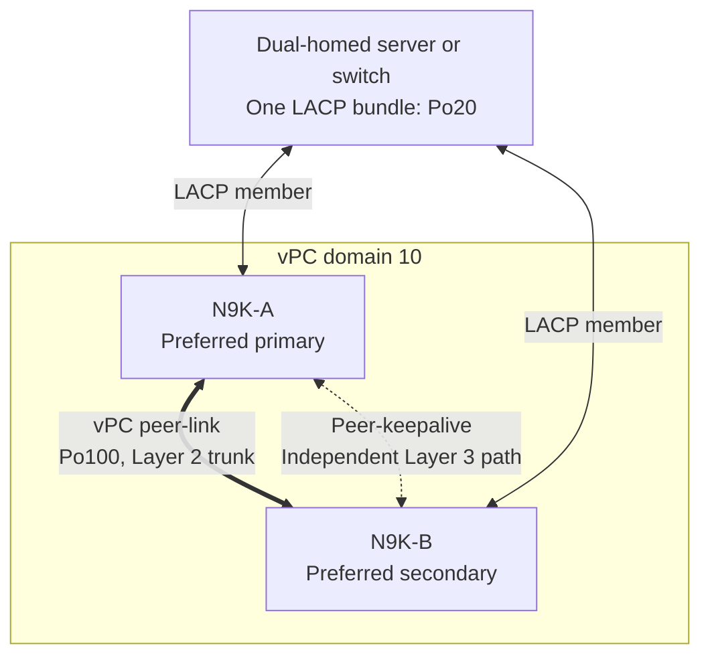
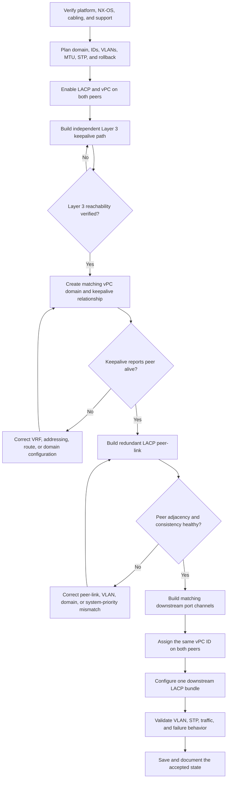
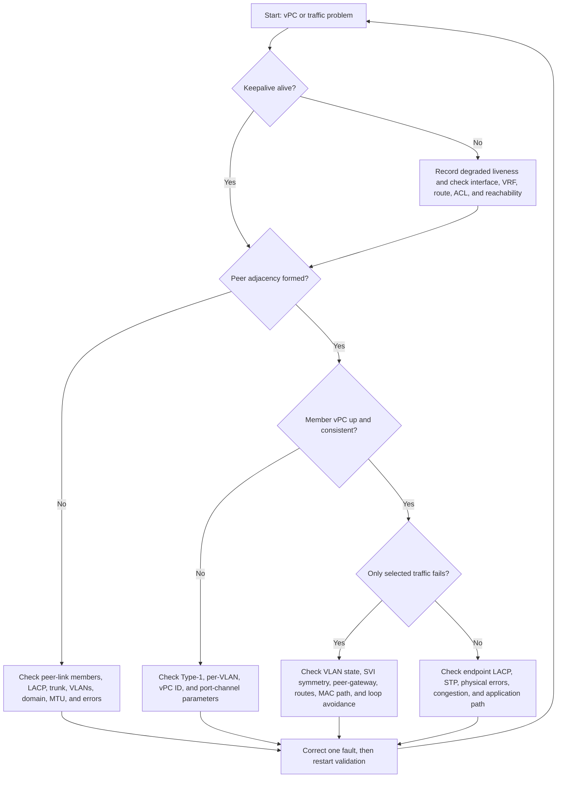

---
categories:
  - "[[Networking]]"
topic@networking:
  - "[[Networking General]]"
tags:
  - category/networking/networking_general
icon: FasNetworkWired
iconColor:
last_update:
aliases:
  - vPC
  - Virtual PortChannel
---
Cisco Nexus Virtual PortChannel, abbreviated vPC, allows a downstream device to build one logical Layer 2 port channel across two physical Nexus switches. Both [[#vPC Peer Devices|peer switches]] can forward traffic at the same time, while the [[#vPC Peer-Link|peer-link]] synchronizes state and the [[#Peer-Keepalive Link|peer-keepalive path]] helps the pair distinguish a peer failure from a peer-link failure.

This note covers classic vPC on Cisco Nexus 9000 switches running standalone NX-OS. The example follows the command model documented for NX-OS 10.6(x). Interface names, addresses, VLANs, timers, priorities, and feature support must be checked against the exact switch model, NX-OS release, topology, and Cisco release notes before production use.

## Definition and Scope

### What vPC Is

vPC is Cisco's multichassis EtherChannel technology for Nexus switches. A normal port channel terminates on one physical switch. A vPC distributes the two halves of that port channel across two physical switches and presents them to the attached device as one logical link aggregation group.

The attached device does not run vPC. It uses an ordinary static port channel or, preferably, an IEEE 802.1AX [[#LACP|LACP bundle]]. The two Nexus peers jointly present the Layer 2 identity needed for that bundle.

vPC provides the following benefits:

- Active-active use of links that might otherwise be blocked by [[#Spanning Tree Behavior|Spanning Tree Protocol]].
- Chassis and link redundancy for a dual-homed device.
- Layer 2 multipathing without merging the two switches into one chassis.
- Fast traffic redistribution after a member-link or peer failure.
- A consistent logical connection for servers, switches, firewalls, load balancers, storage systems, and similar devices.

### What vPC Is Not

vPC is not:

- A cloud Virtual Private Cloud.
- A physical switch stack.
- One shared management plane.
- One shared Layer 3 control plane.
- A replacement for STP.
- A replacement for HSRP, VRRP, routing protocols, or routed ECMP links.
- A mechanism that makes every Layer 2 topology safe or supported.

At Layer 2, a vPC pair can appear as one logical node to a vPC-attached device. At Layer 3, the peers remain two separate routers with separate interfaces, addresses, routing tables, adjacencies, and failure states.

### Common Use Cases

Common vPC attachments include:

- An access switch dual-homed to two aggregation switches.
- A server or hypervisor with one LACP bond split across two Nexus switches.
- A firewall, load balancer, or storage appliance with a multichassis link aggregation group.
- A Fabric Extender design supported by the exact Nexus platform and release.
- A Layer 2 interconnection between two vPC pairs, commonly called double-sided or back-to-back vPC.

### When Not to Use vPC

Prefer a routed design when the requirement can be met with point-to-point Layer 3 links and ECMP. Routed links reduce the Layer 2 failure domain and avoid many STP, VLAN, and peer-link dependencies.

Do not use vPC when:

- The endpoint cannot combine all Nexus-facing links into one supported port channel.
- The selected switch models, line cards, transceivers, or NX-OS releases are not a supported peer combination.
- The peer-link cannot be made redundant or sized for its failure duties.
- The design depends on unsupported transit across the peer-link.
- A larger Layer 2 domain creates more operational risk than value.

## Architecture



### vPC Domain

A vPC domain contains:

- Exactly two vPC peer devices.
- One vPC peer-link port channel.
- One Layer 3 peer-keepalive relationship.
- The downstream [[#vPC Member Port Channel|vPC member port channels]] associated with the pair.
- Domain-wide role, recovery, consistency, and forwarding options.

Both peers use the same domain ID. On Nexus 9000 NX-OS 10.6(x), the documented domain ID range is 1 through 1000, and a peer participates in one vPC domain. The domain ID contributes to the automatically generated vPC system MAC, so Cisco recommends a unique domain ID within a contiguous Layer 2 network. Adjacent vPC pairs in a double-sided design should use different domain IDs.

The peers must be configured independently. Cisco Fabric Services over Ethernet synchronizes operational information, but it does not replace deliberate configuration of both management planes.

### vPC Peer Devices

The two Nexus switches remain independent devices. Each has its own:

- Management address and configuration.
- Supervisor and process state.
- Local interfaces and port channels.
- STP process.
- Layer 3 interfaces and routing state.
- Logging, monitoring, startup configuration, and maintenance lifecycle.

Both peers forward traffic for healthy vPCs. The words primary and secondary describe coordination and failure-handling roles; they do not describe a normal active-standby data plane.

#### Primary and Secondary Roles

The peer with the lower configured `role priority` is preferred as primary. If no role priority is configured, the election can use system MAC information. A role priority may intentionally differ between the peers.

Roles are normally non-preemptive after a failure. If the configured primary reloads, the surviving configured secondary can become operational primary. When the original switch returns, it usually becomes operational secondary so that the network does not flap merely to restore the configured labels.

Use `show vpc role` to distinguish:

- Configured role preference.
- Current operational role.
- Local and peer system identities.

Role priority is different from vPC system priority:

- `role priority` selects the preferred vPC primary. Lower is preferred and the two peers normally use different values.
- `system-priority` is part of the shared LACP system identity. If configured, it must match on both peers.

### vPC Peer-Link

The peer-link is a Layer 2 port channel between the two Nexus peers. It is a foundational part of the vPC system and must be operational before downstream vPCs are placed in service.

#### Peer-Link Functions

The peer-link carries:

- Cisco Fabric Services over Ethernet control communication.
- vPC state and consistency information.
- MAC address synchronization for common VLANs.
- IGMP and multicast forwarding-state synchronization.
- STP BPDUs.
- [[#Broadcast, Unknown-Unicast, and Multicast Traffic|Broadcast, unknown-unicast, and multicast traffic]] when required.
- Traffic to an endpoint that is reachable only through the other peer.
- Data traffic during certain member-link failures.

The peer-link is not intended to be the normal path for [[#Known Unicast Traffic|known unicast traffic]] between two healthy, dual-homed endpoints. Healthy traffic should arrive and leave through local member links whenever a local path exists.

#### Peer-Link Design

For the current Nexus 9000 guide, the peer-link uses 10-Gigabit Ethernet or faster interfaces. Verify the minimum and supported interface types for the exact platform.

Design the peer-link as follows:

- Use at least two high-bandwidth physical members.
- Spread members across modules, line cards, ASICs, or other failure domains when the platform permits it.
- Use an LACP port channel with Nexus members in active mode.
- Configure it as a Layer 2 trunk.
- Allow every VLAN used by a vPC member.
- Normally allow only VLANs that the vPC system requires.
- Match the allowed VLAN list, native VLAN, MTU, speed, STP settings, and port-channel parameters on both peers.
- Configure the peer-link as an STP network port where required so Bridge Assurance protects the inter-switch connection.
- Size it for BUM traffic, [[#Orphan Port|orphan traffic]], and traffic redirected during a local member failure.

Do not carry peer-keepalive messages over the peer-link.

#### vPC Loop-Avoidance Rule

Traffic received across the peer-link is generally not forwarded out a vPC member port that is operational on both peers. This split-horizon behavior prevents a frame from looping between the two switches.

The same protection can expose a poor or unsupported design. If a route, asymmetric SVI state, or single-attached path forces traffic across the peer-link and then expects it to leave through a healthy vPC member, the receiving peer can drop it under the loop-avoidance rule. Typical symptoms are:

- Only some flows fail.
- All links appear up.
- The packet counter increases on the peer-link but not on the expected egress vPC.
- SVI state, gateway MAC handling, or routing is asymmetric between the peers.

Keep SVI and routing intent symmetrical, keep normal forwarding local, and use supported Layer 3 designs.

### Peer-Keepalive Link

The peer-keepalive path is an independent Layer 3 liveness path between the peers. It carries heartbeat messages only. It does not carry user traffic, MAC synchronization, configuration synchronization, or CFSoE state.

Its main job is to answer a specific question after the peer-link fails: is the remote switch still alive?

The keepalive design should:

- Use a dedicated VRF and routed interfaces where practical.
- Otherwise use a resilient out-of-band management network.
- Have unique, mutually reachable global-unicast source and destination addresses.
- Remain independent from the complete peer-link failure domain.
- Be configured and verified before the peer-link.
- Never traverse the peer-link itself.

If `mgmt0` and the management VRF are used, connect both peers through an external management switch rather than a direct cable. An intermediate management network keeps the physical link state and path behavior independent from a peer power failure.

In NX-OS 10.6(x), documented defaults include a one-second keepalive interval, a five-second timeout, and UDP port 3200. These values and their configurable ranges are release-dependent and should not be changed without a measured reason.

### vPC Member Port Channel

A downstream vPC consists of one Layer 2 port channel on each Nexus peer. Each peer contributes one or more physical links to the attached device, and both port channels are assigned the same vPC ID.

The port-channel number and vPC ID are different identifiers. They do not have to be numerically equal, but using the same number on both peers and for the vPC ID reduces operational mistakes.

The downstream device must see all links as one bundle. It must not create one port channel toward Nexus A and a second independent port channel toward Nexus B.

#### LACP

Cisco recommends LACP with Nexus member interfaces in active mode.

LACP provides:

- Member negotiation and health checking.
- Protection against some cabling and configuration errors.
- A shared system identity presented by the vPC pair.
- Predictable member removal and traffic rehashing after a failure.

For a vPC to form correctly, match the following on both halves:

- Layer 2 access or trunk mode.
- Access VLAN or allowed VLAN list.
- Native VLAN and native tagging behavior.
- MTU.
- Link speed, duplex, FEC, and other physical settings.
- Port-channel protocol and compatible LACP mode.
- STP attributes.

An LACP member shown as individual, suspended, or not bundled usually indicates a remote bundle problem, incompatible parameters, cabling error, or a port-channel state mismatch.

### Orphan Port

An orphan port is a single-attached interface on one vPC peer that carries a VLAN also present on the vPC peer-link. An orphan endpoint is not protected by a member link to the other peer.

Traffic to or from an orphan endpoint can require the peer-link. A peer-link failure can therefore isolate the endpoint even while the endpoint's local physical interface remains up.

Preferred treatments are:

- Dual-home critical endpoints.
- Move routed services to a design that does not depend on peer-link transit.
- Model the orphan's exact failure behavior before deployment.
- Apply `vpc orphan-ports suspend` selectively when the endpoint should be disconnected from the secondary during a peer-link failure.

Orphan suspension is not a universal default. On current Nexus guidance, it can also affect non-vPC VLANs and Layer 3 ports associated with the selected interface. Apply it only after checking the platform, release, and intended failure policy.

### VLAN and Trunk Behavior

Every VLAN used by a member vPC must:

- Exist and be active on both peers.
- Be allowed on the peer-link.
- Be allowed on both halves of the downstream vPC.
- Use the same native VLAN and tagging behavior.
- Have consistent STP and, where present, SVI state.

A port channel can remain up while one VLAN is suspended. This produces partial connectivity that is easy to mistake for a routing or endpoint problem. Always inspect active VLANs and [[#Per-VLAN Consistency|per-VLAN consistency]], not only the overall port-channel state.

### Spanning Tree Behavior

vPC removes the need for STP to block one link inside a correctly formed downstream port channel, but STP remains a safety mechanism for the wider Layer 2 topology.

The two peers must use compatible:

- STP mode.
- MST region settings where MST is used.
- VLAN enablement.
- Bridge Assurance settings.
- Port types and guard features.

Use `spanning-tree port type network` on the peer-link when required by the design. Do not apply Bridge Assurance or network port type to an ordinary downstream vPC member. Use an edge or edge-trunk port type only when the attached device is a verified host and cannot bridge BPDUs.

#### Peer-Switch

The optional `peer-switch` feature allows both peers to present a common STP bridge identity and act as one STP root for the relevant topology.

Before enabling it:

- Confirm the topology is supported by the exact platform and NX-OS release.
- Configure the same STP bridge priority on both peers.
- Ensure the pair is intended to be root for every applicable VLAN or MST instance.
- Do not use `peer-switch` in a topology that relies on STP-based redundancy. Current NX-OS 10.6 guidance marks that combination unsupported, and a hybrid peer-switch topology can lose east-west traffic after peer-link failure.

Without `peer-switch`, deliberately align STP root and backup-root placement with the vPC design.

### Layer 3 Gateway and Routing

vPC virtualizes Layer 2 attachment. It does not merge the two Layer 3 nodes.

#### SVIs and First-Hop Redundancy

When the Nexus pair provides default-gateway service:

- Configure the SVI on both peers.
- Keep SVI administrative state and relevant attributes symmetrical.
- Give each peer a unique physical SVI address.
- Use a supported first-hop redundancy protocol such as HSRP or VRRP for a shared virtual gateway.
- Keep the first-hop redundancy configuration consistent except for intentional role priority.

The FHRP control plane can be active-standby while the vPC data plane forwards on both peers.

#### Peer-Gateway

The optional `peer-gateway` feature allows either peer to route packets addressed to the other peer's router MAC locally. This avoids unnecessary peer-link traversal and helps devices that learn or reuse a physical router MAC instead of consistently using the FHRP virtual MAC.

Configure it symmetrically on both peers and verify the exact routing design. It is especially relevant when traffic might otherwise cross the peer-link and encounter the [[#vPC Loop-Avoidance Rule|loop-prevention behavior]].

#### ARP and Neighbor Discovery Synchronization

`ip arp synchronize` accelerates ARP-table recovery between peers. `ipv6 nd synchronize` provides the equivalent benefit for IPv6 Neighbor Discovery where the platform and deployment support it.

Configure the applicable command on both peers. IPv6 synchronization is unnecessary in an IPv4-only deployment.

#### External Routing

Dedicated routed links from each vPC peer to upstream routers are generally the clearest design. They allow each Nexus to form independent adjacencies and use ECMP without making the peer-link the normal routed transit path.

Provide a supported backup routing path between the two vPC peers as well. If one peer loses all of its routed uplinks, the backup adjacency lets it redirect routed traffic to the peer that still has upstream reachability. Prefer a dedicated Layer 3 link; a reviewed non-vPC VLAN trunk with a dedicated SVI is another documented option. Validate complete routed-uplink loss on each peer so locally received traffic does not blackhole.

Direct Layer 3 peering over a vPC attachment is a separate, release-dependent design. On Nexus 9000 it requires the supported `layer3 peer-router` design, applies to unicast in the documented topology, and is not a generic substitute for dedicated routed links. Layer 3 multicast requires its own supported design.

## Forwarding Behavior

### Known Unicast Traffic

During normal operation, traffic arriving on a vPC member is kept local when the local peer has a usable egress path. The peer-link should not be crossed merely to use an equivalent healthy vPC member on the other switch.

The downstream device hashes flows across the complete LACP bundle. Each Nexus also applies its configured local forwarding and port-channel hash. Individual packets in one flow normally remain on one selected member until the hash inputs or member state change.

### Broadcast, Unknown-Unicast, and Multicast Traffic

Broadcast, unknown-unicast, and multicast traffic can cross the peer-link so both sides of the Layer 2 domain receive the required frames. STP BPDUs and multicast state are also coordinated across the pair.

Persistent high BUM volume can indicate:

- A MAC-learning problem.
- Excessive Layer 2 scope.
- Missing multicast controls.
- A loop.
- A VLAN or endpoint design that depends too heavily on flooding.

### Traffic During a Member Failure

If one downstream member fails, LACP removes it from the bundle and the attached device rehashes affected flows onto the remaining members. Traffic that now arrives on the peer opposite a single reachable destination may temporarily use the peer-link.

The peer-link must therefore be sized for failure traffic, not only for control synchronization.

## Consistency Checks

The peers compare critical configuration and operational parameters. The goal is to prevent two switches that claim to be one Layer 2 system from forwarding with incompatible rules.

### Mandatory or Type-1 Consistency

A mandatory mismatch can suspend a vPC, a peer-side member, or affected VLANs.

Common mandatory parameters include:

| Area | Examples |
|---|---|
| Port channel | Protocol and mode, member speed, duplex, Layer 2 state |
| Trunk | Access or trunk mode, native VLAN, allowed VLANs, native tagging |
| STP | Mode, MST region, VLAN enablement, Bridge Assurance, port type, guard settings |
| Frame handling | MTU |
| VLAN state | VLAN existence and operational compatibility |

`graceful consistency-check` is enabled by default in current Nexus 9000 guidance. When an operating vPC develops a mandatory mismatch, graceful checking normally suspends the secondary side rather than both sides. Do not rely on this behavior as a change strategy; correct the mismatch immediately.

### Advisory or Type-2 Consistency

A Type-2 mismatch can be reported without suspending the entire vPC. It can still create asymmetric or incorrect forwarding.

Examples include differences in:

- SVI presence or administrative state.
- ACL or QoS intent.
- Static MAC and MAC-aging policy.
- First-hop redundancy configuration.
- Multicast and routing configuration.
- Other features applied to only one peer.

An operational vPC with a Type-2 failure is not a healthy acceptance state.

### Per-VLAN Consistency

Some mismatches suspend only the affected VLAN. This is why validation must include:

```text
show vpc brief
show vpc consistency-parameters global
show vpc consistency-parameters vpc <vpc-id>
show vpc consistency-parameters interface port-channel <po-id>
```

On Nexus 9000 releases from 9.2(1), the older `show vpc consistency-checker` command is unavailable. Use the `show vpc consistency-parameters` family instead.

Per-VLAN consistency suspension does not apply to MST VLANs in current Nexus 9000 guidance. In an MST design, do not assume a mismatch will isolate only one VLAN; verify the exact failure scope before changing STP or VLAN parameters.

## Design Requirements and Best Practices

### Platform and Software

Before configuration:

- Check the switch model and NX-OS release against the current Cisco vPC guide.
- Run the same supported NX-OS release on both peers outside an approved serialized upgrade.
- For current Nexus 9300 guidance, use the exact same peer model.
- For current Nexus 9500 guidance, verify matching module types and slot placement.
- Confirm interface speed, FEC, transceiver, breakout, and port-channel support.
- Check the verified scalability limits for vPCs, VLANs, MAC addresses, and port-channel members.
- Confirm that required licenses and features are available.

Do not copy platform-specific commands from Nexus 5000 or 7000 examples into a Nexus 9000 deployment without checking the corresponding Nexus 9000 guide.

### Physical Failure Domains

Plan physical diversity for:

- Peer-link members.
- Peer-keepalive path.
- Power feeds.
- Supervisors where applicable.
- Modules, line cards, and ASICs.
- Downstream endpoint links.
- Routed uplinks.

The peer-link and keepalive should not share a single point of failure. Two cables in one module or one optical path do not provide the same protection as genuinely diverse paths.

If the peer-link and all core-facing uplinks cannot be separated from one module, use the platform-specific vPC object-tracking design documented by Cisco. Correct tracking can suspend local vPCs and force traffic to the healthy peer instead of blackholing it after a shared-module failure.

### Configuration Symmetry

Use a paired template or automation so both peers receive matching configuration. Validate after every logical phase.

Do not assume CFSoE copies:

- VLAN creation.
- Interface configuration.
- Port-channel attributes.
- STP intent.
- SVI or routing configuration.
- Optional vPC features.

### Logical Design Worksheet

The following worksheet defines the illustrative configuration used later in this note:

| Item | N9K-A | N9K-B | Shared intent |
|---|---|---|---|
| NX-OS | Verify | Verify | Same supported release |
| vPC domain | 10 | 10 | Unique in the Layer 2 domain |
| Role priority | 1000 | 2000 | Lower value prefers N9K-A |
| System priority | 8192 | 8192 | Must match |
| Keepalive VRF | VPC-KA | VPC-KA | Dedicated Layer 3 path |
| Keepalive address | 192.0.2.1/30 | 192.0.2.2/30 | Documentation addresses |
| Keepalive interface | Ethernet1/48 | Ethernet1/48 | Replace as required |
| Peer-link | Port-channel100 | Port-channel100 | LACP trunk |
| Peer-link members | Ethernet1/49-50 | Ethernet1/49-50 | At least two diverse links |
| Downstream vPC | Port-channel20 | Port-channel20 | vPC ID 20 |
| Downstream member | Ethernet1/1 | Ethernet1/1 | One link per peer in this example |
| VLANs | 10,20,30 | 10,20,30 | Must match end to end |
| STP design | Planned root behavior | Planned root behavior | Validate before service |

The `192.0.2.0/24` range is documentation space. Replace it with production addressing.

## Configuration Flow



The order is a dependency, not just a preference. Cisco requires the keepalive relationship to be configured and operational before the peer-link can form. The peer-link plus global [[#Consistency Checks|consistency checks]] must then be healthy before downstream vPC members are enabled.

### Phase 1: Plan and Capture the Baseline

Confirm:

- Exact model, modules, NX-OS release, and supported peer combination.
- Available out-of-band or console access to both peers.
- Peer-link interfaces and physical path diversity.
- Keepalive interface, VRF, addressing, and independent route.
- Domain ID, port-channel IDs, vPC IDs, VLANs, native VLAN, MTU, and STP intent.
- Downstream LACP support and its maintenance plan.
- Expected capacity after losing one peer or one peer-link member.
- Orphan ports and their required failure policy.
- Layer 3 gateway and routing design.
- A [[#Rollback|rollback trigger]] and a known-good configuration backup.

Useful pre-change evidence on both peers:

```text
show version
show module
show hardware feature-capability
show feature
show interface status
show vlan brief
show spanning-tree summary
show port-channel summary
show vpc brief
show vpc role
show vpc peer-keepalive
show running-config vpc
```

If the platform supports NX-OS checkpoints and rollback, create and verify a local checkpoint on each peer according to the release-specific rollback guide.

### Phase 2: Enable the Required Features

Apply on both peers:

```text
configure terminal
  feature lacp
  feature vpc

  vlan 10,20,30
```

Add Layer 3 features such as `feature interface-vlan`, `feature hsrp`, or routing protocols only when they are part of the reviewed design.

Verify:

```text
show feature
show vlan brief
```

### Phase 3: Build the Peer-Keepalive Path

This example uses a dedicated routed interface and VRF. Replace all values before deployment.

#### N9K-A Keepalive

```text
vrf context VPC-KA

interface Ethernet1/48
  description VPC-KEEPALIVE-to-N9K-B
  no switchport
  vrf member VPC-KA
  ip address 192.0.2.1/30
  no shutdown
```

#### N9K-B Keepalive

```text
vrf context VPC-KA

interface Ethernet1/48
  description VPC-KEEPALIVE-to-N9K-A
  no switchport
  vrf member VPC-KA
  ip address 192.0.2.2/30
  no shutdown
```

Verify bidirectional reachability in the correct VRF before continuing:

```text
show ip interface brief vrf VPC-KA
show ip route vrf VPC-KA
ping <peer-keepalive-address> vrf VPC-KA source <local-keepalive-address>
```

If the management VRF is used instead, reference the existing management addresses:

```text
vpc domain 10
  peer-keepalive destination <peer-mgmt-IP> source <local-mgmt-IP> vrf management
```

Do not overwrite management addressing or use a path that depends on the peer-link.

### Phase 4: Create the vPC Domain

#### N9K-A vPC Domain

```text
vpc domain 10
  role priority 1000
  system-priority 8192
  peer-keepalive destination 192.0.2.2 source 192.0.2.1 vrf VPC-KA
  graceful consistency-check
```

#### N9K-B vPC Domain

```text
vpc domain 10
  role priority 2000
  system-priority 8192
  peer-keepalive destination 192.0.2.1 source 192.0.2.2 vrf VPC-KA
  graceful consistency-check
```

The role priorities differ intentionally. The system priority matches intentionally.

Verify before building the peer-link:

```text
show vpc peer-keepalive
show vpc statistics peer-keepalive
show vpc role
```

Do not proceed until the keepalive reports the peer as alive.

### Phase 5: Build the vPC Peer-Link

Stage the same Layer 2 configuration on both switches while the interfaces remain shut.

#### Both Peers: Peer-Link

```text
interface port-channel100
  description VPC-PEER-LINK
  shutdown
  switchport
  switchport mode trunk
  switchport trunk allowed vlan 10,20,30
  spanning-tree port type network
  vpc peer-link

interface Ethernet1/49-50
  description VPC-PEER-LINK-MEMBER
  shutdown
  switchport
  channel-group 100 mode active
```

After both peers are staged and cabled, enable the members and port channel on both peers:

```text
interface Ethernet1/49-50
  no shutdown

interface port-channel100
  no shutdown
```

Verify:

```text
show port-channel summary
show lacp neighbor
show interface port-channel100
show vpc brief
show vpc role
show vpc consistency-parameters global
show vpc consistency-parameters interface port-channel 100
show spanning-tree vlan <each-vpc-vlan>
```

Required state before continuing:

- Peer adjacency formed.
- Peer-keepalive alive.
- Peer-link up.
- All expected physical members bundled.
- Global consistency successful.
- Expected VLANs active.
- Intended primary and secondary roles established.

### Phase 6: Configure STP Intent

STP priority is a separate design choice from vPC role priority.

Without `peer-switch`, deliberately configure and validate the intended root and backup-root behavior. Do not assume the vPC primary automatically becomes STP root.

An illustrative non-peer-switch design is:

```text
N9K-A:
  spanning-tree vlan 10,20,30 priority 4096

N9K-B:
  spanning-tree vlan 10,20,30 priority 8192
```

Choose values that make the intended pair the actual root and backup root in the complete topology.

For a qualified pure-vPC topology using `peer-switch`, first configure the same root priority on both peers:

```text
spanning-tree vlan 10,20,30 priority 8192

vpc domain 10
  peer-switch
```

Apply the command symmetrically and verify that the pair is root for every relevant VLAN or MST instance. Use this only in a validated pure-vPC topology. Do not use it with STP-based redundancy or a hybrid path that depends on east-west forwarding after peer-link loss.

### Phase 7: Add Design-Dependent Resilience Features

These commands are common, but they are not a substitute for checking the exact platform and failure policy.

#### Peer-Gateway and Address Synchronization

For a pair providing Layer 3 gateway services, apply symmetrically:

```text
vpc domain 10
  peer-gateway
  ip arp synchronize
```

For a supported IPv6 deployment, also consider:

```text
vpc domain 10
  ipv6 nd synchronize
```

#### Auto-Recovery

`auto-recovery` can restore vPC service when both peers reload but only one returns, or in documented sequences where the remaining switch must recover its member ports. It is disabled by default in current Nexus 9000 guidance.

Evaluate the exact dual-active policy before enabling it. A representative command is:

```text
vpc domain 10
  auto-recovery reload-delay 240
```

Apply it on both peers and save it before testing. In NX-OS 10.6(x), 240 seconds is the documented default and minimum reload delay; the supported range is 240 through 3600 seconds.

After the timer, an isolated recovering peer can assume primary functions and raise its local vPCs without normal peer consistency validation. That restores service when the other peer is truly unavailable, but it can create dual-active behavior if the peer is alive and only the control paths are isolated. During a peer replacement, review Cisco's procedure because auto-recovery may need to be disabled temporarily.

#### Delay Restore

When the peers route traffic, a recovering vPC leg should not begin attracting traffic before the routing and forwarding tables have converged. `delay restore` and its SVI-related variant can delay service restoration.

Tune restore timers from measured convergence and the exact release guide. Do not copy an arbitrary timer into production.

### Phase 8: Build the Downstream vPC

This example creates trunk vPC 20. Stage both Nexus sides while shut.

#### Both Peers: Downstream Port Channel

```text
interface port-channel20
  description DOWNSTREAM-LACP
  shutdown
  switchport
  switchport mode trunk
  switchport trunk allowed vlan 10,20,30
  vpc 20

interface Ethernet1/1
  description DOWNSTREAM-LACP-MEMBER
  shutdown
  switchport
  channel-group 20 mode active
```

Configure the attached device before enabling both Nexus legs:

- Create one LACP port channel.
- Add its Nexus A-facing and Nexus B-facing links to that same bundle.
- Match trunk or access mode.
- Match native and allowed VLANs.
- Match MTU, speed, and FEC.
- Use compatible LACP settings.
- Apply host-facing STP edge settings only when the device cannot bridge.

Enable one Nexus member, validate LACP and connectivity, then enable the second member:

```text
interface Ethernet1/1
  no shutdown

interface port-channel20
  no shutdown
```

Verify on both peers:

```text
show port-channel summary
show lacp neighbor
show vpc brief
show vpc consistency-parameters vpc 20
show vpc consistency-parameters interface port-channel 20
show spanning-tree vlan <each-vpc-vlan>
show mac address-table dynamic vlan <each-vpc-vlan>
```

For a server access port instead of a trunk, use a matching access VLAN on the port channel and apply an edge port type only after confirming that the server cannot bridge BPDUs.

### Phase 9: Validate Traffic and Failure Behavior

Complete the checks in [[#Validation and Acceptance Criteria|validation]] before saving the final configuration.

Before any reload, power-cycle, or auto-recovery test, save the verified healthy configuration on both peers:

```text
copy running-config startup-config
```

A reload test performed before this save would discard the new running configuration and would not exercise the intended vPC recovery state.

Test one failure at a time in an approved maintenance window:

1. One physical member of the downstream port channel.
2. One complete downstream vPC leg.
3. One peer-link member while the peer-link remains up.
4. One Nexus peer reload or approved maintenance isolation.
5. Complete peer-link loss while keepalive remains healthy, only in a controlled test plan.
6. Orphan-port behavior where orphan ports exist.
7. Complete routed-uplink loss on one peer when Layer 3 services exist.
8. Recovery timing and routing convergence where SVIs or routed uplinks exist.

Restore and verify each component before starting the next test. Do not intentionally fail the peer-link and keepalive together in production.

### Phase 10: Save and Document

After every acceptance check passes, save both peers again so any post-test corrections are retained:

```text
copy running-config startup-config
```

Record:

- Cabling and remote endpoints.
- Domain, port-channel, and vPC IDs.
- VLAN and MTU intent.
- STP root design.
- Keepalive path and VRF.
- Optional vPC features and the reason for each.
- Baseline command output.
- Tested convergence results.
- Rollback and maintenance procedures.

## Validation and Acceptance Criteria

### Healthy-State Criteria

A healthy vPC pair should show:

- vPC and LACP features enabled.
- Peer adjacency formed.
- Peer-keepalive alive.
- One operational primary and one operational secondary.
- Peer-link up with all expected members bundled.
- Global consistency success.
- Per-VLAN consistency success.
- Type-2 consistency success.
- Each expected member vPC up.
- Correct active VLANs on the peer-link and member vPCs.
- Intended STP root placement.
- Stable MAC learning without repeated moves.
- No unexpected interface errors, drops, or peer-link congestion.

### Command Checklist

```text
show feature
show running-config vpc
show vpc brief
show vpc role
show vpc peer-keepalive
show vpc statistics peer-keepalive
show vpc consistency-parameters global
show vpc consistency-parameters vpc <vpc-id>
show vpc consistency-parameters interface port-channel <po-id>
show port-channel summary
show lacp neighbor
show interface port-channel <peer-link-id>
show interface port-channel <member-po-id>
show interface trunk
show vlan brief
show spanning-tree vlan <vlan-id>
show mac address-table dynamic vlan <vlan-id>
show vpc orphan-ports
show interface counters errors
show logging
```

### Functional Tests

Test:

- Same-VLAN connectivity through the vPC.
- Inter-VLAN connectivity when SVIs exist.
- Default-gateway reachability.
- North-south routing.
- Bidirectional application traffic.
- MAC learning on both peers.
- ARP or ND behavior on both peers where routing is present.
- MTU-sized traffic when jumbo frames are configured.
- Long-lived flows during a single member failure and recovery.

### Failure-Test Evidence

For every approved failure test, record:

- Initial healthy state.
- Failed component.
- Expected behavior.
- Measured packet loss and convergence time.
- LACP, vPC, STP, FHRP, and routing transitions.
- Peer-link utilization.
- Recovery time.
- Final healthy state.

## Failure Behavior

| Failure | Expected behavior | Main risk or observation |
|---|---|---|
| [[#Member-Link Failure|One downstream member fails]] | LACP removes the member and rehashes traffic | Brief loss for affected flows and reduced capacity |
| One peer-link member fails | Remaining peer-link members keep the peer-link up | Reduced peer-link capacity |
| [[#Peer Failure|One Nexus peer fails]] | The surviving peer carries the downstream bundle and may become operational primary | Reduced chassis and link capacity |
| [[#Keepalive-Only Failure|Keepalive fails while peer-link stays up]] | vPC forwarding continues | Peer liveness cannot be safely determined if the peer-link fails next |
| [[#Peer-Link Failure with Keepalive Available|Peer-link fails while keepalive stays up]] | The secondary suspends its vPC member ports and associated SVIs; the primary continues | Orphan or Layer 3 isolation and reduced capacity |
| [[#Dual-Active Condition|Keepalive fails first, then peer-link fails]] | Both switches can become operational primary | Dual-active, MAC divergence, duplicates, or blackholing |
| Both peers reload and only one returns | Member vPCs may remain suspended without a supported recovery policy | Service remains down until the peer returns or auto-recovery expires |
| Mandatory mismatch | The vPC, secondary leg, or affected VLAN is suspended | Immediate or partial loss of forwarding |
| Type-2 mismatch | vPC may remain up | Asymmetric or incorrect forwarding can remain hidden |
| Peer-link congestion | State, BUM, orphan, or redirected traffic competes for capacity | Intermittent loss and difficult troubleshooting |
| Downstream forms two bundles | The endpoint no longer sees one vPC | Loop, STP block, or unpredictable forwarding |

### Member-Link Failure

The attached device removes the failed member and rehashes flows to the remaining links. The surviving links can terminate on the other Nexus peer, so the design must retain enough capacity after a single link or chassis loss.

### Peer Failure

The surviving peer continues forwarding. A configured secondary can become operational primary. When the failed peer returns, it normally joins as operational secondary after keepalive, peer-link, role, and consistency processing.

### Keepalive-Only Failure

There is normally no immediate traffic impact while the peer-link remains healthy. This is a degraded protection state, not a harmless alarm. Restore keepalive before performing peer-link maintenance.

### Peer-Link Failure with Keepalive Available

The secondary detects that the primary is alive and suspends its vPC member ports to prevent both isolated switches from forwarding independently. Associated VLAN interfaces on the secondary also go down. The primary retains its vPC members and SVIs.

Orphan ports do not automatically follow the same behavior. Their reachability depends on the design and any explicit orphan suspension policy.

`dual-active exclude interface-vlan` can keep carefully selected SVIs up, but it is an advanced exception. Cisco cautions against excluding an SVI whose VLAN is carried by a vPC because it can continue attracting Layer 3 traffic during a dual-active failure and cause packet loss.

### Dual-Active Condition

If keepalive is unavailable and the peer-link then fails while both switches remain alive, each switch can believe it should operate as primary. State synchronization stops, and the two devices can learn different MAC and multicast information.

Possible results include:

- MAC flapping.
- Duplicate frames.
- Blackholing.
- Inconsistent STP or gateway behavior.
- New flows behaving differently from established flows.

Restore control connectivity through a reviewed recovery procedure. Do not improvise simultaneous changes on both peers during a split-brain event.

### Recovery

When peer connectivity returns, one switch becomes operational secondary and its vPC links can transition while state is reconciled. Restore-delay features can prevent a recovering leg or SVI from attracting traffic before routing converges.

## Change and Maintenance Flow

### Add a VLAN

1. Create the VLAN on both peers.
2. Add it to the peer-link allowed list on both peers.
3. Verify per-VLAN and global consistency.
4. Add it to both halves of the downstream vPC.
5. Add it to the downstream device.
6. Validate STP, MAC learning, and traffic.
7. Save both configurations.

### Remove a VLAN

Use the reverse dependency order:

1. Remove the VLAN from the downstream device.
2. Remove it from both halves of every member vPC.
3. Verify that no vPC uses it.
4. Remove it from the peer-link.
5. Remove the VLAN from both peers if it is no longer used.
6. Revalidate and save.

### Modify a Mandatory Parameter

Mandatory changes include MTU, trunk mode, native VLAN, allowed VLANs, STP mode, and certain port-channel attributes.

Before changing one:

- Confirm whether the operation is documented as hitless.
- Move or drain traffic if required.
- Prepare matching commands for both peers.
- Change one peer at a time according to the release-specific procedure.
- Expect graceful consistency checking to suspend a mismatched secondary leg.
- Apply the matching change promptly.
- Verify after each peer and after the pair is consistent.

Do not leave a Type-1 mismatch in place.

### Peer Maintenance or Replacement

Follow the exact Cisco replacement or maintenance procedure for the platform. A safe conceptual restoration dependency is:

1. Restore the peer-keepalive path.
2. Restore the peer-link.
3. Verify adjacency, role, and global consistency.
4. Restore vPC member ports.
5. Restore orphan ports according to their policy.
6. Restore routed links and confirm routing convergence.

Auto-recovery, role stickiness, object tracking, and restore timers can change the behavior. Review them before maintenance.

### Software Upgrade

Use the release-specific Cisco upgrade or ISSU guide and compatibility matrix. Keep the operation serialized and never upgrade both peers concurrently. The required first peer can depend on the platform, source release, target release, and upgrade method.

### Rollback

Use out-of-band access and roll back one peer at a time. Preview a platform-supported checkpoint rollback before applying it, then validate the recovered peer before touching the other peer.

Do not use `no feature vpc` as an ordinary undo command. Disabling the vPC feature clears vPC configuration and is disruptive.

## Troubleshooting Flow



### Step 1: Classify the State

Start with:

```text
show vpc brief
```

Classify the problem as:

- Peer adjacency.
- Keepalive.
- Peer-link.
- Global consistency.
- Per-VLAN consistency.
- Member vPC.
- LACP.
- STP.
- Layer 3 forwarding.

Avoid changing configuration until the failing layer is identified.

### Step 2: Check Peer-Keepalive

Verify:

- Physical or management interface state.
- Correct VRF.
- Source and destination addresses.
- Bidirectional reachability in that VRF.
- Route and return route.
- ACL, control-plane, or firewall handling.
- Independence from the peer-link path.

### Step 3: Check the Peer-Link

Verify:

- At least one physical member is up.
- LACP members are bundled.
- The port channel is Layer 2.
- Trunk mode and allowed VLANs match.
- Required VLANs exist on both peers.
- MTU, speed, FEC, and physical parameters match.
- STP network port behavior is correct.
- Error and discard counters are stable.

### Step 4: Check Consistency

Use:

```text
show vpc consistency-parameters global
show vpc consistency-parameters vpc <vpc-id>
show vpc consistency-parameters interface port-channel <po-id>
```

Compare both peers and correct the smallest verified mismatch. Recheck syslog after the correction.

### Step 5: Check VLAN State

Look for:

- VLAN missing on one peer.
- VLAN absent from the peer-link.
- Different allowed VLAN lists.
- Native VLAN mismatch.
- Suspended VLAN.
- Inconsistent STP state.
- SVI present or administratively up on only one peer.

### Step 6: Check LACP and Cabling

Look for:

- Individual, suspended, or non-bundled members.
- Incorrect remote port-channel membership.
- Two downstream bundles instead of one.
- Incompatible active or passive modes.
- Speed, duplex, FEC, or MTU mismatch.
- Minimum-link policy.
- Crossed or mislabeled cables.

### Step 7: Check STP

Verify:

- Expected root placement.
- Same STP mode and MST region.
- Correct peer-link port type.
- No unintended Bridge Assurance dispute.
- No BPDU Guard, Root Guard, Loop Guard, or filter action.
- No unexpected topology-change storm.

### Step 8: Check MAC, ARP, ND, and Routing

Inspect:

- MAC movement between a member vPC, peer-link, and orphan port.
- ARP or ND state on both peers.
- HSRP or VRRP state.
- SVI symmetry.
- Default and specific routes.
- Routing adjacencies.
- Peer-gateway use.
- Whether a packet is forced across the peer-link and then expected to leave through an operational vPC.

### Step 9: Collect Evidence

Before an invasive change or Cisco TAC escalation, collect:

```text
show tech-support vpc
show vpc brief
show vpc role
show vpc peer-keepalive
show vpc consistency-parameters global
show vpc consistency-parameters vpc <vpc-id>
show port-channel summary
show lacp neighbor
show spanning-tree
show interface counters errors
show logging
```

Also record the exact time, affected VLANs, endpoints, packet direction, and whether the issue follows a specific hash path.

## Common Mistakes

- Interpreting vPC primary and secondary as active and standby forwarding roles.
- Using the peer-link for keepalive.
- Building the peer-link before keepalive is reachable.
- Using one undersized peer-link member.
- Placing all peer-link members and routed uplinks in one failure domain.
- Omitting a vPC VLAN from the peer-link.
- Carrying unnecessary VLANs on the peer-link.
- Creating a VLAN or SVI on only one peer.
- Mismatching access or trunk mode, native VLAN, allowed VLANs, MTU, speed, FEC, LACP, or STP.
- Assigning different vPC IDs to the two downstream halves.
- Giving the peers different `system-priority` values.
- Confusing `role priority` with `system-priority`.
- Configuring only one peer.
- Giving the downstream device two independent bundles.
- Applying STP network port type or Bridge Assurance to an ordinary member vPC.
- Applying host-facing edge configuration to a switch-facing port channel.
- Enabling `peer-switch` without identical STP priority and root intent.
- Applying `peer-gateway`, address synchronization, or another domain feature to only one peer.
- Treating `layer3 peer-router` as part of every vPC.
- Enabling auto-recovery without reviewing dual-active and replacement behavior.
- Testing simultaneous keepalive and peer-link failure in production.
- Assuming a port channel is healthy because it is up while an individual VLAN is suspended.
- Using `no feature vpc` as a routine rollback.

## Design Checklist

### Before Configuration

- Supported models, modules, transceivers, and NX-OS release confirmed.
- vPC domain and member IDs assigned.
- Unique adjacent domain IDs confirmed.
- Peer-link capacity and physical diversity confirmed.
- Independent keepalive path and VRF ready.
- VLAN, native VLAN, MTU, FEC, and STP intent documented.
- Downstream single-bundle LACP design confirmed.
- Orphan ports identified.
- Layer 3 gateway and routing design reviewed.
- Out-of-band access, baseline, rollback, and maintenance window ready.

### Before Service Handover

- Keepalive alive.
- Peer adjacency formed.
- Peer-link up with redundant members.
- Global, per-VLAN, and Type-2 consistency successful.
- Every expected vPC operational.
- Required VLANs active end to end.
- STP root placement correct.
- MAC, ARP, ND, FHRP, and routing state correct where applicable.
- Functional traffic tests passed.
- Approved single-failure tests passed.
- Configurations saved.
- Cabling, design values, baselines, and recovery procedures recorded.

## References

- [Cisco Nexus 9000 Series NX-OS Interfaces Configuration Guide, Release 10.6(x): Configuring vPCs](https://www.cisco.com/c/en/us/td/docs/dcn/nx-os/nexus9000/106x/configuration/interfaces/cisco-nexus-9000-series-nx-os-interfaces-configuration-guide-release-106x/m_configuring_vpcs_9x.html)
- [Cisco Nexus 9000 Series NX-OS Troubleshooting Guide, Release 10.6(x): Troubleshooting vPCs](https://www.cisco.com/c/en/us/td/docs/dcn/nx-os/nexus9000/106x/configuration/troubleshooting/cisco-nexus-9000-series-nx-os-troubleshooting-guide-106x/m-troubleshooting-vpcs.html)
- [Cisco: Understand and Configure Nexus 9000 vPC with Best Practices](https://www.cisco.com/c/en/us/support/docs/switches/nexus-9000-series-switches/218333-understand-and-configure-nexus-9000-vpc.html)
- [Cisco: Troubleshoot vPC Inconsistency Issues on NX-OS Switches](https://www.cisco.com/c/en/us/support/docs/ios-nx-os-software/nx-os-software/217989-troubleshoot-vpc-inconsistency-issues-on.html)
- [Cisco: Understand Nexus vPC Loop Avoidance](https://www.cisco.com/c/en/us/support/docs/switches/nexus-9364c-gx-switch/225202-understand-nexus-vpc-loop-avoidance.html)
- [Cisco Nexus 9000 Series NX-OS Command Reference: vPC Show Commands](https://www.cisco.com/c/en/us/td/docs/dcn/nx-os/nexus9000/105x/command-reference/show/b_n9k_show_commands_1051/m_v_showcmds.html)
