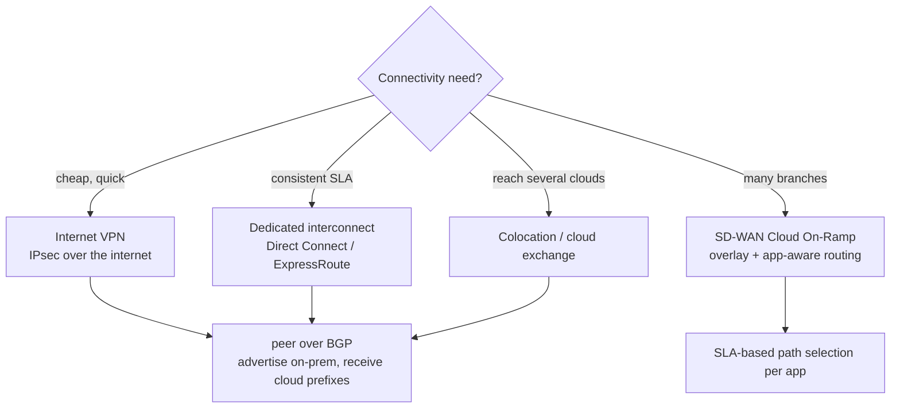
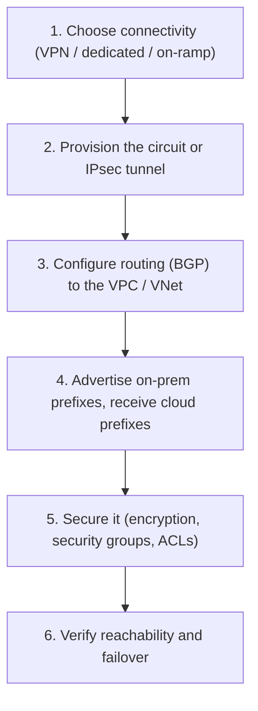
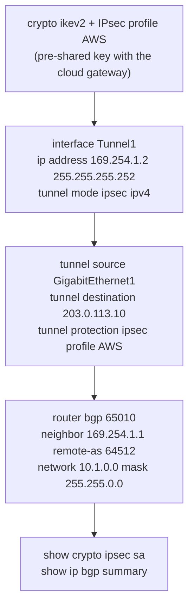

---
categories:
  - "[[Networking]]"
topic@networking:
  - "[[Networking General]]"
tags:
  - category/networking/networking_general
icon: FasNetworkWired
iconColor:
last_update:
---
Cloud computing delivers compute, storage, and networking on demand as a service over the network, billed by use and built on the same [[Hypervisors#Hypervisor Classification|virtualization]] that underpins the modern data center. Instead of buying and racking hardware, an organization consumes resources from a provider and scales them up or down as needed. For the ENCOR exam the relevant angles are the service and deployment models, the way responsibility is split between provider and customer, and — the networking piece — how an enterprise actually connects to cloud workloads. This note covers the essential characteristics, the service and deployment models, shared responsibility, regions and availability zones, the connectivity options, and the cloud-versus-on-premises tradeoff.

## Essential Characteristics

_Five traits, from the common NIST definition, distinguish a cloud from ordinary hosting._

- On-demand self-service — a consumer provisions resources automatically, without human interaction with the provider.
- Broad network access — capabilities are available over the network from a range of client devices.
- Resource pooling — the provider's resources are pooled and multi-tenanted, assigned and reassigned on demand.
- Rapid elasticity — capacity scales out and back quickly, appearing effectively unlimited to the consumer.
- Measured service — usage is metered, so consumers pay for what they use and the system is transparent about it.

## Service Models

_How much of the stack the provider operates, from raw infrastructure to a finished application._

### Infrastructure as a Service (IaaS)

The provider offers virtual machines, storage, and networking; the customer manages everything from the operating system upward. It gives the most control and the most responsibility. Virtual-machine services are the classic example.

### Platform as a Service (PaaS)

The provider manages the operating system, runtime, and platform; the customer deploys applications and data onto it and configures them. It trades some control for less operational burden.

### Software as a Service (SaaS)

The provider runs the entire stack and delivers a finished application; the customer just uses it and manages their users, data, and access. It gives the least control and the least maintenance.

```
                  IaaS         PaaS         SaaS
   Applications │ customer  │ customer  │ provider │
   Data         │ customer  │ customer  │ provider │
   Runtime      │ customer  │ provider  │ provider │
   OS           │ customer  │ provider  │ provider │
   Virtualization provider  │ provider  │ provider │
   Servers / net  provider  │ provider  │ provider │
        more you manage ◄──────────────► more the provider manages
```

|Model|Provider manages|You manage|Example|
|---|---|---|---|
|IaaS|Physical hardware and virtualization|OS, runtime, applications, data|Virtual machines|
|PaaS|Up through the runtime and platform|Applications and data|Managed app platform|
|SaaS|The entire stack|App usage, users, data access|Email and productivity suites|

## Deployment Models

_Where the cloud lives and who it serves._

### Public Cloud

Shared, multi-tenant infrastructure operated by a provider and reached over the internet. Maximum elasticity and no capital outlay, at the cost of sharing infrastructure.

### Private Cloud

Cloud infrastructure dedicated to a single organization, run on-premises or hosted. It keeps cloud operating characteristics while retaining control and isolation, for regulatory or performance reasons.

### Hybrid Cloud

Public and private clouds combined and connected so that workloads and data can move between them — for example keeping sensitive systems private while bursting capacity to public cloud.

### Multicloud

Using more than one public-cloud provider together, to avoid lock-in, place workloads where they run best, or meet regional requirements. It raises the networking challenge of connecting and securing several providers at once.

|Model|Where and who|
|---|---|
|Public|Shared provider infrastructure, multi-tenant, over the internet|
|Private|Dedicated to one organization, on-premises or hosted|
|Hybrid|Public and private combined, workloads move between them|
|Multicloud|Several public providers used together|
|Community|Shared by organizations with common requirements|

## Shared Responsibility

_Security and operational duties are divided between provider and customer, and the line moves with the service model._

The provider is responsible for security of the cloud — the physical facilities, hardware, and virtualization layer — while the customer is responsible for security in the cloud — their data, identities, access, and configuration. How much falls to the customer depends on the model: with [[#Infrastructure as a Service (IaaS)|IaaS]] the customer secures the OS and everything above it; with [[#Platform as a Service (PaaS)|PaaS]] the provider secures the platform and the customer secures their implementation and configuration; with [[#Software as a Service (SaaS)|SaaS]] the provider carries almost everything, leaving the customer responsible mainly for user access and data.

```
Provider secures "OF the cloud":  facilities, hardware, virtualization
Customer secures "IN the cloud":  data, identities, access, configuration
     IaaS ─────────────────────────────────► customer responsibility largest
     SaaS ─────────────────────────────────► customer responsibility smallest
```

> [!warning] Cloud does not mean "someone else handles security"
> A common failure is assuming the provider secures everything. Misconfigured storage, weak identity policies, and exposed access keys are customer-side responsibilities in every model — the provider secures the infrastructure, not your configuration.

## Regions and Availability Zones

_Providers structure capacity geographically so workloads can be placed for locality and survivability._

A region is a geographic area; an availability zone is one or more isolated data centers within a region with independent power and networking. Deploying a workload across multiple availability zones protects it from a single data-center failure, and deploying across regions provides disaster recovery and places services closer to users. This is the cloud expression of the same redundancy thinking that drives on-premises [[High Availability|high availability]].

```
Region (a geographic area)
  ├── Availability Zone A   (isolated data center[s])
  ├── Availability Zone B
  └── Availability Zone C
  across AZs → high availability;  across regions → disaster recovery + locality
```

## Connecting to the Cloud

_The networking angle: how an enterprise reaches its cloud workloads, from cheap and variable to private and predictable._



### Internet VPN

An IPsec tunnel from the enterprise edge across the public internet to the cloud. It is inexpensive and available anywhere, but bandwidth and latency ride on the public internet and vary.

### Dedicated Interconnect

A private circuit into the provider, terminated in a colocation facility or data center — AWS Direct Connect, Azure ExpressRoute, and Google Cloud Interconnect. It delivers consistent bandwidth, latency, and SLA for backups, replication, and latency-sensitive workloads, at higher cost and with provisioning lead time.

### Colocation and Cloud Exchange

Placing enterprise equipment in a carrier-neutral facility where many providers can be reached, often through a cloud exchange. One footprint can then connect privately to several clouds — the common foundation for multicloud.

### SD-WAN Cloud On-Ramp

Cisco Catalyst SD-WAN Cloud OnRamp extends the SD-WAN overlay and its [[Catalyst SD-WAN#Application-Aware Routing|application-aware routing]] into IaaS and toward SaaS applications, choosing and optimizing the best path to cloud workloads automatically rather than [[Backhaul|backhauling]] or relying on plain [[Catalyst SD-WAN#Onboarding and Transport Independence|direct internet access]].

|Option|How it works|Tradeoff|
|---|---|---|
|Internet VPN|IPsec over the public internet|Cheap and ubiquitous; performance varies|
|Dedicated interconnect|Private circuit via colocation (Direct Connect, ExpressRoute, Cloud Interconnect)|Consistent SLA; higher cost and lead time|
|Colocation / cloud exchange|Meet many providers at a neutral facility|One footprint reaches multiple clouds|
|SD-WAN Cloud On-Ramp|Extend the SD-WAN overlay and SLA-based routing into the cloud|Automated and optimized; requires SD-WAN|

## Cloud versus On-Premises

_The tradeoffs that drive where a workload should live._

Cloud shifts spending from capital to operational, turns fixed capacity into elastic capacity, and cuts deployment from weeks of procurement to minutes — in exchange for sharing control and responsibility with a provider. On-premises keeps full control and full responsibility but must be sized and paid for in advance. Most enterprises land on a [[#Hybrid Cloud|hybrid]] balance: keep what needs control or has steady load on-premises, and use public cloud for elasticity, reach, and managed services.

|Aspect|Cloud|On-premises|
|---|---|---|
|Cost model|Operational, pay-as-you-go|Capital, purchased up front|
|Capacity|Elastic, on demand|Fixed, provisioned ahead|
|Deployment speed|Minutes|Procurement lead time|
|Control|Shared with the provider|Full|
|Responsibility|Shared|Entirely the organization's|

## Configuration

_Reaching the cloud is a networking task: choose the path, provision the circuit or tunnel, then peer with the cloud over [[Border Gateway Protocol|BGP]] and secure it._

### High-Level Workflow



### CLI Companion

_Route-based IPsec VTI to a cloud VPN gateway with BGP (Cisco IOS-XE)._


