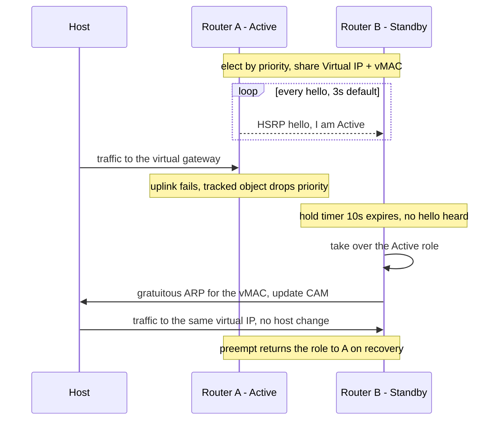
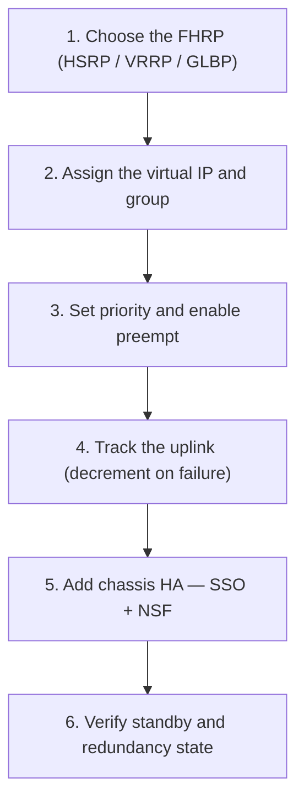
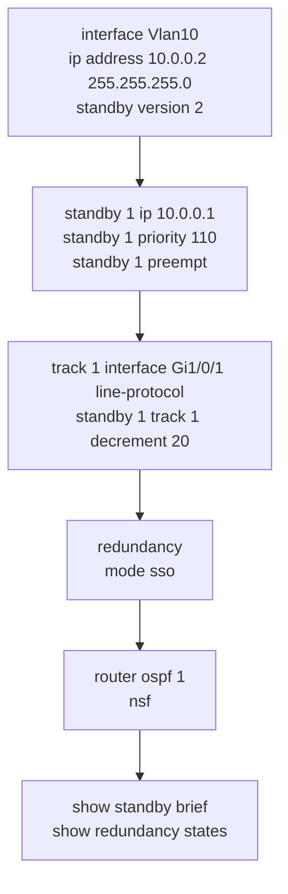

---
categories:
  - "[[Networking]]"
topic@networking:
  - "[[Networking General]]"
tags:
  - category/networking/networking_general
icon: FasNetworkWired
iconColor:
last_update:
aliases:
  - HA
---
High availability is about keeping the network forwarding through failures — removing single points of failure and recovering fast enough that users barely notice. The techniques fall into a few groups: plain redundancy of devices, links, and power; [[#First-Hop Redundancy Protocols|first-hop redundancy]] that protects the default gateway; [[#Switch Redundancy and Virtualization|switch virtualization]] that turns several boxes into one logical device; and [[#Supervisor and Control-Plane Redundancy|control-plane resilience]] that keeps a device forwarding while its brain fails over. This note works alongside [[Campus Design#Hierarchical Layers|Campus Design]] — high availability is what makes each layer of the hierarchy survivable rather than a single point of failure.

## Redundancy Fundamentals

_Remove single points of failure at every level, and accept that redundancy trades cost and complexity for uptime._

Redundancy is applied at each layer of the system, and the right amount is a design decision — full duplication everywhere is rarely worth its cost, so the goal is to protect the parts whose failure would isolate users or whole fault domains.

|Level|Redundancy technique|
|---|---|
|Device|Dual chassis or stack members|
|Supervisor / route processor|Dual supervisors with stateful switchover|
|Link|EtherChannel, dual uplinks|
|Path|Equal-cost multipath, multiple routed paths|
|Gateway|First-hop redundancy protocol, or anycast gateway|
|Power|Dual power supplies, redundant fans|

## First-Hop Redundancy Protocols

_Give endpoints a virtual default gateway shared by two or more routers, so the loss of a gateway is invisible to the hosts._

An endpoint has a single default-gateway address. If the router holding that address fails, every host on the subnet is stranded even though a second router may be sitting right beside it. A first-hop redundancy protocol (FHRP) solves this by presenting a virtual IP address and a virtual MAC that are backed by two or more routers: the hosts point at the virtual address, and the routers decide among themselves which one actually forwards.



### HSRP

Hot Standby Router Protocol, Cisco proprietary. One router is active and forwards for the virtual IP; another is standby and takes over if the active fails. The virtual MAC is 0000.0C07.ACxx, where xx is the group number. Version 1 supports groups 0–255 and uses multicast 224.0.0.2; version 2 supports groups 0–4095, uses 224.0.0.102, and adds IPv6 support. Both run over UDP 1985. Priority defaults to 100 and the higher priority wins the active role, but preemption is off by default, so a recovered router does not reclaim active unless preemption is enabled. Interface or object tracking can decrement priority when an uplink fails, handing the active role to the peer.

```
             Virtual IP 10.0.0.1  (virtual MAC 0000.0C07.ACxx)
        ┌───────────────────────┬───────────────────────┐
     Router A                Router B
   (Active, priority 110)   (Standby, priority 100)
        └───────────┬───────────┴───────────┬───────────┘
              hosts use default gateway 10.0.0.1
     Active forwards; Standby assumes the role if Active fails
```

### VRRP

Virtual Router Redundancy Protocol, an open standard. It works like HSRP — one master, one or more backups — but interoperates across vendors. The virtual MAC is 0000.5E00.01xx, it uses multicast 224.0.0.18 carried directly in IP protocol 112, and the router that owns the virtual IP as one of its real interface addresses is the address owner with a fixed priority of 255, making it master whenever it is up. Preemption is on by default, the opposite of HSRP.

### GLBP

Gateway Load Balancing Protocol, Cisco proprietary. Unlike HSRP and VRRP, GLBP lets all the routers forward at once. Each group elects one Active Virtual Gateway (AVG) that hands out a different virtual MAC to each of up to four Active Virtual Forwarders (AVF). When a host ARPs for the gateway, the AVG replies with one AVF's MAC — round-robin, weighted, or host-dependent — so different hosts send to different routers while sharing a single virtual IP. It uses multicast 224.0.0.102 over UDP 3222, with virtual MACs of the form 0007.B4xx.xxxx.

```
                 Virtual IP 10.0.0.1
     Host1 ─ARP→ AVG → "use AVF-1 MAC" → forwards via Router A
     Host2 ─ARP→ AVG → "use AVF-2 MAC" → forwards via Router B
          both routers forward simultaneously (load balancing)
```

### Choosing an FHRP

|Protocol|Standard|Model|Virtual MAC|Multicast / transport|Preempt default|
|---|---|---|---|---|---|
|HSRP|Cisco|Active/standby|0000.0C07.ACxx|224.0.0.2 (v1) / 224.0.0.102 (v2), UDP 1985|Off|
|VRRP|Open standard|Master/backup|0000.5E00.01xx|224.0.0.18, IP protocol 112|On|
|GLBP|Cisco|Active/active load balancing|0007.B4xx.xxxx|224.0.0.102, UDP 3222|Off|

> [!note] FHRP disappears inside an SD-Access fabric
> A fabric does not run HSRP, VRRP, or GLBP. The default gateway is the [[SD-Access#Anycast Gateway|anycast gateway]] — the same IP and MAC live on every edge node at once — so gateway redundancy is inherent rather than a protocol negotiating an active router.

## Switch Redundancy and Virtualization

_Making several physical switches behave as one logical device removes the need for spanning tree or an FHRP between them._

### StackWise

Access-layer stacking. Several switches are joined by dedicated stack cables into a single logical switch with one control plane, one configuration, and one management IP. Ports across all members forward as if they were one chassis, and losing a member does not bring down the stack.

### StackWise Virtual and VSS

The same idea for distribution and core chassis. Two chassis are combined into one logical switch: the Virtual Switching System (VSS) on older Catalyst 6500 and 4500 platforms, and StackWise Virtual on Catalyst 9000, joined over a StackWise Virtual Link (VSL on VSS). Downstream devices see a single switch, and both chassis forward.

### Multichassis EtherChannel (MEC)

Because the pair is one logical switch, an EtherChannel can be split across both members. A downstream switch dual-homes into what it believes is a single device, so both uplinks forward with no spanning-tree-blocked link and no first-hop redundancy protocol required between the two chassis. This is the main payoff of switch virtualization: loop-free, active-active dual-homing with faster convergence than spanning tree.

```
        ┌─── StackWise Virtual: 2 chassis = 1 logical switch ───┐
        │   Chassis-1  ═══════ SVL ═══════  Chassis-2            │
        └────────┬─────────────────────────────┬────────────────┘
                  ╲          Multichassis      ╱
                   ╲         EtherChannel     ╱
                    ╲                        ╱
                     Access switch (one switch, both links active)
```

## Supervisor and Control-Plane Redundancy

_Keeping a device forwarding when its route processor or supervisor fails over to a backup._

### Stateful Switchover (SSO)

A chassis with two supervisors runs one active and one hot standby, continuously synchronizing state — including Layer 2 and forwarding information — to the standby. If the active supervisor fails, the standby takes over with that state intact, so Layer 2 traffic is not disrupted and the switchover is sub-second.

### Nonstop Forwarding (NSF)

NSF runs together with [[#Stateful Switchover (SSO)|SSO]]. During a supervisor switchover the routing protocols must re-establish, which normally takes time; NSF keeps forwarding along the existing hardware forwarding table during that window so no traffic is dropped and neighbors see no routing flap. It depends on [[#Graceful Restart|graceful restart]] — the neighbors must be NSF-aware to hold the adjacency while the control plane recovers.

### Nonstop Routing (NSR)

NSR keeps the routing-protocol state itself synchronized on the standby supervisor, so after a switchover the protocols simply continue and the event is invisible to neighbors. Unlike NSF, it needs no cooperation from neighbors — at the cost of maintaining more state internally.

### Graceful Restart

The protocol extension that NSF relies on. A restarting router signals its neighbors that it is restarting; NSF-aware neighbors keep the routes and keep forwarding for a grace period instead of tearing the adjacency down. It is the mechanism that lets a control-plane restart happen without a network-wide reconvergence.

|Feature|What it preserves|Neighbor dependency|
|---|---|---|
|SSO|Supervisor state — Layer 2 and forwarding — across a switchover|None (within the chassis)|
|NSF|Data-plane forwarding while the control plane recovers|Neighbors must be NSF-aware (graceful restart)|
|NSR|Routing-protocol state on the standby supervisor|None — switchover is invisible to neighbors|

## Link and Path Redundancy

_Beneath the gateway, bundled links and multiple routed paths keep traffic moving when a link or path fails._

EtherChannel bundles several physical links into one logical link, negotiated with LACP (open standard) or PAgP (Cisco). It survives the loss of a member, load-balances across the members, and — combined with [[#Multichassis EtherChannel (MEC)|MEC]] — removes spanning-tree-blocked links entirely. At Layer 3, equal-cost multipath forwards across several routed paths at once, and Bidirectional Forwarding Detection with tuned timers detects a failed path in milliseconds so routing reconverges quickly.

## Where HA Fits in the Hierarchy

_Each layer of the campus uses the redundancy technique that suits its role._

At the [[Campus Design#Access Layer|access layer]], switches are stacked with StackWise, endpoints get dual uplinks, and power is duplicated. At the [[Campus Design#Distribution Layer|distribution layer]], a first-hop redundancy protocol protects the gateway for [[Campus Design#Layer 2 Access|Layer 2 access]], while StackWise Virtual or VSS with MEC provides loop-free dual-homing and SSO with NSF protects the chassis control plane. The core uses redundant nodes, equal-cost paths, and the same chassis-level protection. In an SD-Access fabric these roles still exist, but gateway redundancy shifts to the anycast gateway and the control plane to LISP, so the fabric achieves the same resilience by different means.

## Configuration

_Give the hosts a redundant gateway with an FHRP, track the uplink so the role follows the working path, then add chassis-level SSO and NSF._

### High-Level Workflow



### CLI Companion

_HSRP version 2 with interface tracking, plus SSO/NSF (Cisco IOS-XE)._


