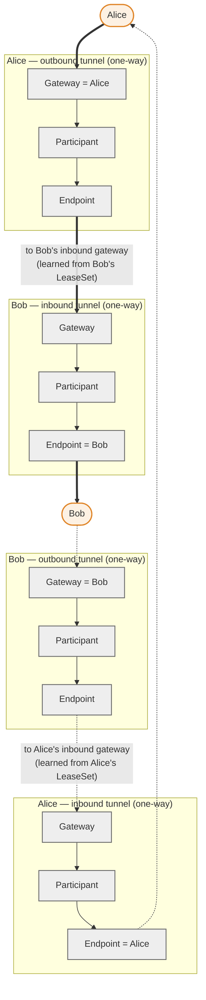
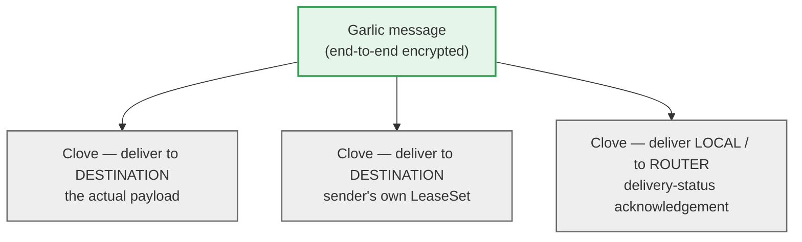

---
categories:
  - "[[Privacy]]"
  - "[[Networking]]"
topic@privacy: "[[Privacy General]]"
tags:
  - claude
  - category/networking
  - category/privacy/privacy_general
icon: FasNetworkWired
iconColor: "#003791"
last_update: 2026-07-15
aliases:
  - Invisible Internet Project
  - I2P
---
The <strong>Invisible Internet Project</strong> (I2P) is an anonymous overlay network: a message-oriented, packet-switched layer that runs on top of the ordinary Internet and hides who is talking to whom. It is fully distributed and self-organising — there are no central servers or directory authorities — and every participant is also a relay that carries traffic for others. Unlike a general-purpose proxy, I2P is designed first for anonymous services that live entirely inside the network (its own sites, chat, file sharing and mail), rather than for anonymising access to the ordinary web.

Communication is protected by [[#Garlic Routing|garlic routing]], a variant of onion routing, carried over short-lived one-way [[#Tunnels|tunnels]]. Peers locate one another through a distributed [[#Network Database|network database]] rather than a central index. The result is closer in spirit to a peer-to-peer mesh than to the client–relay model used by [[#Comparison with Tor|Tor]].

## Design Goals and Threat Model

I2P aims to let two parties exchange data without either the network or an external observer being able to link the sender to the receiver. Anonymity is achieved through a mix of layered encryption, indirection (traffic never travels directly from source to destination), and the fact that every router both originates and relays traffic, so participating in the network is itself cover.

The design favours a few specific properties. It is decentralised, avoiding the trusted directory servers that a global adversary could subpoena or attack. It is packet-switched rather than circuit-switched, so a single logical conversation can be spread across many peers and paths and can survive individual peers failing. And it treats mutual anonymity as the norm: both ends of a conversation are typically anonymous, which suits internal services better than the client-anonymous-only model of a browsing proxy.

### Anonymity Model

The unit of anonymity is the [[#Destinations|destination]], a cryptographic identity that is deliberately not tied to an IP address. Messages are addressed to a destination, and the network resolves that destination to a set of current entry points without revealing the router that hosts it. Because tunnels are one-directional and rebuilt frequently, and because unrelated messages are bundled together, an observer who sees part of a path learns very little about the whole.

I2P defends against a partial adversary — one who controls some routers, watches some links, or runs some services — rather than a global passive adversary who can observe every link simultaneously. Within that model it raises the cost of deanonymisation by spreading trust across many independently operated routers and by rotating the paths traffic takes.

### Limits of the Threat Model

I2P does not claim to defeat an attacker who can observe the entire network at once; end-to-end timing correlation remains possible in principle for such an adversary, as it does for most low-latency anonymity systems. It also does not, by itself, anonymise the ordinary Internet: reaching a normal website requires an [[#Outproxies|outproxy]], and that outproxy sees the exiting traffic much as a Tor exit node does. Anonymity can also be undermined above the network layer — by application data that leaks an identity, by correlating activity across sessions, or by an attacker who can position enough malicious routers around a target (see [[#Attacks and Limitations|attacks and limitations]]).

## Network Architecture

Every I2P node runs a router: the software component that maintains the node's identity, builds and manages tunnels, participates in the network database, and speaks the low-level [[#Transport Layer|transport]] protocols to its neighbours. By default a router also volunteers to relay traffic for other participants, so the network is a mesh in which the roles of client and infrastructure are not separated — the same routers that carry your traffic are carrying everyone else's.

Traffic never flows straight from one party to another. Each router builds one-way tunnels: outbound tunnels for sending and inbound tunnels for receiving. To hold a two-way conversation, a sender pushes a message out through one of its own outbound tunnels to one of the recipient's inbound tunnels; the reply travels the mirror image, out through the recipient's outbound tunnel to the sender's inbound tunnel. Four independent tunnels are therefore involved in a single exchange, and no single tunnel ever carries traffic in both directions.

The sender learns where to deliver a message from the recipient's [[#Leases and LeaseSets|LeaseSet]], which lists the current inbound tunnel gateways for that destination. Everything a router needs to take part — how to reach other routers, and how to reach destinations — is published in and retrieved from the network database.

## Cryptographic Identities

I2P has two kinds of identity, and almost everything else is built on them. Routers are identified by a router identity and described by a [[#Router Identity and RouterInfo|RouterInfo]]; endpoints of communication are identified by a destination and reached through a LeaseSet. Both kinds of record are self-authenticating: each carries public keys and is signed by the corresponding private key, so any router can verify a record without a trusted third party.

### Router Identity and RouterInfo

A router identity is the permanent cryptographic identity of a router: a public encryption key, a public signing key, and a certificate describing the key types. Its hash serves as the router's address inside the network.

The RouterInfo is the published record built around that identity. It contains the router identity, the transport addresses at which the router can be contacted (IP, port and options for each supported transport), a set of published options and statistics, a timestamp, and a signature. RouterInfos are distributed through the network database so that any router can discover how to open a connection to any other. Capability flags in the RouterInfo advertise properties such as reachability, bandwidth tier, and whether the router acts as a [[#Floodfill Routers|floodfill]].

### Destinations

A destination is the cryptographic identity of an endpoint — the thing a client actually addresses. Like a router identity it consists of a public encryption key, a public signing key and a certificate, but it deliberately carries no network location: a destination says who, never where. This separation is what lets a service move between routers, or hide the router hosting it, without changing its address.

Because a full destination is a few hundred bytes of key material, it is rarely typed by hand. Its hash, encoded as a [[#Base32 Addresses|Base32]] string, gives the compact machine-readable address, while human-friendly names are handled separately through [[#Address Books and Subscriptions|address books]].

### Leases and LeaseSets

A lease is a single, time-limited pointer to one way in to a destination. It names an inbound tunnel gateway (by router hash), the tunnel identifier to use at that gateway, and an expiry time. Because tunnels are short-lived, leases expire quickly and are continually replaced.

A LeaseSet gathers the current leases for a destination together with the destination's public keys, all signed by the destination. It is the record a sender needs in order to deliver anything: it reveals the current entry points without revealing the router that ultimately hosts the service. LeaseSets are looked up from the network database just as RouterInfos are. Publicly reachable services publish their LeaseSet openly; private services can instead use encrypted or blinded LeaseSets, so that only clients who already know a secret can resolve and decrypt the entry points, keeping the very existence of the service hidden from the wider network.

## Tunnels

A tunnel is a one-way path through a fixed sequence of routers, and it is the fundamental mechanism by which I2P separates a message's origin from its destination. The router that creates a tunnel chooses its members and layers encryption so that each hop can peel off only its own layer, learning nothing but the previous and next hop. No router in the middle of a tunnel knows the tunnel's full length, its position within it, or the identities of the endpoints.

### Inbound and Outbound Tunnels

Each router maintains two kinds of tunnel. Outbound tunnels carry messages away from the creating router toward the rest of the network. Inbound tunnels carry messages from the network back to the creating router. Neither kind is reversible; a message travelling to a peer and its reply use different tunnels, and typically entirely different sets of routers.

This one-directional design is a defining choice of I2P. It means the path a request takes is unrelated to the path its response takes, which denies an observer of one direction any easy knowledge of the other, at the cost of requiring twice as many tunnels as a two-way circuit would.

### Tunnel Roles

Within any single tunnel, a router plays one of three roles. The [[#Tunnel Building|tunnel's creator]] occupies the endpoint role for its own inbound tunnels and the gateway role for its own outbound tunnels; every other member is a participant.

#### Gateway

The gateway is the first router of a tunnel — the point at which messages enter it. For an outbound tunnel the gateway is the creator itself, which injects its own messages. For an inbound tunnel the gateway is a remote router, published in the destination's leases, to which other parties send messages destined for the owner.

#### Participant

A participant is an intermediate hop. It receives an encrypted message from its predecessor, removes one layer of tunnel encryption, and forwards the result to its successor. A participant knows only those two neighbours and cannot read the payload, distinguish this tunnel's traffic from any other tunnel it carries, or tell whether its predecessor is the true origin.

#### Endpoint

The endpoint is the last router of a tunnel — the point at which messages leave it. For an inbound tunnel the endpoint is the creator, where messages finally arrive and are reassembled. For an outbound tunnel the endpoint is the final remote hop, which forwards the emerging message on toward its target, usually the gateway of the recipient's inbound tunnel.

### Tunnel Pools

A client does not rely on a single tunnel. Each destination maintains a tunnel pool — a group of inbound and outbound tunnels kept ready at all times — from which individual messages are assigned. Pools are configured per client with a target length, a quantity of active tunnels, and optional backup tunnels, letting an operator trade latency and overhead against anonymity and reliability. A separate pool of exploratory tunnels, owned by the router rather than any client, is used for the router's own housekeeping such as building further tunnels and querying the network database; these are usually shorter than client tunnels.

### Tunnel Building

To build a tunnel, the creator selects a sequence of peers and sends a build request that travels the proposed path, offering each candidate an encrypted record that only it can read. Each hop learns only its neighbours and the tunnel identifiers it must use, then accepts or declines. Peer selection is not random: the reference implementation continuously profiles the routers it interacts with, ranking them by measured speed and capacity, and draws client-tunnel hops from the better-performing tiers while still spreading selection widely enough to resist manipulation.

The build request itself is protected by the network's public-key [[#Public-Key Encryption|encryption]] so that an outside observer cannot read the tunnel's membership. Modern I2P uses compact, variable-length build messages so that intermediate routers cannot infer a tunnel's length from the size of the build request.

### Tunnel Lifetime and Rebuilding

Tunnels are deliberately short-lived: a tunnel expires roughly ten minutes after it is built. Before a tunnel expires the owner builds a replacement, so the pool stays populated and traffic migrates onto fresh paths continuously. Frequent rebuilding limits how long any observed path stays valid and continually reshuffles which routers carry a given client's traffic, shrinking the window available for analysis of any single route.

## Garlic Routing

Garlic routing is I2P's end-to-end encryption technique and its variation on onion routing. The name reflects the central idea: rather than wrapping and forwarding a single message, a sender can bundle several messages together — like the cloves of a bulb of garlic — inside one encrypted package, each clove with its own instructions. This bundling both encrypts the payload end to end, on top of the per-hop encryption that tunnels already provide, and lets a sender attach related items to a message without extra round trips.

### Cloves and Garlic Messages

A garlic message is an encrypted container holding one or more cloves. Each clove carries a payload plus delivery instructions that say what to do with it — deliver it to the local router, forward it to a named router, or forward it to a destination — and, optionally, timing and delay information. The recipient decrypts the container, reads each clove's instructions, and acts on them independently.

This structure is used constantly. A client sending data to a service it has not spoken to recently can bundle its own LeaseSet alongside the payload, so the service can reply without a separate lookup; it can include a delivery-status clove routed back through an inbound tunnel to confirm arrival; and it can pad or combine messages to blur traffic patterns.

### End-to-End Encryption

Garlic routing establishes a layer of encryption between the two destinations that no intermediate router shares. Tunnel encryption protects each hop and is stripped away as a message moves along a tunnel; garlic encryption sits above it and can only be removed by the intended recipient. The two layers are independent, so even a router that sits on both a sender's outbound tunnel and a recipient's inbound tunnel sees only ciphertext it cannot associate with either identity. The algorithms that implement this layer are described under public-key encryption.

## Network Database

The network database, usually abbreviated NetDb, is the distributed directory through which routers publish and discover the two kinds of [[#Cryptographic Identities|identity record]]. It replaces the central directory servers of other systems with a self-organising store spread across the participating routers, so there is no single index to seize or block.

### Stored Records

The NetDb holds exactly two record types. A RouterInfo tells a router how to contact another router. A LeaseSet tells a client how to reach a destination. Both are signed by their owners, so any router can validate a record it receives and reject forgeries without consulting anyone.

### Floodfill Routers

Not every router stores the whole database. A subset, the floodfill routers, form the backbone of the NetDb: they hold the records, answer lookups, and flood newly received records among themselves so that the store stays consistent. A router becomes a floodfill automatically when it has spare capacity and good reachability, or can be configured to act as one, which keeps the set large, diverse and independently operated rather than fixed and central.

### Storage and Lookups

The floodfills organise records using a distributed hash table based on the Kademlia design. Each record is placed at the floodfills whose identifiers are closest, under an XOR distance metric, to the record's routing key. To publish, an owner stores its record at the appropriate floodfills; to resolve an identity, a router queries the floodfills near the target key and follows their responses toward the answer, using its [[#Tunnel Pools|exploratory tunnels]] so that the lookup itself does not reveal who is asking.

The routing key is not the bare hash of the record but the hash combined with the current date, so it changes at the start of each day. Rotating the keyspace daily means the floodfills responsible for a given record move over time, which frustrates an attacker who would otherwise position routers permanently around a chosen key to control or observe its lookups.

### Reseeding

A brand-new router starts with an empty NetDb and no way to build tunnels, because it knows no peers. Reseeding solves this bootstrap problem: the router fetches an initial bundle of RouterInfos from a set of reseed servers over HTTPS, giving it enough peers to begin ordinary [[#Storage and Lookups|lookups]] and tunnel building. After this first contact the router discovers further peers organically and no longer depends on the reseed servers, which matter only at first start or after a long time offline.

## Transport Layer

Beneath tunnels and garlic routing, routers still need to move bytes between neighbouring machines across the ordinary Internet. The transport layer provides these point-to-point links, each independently encrypted and authenticated so that the connection between two routers reveals nothing to a network observer beyond the fact that two I2P routers are connected. This link encryption is separate from, and additional to, the tunnel and garlic layers above it. I2P uses two transports, and a router will generally offer both.

### NTCP2

NTCP2 is the TCP-based transport. It carries router traffic over long-lived TCP connections and secures them with a handshake built on the Noise protocol framework, providing forward-secret encryption and authentication of the router identity. NTCP2 is also designed to resist traffic analysis and deep packet inspection: its framing is obfuscated and padded so that an on-path observer cannot easily fingerprint I2P by the shape of its packets. It replaced the earlier NTCP transport.

### SSU and SSU2

SSU (Secure Semi-reliable UDP) is the UDP-based transport. In addition to carrying router traffic, it provides services that a UDP transport is well placed to offer: NAT traversal so that firewalled routers can still connect, peer testing to let a router discover whether it is externally reachable, and detection of the router's own external address. SSU2 is the modernised successor, rebuilt on the same Noise-based cryptography used by [[#NTCP2|NTCP2]] while keeping SSU's connectivity and reachability-testing functions. Offering both a TCP and a UDP transport lets routers connect under a wide range of network conditions.

## Cryptographic Primitives

I2P combines public-key encryption, digital signatures, and symmetric ciphers and hashing. The network has been migrating for years from an older primitive set toward modern elliptic-curve cryptography, and both the router identity and each destination carry a certificate that names the key types in use, so different algorithms can coexist during the transition.

### Public-Key Encryption

Public-key encryption protects the [[#End-to-End Encryption|end-to-end garlic layer]] and the tunnel build records. Current I2P uses an elliptic-curve scheme based on X25519, wrapped in an authenticated construction that adds a ratchet: session keys evolve as messages are exchanged, giving forward secrecy and limiting the damage from any single key compromise. The legacy scheme it replaces was ElGamal over a large prime-field group, which is slower, larger, and lacks the ratchet's forward secrecy; new installations use the elliptic-curve scheme by default.

### Signatures

Signatures authenticate every published record — RouterInfos, LeaseSets and the identities themselves — so that recipients can trust a record without a certificate authority. The current default is Ed25519, an elliptic-curve signature scheme that is fast and produces compact keys and signatures. It supersedes the original DSA-based signatures, which used weaker parameters and a now-dated hash; the certificate in each identity records which scheme applies.

### Symmetric Ciphers and Hashing

Bulk data inside tunnels and sessions is encrypted with symmetric ciphers keyed by the public-key exchanges above — historically AES, with modern authenticated constructions used alongside the elliptic-curve migration. Hashing throughout the protocol, including the router and destination hashes that become network addresses and NetDb routing keys, uses SHA-256. The separate link encryption performed by the transports uses the Noise framework rather than these primitives directly.

## Addressing and Naming

Because a full destination is unwieldy and I2P has no global name authority, addressing works on two levels: a compact cryptographic address that is always valid, and optional human-readable names resolved locally.

### Base32 Addresses

The canonical machine address of a destination is the SHA-256 hash of that destination, encoded in Base32 and suffixed with `.b32.i2p`. This yields a fixed-length string that any router can verify against the destination it eventually retrieves, since the address is simply the destination's hash. Base32 addresses are self-authenticating and need no registration, which makes them the reliable way to refer to a service even though they are not memorable.

### Address Books and Subscriptions

Friendly names ending in `.i2p`, such as a site called `stats.i2p`, are not resolved by any global DNS. Instead each router keeps a local address book — a mapping from names to destinations — that the user controls. Address books are kept current through subscriptions to hosts lists published within the network; the router periodically fetches these lists and merges new entries. Because naming is local and populated from chosen registries on a first-come basis, a name means only what a given router's address book says it means, with no central authority to arbitrate.

### Jump Services

When a user follows a `.i2p` name that is not yet in their address book, a jump service bridges the gap. The jump service holds a large set of name-to-destination mappings and, on request, returns the destination for the requested name and offers to add it to the local address book. This provides an on-demand alternative to waiting for subscription updates, while leaving the decision to trust and store a mapping with the user.

## Applications and Services

Applications do not speak the tunnel protocols directly. They connect to the local router through a client protocol and higher-level libraries, and the router handles identities, tunnels and garlic routing on their behalf. This lets ordinary software use I2P as a transport with little modification.

### I2CP and the Client Libraries

The I2P Client Protocol (I2CP) is the interface between an application and its local router. Through I2CP an application opens a session, is assigned or supplied with a destination, and hands the router messages to send and receives messages addressed to it; the router manages that destination's tunnel pool and LeaseSet transparently. I2CP exposes a message interface, and most applications use one of two libraries layered on top of it rather than sending raw messages.

#### Streaming Library

The streaming library provides reliable, ordered, connection-oriented transport over I2P's underlying messages — the equivalent of TCP for the anonymous network. It handles sequencing, acknowledgement, retransmission and flow control, so that applications expecting a stream, such as web or shell traffic, work over I2P without implementing those mechanisms themselves.

#### Datagram Library

The datagram library provides message-oriented delivery — the equivalent of UDP — for applications that prefer discrete, independent messages to a stream. It offers both authenticated datagrams, which carry the sender's destination so the receiver can reply and verify origin, and unauthenticated ones for cases where neither is needed.

### I2PTunnel

I2PTunnel is the built-in application that carries ordinary TCP (and UDP) traffic across I2P using the [[#Streaming Library|streaming]] and datagram libraries. A client tunnel exposes a local port that forwards to a destination inside the network — this is how the HTTP proxy, IRC access and similar clients are configured. A server tunnel does the reverse, exposing a service running on the local machine to the network under its own destination, which is how most services, including [[#Eepsites|eepsites]], are published. I2PTunnel is what lets unmodified software reach and offer I2P services.

### Eepsites

An eepsite is a website hosted inside I2P and reachable only through it. The operator runs an ordinary web server and exposes it with an [[#I2PTunnel|I2PTunnel]] server tunnel, giving the site a destination and a `.i2p` address; visitors reach it by pointing their browser at the router's HTTP proxy, conventionally on `127.0.0.1:4444`, which resolves the address and routes the request through tunnels. Both the visitor and the server can remain anonymous, since neither the site's LeaseSet nor the request reveals the hosting router.

### SAM and BOB

Because the reference router is written in Java, external and non-Java applications need a language-neutral way to reach it. SAM (Simple Anonymous Messaging) and BOB (Basic Open Bridge) are bridge protocols that expose I2P's session, streaming and datagram capabilities over a simple local socket interface, so that programs in any language can create a destination and exchange traffic without linking against the Java libraries or speaking [[#I2CP and the Client Libraries|I2CP]] directly. SAM, in its current version, is the more widely used of the two.

### Outproxies

I2P is built for services that live inside the network, so reaching the ordinary Internet is a secondary function handled by outproxies. An outproxy is a volunteer-run gateway that accepts requests from inside I2P and relays them to the clearnet, returning the responses — the counterpart to an exit relay in other systems. Outproxies are comparatively few, apply chiefly to web protocols, and represent a weaker point in the trust chain, since the outproxy observes the exiting traffic in the clear; anonymity toward the outside site therefore depends on both the network and the chosen outproxy.

### Bundled Applications

The reference distribution ships with a set of ready-to-use applications so that a fresh install is immediately useful. These typically include a BitTorrent client that operates entirely within I2P, a web mail client, an address book manager with subscription handling, and the pre-configured HTTP proxy and I2PTunnel instances — all reachable from the router console, the local web interface conventionally served on `127.0.0.1:7657`. Additional services such as anonymous IRC and Git access run over the same tunnel and streaming machinery.

## Implementations

I2P is a protocol with more than one interoperable implementation. The two run on the same network and speak the same wire protocols, so a router of either kind can build tunnels through, and communicate with, routers of the other.

### I2P (Java)

The Java implementation is the original and reference implementation of the protocol. It bundles the router with a web-based router console for monitoring and configuration and with the standard [[#Bundled Applications|applications]] — the proxy, mail, torrent and address-book tools — making it a self-contained package aimed at end users on desktops.

### i2pd (C++)

i2pd is an independent implementation written in C++. It is lighter on resources and ships as a bare router without the bundled end-user applications by default, which makes it well suited to servers, embedded devices, and hosting services, or to being embedded in other software. It implements the same protocol and interfaces, so it participates in the network on equal terms with the Java router.

## Comparison with Tor

I2P and Tor pursue overlapping goals with different architectures, and the contrast is the quickest way to place I2P for a reader who already knows Tor. Tor uses onion routing over bidirectional circuits and relies on a small set of trusted directory authorities to publish the list of relays; it is optimised for anonymous access to the ordinary web through exit relays, and its large network keeps latency relatively low. I2P uses garlic routing over one-way tunnels, distributes directory information through the decentralised network database instead of authorities, and is optimised for anonymous services that live inside the network.

Several concepts map across with caveats. A Tor circuit corresponds roughly to a pair of I2P tunnels, but I2P separates the two directions into independent paths. A Tor relay corresponds to an I2P router, except that in I2P nearly every client is also a relay by default, whereas Tor distinguishes clients from relays. Tor's directory authorities correspond in function to I2P's floodfill routers, but the floodfills are numerous and self-selected rather than few and fixed. Tor's onion services correspond to I2P's eepsites and other internal services, which are I2P's primary use case rather than an addition. The practical trade-off is that Tor offers a larger network and a more developed exit ecosystem for reaching the clearnet, while I2P offers a fully distributed design with no directory authorities and a model built around mutual anonymity and internal services.

## Attacks and Limitations

I2P's guarantees hold against a partial adversary, and understanding where they weaken is part of using it correctly. Because low-latency anonymity systems do not delay traffic enough to hide timing, an adversary who can observe both ends of a conversation may correlate them by timing and volume; one-way tunnels and garlic bundling raise the cost of this but do not eliminate it against a sufficiently global observer.

The network is also a target for structural attacks. In a Sybil attack an adversary introduces many malicious [[#Network Architecture|routers]] to gain influence over tunnels or the database; I2P resists this through peer profiling that favours proven routers and through the diversity of the floodfill set. In an eclipse attack an adversary tries to surround a particular target or database key with routers it controls in order to isolate or observe it; the daily rotation of the NetDb routing key moves responsibility for each key over time and undercuts attempts to hold a fixed position. Predecessor and intersection attacks, which try to infer an originator by watching which routers recur across many observed paths or which peers are consistently online when a service is, are met by frequent [[#Tunnel Lifetime and Rebuilding|tunnel rebuilding]] and wide peer selection, again as mitigations rather than cures.

Beyond deliberate attacks there are plain limitations. I2P is not intended for anonymous general web browsing and provides only a limited outproxy path to the clearnet, so an outbound gateway sees exiting traffic much as a Tor exit does. The network is smaller than Tor's, and its indirection and multiple hops add latency compared with the direct Internet. Anonymity can still be lost above the network — through identifying data leaked by an application, through behaviour correlated across sessions, or through operational mistakes — so the network layer protects the path, not everything a user does over it.