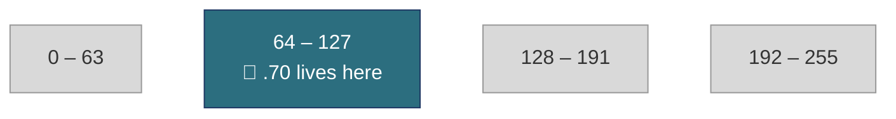
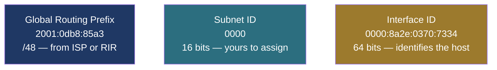
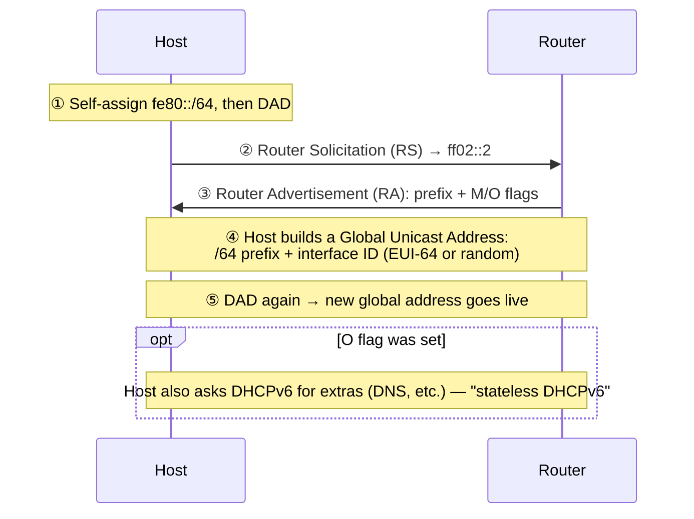

---
tags:
  - networking
  - ipv4
  - ipv6
  - subnetting
  - slaac
  - reference
created: 2026-07-10
---
## Part 1 — IPv4 Subnetting Fluency

### 1.1 The Building Blocks

An IPv4 address is 32 bits, almost always written as four decimal numbers ("octets") separated by dots, each ranging 0–255. Fluency starts with knowing the eight binary place values of a single octet cold:

`128   64   32   16   8   4   2   1`

Every octet is some combination of these switched on or off. 192, for instance, is 128 + 64 — the top two bits on, the rest off. That single fact is the entire basis of the "magic number" shortcut in 1.4.

For context, classful addressing assigned a fixed mask by the value of the first octet:

- **Class A** (1–126): default mask `/8`
- **Class B** (128–191): default mask `/16`
- **Class C** (192–223): default mask `/24`

Classful addressing hasn't been how the internet actually routes traffic since the early 1990s — everything today is classless (CIDR) — but the ranges are still worth recognizing, since vendor defaults, ACL shorthand, and older material still reference them.

### 1.2 Subnet Masks and CIDR Notation

A subnet mask marks which bits of an address are "network" bits (shared by every host on the subnet) and which are "host" bits (unique to one device). CIDR notation writes this as a slash and a number — `/24`, `/26`, `/30` — meaning "this many leading bits are network bits." The rest is the host portion, and how many bits are left over determines how many addresses fit in the block.

`/24` → `255.255.255.0`

Both notations describe the exact same 24-network-bit / 8-host-bit split — CIDR is just shorter to write and, unlike the old class system, works at any bit boundary. That flexibility is the entire reason subnetting is useful: it lets one address block be carved into pieces sized to actual need instead of being stuck at 8-bit boundaries. VLSM (1.6) puts this to work directly.

### 1.3 The Core Formulas

Let *n* = prefix length.

- **Total addresses in a block** = $2^{(32-n)}$
- **Usable host addresses** = $2^{(32-n)} - 2$ (subtract the network address and the broadcast address)
- **Network address** = the IP address with every host bit set to `0`
- **Broadcast address** = the IP address with every host bit set to `1`
- **Subnets created by borrowing *b* bits** = $2^{b}$

> [!warning] Edge cases
> RFC 3021 makes `/31` legal on point-to-point links — both addresses are usable and there is no network or broadcast address. `/32` identifies a single host route (one address, nothing to subtract).

### 1.4 The Fluency Shortcut: The Magic Number Method

This is the calculation experienced network engineers do in their head in a few seconds, with no binary written down anywhere.

1. Find the "interesting octet" — the one octet in the subnet mask that isn't 255 or 0.
2. Subtract that octet's mask value from 256. That's your **magic number**: the size of each block, and the distance from one network address to the next.
3. Count up by the magic number from 0 until you find the two multiples your address falls between. The lower multiple is the network address; one less than the upper multiple is the broadcast address.

*192.168.10.0/24 divided into four /26 blocks — magic number = 64*

> [!example]+ Worked example — 192.168.10.70/26
> `/26` = `255.255.255.192`, so the interesting octet is the fourth one, where the mask value is 192. Magic number = 256 − 192 = **64**. Counting up by 64 gives 0, 64, 128, 192 — seventy falls between 64 and 128, so:
> - **Network address:** `192.168.10.64`
> - **Broadcast address:** `192.168.10.127`
> - **Usable hosts:** `.65` – `.126`

### 1.5 Another Worked Example — 10.15.200.5/20

1. `/20` = `255.255.240.0`, so the interesting octet is the third one, mask value 240.
2. Magic number = 256 − 240 = 16.
3. Blocks of 16 in the third octet: …, 176, 192, 208, 224… — 200 falls between 192 and 208.

> [!example]+ Answer
> **Network:** `10.15.192.0` **Broadcast:** `10.15.207.255` **Usable:** `10.15.192.1` – `10.15.207.254`
> Notice the fourth octet resets to a full 0–255 range — once the interesting octet is decided, every octet after it is entirely host bits.

### 1.6 VLSM — Subnetting to Fit

Variable-Length Subnet Masking means not every subnet carved from a block has to be the same size. Instead of picking one prefix and stamping out identical subnets — wasting addresses on the small ones and possibly running out for the large ones — VLSM sizes each subnet to what it actually needs.

**Scenario:** you're given `172.16.0.0/16` and asked to provide for four groups — Sales (100 hosts), Engineering (50 hosts), Guest Wi-Fi (20 hosts), and a router-to-router WAN link (2 hosts).

1. Convert each requirement to the smallest prefix that covers it, using the host formula in reverse.
2. Sort the list largest to smallest.
3. Allocate sequentially, starting each new subnet immediately after the previous one's broadcast address.

| Group | Hosts Needed | Prefix | Network Address | Broadcast Address | Usable Range |
|---|---|---|---|---|---|
| Sales | 100 | `/25` | `172.16.0.0` | `172.16.0.127` | `.1` – `.126` |
| Engineering | 50 | `/26` | `172.16.0.128` | `172.16.0.191` | `.129` – `.190` |
| Guest Wi-Fi | 20 | `/27` | `172.16.0.192` | `172.16.0.223` | `.193` – `.222` |
| WAN Link | 2 | `/30` | `172.16.0.224` | `172.16.0.227` | `.225` – `.226` |

Notice the order: largest block first (Sales, /25) so it can start on a clean boundary, then progressively smaller ones slotted into the gaps. Everything from `172.16.0.228` through `172.16.255.255` is still untouched and available for whatever comes next — which is the entire point of sizing subnets instead of defaulting to one fixed prefix everywhere.

### 1.7 CIDR Quick-Reference Table

Keep this nearby until the magic numbers are second nature.

| Prefix | Subnet Mask | Total Addresses | Usable Hosts | Magic Number |
|---|---|---|---|---|
| /8 | `255.0.0.0` | 16,777,216 | 16,777,214 | 1 |
| /9 | `255.128.0.0` | 8,388,608 | 8,388,606 | 128 |
| /10 | `255.192.0.0` | 4,194,304 | 4,194,302 | 64 |
| /11 | `255.224.0.0` | 2,097,152 | 2,097,150 | 32 |
| /12 | `255.240.0.0` | 1,048,576 | 1,048,574 | 16 |
| /13 | `255.248.0.0` | 524,288 | 524,286 | 8 |
| /14 | `255.252.0.0` | 262,144 | 262,142 | 4 |
| /15 | `255.254.0.0` | 131,072 | 131,070 | 2 |
| /16 | `255.255.0.0` | 65,536 | 65,534 | 1 |
| /17 | `255.255.128.0` | 32,768 | 32,766 | 128 |
| /18 | `255.255.192.0` | 16,384 | 16,382 | 64 |
| /19 | `255.255.224.0` | 8,192 | 8,190 | 32 |
| /20 | `255.255.240.0` | 4,096 | 4,094 | 16 |
| /21 | `255.255.248.0` | 2,048 | 2,046 | 8 |
| /22 | `255.255.252.0` | 1,024 | 1,022 | 4 |
| /23 | `255.255.254.0` | 512 | 510 | 2 |
| /24 | `255.255.255.0` | 256 | 254 | 1 |
| /25 | `255.255.255.128` | 128 | 126 | 128 |
| /26 | `255.255.255.192` | 64 | 62 | 64 |
| /27 | `255.255.255.224` | 32 | 30 | 32 |
| /28 | `255.255.255.240` | 16 | 14 | 16 |
| /29 | `255.255.255.248` | 8 | 6 | 8 |
| /30 | `255.255.255.252` | 4 | 2 | 4 |
| /31 | `255.255.255.254` | 2 | 0 (2 for P2P) | 2 |
| /32 | `255.255.255.255` | 1 | 0 (host route) | 1 |

### 1.8 Practice Problems

Work each one with the magic-number method from 1.4, then check your answer against the last three columns.

| Address / Prefix | Network Address | Broadcast Address | Usable Range |
|---|---|---|---|
| `192.168.1.130/25` | `192.168.1.128` | `192.168.1.255` | `.129` – `.254` |
| `172.20.50.10/22` | `172.20.48.0` | `172.20.51.255` | `172.20.48.1` – `172.20.51.254` |
| `10.4.4.4/30` | `10.4.4.4` | `10.4.4.7` | `10.4.4.5` – `10.4.4.6` |
| `192.168.100.200/27` | `192.168.100.192` | `192.168.100.223` | `.193` – `.222` |

---

## Part 2 — IPv6 Addressing

### 2.1 Address Format & Compression

IPv6 addresses are 128 bits, written as eight groups of four hexadecimal digits separated by colons:

`2001:0db8:85a3:0000:0000:8a2e:0370:7334`

Two compression rules make these shorter to write, and both are worth having automatic:

- Leading zeros within a group can be dropped: `0db8` → `db8`, `0000` → `0`.
- One run of consecutive all-zero groups — only one run, ever, per address — can be collapsed to a double colon `::`.

`2001:0db8:85a3:0000:0000:8a2e:0370:7334` → `2001:db8:85a3::8a2e:370:7334`

Prefix length is still written with a slash, exactly like IPv4 — `2001:db8::/32`. Where an IPv4 network/host split can land on any bit boundary, most IPv6 unicast addresses split cleanly at bit 64: the first half is the routed network prefix, the second half is the interface ID. That boundary is the key to how SLAAC works (2.3).

*Anatomy of a typical /64 global unicast address (RFC 3849 documentation prefix, used only as an example).*

### 2.2 Address Types

Every IPv6 address falls into one of these categories:

| Type | Prefix / Range | What it's for |
|---|---|---|
| **Global Unicast (GUA)** | `2000::/3` | Publicly routable — the IPv6 counterpart to a public IPv4 address. Assigned down through IANA → RIR → ISP → you. |
| **Unique Local (ULA)** | `fc00::/7` (`fd00::/8` in practice) | Private addressing for use inside an organization, across any number of sites. Not routed on the public internet — the counterpart to RFC 1918 space. |
| **Link-Local (LLA)** | `fe80::/10` | Assigned automatically to every interface; never forwarded past the local link. Full detail in 2.4. |
| **Multicast** | `ff00::/8` | One-to-many delivery. IPv6 has no broadcast at all — multicast fully replaces that function. |
| **Anycast** | *(drawn from unicast space)* | The same address assigned to several interfaces; delivery goes to whichever is topologically nearest. Not a distinct syntax, just a different assignment policy. |
| **Loopback** | `::1/128` | The local host talking to itself — the counterpart to IPv4's `127.0.0.1`. |
| **Unspecified** | `::/128` | "No address yet." Used as a source address before configuration completes, such as during Duplicate Address Detection. |

> [!info] Worth memorizing on sight
> `ff02::1` reaches every node on the link, and `ff02::2` reaches every router on the link. Both show up constantly in Neighbor Discovery — and, as the next section shows, in SLAAC itself.

### 2.3 SLAAC — Stateless Address Autoconfiguration

SLAAC lets a device configure a working, routable global address on its own, with no DHCP server required for the address itself. It leans entirely on link-local addressing and router advertisements to get there.

**① Link-local first.** Every SLAAC exchange happens over link-local addresses, so the host must self-assign an `fe80::` address and confirm it's unique — Duplicate Address Detection, via Neighbor Solicitation — before doing anything else on the network.

**② Router Solicitation (RS).** The host multicasts a solicitation to `ff02::2` (all routers on the link) so it doesn't have to wait for the router's next periodic announcement.

**③ Router Advertisement (RA).** The router replies with one or more on-link prefixes (almost always /64), lifetimes, and two flags worth remembering:

- **M (Managed) flag set** — ignore SLAAC for the address itself; get it from DHCPv6 instead.
- **O (Other) flag set** — keep the SLAAC-derived address, but still ask DHCPv6 for extras like DNS servers. This combination is often called "stateless DHCPv6."

**④ Building the address.** The host appends a 64-bit interface ID to the advertised prefix, generated one of two ways:

- **EUI-64** — derived from the interface's 48-bit MAC address (split in half with `FFFE` inserted in the middle, and one bit flipped). Deterministic, and traceable back to the hardware.
- **Privacy extensions (RFC 4941 / RFC 8981)** — a random interface ID, regenerated on a schedule.

> [!tip] Default in modern OSes
> Privacy extensions are the default in current Windows, macOS, iOS, Android, and most Linux distributions — specifically so a device can't be tracked across networks by a MAC-derived address.

**⑤ One more Duplicate Address Detection** pass on the new global address, and it's live — no DHCP server ever had to hand out a lease.

### 2.4 Link-Local Behavior

Every IPv6-capable interface carries a link-local address automatically, whether or not the network has a router or a DHCPv6 server anywhere on it. It needs no configuration and no help from anything else on the network.

- **Range:** `fe80::/10` by the standard, though every real implementation uses `fe80::/64` in practice.
- **Never routed.** A router will not forward a packet with a link-local source or destination, under any circumstance — this is enforced behavior, not just convention.
- **What it's used for:** Neighbor Discovery Protocol (NDP, IPv6's replacement for ARP), the RS/RA exchange that makes SLAAC possible in the first place, a host's default-gateway entry (routers advertise themselves by link-local address, so renumbering the global prefix later doesn't break anyone's routing table), and routing-protocol adjacencies such as OSPFv3 and RIPng.
- **Scope / zone ID:** the same `fe80::` address legitimately exists on every interface a host has, so tools append a zone ID to say which one — `fe80::5054:ff:fe12:3456%eth0`. You'll see this in `ping` and `traceroute` output and in socket APIs.
- **Not optional:** even a host using a manually configured or DHCPv6-assigned global address still depends on its link-local address for the underlying link operations to work at all.

### 2.5 IPv4 vs. IPv6 at a Glance

| Feature | IPv4 | IPv6 |
|---|---|---|
| Address length | 32 bits | 128 bits |
| Written as | Dotted decimal (`192.168.1.1`) | Hex, colon-separated (`2001:db8::1`) |
| Broadcast | Yes | None — multicast replaces it entirely |
| Address assignment | Static or DHCP | Static, DHCPv6, or SLAAC |
| Neighbor discovery | ARP (broadcast) | Neighbor Discovery Protocol (multicast) |
| Private addressing | RFC 1918 (`10/8`, `172.16/12`, `192.168/16`) | Unique Local Address (`fd00::/8`) |
| Link-local | Rare, fallback only (APIPA, `169.254/16`) | Mandatory on every interface |
| NAT | Common, often necessary | Essentially unnecessary — address space isn't scarce |

---

The two protocols solve the address problem in almost opposite ways. IPv4 fluency is mostly about doing tight, careful arithmetic on a scarce resource — every address counts, so subnetting is a skill worth having cold. IPv6 was designed so a device can configure itself correctly, at global scale, without a human doing arithmetic at all — the skill there is knowing what SLAAC and link-local addressing are quietly doing on your behalf.
