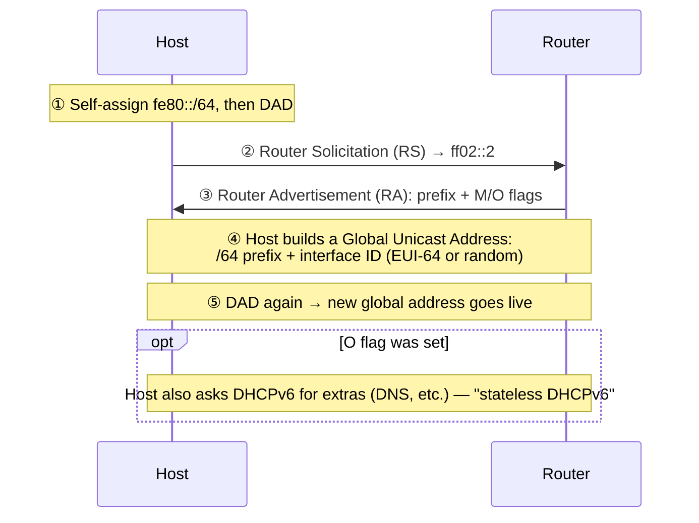

---
categories:
  - "[[Networking]]"
topic@networking:
  - "[[Networking General]]"
tags:
  - category/networking/networking_general
icon: FasNetworkWired
iconColor:
last_update: 2026-07-15
---
### SLAAC — Stateless Address Autoconfiguration

SLAAC lets a device configure a working, routable global address on its own, with no DHCP server required for the address itself. It leans entirely on link-local addressing and router advertisements to get there.

**① Link-local first.** Every SLAAC exchange happens over link-local addresses, so the host must self-assign an `fe80::` address and confirm it's unique — Duplicate Address Detection, via Neighbor Solicitation — before doing anything else on the network.

**② Router Solicitation (RS).** The host multicasts a solicitation to `ff02::2` (all routers on the link) so it doesn't have to wait for the router's next periodic announcement.

**③ Router Advertisement (RA).** The router replies with one or more on-link prefixes (almost always /64), lifetimes, and two flags worth remembering:

- **M (Managed) flag set** — ignore SLAAC for the address itself; get it from DHCPv6 instead.
- **O (Other) flag set** — keep the SLAAC-derived address, but still ask DHCPv6 for extras like DNS servers. This combination is often called "stateless DHCPv6."

**④ Building the address.** The host appends a 64-bit interface ID to the advertised prefix, generated one of two ways:

- **EUI-64** — derived from the interface's 48-bit MAC address (split in half with `FFFE` inserted in the middle, and one bit flipped). Deterministic, and traceable back to the hardware.
- **Privacy extensions (RFC 4941 / RFC 8981)** — a random interface ID, regenerated on a schedule.

> [!tip] Default in modern OSes
> Privacy extensions are the default in current Windows, macOS, iOS, Android, and most Linux distributions — specifically so a device can't be tracked across networks by a MAC-derived address.

**⑤ One more Duplicate Address Detection** pass on the new global address, and it's live — no DHCP server ever had to hand out a lease.

### Link-Local Behavior

Every IPv6-capable interface carries a link-local address automatically, whether or not the network has a router or a DHCPv6 server anywhere on it. It needs no configuration and no help from anything else on the network.

- **Range:** `fe80::/10` by the standard, though every real implementation uses `fe80::/64` in practice.
- **Never routed.** A router will not forward a packet with a link-local source or destination, under any circumstance — this is enforced behavior, not just convention.
- **What it's used for:** Neighbor Discovery Protocol (NDP, IPv6's replacement for ARP), the RS/RA exchange that makes SLAAC possible in the first place, a host's default-gateway entry (routers advertise themselves by link-local address, so renumbering the global prefix later doesn't break anyone's routing table), and routing-protocol adjacencies such as OSPFv3 and RIPng.
- **Scope / zone ID:** the same `fe80::` address legitimately exists on every interface a host has, so tools append a zone ID to say which one — `fe80::5054:ff:fe12:3456%eth0`. You'll see this in `ping` and `traceroute` output and in socket APIs.
- **Not optional:** even a host using a manually configured or DHCPv6-assigned global address still depends on its link-local address for the underlying link operations to work at all.