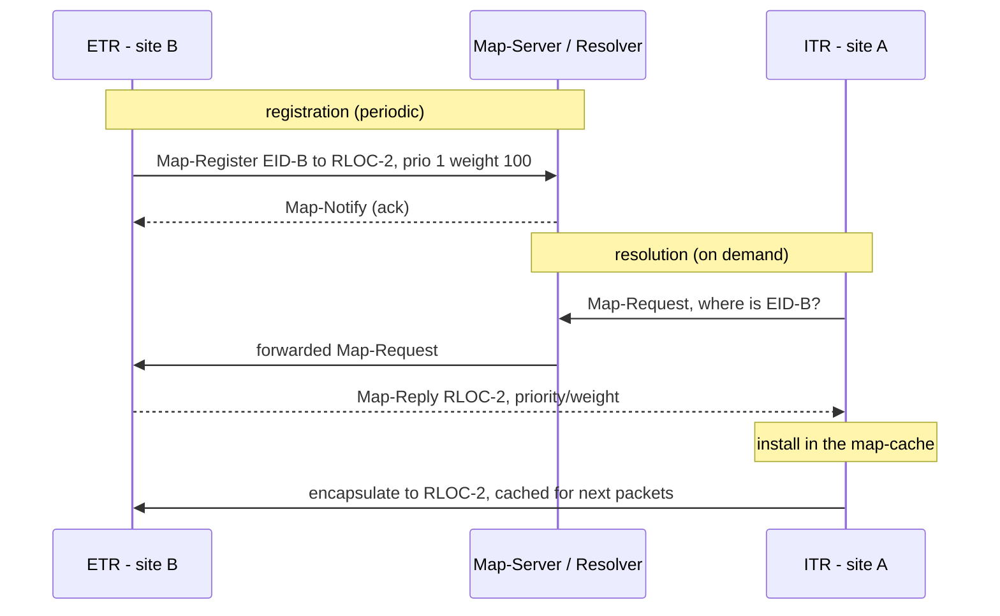
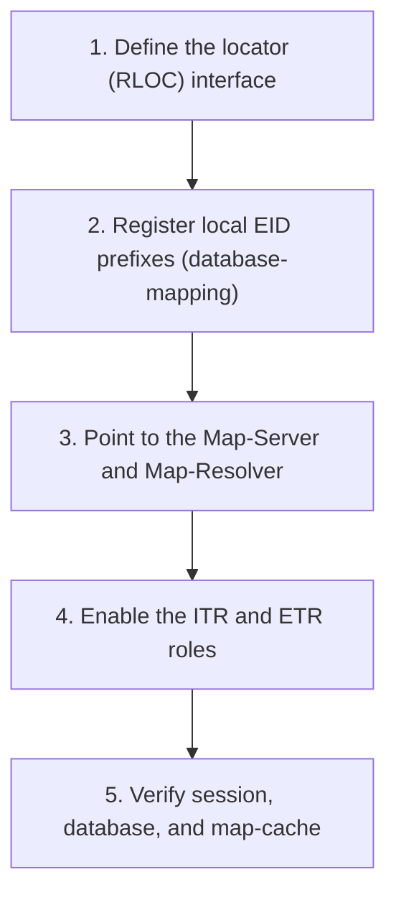
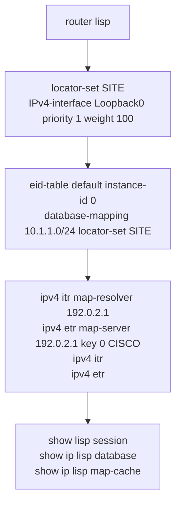

---
categories:
  - "[[Networking]]"
topic@networking:
  - "[[Networking General]]"
tags:
  - category/networking/networking_general
icon: FasNetworkWired
iconColor:
last_update:
aliases:
  - Locator/ID Separation Protocol
---
LISP (Locator/ID Separation Protocol) is a control-plane architecture that splits the single meaning of an IP address into two separate namespaces — an identity and a location — and keeps a mapping database that binds one to the other. A router that needs to reach a host asks the mapping system where that host currently is, caches the answer, and tunnels the traffic there: a model called map-and-encapsulate, conceptually close to how DNS resolves a name to an address. Originally defined in RFC 6830 and updated by RFC 9300 and RFC 9301, LISP matters for the ENCOR exam as the control plane of Cisco SD-Access, where it locates endpoints while [[VXLAN#VXLAN Encapsulation|VXLAN]] carries their traffic. This note covers the problem LISP solves, its two namespaces, the map-and-encapsulate flow, the device roles and control messages, and how all of it maps onto the SD-Access fabric.

## The Problem LISP Solves

_An IP address means two things at once — who a host is and where it sits in the topology — and overloading one number with both jobs is what limits routing scale and mobility._

In traditional routing an IP address is simultaneously the host's identity and its place in the network. That dual role has two costs. Routing tables bloat, because every site's prefixes must be carried through the transit network for anyone to reach them. And mobility is awkward, because a host that moves either has to change its address or force its specific route to be injected everywhere it appears. LISP removes the overload by giving the host a stable identity and letting its location vary independently, with a mapping system tracking the current binding.

## Core Namespaces

_LISP replaces the one overloaded IP address with two purpose-built identifiers._

### Endpoint Identifier (EID)

The address of the end host — its identity. EIDs are used inside sites and in the overlay, and they are deliberately not advertised into the underlay or transit network, so they do not bloat the global routing table.

### Routing Locator (RLOC)

The address of the tunnel router that can currently reach the host — its location. RLOCs are ordinary routable addresses in the underlay. When a host moves to a new attachment point, its EID stays the same while the RLOC it maps to changes.

|Namespace|Answers|Assigned to|Routed in|
|---|---|---|---|
|EID (Endpoint Identifier)|Who the host is — identity|End hosts|The site or overlay; not carried in the underlay|
|RLOC (Routing Locator)|Where the host attaches — location|Tunnel routers (VTEPs)|The underlay / global routing system|

> [!note] The DNS analogy
> An EID is like a hostname and an RLOC is like the IP address it resolves to; the LISP mapping system plays the role of DNS. A host keeps its name (EID) while the address behind it (RLOC) can change — which is exactly what makes seamless mobility possible.

## Map-and-Encapsulate Operation

_A packet reaches a remote EID in two steps: resolve the mapping, then tunnel to the RLOC it points at._

When a host sends to a destination the local router does not yet know, the router resolves the destination EID to an RLOC through the mapping system, caches the result, and encapsulates the traffic toward that RLOC. Subsequent packets hit the cache and are tunneled immediately.

```
Host-A (EID)                                           Host-B (EID)
   │                                                        ▲
   ▼                                                        │
 ITR ──1. Map-Request──►  Map-Resolver ──► mapping system   │
   │  ◄─2. Map-Reply: EID-B → RLOC-2 (priority/weight)─      │
   │                                                        │
   │  3. cache the mapping, encapsulate toward RLOC-2        │
   └────► underlay routes RLOC-1 → RLOC-2 ────► ETR ─────────┘
                                              (decapsulates)
```

The resolved mapping lives in the router's map-cache, populated on demand rather than by carrying every EID prefix in the routing table — the property that keeps LISP scalable.

## Device Roles

_LISP separates the tunnel-router functions at the edge from the mapping-system infrastructure._

### Ingress Tunnel Router (ITR)

Sits at the source site. It requests EID-to-RLOC mappings, caches them, and encapsulates outbound traffic toward the destination RLOC.

### Egress Tunnel Router (ETR)

Sits at the destination site. It registers its own EID prefixes and RLOCs with the [[#Map-Server (MS)\|Map-Server]], decapsulates arriving traffic, and answers Map-Requests for the EIDs it owns.

### xTR

A single device performing both [[#Ingress Tunnel Router (ITR)\|ITR]] and [[#Egress Tunnel Router (ETR)\|ETR]] functions — the usual case, since a site both sends and receives.

### Proxy Tunnel Routers (PITR and PETR)

Interworking devices that bridge LISP and non-LISP networks. A PITR encapsulates on behalf of legacy sites so non-LISP hosts can reach EIDs; a PETR lets LISP sites reach destinations that are not in the mapping system.

### Map-Server (MS)

The infrastructure device that ETRs register with. It receives registrations and holds the authoritative EID-to-RLOC database.

### Map-Resolver (MR)

The infrastructure device that ITRs send queries to. It accepts Map-Requests and resolves them against the mapping system. The MS and MR functions are commonly colocated on the same device.

|Role|Function|
|---|---|
|ITR|Encapsulates traffic leaving an EID site; requests and caches EID-to-RLOC mappings|
|ETR|Registers its EID prefixes with the Map-Server; decapsulates arriving traffic; answers Map-Requests|
|xTR|A device doing both ITR and ETR|
|PITR|Proxy ITR — encapsulates on behalf of non-LISP sites so legacy hosts can reach EIDs|
|PETR|Proxy ETR — lets LISP sites reach non-LISP destinations|
|Map-Server (MS)|Receives ETR registrations; holds the EID-to-RLOC database|
|Map-Resolver (MR)|Receives ITR Map-Requests and resolves them|

## Control-Plane Messages

_Four messages register and resolve mappings, and they all ride on UDP 4342._



### Registration — Map-Register and Map-Notify

An [[#Egress Tunnel Router (ETR)\|ETR]] periodically sends a Map-Register to the Map-Server to advertise the EID prefixes it serves and the RLOCs behind them. The Map-Server replies with a Map-Notify to acknowledge the registration.

### Resolution — Map-Request and Map-Reply

An [[#Ingress Tunnel Router (ITR)\|ITR]] sends a Map-Request to the Map-Resolver to learn the RLOC for a destination EID. The answer comes back as a Map-Reply, whose RLOC records carry two selectors:

- Priority — lowest value wins; a value of 255 means the RLOC must not be used for traffic. This chooses the primary path and enables failover.
- Weight — load-shares traffic across RLOCs that share the same priority.

|Message|Direction|Purpose|UDP|
|---|---|---|---|
|Map-Register|ETR → MS|Register EID prefixes with their RLOCs|Destination 4342|
|Map-Notify|MS → ETR|Acknowledge a registration|4342|
|Map-Request|ITR → MR (or ETR)|Ask for the RLOC of an EID|Destination 4342|
|Map-Reply|ETR / MS → ITR|Return the RLOC set with priority and weight|Source 4342|

> [!info] Control 4342, data 4341
> LISP control-plane messages use UDP port 4342. Native LISP data-plane encapsulation uses UDP port 4341 — but in SD-Access the data plane is VXLAN, not native LISP, as the next section explains.

## Data Plane

_LISP defines its own encapsulation, but SD-Access swaps it out for VXLAN and keeps LISP purely as the control plane._

Native LISP wraps the original packet in an outer IP header, a UDP header on port 4341, and an 8-byte LISP header. That LISP header carries an Instance ID that keeps tenants separate — the same idea as the [[VXLAN#VXLAN Network Identifier\|VXLAN VNI]], which is unsurprising given the two encapsulations are close cousins.

Cisco SD-Access does not use the native LISP data plane. It keeps LISP for control — locating endpoints — and uses [[VXLAN#VXLAN Encapsulation\|VXLAN]] to actually carry the traffic, because VXLAN transports Layer 2 frames and can carry the Scalable Group Tag for policy.

> [!important] The exam's one-liner
> In SD-Access, LISP is the control plane and VXLAN is the data plane. LISP answers where an endpoint is; VXLAN moves the packet there. [[TrustSec#TrustSec in Cisco SD-Access|Cisco TrustSec]] then supplies the policy plane. Most fabric questions come down to knowing which plane owns which job.

## LISP in Cisco SD-Access

_The [[SD-Access#Fabric Roles|campus fabric]] maps the LISP roles directly onto fabric node types._

### Fabric Edge Node — xTR

The access-layer switches where endpoints connect. Each edge node is an [[#xTR\|xTR]]: it detects connected clients, registers their EIDs with the [[#Control-Plane Node — Map-Server and Map-Resolver\|control-plane node]], and encapsulates and decapsulates fabric traffic. It is also the VXLAN tunnel endpoint for the [[VXLAN#VXLAN in Cisco SD-Access\|data plane]].

### Control-Plane Node — Map-Server and Map-Resolver

Runs the LISP [[#Map-Server (MS)\|Map-Server]] and [[#Map-Resolver (MR)\|Map-Resolver]]. It holds the fabric's host-tracking database — every EID mapped to the RLOC of the edge node it lives behind — and answers the edge nodes' location queries.

### Border Node

Connects the fabric to everything outside it — other domains, the WAN, the data center, and shared services. It behaves as a proxy tunnel router for destinations that are not registered inside the fabric, providing the exit for traffic to unknown EIDs.

### Instance IDs and Segmentation

LISP instance IDs keep tenants separate in the control plane and map onto the VXLAN VNI in the data plane. SD-Access uses a Layer 3 instance per VRF or virtual network and a Layer 2 instance per fabric VLAN, so segmentation is consistent end to end — the mapping database, the encapsulation, and the forwarding all agree on which segment a packet belongs to.

```
Endpoint joins the fabric
   │  edge node (xTR) registers  EID → its own RLOC
   ▼
Control-Plane Node  (Map-Server / Map-Resolver)
   ▲  host-tracking database of every EID-to-RLOC binding
   │  edge node queries for an unknown destination EID
   │  receives the RLOC of the remote edge node
   ▼
Encapsulate in VXLAN toward that RLOC ─► remote edge decapsulates ─► endpoint
```

## Benefits of the Identity and Location Split

_Separating who from where is what buys LISP its scalability, mobility, and flexibility._

Because EID prefixes are resolved on demand and cached rather than carried everywhere, the transit network holds only RLOCs — routing tables stay small and the control plane scales. Because a host's EID is independent of its location, that host can move and simply be re-registered against a new RLOC, so mobility works without renumbering; in the fabric this is what lets a client roam between edge nodes and keep its address and policy. The priority and weight in each Map-Reply give built-in multihoming and traffic engineering, and because EIDs and RLOCs are independent, they can even be different address families — an IPv4 EID reachable over an IPv6 RLOC, for instance. In Cisco SD-Access these properties become subnet stretching, seamless roaming, and segmentation that holds across the whole campus.

## Configuration

_Standing up a LISP site: define the locator, register the local EID prefixes, point at the mapping system, and turn on the tunnel-router roles._

### High-Level Workflow



### CLI Companion

_Cisco IOS-XE (representative; exact sub-mode syntax varies by release)._


