A finished network is one that already carries production traffic. The design decisions are made, the addressing is allocated, the protocols have converged, and every change from this point on touches something that somebody depends on. Moving on a network like this is a different discipline from building one: the work is reading, tracing, verifying, and only then touching.

This note describes how a typical enterprise campus and WAN is assembled when it uses VRFs for segmentation, OSPF as the interior routing protocol, and BGP as the carrier of reachability between sites — and how to move through it in both senses of the word.

| Sense                 | Question it answers                                                                                     |
| --------------------- | ------------------------------------------------------------------------------------------------------- |
| How a packet moves    | Which VLAN, which gateway, which VRF, which routing table, which next hop, which exit.                  |
| How an engineer moves | Which device to log into next, which table to read, which command proves the hop, which change is safe. |

The two are the same journey. An engineer follows a packet by walking the same tables the hardware walks, one hop at a time.

The shape of the network described here:

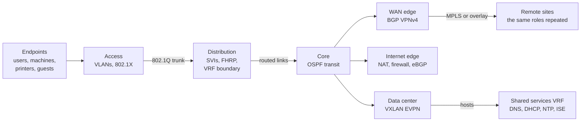

---

## Network Model

Before tracing anything, place yourself on the map. Every enterprise network is a small number of repeating roles glued together by a routing protocol, and every device you log into belongs to one of them.

### Planes of Operation

A single physical device runs three logically separate planes. Confusing them is the most common reason a trace goes nowhere.

|Plane|Job|Typical evidence|
|---|---|---|
|Management|Reach the device to configure and monitor it|SSH, SNMP, NetFlow, syslog, RADIUS for device login|
|Control|Build the forwarding tables|OSPF adjacencies, BGP sessions, ARP, STP, HSRP hellos|
|Data|Move user traffic|CEF lookups, ACL hits, interface counters|

#### Management Plane

The management plane is how you arrive. It is usually isolated from user traffic, either physically on a dedicated out-of-band network or logically in a [[#Management VRF|management VRF]]. A device can be perfectly healthy in the data plane while unreachable in the management plane, and the reverse is also true — a switch you can SSH into is not proof that it is forwarding anything.

The baseline management configuration for the access switches in this environment is documented in [[PBA - NAC - Network Access Devices#Initial Configuration|the NAD note]].

#### Control Plane

The control plane is the set of protocols that agree on where everything is. [[#OSPF|OSPF]] discovers the internal topology, [[#BGP|BGP]] carries prefixes between routing domains, [[#Spanning Tree|spanning tree]] decides which Layer 2 links may forward, and [[#First Hop Redundancy|first hop redundancy]] decides which router owns the gateway address. When the control plane is wrong, traffic goes to the wrong place quickly and consistently.

#### Data Plane

The data plane is hardware executing the result of the control plane. It does not reason; it looks up. Almost every "the routing is broken" report is really a control plane fault expressed by a data plane that is doing exactly what it was told.

### Device Roles

#### Access Layer

Where endpoints attach. Access switches terminate [[#Access Port|access ports]], apply port security and NAC enforcement, and usually do not route. They are the only place where a MAC address maps to a physical cable, which makes them the starting point of nearly every trace.

#### Distribution Layer

Where Layer 2 stops and Layer 3 begins. The distribution pair owns the [[#SVI|SVIs]] that act as default gateways, runs [[#First Hop Redundancy|FHRP]] between the two chassis, and is normally the first device that is [[#VRF|VRF]] aware. This is the boundary at which a frame becomes a routed packet.

#### Core Layer

A small, fast, deliberately boring transit layer. The core carries [[#OSPF|OSPF]] and often iBGP, holds few or no user SVIs, and applies as little policy as possible. If policy is being applied in the core, that is worth knowing before you start troubleshooting.

#### WAN Edge

Where the site connects to other sites — MPLS provider, dark fibre, SD-WAN overlay, or IPsec tunnels. The WAN edge is almost always the [[#BGP|BGP]] speaker of the site and the place where [[#Route Filtering|route filtering]] and [[#BGP Attributes|attribute manipulation]] decide which path the site prefers.

#### Internet Edge

Where private addressing meets public. The internet edge holds the [[#NAT|NAT]] pools, the perimeter [[#Firewall|firewalls]], the default route origin, and usually a second [[#BGP|BGP]] domain facing the providers.

#### Data Center Fabric

Where servers attach. Modern fabrics are leaf-and-spine with a [[#VXLAN EVPN|VXLAN EVPN]] overlay, which changes what "the same VLAN" means physically but not logically. Older fabrics look like a distribution layer with more ports.

---

## Layer 2 Domain

Everything below the gateway. A packet spends its first and last hop here, and a large share of real faults never leave this section.

### VLAN

A VLAN is a broadcast domain identified by a 12-bit tag. Two endpoints in the same VLAN reach each other by MAC address and never involve a router. Two endpoints in different VLANs cannot reach each other without a Layer 3 hop, no matter how close together they are physically.

#### Access Port

A port carrying exactly one VLAN, untagged toward the endpoint. This is where NAC assigns a VLAN dynamically after authentication, so the VLAN on the running configuration is not always the VLAN in effect — the authorization result wins.

```cisco
show interface GigabitEthernet1/0/12 switchport
show access-session interface GigabitEthernet1/0/12 details
```

#### Trunk Port

A port carrying multiple VLANs, tagged with 802.1Q. A trunk only carries the VLANs in its allowed list, and both ends must agree. A VLAN missing from one side of one uplink is the classic cause of "it works on this floor but not that one".

```cisco
show interface trunk
```

#### Native VLAN

The single VLAN sent untagged on a trunk. It must match on both ends. A native VLAN mismatch merges two broadcast domains silently and is reported by CDP rather than by any outage, so it can persist for years.

### Spanning Tree

Spanning tree keeps a Layer 2 topology loop free by blocking redundant links. In a finished network its job is invisible until something changes.

|What to check|Why it matters|
|---|---|
|Root bridge identity|The root should be the distribution pair, not an access switch. A wandering root means traffic takes a strange path through the campus.|
|Blocked ports|A link that "does not work" may be blocking correctly and by design.|
|Topology change counters|Frequent changes flush MAC tables and cause repeated brief outages that look like flapping applications.|

```cisco
show spanning-tree root
show spanning-tree vlan 140 detail
show spanning-tree interface GigabitEthernet1/0/12 detail
```

### Link Aggregation

#### Port Channel

Several physical links presented as one logical link, negotiated with LACP. Spanning tree sees one port, so no member is blocked. Traffic is distributed per flow by a hash, not per packet, so one large flow never exceeds one member link's capacity.

```cisco
show etherchannel summary
show etherchannel load-balance
```

#### Multi-Chassis Link Aggregation

The same idea across two physical chassis — StackWise Virtual, VSS, vPC, or MLAG depending on platform. The downstream switch sees a single upstream device, which removes the blocked link that [[#Spanning Tree|spanning tree]] would otherwise create and makes both uplinks active.

The difference is visible from the access switch, which either sees two upstream devices and blocks one path, or sees one.

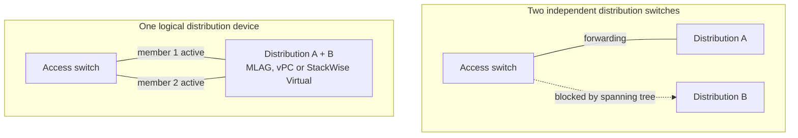

### First Hop Redundancy

Endpoints know one gateway address. FHRP lets two routers share it so the failure of one is invisible.

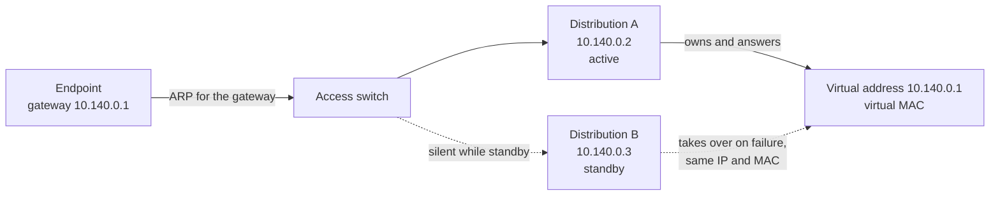

#### HSRP

Cisco's protocol. One router is active, one is standby, and they share a virtual IP and virtual MAC. The endpoint never notices a failover because the MAC it has in ARP does not change.

```cisco
show standby brief
```

#### VRRP

The standards-based equivalent, used where the pair is multi-vendor. The behaviour is the same: one master, one backup, one shared address.

#### Anycast Gateway

In a [[#VXLAN EVPN|VXLAN EVPN]] fabric there is no active/standby pair. Every leaf configures the identical gateway IP and MAC, so the gateway is always one hop away regardless of where the endpoint is attached. There is nothing to fail over.

> [!note] Which router actually answers The FHRP virtual address is not owned by both routers equally. Only the active router replies to ARP for it and only the active router forwards. If a trace shows traffic leaving the site through the router you did not expect, check the FHRP state before you look at the routing table.

### Binding Tables and Layer 2 Security

DHCP snooping, dynamic ARP inspection, and IP device tracking build the tables that both NAC and troubleshooting depend on. When the binding table is empty, ARP inspection drops traffic that looks perfectly valid, and profiling loses its source data. These features are documented on the switch side in [[PBA - NAC - Network Access Devices#Layer-2 Security|the NAD note]].

```cisco
show ip dhcp snooping binding
show device-tracking database
```

---

## Layer 3 Edge

The boundary where a frame stops being switched and starts being routed. Every packet crosses it exactly twice — once leaving the source VLAN, once entering the destination VLAN.

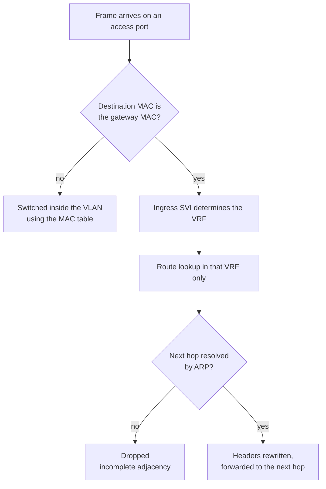

### SVI

A switched virtual interface is a routed interface for a VLAN. It holds the gateway address, it belongs to exactly one [[#VRF|VRF]], and it is the point at which VRF membership is decided for everything in that VLAN.

```cisco
interface Vlan140
 description CLIENTS
 vrf forwarding CORP
 ip address 10.140.0.2 255.255.255.0
 standby 140 ip 10.140.0.1
```

The line that matters most for tracing is `vrf forwarding` — it tells you which routing table this VLAN's traffic will be looked up in, and therefore which of several possible answers the router will give for the same destination address.

### Routed Port

A physical interface with no VLAN, carrying only routed traffic. Used for core and WAN links. Because there is no [[#Spanning Tree|spanning tree]] and no broadcast domain, a routed link's only states are up, down, and adjacency formed.

```cisco
interface TenGigabitEthernet1/1/1
 no switchport
 vrf forwarding CORP
 ip address 10.255.0.1 255.255.255.252
```

### ARP and the Default Gateway

An endpoint sends to its gateway's MAC address, not its IP. The chain is therefore: endpoint ARPs for the gateway IP, the [[#First Hop Redundancy|FHRP]] active router answers with the virtual MAC, the switch forwards the frame to whichever port that MAC lives on, and only then does a routing lookup happen.

ARP is per VRF. The same IP address can exist in two VRFs on the same device with two different MAC addresses, and a lookup in the wrong table returns nothing.

```cisco
show ip arp vrf CORP 10.140.0.57
show mac address-table address 0011.2233.4455
```

### IPv6 and Dual Stack

Where both protocols are deployed, they are two independent control planes sharing one physical network. Addresses, neighbour tables, routing tables, [[#First Hop Redundancy|FHRP]] groups, and access lists all exist twice, and a fault in one is invisible in the other. A destination that resolves to an AAAA record will be traced entirely in the IPv6 tables even though the IPv4 path is healthy.

```cisco
show ipv6 neighbors vrf CORP
show ipv6 route vrf CORP 2001:db8:200:5::10
show bgp vpnv6 unicast all summary
```

---

## VRF

A VRF is a separate routing table on the same physical device. Interfaces are assigned to it, routes are learned into it, and lookups happen only within it. Two VRFs on one router are, for forwarding purposes, two different routers that happen to share a chassis.

This is why the first question in any trace on a segmented network is not "what is the route" but "the route in which table".

```cisco
show vrf
show ip route vrf CORP 10.200.5.10
```

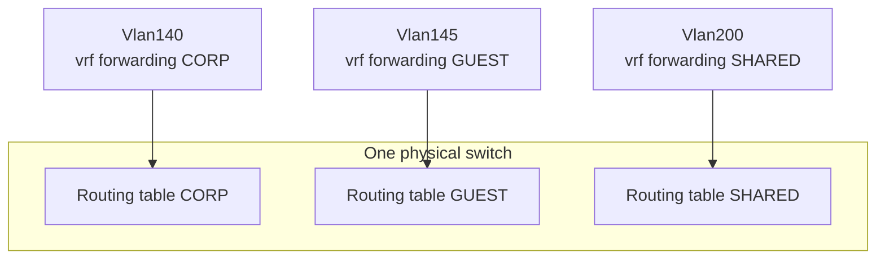

Three tables, no relationship between them unless one is created deliberately.

### Route Distinguisher

An 8-byte value prepended to an IPv4 prefix to make it globally unique before it is carried in [[#MP-BGP VPNv4|MP-BGP]]. Two VRFs may both contain 10.0.0.0/8; with distinct RDs they become two distinct VPNv4 routes and never collide in the BGP table.

The RD controls uniqueness only. It does not decide who receives the route.

### Route Target

An extended community attached on export and matched on import. The route target is what actually decides membership: a VRF exports its routes with one or more RTs, and imports any route carrying an RT in its import list.

```cisco
vrf definition CORP
 rd 65001:140
 address-family ipv4
  route-target export 65001:140
  route-target import 65001:140
  route-target import 65001:999
 exit-address-family
```

|Line|Effect|
|---|---|
|`rd 65001:140`|Makes this VRF's prefixes unique inside BGP.|
|`route-target export 65001:140`|Tags every route this VRF advertises.|
|`route-target import 65001:140`|Accepts routes from other sites belonging to the same VRF.|
|`route-target import 65001:999`|Accepts routes from a [[#Shared Services VRF|

> [!warning] Asymmetric route targets Import and export lists do not have to match, and that asymmetry is deliberate in shared-services designs. It is also the single most common cause of "the route exists on the WAN router but never appears in the VRF" — the prefix is in the BGP table, it simply carries no RT that this VRF is willing to import.

### VRF-Lite

VRF separation without MPLS. Every hop between two VRF-aware devices needs its own link or subinterface per VRF, and every hop must run its own routing protocol instance or address family per VRF.

```cisco
interface TenGigabitEthernet1/1/1.140
 encapsulation dot1Q 140
 vrf forwarding CORP
 ip address 10.255.0.1 255.255.255.252
```

VRF-lite is simple to read and scales badly: n VRFs across a path of m hops means n × m adjacencies to maintain. It is the normal choice inside a campus, and the normal thing to outgrow across a WAN.

### MP-BGP VPNv4

The scalable alternative. A single BGP session between two devices carries the routes of every VRF, each tagged with its [[#Route Distinguisher|RD]] and [[#Route Target|RTs]], with an MPLS label identifying the destination VRF. One session, many tables.

```cisco
router bgp 65001
 address-family vpnv4
  neighbor 10.255.255.2 activate
  neighbor 10.255.255.2 send-community extended
 exit-address-family
 !
 address-family ipv4 vrf CORP
  redistribute ospf 10
 exit-address-family
```

The `send-community extended` line is mandatory. Without it the [[#Route Target|route targets]] are stripped, the far end imports nothing, and the symptom is identical to a missing import statement.

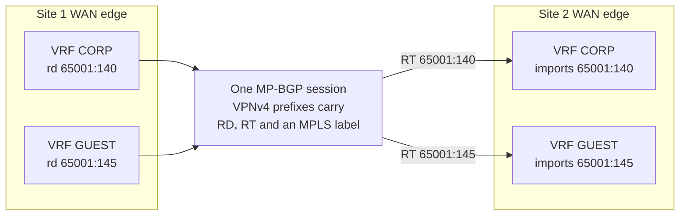

### Route Leaking

Deliberately moving routes between VRFs. Segmentation is only useful if some things are shared, and leaking is how that exception is expressed.

#### Shared Services VRF

A VRF holding resources everyone needs — DNS, DHCP, NTP, [[PBA - NAC - ISE Server#Network Devices|ISE]], antivirus, monitoring. It imports the RTs of every client VRF and exports one RT that every client VRF imports. Clients reach services, services reach clients, and clients do not reach each other.

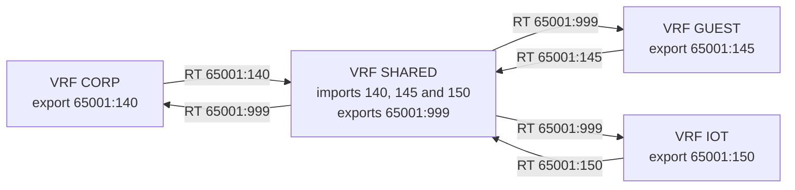

No client VRF imports another client's RT, so no arrow exists between them.

#### Import and Export Maps

Route targets are all-or-nothing per VRF. When only part of a VRF should be leaked, an import map or export map filters by prefix on top of the RT.

```cisco
vrf definition GUEST
 address-family ipv4
  import map ONLY-DNS
```

#### Fusion Device

Where leaking must be stateful or policed rather than simply routed, the two VRFs are joined through a firewall or a router outside both. Traffic leaves VRF A, is inspected, and re-enters VRF B. This is slower and more expensive than route leaking, and it is the only option when the requirement is inspection rather than reachability.

> [!note] Leaking is not symmetric by accident A leak that works in one direction and not the other is almost always correct configuration meeting an incomplete requirement. Confirm both the forward RT import and the return RT import before assuming a fault.

### Management VRF

A dedicated VRF containing only management interfaces, so that a routing failure in the production tables cannot cost you access to the device. Its presence is the reason `ping` and `traceroute` from a router so often fail when the same test from an endpoint succeeds — the router sources from the management table unless told otherwise.

```cisco
ping vrf CORP 10.200.5.10 source Vlan140
traceroute vrf CORP 10.200.5.10
```

---

## OSPF

The interior routing protocol. OSPF's job is to make every internal prefix reachable and to reconverge quickly when a link fails. In a design that also runs [[#BGP|BGP]], OSPF is usually kept deliberately small: loopbacks, transit links, and site-internal subnets only.

OSPF is a link-state protocol. Every router in an area holds an identical database describing the topology, and each one independently runs shortest path first over it. Routers do not advertise routes to each other; they advertise the topology and each computes the same result.

### OSPF Areas

Areas limit the scope of the topology database. Inside an area every router sees every link; between areas only summarised reachability crosses.

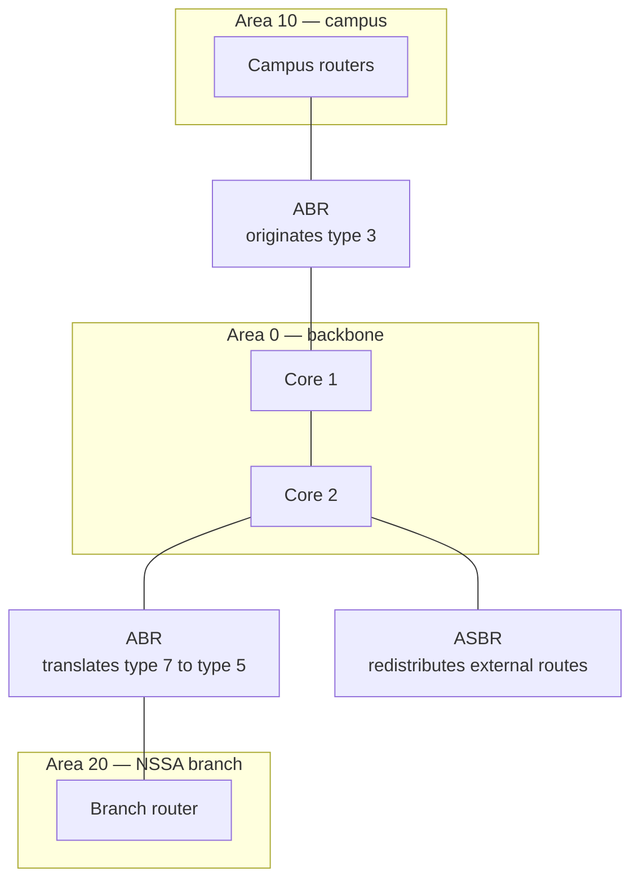

#### Backbone Area

Area 0. Every other area must touch it, and all inter-area traffic transits it. A non-backbone area that loses its connection to area 0 becomes unreachable from the rest of the domain even when the physical path is intact.

#### Area Border Router

A router with interfaces in two or more areas. The ABR is where [[#LSA Types|type 3 LSAs]] are generated, where summarisation is possible, and where a stub area's default route is injected.

#### Stub and NSSA Areas

Area types trade information for size.

|Area type|Blocks|Receives|
|---|---|---|
|Standard|Nothing|Everything, including externals|
|Stub|Type 5 externals|A default route from the [[#Area Border Router|
|Totally stubby|Types 3, 4 and 5|A default route only|
|NSSA|Type 5, but allows local externals as type 7|Inter-area routes plus its own externals|
|Totally NSSA|Types 3, 4 and 5|A default route plus its own externals|

An area type mismatch between two routers prevents adjacency entirely — the stub flag is checked in the hello.

### Adjacency Formation

Two OSPF routers become neighbours before they exchange anything. Understanding what must match is the fastest way to diagnose an adjacency that never forms.

|Must match|Consequence if not|
|---|---|
|Area ID|No adjacency|
|Hello and dead timers|No adjacency|
|Subnet mask on the shared link|No adjacency on broadcast media|
|Authentication type and key|No adjacency|
|Stub or NSSA flags|No adjacency|
|MTU|Adjacency sticks in EXSTART or EXCHANGE|
|Router ID|Must be unique, not matching|

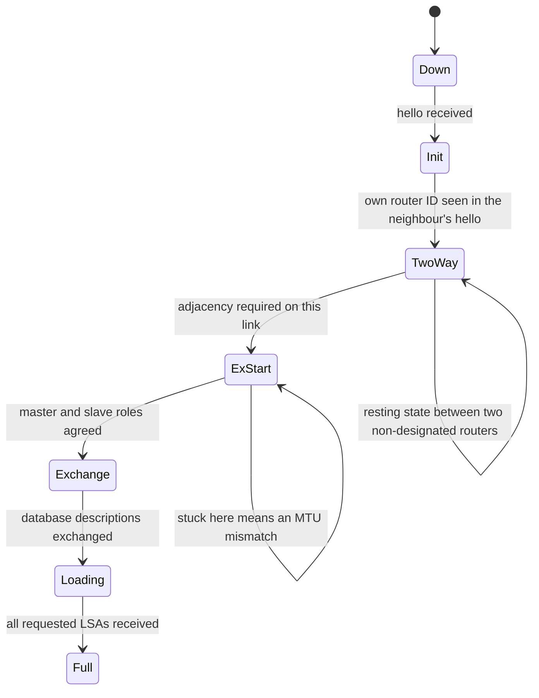

A neighbour stuck at 2-WAY on a broadcast segment is normal between two non-designated routers. Stuck at EXSTART or EXCHANGE is almost always an MTU mismatch.

#### Hello and Dead Timers

|Network type|Hello|Dead|DR election|
|---|---|---|---|
|Broadcast|10s|40s|Yes|
|Point-to-point|10s|40s|No|
|Non-broadcast|30s|120s|Yes|
|Point-to-multipoint|30s|120s|No|

#### Network Types

The network type is a per-interface property, not a property of the medium. On a routed link between two switches, setting `ip ospf network point-to-point` removes the DR election and the type 2 LSA, forms the adjacency faster, and simplifies the database. It is standard practice on all internal transit links.

#### DR and BDR

On broadcast segments one router is elected designated router and represents the segment in the database, so that n routers form n adjacencies with the DR rather than n² with each other. Election is by highest priority, then highest [[#Router ID|router ID]], and it is not pre-emptive — a router that boots later never takes over from a working DR. Priority 0 removes a router from the election entirely.

#### Router ID

A 32-bit identifier written like an IP address, chosen from the configured value, else the highest loopback, else the highest active interface. It should always be configured explicitly and should match the device's loopback, because every OSPF and [[#BGP|BGP]] output identifies neighbours by RID rather than by name.

### LSA Types

The database is built from link-state advertisements. Knowing which type carries which information turns `show ip ospf database` from noise into a map.

|Type|Name|Carries|Scope|
|---|---|---|---|
|1|Router|A router's own links and their costs|Within the area|
|2|Network|The routers attached to a broadcast segment, generated by the [[#DR and BDR|DR]]|
|3|Summary|Inter-area prefixes, generated by the [[#Area Border Router|ABR]]|
|4|ASBR summary|How to reach the ASBR|Across areas|
|5|External|Redistributed routes|Whole domain except stub areas|
|7|NSSA external|Externals originated inside an NSSA, translated to type 5 at the ABR|Within the NSSA|

### Cost and SPF

OSPF's metric is cost, derived from bandwidth by a reference value that has not scaled with modern interface speeds. With the default reference of 100 Mbps, every link of 100 Mbps or faster has a cost of 1, which makes a 1 Gbps link and a 100 Gbps link equally attractive.

```cisco
router ospf 10
 auto-cost reference-bandwidth 100000
```

The reference bandwidth must be identical on every router in the domain or the path calculation becomes inconsistent between them. On a finished network, check it before assuming a path preference is misconfigured.

### OSPF in a VRF

Each [[#VRF|VRF]] needs its own OSPF process or its own address family, with its own database and its own adjacencies. A neighbour that is up in the global table proves nothing about the same neighbour in a VRF.

```cisco
router ospf 20 vrf CORP
 router-id 10.255.255.1
 network 10.140.0.0 0.0.255.255 area 10
```

### OSPF Verification

```cisco
show ip ospf neighbor
show ip ospf interface brief
show ip ospf database
show ip route ospf
show ip ospf neighbor vrf CORP
```

---

## BGP

Where [[#OSPF|OSPF]] describes a topology, BGP describes reachability and policy. It carries large numbers of prefixes between routing domains, applies rules about which path is preferred, and — through [[#MP-BGP VPNv4|VPNv4]] — carries the routes of every [[#VRF|VRF]] over a single session.

BGP does not discover neighbours. Every session is configured by hand on both ends, runs over TCP port 179, and does not require the two routers to be directly connected.

### BGP Sessions

#### eBGP

A session between two different autonomous systems. Routes learned from an eBGP peer are advertised to every other peer. The AS number is prepended to the AS path on the way out, which is what makes loop detection work. eBGP peers are expected to be directly connected — a session between loopbacks requires `ebgp-multihop` or `update-source` adjustments.

#### iBGP

A session inside one autonomous system. iBGP exists to carry externally-learned prefixes across a domain without redistributing them into the [[#OSPF|IGP]]. Its defining rule: a route learned from an iBGP peer is never advertised to another iBGP peer.

That rule prevents loops and creates the requirement for a full mesh — or for a [[#Route Reflector|route reflector]] to relax it.

iBGP sessions are built between loopbacks, so that the session survives the loss of any single link as long as the IGP can still reach the loopback.

```cisco
router bgp 65001
 neighbor 10.255.255.2 remote-as 65001
 neighbor 10.255.255.2 update-source Loopback0
 neighbor 10.255.255.2 next-hop-self
```

`next-hop-self` matters because BGP does not rewrite the next hop on iBGP advertisements. Without it, an internal router receives a prefix whose next hop is an external address it has no route to, and the prefix is valid but never installed.

#### Session States

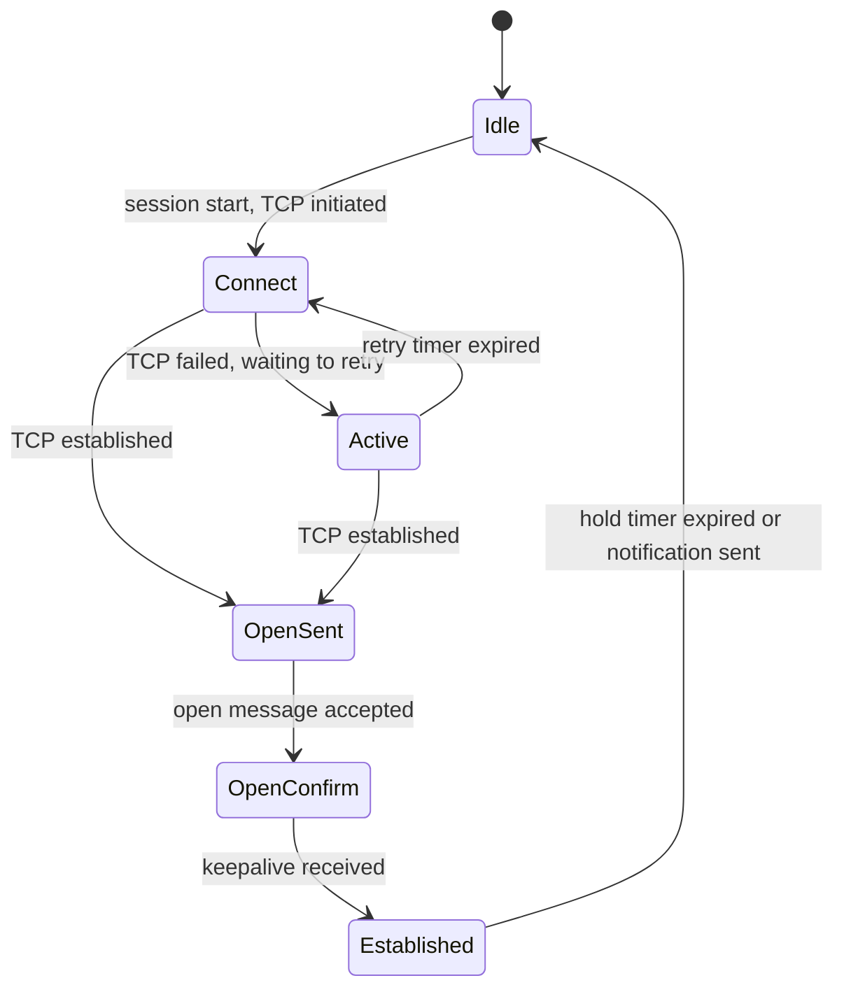

A session cycling between CONNECT and ACTIVE means the TCP session is not completing: a routing problem toward the peer address, an ACL, a wrong `update-source`, or a wrong remote AS.

### Scaling iBGP

#### Route Reflector

A route reflector is permitted to re-advertise routes learned from one iBGP peer to another, removing the need for a full mesh. Clients peer only with the reflector. The design cost is that clients see only the paths the reflector chose to reflect, which can hide alternatives that a full mesh would have exposed.

Reflectors are normally deployed in pairs, in the core or at the WAN edge, and are the correct first place to look when a prefix exists at one site and not at another.

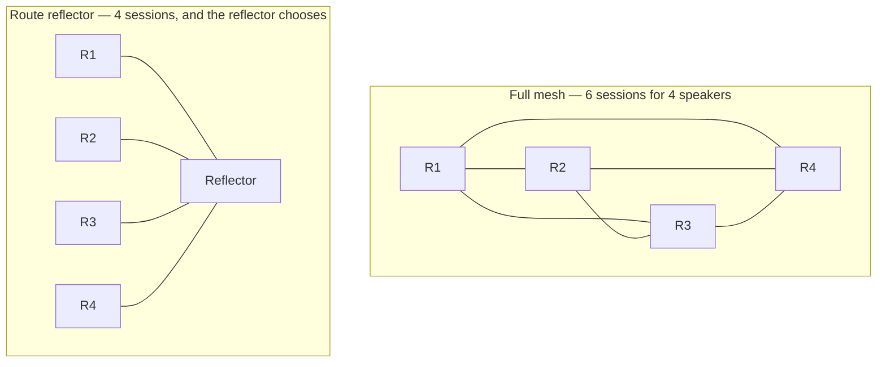

#### Confederation

An alternative that divides the AS into sub-autonomous systems. Rare in enterprise networks and mentioned here only so that an unexpected AS number in a path is recognised rather than treated as a fault.

### Address Families

One BGP process carries several kinds of reachability, each negotiated separately at session setup. A peer can be up and still carry nothing if the relevant address family was never activated.

|Address family|Carries|
|---|---|
|IPv4 unicast|Global table prefixes|
|VPNv4 / VPNv6|[[#VRF|
|IPv4 unicast under `vrf`|The per-VRF view of prefixes, including redistribution into and out of the IGP|
|L2VPN EVPN|MAC and IP reachability for a [[#VXLAN EVPN|

```cisco
show bgp ipv4 unicast summary
show bgp vpnv4 unicast all summary
show bgp vpnv4 unicast vrf CORP 10.200.5.0/24
```

### BGP Path Selection

When BGP holds several paths for the same prefix it installs exactly one, chosen by walking this list until a winner emerges. Reading it in order explains almost every "why is it going that way" question.

|Step|Criterion|Prefers|
|---|---|---|
|1|Weight|Highest. Cisco-only, never advertised, local to one router.|
|2|Local preference|Highest. Advertised within the AS — the standard way to choose an exit.|
|3|Locally originated|Routes this router originated over routes it learned.|
|4|AS path length|Shortest. The standard way to influence an inbound choice, by prepending.|
|5|Origin|IGP over EGP over incomplete.|
|6|MED|Lowest. Compared only between paths from the same neighbouring AS by default.|
|7|eBGP over iBGP|External paths.|
|8|IGP metric to the next hop|Lowest. This is where [[#OSPF|
|9|Oldest path|The established eBGP path, for stability.|
|10|Router ID|Lowest.|
|11|Neighbour address|Lowest.|

Any step that produces a winner ends the walk immediately; only a tie continues downward.

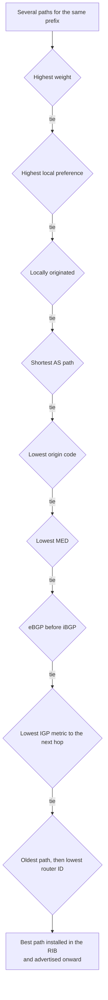

### BGP Attributes

#### Weight

Local to a single router and never advertised. Useful for a quick, contained preference on one device; dangerous as a design tool because no other router knows about it.

#### Local Preference

Advertised to all iBGP peers, default 100, highest wins. This is how an AS agrees internally on which door to leave by, and it is the attribute to check first when traffic exits through the wrong site.

#### AS Path

The list of autonomous systems a prefix has traversed. It is a loop-prevention mechanism first and a tie-breaker second. Because a neighbouring AS chooses its own preferences, prepending your own AS number on advertisement is the main lever for influencing traffic coming toward you.

#### MED

A hint to a neighbouring AS about which of several links into your AS to use. It is only compared between paths learned from the same AS unless `bgp always-compare-med` is configured, and neighbours are free to ignore it entirely.

#### Communities

Tags carried with a prefix so that policy can be applied consistently without matching on prefix lists everywhere. In enterprise designs communities typically mark a route's origin site, its class, or the treatment it should receive at the edge. [[#Route Target|Route targets]] are extended communities, which is why `send-community extended` is required on [[#MP-BGP VPNv4|VPNv4]] sessions.

```cisco
show bgp ipv4 unicast 10.200.5.0/24
show ip bgp community 65001:100
```

### Route Filtering

Every BGP session should have an explicit policy in both directions. In a finished network the filters are already there, and reading them is how you learn what the design intends.

|Mechanism|Matches on|
|---|---|
|Prefix list|Network and prefix length ranges|
|AS path access list|Regular expression against the AS path|
|Route map|Any of the above, and the place where attributes are set|

```cisco
show ip bgp neighbors 10.255.255.2 advertised-routes
show ip bgp neighbors 10.255.255.2 routes
show ip bgp neighbors 10.255.255.2 received-routes
```

> [!note] Received versus accepted `received-routes` requires soft reconfiguration inbound to be configured, otherwise the router does not keep a copy of what it discarded. If the command returns nothing, that is a missing feature rather than an empty advertisement — compare with the neighbour's `advertised-routes` from the other side.

### BGP Verification

```cisco
show bgp ipv4 unicast summary
show ip bgp 10.200.5.0/24 bestpath
show bgp vpnv4 unicast all neighbors
show ip bgp all dampening flap-statistics
```

---

## Control Plane Arbitration

Several protocols offer answers for the same destination. This section is the referee, and it is where most confident-but-wrong assumptions get corrected.

### Longest Prefix Match

Before anything else, the most specific prefix wins. A /32 static route defeats a /24 from OSPF and a /8 from BGP, regardless of protocol or metric. Comparisons of [[#Administrative Distance|administrative distance]] and metric only happen between routes of identical prefix and length.

### Administrative Distance

When two protocols offer the same prefix at the same length, the lower distance is installed.

|Source|Distance|
|---|---|
|Connected|0|
|Static|1|
|eBGP|20|
|EIGRP internal|90|
|OSPF|110|
|IS-IS|115|
|RIP|120|
|EIGRP external|170|
|iBGP|200|

The asymmetry of eBGP at 20 and iBGP at 200 is deliberate: an external path should beat the IGP, an internal BGP path should not.

### Redistribution

Moving routes from one protocol into another. Redistribution is where two independent control planes are joined, and therefore where loops become possible.

#### Redistribution Points

A single redistribution point is safe. Two or more between the same pair of protocols create the possibility that a route redistributed out of protocol A into B is learned back into A elsewhere, at a distance that makes it preferred over the original.

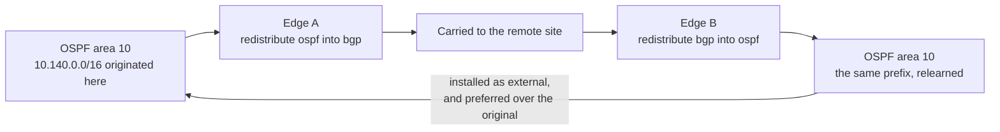

#### Route Tagging

The standard defence. Tag routes on the way out, and refuse to redistribute anything carrying that tag on the way back in. The tag survives redistribution in both OSPF and BGP, which makes it a reliable loop marker across the boundary.

```cisco
route-map OSPF-TO-BGP permit 10
 match tag 100
 set tag 100
!
route-map BGP-TO-OSPF deny 10
 match tag 100
```

#### Metric and Subnet Behaviour

Redistribution discards the source protocol's metric, because the two metrics are not comparable. A default metric must be supplied or the routes may be silently dropped. Into OSPF, external routes are type E2 by default, meaning the metric does not increase as the route travels — which makes two exit points look equally good from everywhere.

### Next-Hop Recursion

A routing table entry does not always point at an interface. A [[#BGP|BGP]] route points at a next-hop address, which must itself be resolved in the same table, usually via [[#OSPF|OSPF]], before the route can be installed and used.

```
10.200.5.0/24 via 10.255.255.2   ← BGP next hop
10.255.255.2/32 via 10.255.0.6   ← resolved by OSPF
10.255.0.4/30 is directly connected, Te1/1/1   ← finally an interface
```

A BGP prefix that is present but marked inaccessible is nearly always a recursion failure: the next hop is not in the table, or is not in the same [[#VRF|VRF]], or [[#iBGP|next-hop-self]] was never configured.

### Route Selection Summary

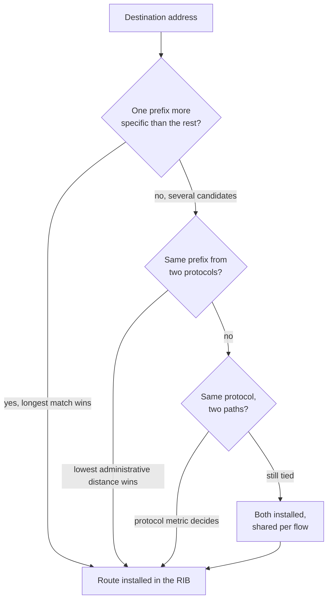

---

## Forwarding Plane

What the hardware actually does once the control plane has agreed.

### RIB and FIB

The routing information base is the control plane's collection of best routes. The forwarding information base is the hardware-optimised copy that packets are looked up in. They are normally identical, and when they are not, the FIB is the one telling the truth about where traffic is going.

```cisco
show ip route vrf CORP 10.200.5.10
show ip cef vrf CORP 10.200.5.10 detail
```

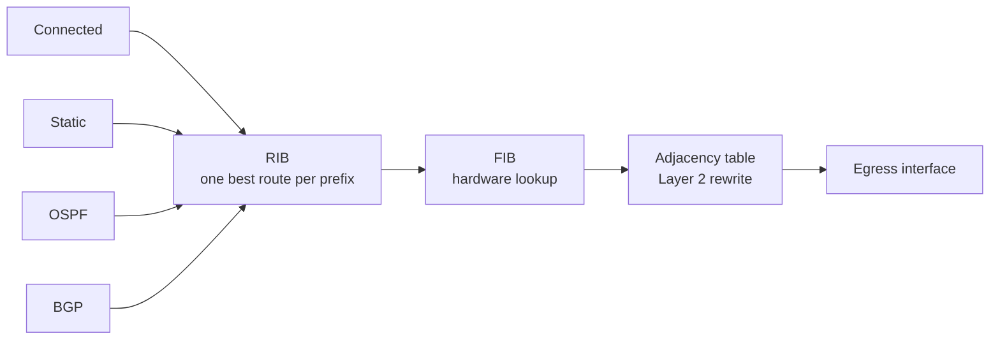

### Adjacency Table

The FIB says which next hop; the adjacency table says which rewritten Layer 2 header to put on the frame. An incomplete adjacency means the next hop has not been resolved by [[#ARP and the Default Gateway|ARP]] and the packet is dropped despite a perfectly valid route.

### ECMP

When several paths tie, all are installed and traffic is distributed by a hash of the flow's addresses and ports. This is per flow, not per packet, so ordering is preserved but a single large transfer uses exactly one path. It also means two consecutive tests may take different paths and produce different results.

```cisco
show ip cef exact-route 10.140.0.57 10.200.5.10
```

### MTU and Fragmentation

Every encapsulation costs bytes, and on a network with overlays or tunnels the effective MTU is smaller than the interface MTU.

|Encapsulation|Overhead|
|---|---|
|802.1Q tag|4 bytes|
|MPLS label|4 bytes per label|
|GRE|24 bytes|
|VXLAN|50 bytes, 54 with an inner tag|
|IPsec|Varies with cipher and mode, commonly 50 to 73 bytes|

```
Interface MTU 1500
 ├─ 802.1Q tag        4 bytes  ──→ 1496 usable
 ├─ Two MPLS labels   8 bytes  ──→ 1492 usable
 ├─ GRE              24 bytes  ──→ 1476 usable
 ├─ VXLAN            50 bytes  ──→ 1450 usable
 └─ IPsec        50-73 bytes   ──→ 1427 usable or less
```

Path MTU discovery depends on ICMP "fragmentation needed" messages returning to the sender. Where a firewall filters that ICMP, small packets succeed, large packets vanish, and the result is the classic partial failure: pings work, file transfers and HTTPS hang. The usual mitigations are raising MTU across the transit path and clamping TCP MSS at the tunnel edge.

### TTL

Each routed hop decrements TTL by one and discards the packet at zero, returning an ICMP time-exceeded message. This is what [[#Traceroute and Its Blind Spots|traceroute]] exploits, and it is why an MPLS core configured with `no mpls ip propagate-ttl` appears as a single hop.

---

## Overlay Transport

Where the site-to-site or fabric-to-fabric path is not a plain routed link. Overlays change what a trace looks like, because the underlay hops carry the traffic but never see the inner addresses.

### VXLAN EVPN

A data centre fabric that tunnels Layer 2 and Layer 3 traffic inside UDP, using [[#Address Families|BGP EVPN]] as the control plane instead of flooding and learning.

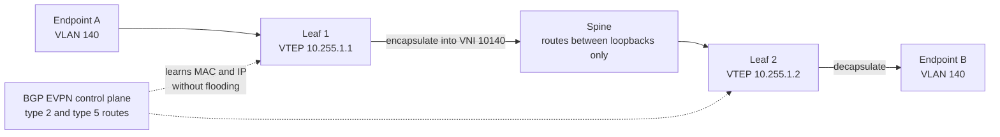

The spine forwards ordinary routed traffic between the two loopbacks and never sees the inner addresses.

#### VTEP

The tunnel endpoint, normally a leaf switch. It encapsulates traffic from locally attached endpoints and decapsulates traffic arriving from other VTEPs. Everything between two VTEPs is ordinary routed traffic between their loopbacks.

#### VNI

The 24-bit segment identifier inside the encapsulation. An L2VNI corresponds to a VLAN and carries bridged traffic; an L3VNI corresponds to a [[#VRF|VRF]] and carries routed traffic between subnets in that VRF. The VRF-to-L3VNI mapping is what preserves segmentation across the fabric.

#### EVPN Route Types

|Type|Purpose|
|---|---|
|2|MAC and MAC/IP advertisement — how endpoint reachability is learned without flooding|
|3|Multicast tunnel endpoint discovery — how broadcast and unknown unicast are replicated|
|5|IP prefix advertisement — how routed prefixes reach other VRFs and the external world|

### MPLS L3VPN

The provider equivalent of the same idea. The site's [[#WAN Edge|CE router]] peers with the provider's PE, the PE places the site's routes in a VRF with an [[#Route Target|RT]], and [[#MP-BGP VPNv4|MP-BGP]] carries them between PEs. From the enterprise side the provider cloud is one BGP hop, and the internal topology of the provider is invisible and not yours to troubleshoot.

### DMVPN and SD-WAN

Tunnel overlays across the internet or a hybrid transport. Both build tunnels between edge devices and run a routing protocol inside them, so the [[#MTU and Fragmentation|MTU]] arithmetic and the two-layer troubleshooting model apply. Reachability of the tunnel destination is an underlay question; reachability of a prefix through the tunnel is an overlay question, and the two must be tested separately.

---

## Edge and Policy Enforcement

Reachability is necessary but not sufficient. A path can be routed correctly and still be blocked deliberately.

### ACL

Stateless filters applied per interface and direction. On a segmented network they most often live on [[#SVI|SVIs]] and on [[#WAN Edge|WAN edge]] interfaces. Because they are stateless, return traffic needs its own permit, and an ACL that appears to break only replies is usually missing exactly that.

```cisco
show ip access-lists CLIENT-IN
show ip interface Vlan140 | include access list
```

### Firewall

Stateful inspection, usually between zones or between [[#VRF|VRFs]] acting as a [[#Fusion Device|fusion device]]. The firewall's session table is authoritative for whether a flow was ever established, and it is the first place to look when routing is provably correct and traffic still fails.

Firewalls also break [[#MTU and Fragmentation|path MTU discovery]] when they filter ICMP, and break otherwise valid flows when the return path bypasses them — see [[#Asymmetric Routing|asymmetric routing]].

### NAT

Address translation at the [[#Internet Edge|internet edge]]. Traced from inside, the packet's source address changes at the NAT device, which means captures taken on either side of it show different flows and cannot be correlated by address alone.

```cisco
show ip nat translations | include 10.140.0.57
```

### QoS

Classification, marking, queueing, and policing. QoS does not change where a packet goes, only whether it arrives on time or at all under congestion. A flow that is intermittently slow while the routing is stable is a QoS or congestion question, not a routing one.

### SGT

Scalable group tags carry policy identity with the packet rather than with its address, so that enforcement does not depend on VLAN or subnet. The tag is assigned at authentication by ISE and enforced downstream. This is the point where the routing design and the [[PBA - NAC - ISE Server#Policy|NAC policy]] meet: the network decides where a packet may go, and the tag decides whether it may.

---

## Supporting Services

Services that are not routing but fail in ways that look like routing. Each of them crosses the boundaries described above, and each breaks when a [[#VRF|VRF]] edge is crossed without being accounted for.

### DHCP Relay

Endpoints broadcast to find an address, and broadcasts do not cross a routed boundary. The [[#SVI|SVI]] turns that broadcast into a unicast toward the server.

```cisco
interface Vlan140
 ip helper-address 10.200.5.20
```

Three conditions must all hold, and each fails differently.

|Condition|Symptom when missing|
|---|---|
|The helper is on the endpoint's gateway SVI, on both members of the [[#First Hop Redundancy|FHRP]] pair|
|The server is reachable from the VRF that SVI belongs to|Discover packets leave and nothing returns|
|The server has a return route to the SVI address|Offers are generated but never arrive|

The relay inserts the SVI address into the request, and the server selects the scope from it. That is why a renumbered or added SVI silently breaks addressing even when routing is correct.

### DNS and NTP

Both normally live in [[#Shared Services VRF|shared services]] and are reached by leaked routes. Time in particular is a dependency of things that do not look time-related: certificate validation, log correlation across devices, and authentication all fail in confusing ways when clocks disagree, and the failures are reported as network faults.

### Multicast

Multicast builds its own forwarding state and follows its own rules. Unicast reachability is a prerequisite, not a guarantee.

#### RPF Check

A router accepts a multicast packet only on the interface it would use to send unicast traffic back toward the source. Where the forward and return unicast paths differ, the check fails and the stream is discarded on an otherwise healthy path — the multicast form of [[#Asymmetric Routing|asymmetric routing]].

```cisco
show ip rpf vrf CORP 10.200.9.5
```

#### IGMP Snooping

Constrains multicast flooding at Layer 2 by learning which ports have receivers. Without it, every group is flooded to every port in the [[#VLAN|VLAN]], which turns a single video stream into a campus-wide load problem.

#### PIM and the Rendezvous Point

In sparse mode, sources register with a rendezvous point and receivers join a shared tree toward it, then switch to a source-specific tree once traffic flows. Every router in the path must agree on which address is the RP; a disagreement produces receivers that join successfully and never receive anything.

#### Multicast in a VRF

Multicast routing is enabled and held per [[#VRF|VRF]], with its own tables and its own RP. As with unicast, a lookup in the wrong table returns nothing.

```cisco
show ip mroute vrf CORP
show ip pim vrf CORP neighbor
show ip igmp snooping groups
```

---

## Path of a Packet

The theory assembled into end-to-end walks. Each one is also a checklist — every arrow is a table you can read on a real device.

### Same VLAN, Same Switch

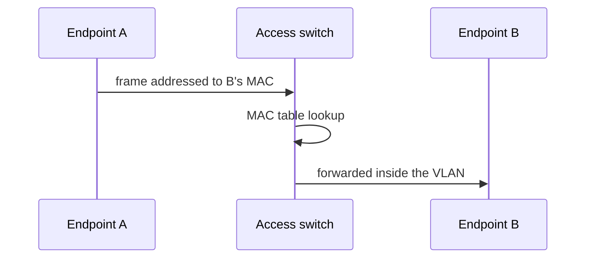

No routing at all. The switch looks up the destination MAC in its table and forwards. If this fails, the fault is in [[#VLAN|VLAN]] assignment, port state, [[#Spanning Tree|spanning tree]], or a Layer 2 security feature such as ARP inspection.

### Different VLAN, Same Site

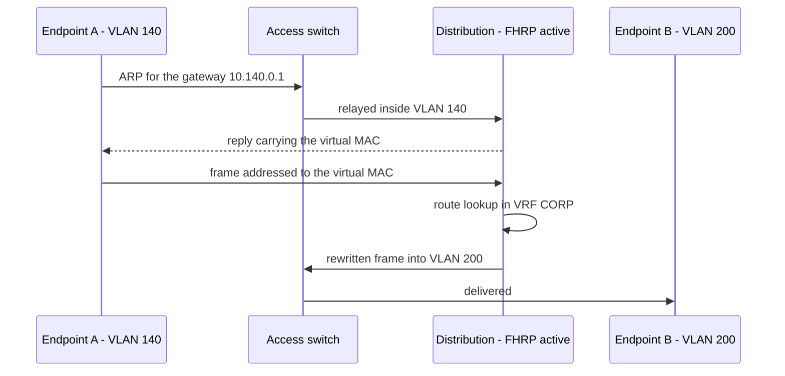

Two Layer 3 lookups' worth of state to verify: the [[#ARP and the Default Gateway|ARP entry]] for the gateway, the [[#First Hop Redundancy|FHRP]] state, the route in the correct [[#VRF|VRF]], and any [[#ACL|ACL]] on either SVI.

### Same VRF, Different Site

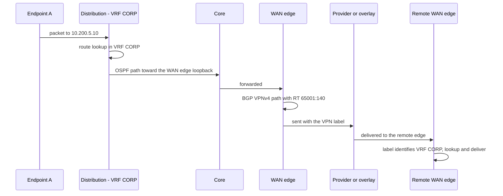

The prefix must exist in the local VRF, have been exported with the right [[#Route Target|RT]], imported at the far end, and have a next hop that resolves through [[#OSPF|OSPF]]. Four independent conditions, each with its own command.

### Across VRFs

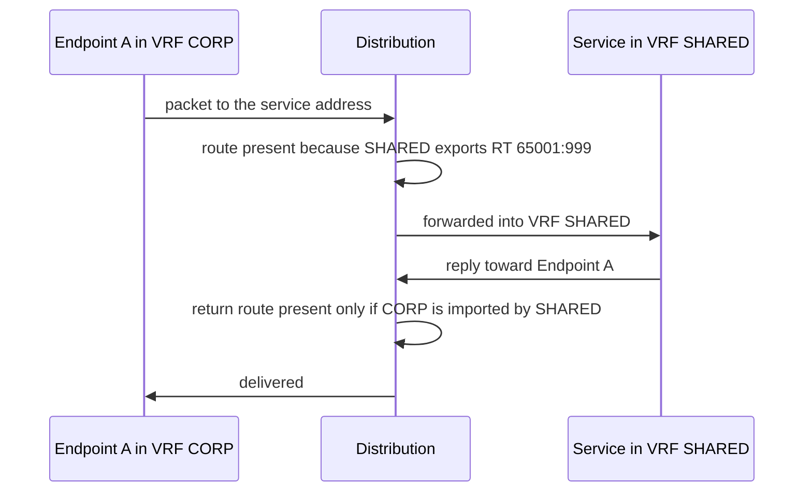

Both directions must be leaked. A one-way leak produces a flow that starts and never replies, which looks exactly like a firewall drop until you check the return route. See [[#Route Leaking|route leaking]].

### To the Internet

```mermaid
sequenceDiagram
    participant A as Endpoint A
    participant D as Distribution - VRF CORP
    participant I as Internet edge
    participant F as Firewall
    participant N as NAT
    participant P as Provider
    A->>D: packet to a public address
    D->>D: no specific route, default route used
    D->>I: forwarded to the internet edge
    I->>F: policy check, session created
    F->>N: source address translated
    N->>P: sent along the eBGP best path
```

The default route's origin matters: it is usually injected by the internet edge into [[#BGP|BGP]] or the [[#OSPF|IGP]], and a site with two exits will follow whichever is preferred by [[#Local Preference|local preference]] rather than by geography.

### The Return Path

Every walk above must be repeated in reverse before it is finished. Routing is per hop and per direction, and there is no rule requiring the two directions to match. Half of all "intermittent" faults are a return path that differs from the forward path in one hop.

---

## Moving Through the Network as an Operator

The practical procedure. It follows the same order as the packet, which is what makes it reliable — each step produces the input for the next.

### Sources of Truth

Documentation is a hypothesis and the device is the evidence. Start from the record, confirm on the hardware, and correct the record when the two disagree.

|Source|What it answers|How it fails|
|---|---|---|
|Topology diagram|Which devices exist and how they are meant to connect|Drifts after every unrecorded change|
|Address plan|Which subnet belongs to which site, [[#VLAN|VLAN]] and [[#VRF|
|Configuration archive|What the device looked like before today|Only as good as its last successful backup|
|Inventory and naming|Which physical device a hostname refers to|Hostnames survive relocations and rebuilds|
|Monitoring and flow data|What normal looked like, and when it stopped|Blind to anything not instrumented|
|Change records|Why something is the way it is|Usually the fastest explanation for a fault that started today|

> [!note] The most valuable record On a finished network the single most useful artefact is a captured baseline — the output of the verification commands taken while everything worked. Without one, "normal" has to be reconstructed from memory during an outage.

### Discovery Workflow

```mermaid
flowchart TD
    S["Endpoint address, mask,<br/>gateway and MAC"]
    M["MAC to port on the access switch"]
    A["ARP entry and FHRP state<br/>in the correct VRF"]
    R["Route lookup in that VRF<br/>note the protocol and next hop"]
    N{"Next hop reachable<br/>and no policy in the way?"}
    F["Fault is at this hop"]
    D{"Destination connected here,<br/>or outside your control?"}
    H["Connect to the next hop"]
    E["Trace complete"]

    S --> M --> A --> R --> N
    N -->|"no"| F
    N -->|"yes"| D
    D -->|"no"| H
    H --> R
    D -->|"yes"| E
```

#### Start at the Endpoint

Collect the IP address, the mask, the gateway, and the MAC. Confirm the endpoint's own view: an address obtained by DHCP in the expected range, a gateway that answers ARP, and DNS resolving to the address you expect to trace to. Half of reported network faults are resolved here.

#### MAC to Port

On the access switch, translate the MAC into a physical interface. This also proves which switch and which floor the endpoint is really on, which is frequently not where it was said to be.

```cisco
show mac address-table address 0011.2233.4455
show ip dhcp snooping binding | include 0011.2233.4455
```

#### ARP to Gateway

On the distribution pair, confirm the endpoint appears in the ARP table of the correct [[#VRF|VRF]], and confirm which chassis is [[#First Hop Redundancy|FHRP]] active. From here on, all lookups must specify the VRF.

```cisco
show ip arp vrf CORP 10.140.0.57
show standby brief
```

#### Route to Next Hop

Look up the destination in that VRF, note the next hop, and note the protocol that supplied it. If the route came from [[#BGP|BGP]], check that its next hop resolves — see [[#Next-Hop Recursion|next-hop recursion]].

```cisco
show ip route vrf CORP 10.200.5.10
show ip cef vrf CORP 10.200.5.10 detail
```

#### Repeat Hop by Hop

Connect to the next hop and repeat the route lookup. Continue until the destination is directly connected or leaves your administrative control. At each hop, three questions: is the route what I expect, is the next hop reachable, and is there policy on this interface.

> [!info] Why hop-by-hop beats guessing Every hop makes its own independent decision using only its own table. A path is not a thing that exists anywhere in the network — it is the accumulated result of many local decisions, and the only way to know it is to read each one.

### Traceroute and Its Blind Spots

Traceroute is the fastest first look and the least trustworthy final answer.

|Limitation|Effect|
|---|---|
|Shows only the forward path|The return path may be entirely different|
|[[#ECMP|ECMP]] hashing|
|MPLS TTL hiding|A whole provider core appears as one hop|
|ICMP rate limiting and filtering|Missing hops that are actually forwarding correctly|
|Wrong table by default|A router sources from the global table unless `vrf` is specified|

```cisco
traceroute vrf CORP 10.200.5.10 source Vlan140
```

### Reading a Live Configuration

Read narrowly. On a finished network the running configuration is thousands of lines, and the section commands are what make it navigable.

```cisco
show running-config interface Vlan140
show running-config | section router bgp
show running-config | section vrf definition CORP
show running-config | include ^ip route
```

### Building a Mental Map

Two commands describe most of a device's role before you read a single interface.

```cisco
show ip protocols
show vrf
show cdp neighbors detail
show lldp neighbors detail
```

`show ip protocols` reveals every routing process, its networks, its redistribution, and its filters. Neighbour discovery reveals the physical topology as it is, which regularly differs from the diagram.

---

## Changing a Finished Network

The difference between a build and a change is that a change has an audience.

### Blast Radius

Before any change, state what breaks if it is wrong. The answer is usually broader than it appears.

|Change|Blast radius|
|---|---|
|Access port VLAN|One endpoint|
|Trunk allowed VLAN list|Every VLAN on that uplink, in both directions|
|[[#SVI|SVI]] address or [[#First Hop Redundancy|
|[[#OSPF|OSPF]] cost or area|
|[[#Route Target|Route target]] or redistribution|
|[[#BGP Attributes|BGP attribute]] on an edge session|

### Draining a Device

Never reload a device that is still attracting traffic. Make it unattractive first, confirm traffic has moved, then work on it.

|Protocol|Method|Effect|
|---|---|---|
|OSPF|`max-metric router-lsa`|Advertises maximum cost, so the device remains reachable but is no longer used for transit|
|BGP|Graceful shutdown community, or lower [[#Local Preference|local preference]] and prepend the [[#AS Path|
|FHRP|Lower priority on the pair member|Moves the gateway to the peer with no endpoint impact|
|Platform|Graceful insertion and removal, where supported|Applies all of the above in one operation|

```mermaid
flowchart LR
    B["Capture the baseline"]
    U["Make the device unattractive<br/>max-metric, graceful shutdown,<br/>lower FHRP priority"]
    V["Verify traffic has moved<br/>counters, sessions, neighbours"]
    W["Perform the work"]
    R["Restore normal metrics"]
    C["Compare against the baseline"]

    B --> U --> V --> W --> R --> C
```

### Rollback Safety Nets

|Mechanism|Protects against|
|---|---|
|`reload in 10`|Losing access to a remote device — the pending reload restores the saved configuration if you cannot cancel it|
|`configure replace` from an archived configuration|A change that is wrong but has not cost you access|
|Configuration archive with logging|Not knowing what was changed, by whom, and when|
|Out-of-band console access|Everything else|

Save only after the change is verified. An unsaved change is the cheapest rollback available.

### Verifying a Change

A change is finished when the control plane, the forwarding plane, and the user experience all agree.

```cisco
show ip ospf neighbor
show bgp ipv4 unicast summary
show ip route vrf CORP <prefix>
show ip cef vrf CORP <prefix> detail
show logging | include ADJCHANGE|LINEPROTO
```

Compare against the same commands captured before the change. The pre-change capture is the only definition of "normal" that will be available at three in the morning.

---

## Common Failure Patterns

Symptoms that recur often enough to be recognised rather than investigated from first principles.

### Asymmetric Routing

Forward and return traffic take different paths. Harmless in a pure routing sense, fatal wherever a stateful [[#Firewall|firewall]] sits on only one of the two paths and drops replies belonging to a session it never saw. Suspect it when a flow fails only in one direction, or only for some destinations behind the same next hop.

```mermaid
flowchart LR
    C["Client"]
    FW["Stateful firewall"]
    S["Server"]
    ALT["Alternate path<br/>shorter or lower cost"]

    C -->|"forward path, session created"| FW
    FW --> S
    S -->|"return path chosen independently"| ALT
    ALT -->|"reply arrives with no matching session"| C
```

### MTU Black Hole

Small packets pass, large ones disappear. Ping succeeds, DNS succeeds, HTTPS and file transfers stall. Caused by an encapsulation shrinking the usable [[#MTU and Fragmentation|MTU]] combined with filtered ICMP. Confirm with a sweep of increasing sizes and the do-not-fragment bit set.

```cisco
ping vrf CORP 10.200.5.10 size 1500 df-bit
```

### Missing Route Target

A prefix is present in the [[#BGP|BGP]] table on the WAN edge but absent from the [[#VRF|VRF]] routing table at one site. The route is being advertised; nothing is willing to import it. Compare the [[#Route Target|RT]] carried by the route against the VRF's import list, and confirm `send-community extended` on the session.

### Recursion Failure

A BGP prefix is in the table, marked inaccessible or simply never installed. The next hop has no route, is in the wrong VRF, or was never rewritten because [[#iBGP|next-hop-self]] is missing. See [[#Next-Hop Recursion|next-hop recursion]].

### Redistribution Loop

Routes reappear with worse metrics, flap, or point back toward their origin. Two or more [[#Redistribution Points|redistribution points]] without [[#Route Tagging|tag filtering]]. The symptom often follows a change made at a completely different site.

### Suboptimal Exit

Traffic leaves through the wrong site or the wrong provider. Walk [[#BGP Path Selection|path selection]] in order — the answer is almost always [[#Local Preference|local preference]] at step 2 or [[#Next-Hop Recursion|IGP metric to the next hop]] at step 8.

### Flapping Adjacency

An [[#OSPF|OSPF]] neighbour or [[#BGP|BGP]] session repeatedly rises and falls, reconverging the network each time. Causes are physical (errors, a failing optic, a duplex mismatch), timing (aggressive timers over a congested link), or control-plane load. Look at interface error counters before touching protocol configuration.

### Duplicate Router ID

Two devices sharing a [[#Router ID|router ID]] produce adjacencies that never stabilise and database entries that overwrite each other. It appears after a device is rebuilt from a copied configuration and is easy to miss because everything else looks correct.

### Stuck at EXSTART

An [[#Adjacency Formation|OSPF adjacency]] that reaches EXSTART or EXCHANGE and goes no further is an MTU mismatch on the link, almost without exception.

---

## Command Quick Reference

### Layer 2 Commands

```cisco
show interface status
show interface trunk
show mac address-table address <mac>
show spanning-tree vlan <id> detail
show etherchannel summary
show ip dhcp snooping binding
show device-tracking database
```

### Layer 3 and VRF Commands

```cisco
show vrf
show vrf detail <name>
show ip interface brief | exclude unassigned
show ip arp vrf <name> <ip>
show standby brief
show ip route vrf <name> <ip>
show ip cef vrf <name> <ip> detail
show ip cef exact-route <src> <dst>
```

### OSPF Commands

```cisco
show ip ospf
show ip ospf neighbor
show ip ospf interface brief
show ip ospf database
show ip ospf border-routers
show ip route ospf
```

### BGP Commands

```cisco
show bgp ipv4 unicast summary
show bgp vpnv4 unicast all summary
show ip bgp <prefix> bestpath
show bgp vpnv4 unicast vrf <name> <prefix>
show ip bgp neighbors <ip> advertised-routes
show ip bgp neighbors <ip> routes
show ip bgp community <value>
```

### Reachability Commands

```cisco
ping vrf <name> <ip> source <interface>
ping vrf <name> <ip> size 1500 df-bit
traceroute vrf <name> <ip> source <interface>
```

### Change and Recovery Commands

```cisco
show archive
show archive config differences
configure replace flash:<file>
reload in 10
reload cancel
```