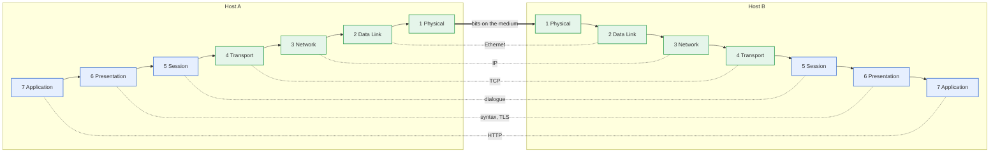
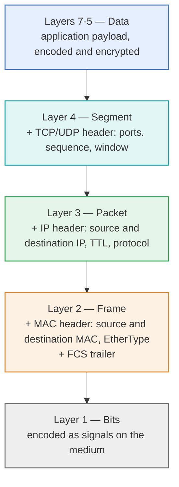
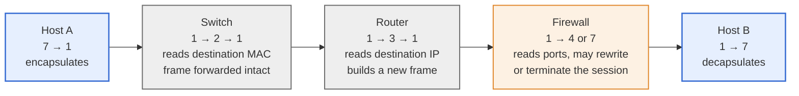

---
categories:
  - "[[Networking]]"
topic@networking:
  - "[[Networking General]]"
tags:
  - ccnp
  - encor
  - Networking
icon: FasNetworkWired
iconColor: "#003791"
last_update: 2026-07-15
---
The <strong>Open Systems Interconnection</strong> (OSI) model is a <strong>seven-layer reference model</strong> that describes how a communication system carries data between two applications running on different machines. It was published by the International Organization for Standardization as ISO/IEC 7498-1 and, in parallel, by the ITU-T as recommendation X.200. 

Each layer performs a defined group of functions, offers those functions as a service to the layer above it, and relies on the service of the layer below it. The model is the common vocabulary of networking: it is how engineers name where a protocol operates, what a device does, and at which point a fault occurs.

## Purpose and Scope

The model exists so that systems built independently by different vendors can interoperate — the "open" in Open Systems Interconnection. It does this by decomposing one very large problem, "move this data to that application", into seven smaller problems with defined boundaries between them.

What the decomposition buys:

- A shared vocabulary. "The problem is at layer 2" carries precise meaning between two engineers who have never met.
- Independent evolution. A layer can be replaced entirely without disturbing its neighbours, provided the service it offers is unchanged. Ethernet can become Wi-Fi without altering IP, TCP or HTTP.
- Bounded scope. A protocol designer inherits a defined service from below and must offer a defined service above; nothing else is their concern.
- Division of labour. Cabling, switching, routing and application development are separate disciplines because the model separates them.
- An order of investigation. A fault can be localised layer by layer instead of guessed at.

What it costs: every layer adds control information to the data, so bandwidth is spent on headers; some functions are performed more than once at different layers; and strict layering, followed literally, is slow enough that real implementations break it deliberately. These are covered in [[#Limitations of the Model|the limitations of the model]].

### A Reference Model, Not a Protocol Stack

Nothing in a modern network runs "the OSI stack". The model is a description of how communication functions should be organised, not software.

ISO did define a complete protocol suite alongside the model — CLNP (ISO 8473) at the network layer, [[#The OSI Transport Classes|transport classes TP0 to TP4]], and [[#The OSI Application Layer Protocols|FTAM, X.400 and X.500]] at the top. That suite lost to TCP/IP through the late 1980s and 1990s and is now almost entirely historical. What survived is the model itself and a handful of its protocols: IS-IS (ISO 10589) is still a mainstream routing protocol, X.500 shaped LDAP, and ASN.1 is still the notation behind X.509 certificates and SNMP.

The consequence matters when reading the rest of this note. The model describes, it does not dictate. Real protocols map onto it with varying degrees of comfort, several sit between layers, and a few refuse to sit anywhere.

### Origin and Standardization

Work began at ISO in 1977 in subcommittee TC97/SC16, at a point where every large vendor had its own incompatible network architecture. The seven-layer architecture is credited principally to Charles Bachman; Hubert Zimmermann's 1980 paper is its canonical published description. The model was issued as ISO 7498 in 1984 and revised as ISO/IEC 7498-1 in 1994, with CCITT (now ITU-T) publishing the identical text as X.200.

The Basic Reference Model has companion parts that are less well known but part of the same architecture:

- ISO/IEC 7498-1 — the Basic Reference Model: the seven layers themselves.
- ISO/IEC 7498-2 — the Security Architecture: which security services may be placed at which layer, discussed under [[#Security Controls by Layer|security controls by layer]].
- ISO/IEC 7498-3 — naming and addressing.
- ISO/IEC 7498-4 — the management framework.

## Layering Principles

A layer in the model is defined by four rules:

- It performs a related and well-defined set of functions.
- It uses only the service of the layer immediately below it.
- It offers a service to the layer immediately above it.
- It hides how it does its work from both.

The software or hardware implementing a layer on one system is an entity. Two entities at the same layer on two different systems are peer entities, and the rules they exchange messages by are the layer's protocol.

Two properties follow, and they are the whole point of the exercise. Vertical independence: a layer may be reimplemented, or swapped for something entirely different, without any layer above or below being rewritten. Horizontal interoperability: two implementations from two vendors interoperate if they agree on the protocol, whatever else differs between them.

### Services, Protocols and Interfaces

The model draws a distinction that is easy to lose and worth holding onto, because most confusion about layering comes from collapsing these three ideas into one.

- Service — what a layer offers upward. It is abstract and says what, never how. OSI describes a service with primitives: request, indication, response and confirm. "Deliver this packet to that address" is a service.
- Protocol — the rules, message formats and procedures that [[#Peer Communication|peer entities]] use to communicate with each other at the same layer on different systems. It is horizontal, and it is private to the layer: the layers above and below neither know nor care what it is.
- Interface — how the layer above reaches the service. It is vertical and local to a single machine. A socket API is an interface, not a protocol; it never appears on the wire.

The distinction explains why swapping Ethernet for Wi-Fi changes nothing above: the protocol changed completely, the service — deliver this frame to a neighbour on this link — did not.

### Service Access Points
[[]]
A Service Access Point (SAP) is the addressable point at which a layer offers its service to the layer above, and in practice it is the field in a header that tells the receiving layer which upper-layer entity a message belongs to. Any layer that can carry more than one kind of payload needs one, because without it [[#Encapsulation and Decapsulation|decapsulation]] cannot know where to hand the payload next.

The same idea appears at every layer under a different name:

|Layer|Demultiplexing field|Example values|
|---|---|---|
|Data link (802.2 LLC)|DSAP / SSAP|`0x42` = Spanning Tree, `0xAA` = SNAP|
|Data link (Ethernet II)|EtherType|`0x0800` = IPv4, `0x86DD` = IPv6, `0x0806` = ARP, `0x888E` = EAPOL, `0x8100` = 802.1Q|
|Network|IPv4 Protocol / IPv6 Next Header|`1` = ICMP, `6` = TCP, `17` = UDP, `47` = GRE, `50` = ESP|
|Transport|Destination port|`443` = HTTPS, `53` = DNS, `22` = SSH|

Every one of these answers the same question: which entity above me does this payload belong to? Recognising a SAP for what it is makes the whole encapsulation chain legible — each header contains a pointer to the meaning of the next.

### Peer Communication

Layer N on one host behaves as though it is speaking directly to layer N on the other host. That conversation is logical. Physically, nothing crosses between them: the data travels down the sender's stack, across the medium, and up the receiver's stack. Only [[#Layer 1 — Physical Layer|layer 1]] transfers anything at all.

The practical form of the abstraction is that each layer writes its header for its peer and reads only its own. The receiving transport layer reads the transport header; the layers it passed through on the way did not inspect it and did not need to.

The dashed lines are the protocols — the conversations each layer believes it is having. The solid path down, across and up is what actually happens.

### Protocol Data Units

Three terms describe the data as it moves between layers:

- <strong>SDU</strong> (<strong>Service Data Unit</strong>) — the data a layer receives from the layer above. To the receiving layer it is opaque payload, to be delivered unchanged to its peer's layer above.
- <strong>PCI</strong> (<strong>Protocol Control Information</strong>) — the header, and at [[#Layer 2 — Data Link Layer|layer 2]] also the trailer, that the layer adds for its peer.
- <strong>PDU</strong> (<strong>Protocol Data Unit</strong>) — SDU plus PCI: the complete unit the layer hands down.

One rule generates the entire stack: the layer N PDU becomes the layer N-1 SDU. What one layer regards as a structured message with a header is, to the layer beneath, an undifferentiated block of bytes.

|Layer|Common PDU name|
|---|---|
|7 Application|Data|
|6 Presentation|Data|
|5 Session|Data|
|4 Transport|Segment (TCP) or Datagram (UDP)|
|3 Network|Packet|
|2 Data Link|Frame|
|1 Physical|Bit or symbol|

The names segment, packet and frame are not ISO terminology — the standard simply calls them N-PDUs — but they are universal in practice, and using them precisely is a useful discipline. A router forwards packets; a switch forwards frames; the difference in the sentence is the difference in the device.

### Encapsulation and Decapsulation

Encapsulation is a layer wrapping the SDU it received in its own control information. Decapsulation is the reverse. Together they are the mechanism that turns the abstract layering into concrete bytes.

Going down the sending stack, each layer prepends its header, and layer 2 also appends a trailer. Going up the receiving stack, each layer checks its own header, strips it, reads its [[#Service Access Points|SAP]] field, and hands the remainder to the entity above.

Encapsulation has a hard constraint attached to it. The frame that layer 2 can carry has a maximum payload — the maximum transmission unit (MTU), 1500 bytes on standard Ethernet — and everything above must fit inside it. That single number propagates upward as pressure: it is why the transport layer performs [[#Segmentation and Reassembly|segmentation]], why the network layer performs [[#Fragmentation and Reassembly|fragmentation]], and why the payload an application actually gets is smaller than the MTU.

A standard IPv4 and TCP conversation over untagged Ethernet spends 54 bytes per frame on headers: 14 for Ethernet, 20 for IPv4, 20 for TCP. The 1518-byte frame carries 1460 bytes of application data. A VLAN tag, a tunnel header or IPsec each take a further bite out of the same budget.

## The Seven Layers

The layers are numbered from the medium upward: layer 1 is closest to the wire, layer 7 closest to the user.

| #   | Layer                                           | PDU                | Addressing             | Core responsibility                                         |
| --- | ----------------------------------------------- | ------------------ | ---------------------- | ----------------------------------------------------------- |
| 7   | [[#Layer 7 — Application Layer\|Application]]   | Data               | None (names, URIs)     | Provide network services to application processes           |
| 6   | [[#Layer 6 — Presentation Layer\|Presentation]] | Data               | None                   | Data representation, encryption, compression                |
| 5   | [[#Layer 5 — Session Layer\|Session]]           | Data               | None                   | Establish, manage and terminate dialogues                   |
| 4   | [[#Layer 4 — Transport Layer\|Transport]]       | Segment / Datagram | Port number            | End-to-end delivery to the correct process, reliability     |
| 3   | [[#Layer 3 — Network Layer\|Network]]           | Packet             | Logical (IP) address   | End-to-end delivery across interconnected networks, routing |
| 2   | [[#Layer 2 — Data Link Layer\|Data Link]]       | Frame              | Physical (MAC) address | Node-to-node delivery over one link, media access           |
| 1   | [[#Layer 1 — Physical Layer\|Physical]]         | Bit                | None                   | Transmit raw bits over a medium                             |

| #   | Layer        | Representative protocols and standards                       | Devices                                              |
| --- | ------------ | ------------------------------------------------------------ | ---------------------------------------------------- |
| 7   | Application  | HTTP, DNS, DHCP, SMTP, FTP, SSH, SNMP, LDAP, RADIUS          | Proxy, WAF, next-generation firewall, API gateway    |
| 6   | Presentation | TLS, ASN.1/DER, JPEG, MPEG, ASCII, Unicode, MIME             | Terminating proxies, TLS offload                     |
| 5   | Session      | RPC, NetBIOS, SIP, L2TP and PPTP control channels            | Session-aware gateways                               |
| 4   | Transport    | TCP, UDP, SCTP, QUIC, DCCP                                   | Stateful firewall, NAT/PAT, L4 load balancer         |
| 3   | Network      | IPv4, IPv6, ICMP, IPsec, OSPF, IS-IS, BGP, EIGRP             | Router, layer 3 switch, packet filter                |
| 2   | Data Link    | Ethernet 802.3, Wi-Fi 802.11, 802.1Q, STP, LACP, PPP, 802.1X | Switch, bridge, wireless access point, NIC           |
| 1   | Physical     | 10BASE-T through 400GBASE, RS-232, DSL, SONET, radio         | Hub, repeater, transceiver, media converter, cabling |

### Upper and Lower Layers

The seven divide naturally into two groups, and the split is more than presentational.

- Layers 5 to 7, the host or application layers, exist only on the end systems. They are concerned with the content of the conversation and the dialogue about it. No device in the middle of the network implements them as a matter of course.
- Layers 1 to 4, the media or data-flow layers, are concerned with getting bits from one place to another. Layers 1 to 3 are implemented in the network itself as well as in the hosts.

Layer 4 is the hinge. It is the lowest layer that only the end systems implement, and traditionally the highest that intermediate devices ignore. Every device that looks above layer 4 — a proxy, a WAF, an application load balancer — is doing something the model did not anticipate, and pays for it in state and in cost.

### Layer 1 — Physical Layer

The physical layer transmits raw bits over a medium. It defines the mechanical, electrical, functional and procedural means to activate, maintain and deactivate a physical connection between two systems. It has no idea what the bits mean, where they came from or where they are ultimately going; it knows only how to put a one on the wire and recover it at the other end.

Everything above depends on it and nothing above can compensate for it. A layer 1 fault does not present as a layer 1 fault — it presents as [[#Error Detection|CRC errors]] at layer 2, retransmissions at layer 4 and a slow application at layer 7.

#### Physical Layer Functions

- <strong>Bit representation</strong> — <strong>encoding a binary one and zero as a signal</strong>: a <mark style="background: #ABF7F7A6;">voltage</mark>, a <mark style="background: #FFF3A3A6;">light pulse</mark>, a <mark style="background: #CACFD9A6;">radio symbol</mark>.
- <strong>Data rate</strong> — <mark style="background: #FFB8EBA6;">how many bits per second</mark>, and therefore how long a bit lasts on the medium.
- <strong>Bit synchronization</strong> — keeping sender and receiver clocked together so the receiver samples each bit at the right instant.
- <strong>Physical topology</strong> — <mark style="background: #BBFABBA6;">how the devices are physically wired together</mark>.
- <strong>Transmission mode</strong> — simplex, half-duplex or full-duplex.
- <strong>Physical characteristics</strong> — connectors, pinouts, voltage levels, wavelengths, maximum distances, power.

#### Transmission Media

| Medium                                         | Characteristics                                         | Constraints                                                                                                   |
| ---------------------------------------------- | ------------------------------------------------------- | ------------------------------------------------------------------------------------------------------------- |
| <strong>Twisted pair copper</strong> (UTP/STP) | Cheap, easy to terminate, Cat5e through Cat8            | 100 m for BASE-T; susceptible to EMI, crosstalk and attenuation; shielding needs proper bonding               |
| Coaxial                                        | Legacy 10BASE2/10BASE5; still used by DOCSIS and for RF | Largely displaced in the LAN                                                                                  |
| <strong>Multimode fibre</strong>               | 50 or 62.5 µm core, LED or VCSEL sources, short reach   | Modal dispersion limits distance; cheap optics                                                                |
| <strong>Single-mode fibre</strong>             | 8–10 µm core, laser sources, long reach                 | Expensive optics; the only choice over distance; dirty connectors are a leading fault                         |
| <strong>Wireless (radio)</strong>              | No cabling, mobility                                    | Shared, unbounded medium; interference, multipath, attenuation; capacity shared between all stations in range |

Fibre carries two structural advantages over copper that matter to the layers above: immunity to electromagnetic interference, and no electrical continuity between endpoints. It is also the hardest of the three to tap unnoticed — intercepting it requires bending or splicing the strand, and both show up as a measurable change in the optical budget, whereas copper can be tapped inductively and radio needs no tap at all.

#### Signaling and Encoding

A bit cannot simply be placed on a wire. <mark style="background: #FFF3A3A6;">It must be represented as a signal that the receiver can recover</mark>, and <mark style="background: #BBFABBA6;">that recovery has requirements</mark> the naive representation does not meet: <mark style="background: #ABF7F7A6;">the receiver must be able to extract a clock from the signal</mark>, and <mark style="background: #D2B3FFA6;">long runs of the same value must not build a DC offset</mark>.

Line coding solves both, at the cost of overhead:

|Encoding|Used by|Notes|
|---|---|---|
|Manchester|10BASE-T|A transition in the middle of every bit — self-clocking, at the cost of half the usable bandwidth|
|4B/5B with MLT-3|100BASE-TX|Four data bits sent as five code bits to guarantee transitions; 25% overhead|
|8B/10B|1000BASE-X, older SANs|Guarantees DC balance and transitions; 25% overhead|
|4D-PAM5|1000BASE-T|Five voltage levels across four pairs simultaneously, in both directions|
|64B/66B|10GBASE-R and above|Only 3% overhead — the trade the higher speeds could not afford to keep paying|

Two further distinctions belong here:

- <strong>Baseband</strong> versus <strong>broadband</strong> — <mark style="background: #CACFD9A6;">baseband uses the whole medium for one signal</mark> (<strong>Ethernet</strong>, <mark style="background: #CACFD9A6;">hence the BASE in every name</mark>); <mark style="background: #FFB8EBA6;">broadband</mark> <mark style="background: #FFB8EBA6;">divides it into frequency channels carrying independent signals</mark> (DOCSIS, DSL, radio).
- <strong>Bit rate</strong> versus <strong>baud rate</strong> — <strong>baud</strong> <mark style="background: #FF5582A6;">is symbols per second</mark>; <strong>bit</strong> rate <mark style="background: #FFB86CA6;">is bits per second</mark>. Modulation schemes such as QAM, PSK and OFDM carry several bits per symbol, so the two numbers differ. The ceiling on how many bits a symbol can carry is set by the noise on the channel, formalised by the Shannon–Hartley theorem — which is why a marginal cable negotiates a lower speed rather than simply erroring.

#### Physical Topology

<strong>Point-to-point</strong>, <strong>bus</strong>, <strong>star</strong>, <strong>ring</strong> and <strong>mesh</strong> describe the wiring. They must be kept distinct from the logical topology, which describes how the signal actually flows: 10BASE-T wired through a hub is a physical star and a logical bus, since every station receives every transmission and shares one [[#Collision and Broadcast Domains|collision domain]]. A switched network is a physical star and a logical point-to-point mesh, which is why [[#Media Access Control|media access control]] became unnecessary on it.

#### Duplex and Synchronization

- Simplex — one direction only.
- Half-duplex — both directions, one at a time. Requires arbitration for the medium.
- Full-duplex — both directions simultaneously. On twisted pair this means one pair transmits and another receives; collisions become impossible by construction.

Ethernet autonegotiation (802.3u clause 28) lets two interfaces agree speed and duplex by exchanging capabilities in the link pulses. Its classic failure is the duplex mismatch: one side negotiated, the other hard-coded, and the two end up disagreeing. The half-duplex side detects collisions the full-duplex side never stops causing, and the result is late collisions, FCS errors and throughput that collapses under load while a ping still succeeds. It is the archetypal layer 1 problem that reports itself as a layer 2 counter and is experienced as a layer 7 complaint.

#### Physical Layer Devices

- <mark style="background: #ABF7F7A6;">Cabling, patch panels and connectors</mark> — the medium itself, and the most common point of failure.
- <mark style="background: #ABF7F7A6;">Transceivers and optics</mark> — SFP, SFP+, QSFP; matching optic to fibre type and to distance is a layer 1 design decision.
- <mark style="background: #ABF7F7A6;">Repeaters and media converters</mark> — regenerate or translate a signal without interpreting it.
- <mark style="background: #ABF7F7A6;">Hubs</mark> — multiport repeaters. A hub reproduces every incoming signal on every other port, which places all its ports in one [[#Collision and Broadcast Domains|collision domain]] and forces half-duplex operation. Obsolete, but the reason switching exists.

A device belongs to layer 1 when it acts on the signal without reading the frame. That is the whole test.

### Layer 2 — Data Link Layer

The data link layer delivers frames between nodes that share a link or a segment. <mark style="background: #FFB8EBA6;">It takes the undifferentiated bit stream</mark> <strong>layer 1</strong> provides and <mark style="background: #FF5582A6;">imposes structure on it</mark>: where a frame begins and ends, who it is for, whether it arrived intact, and — when the medium is shared — who is allowed to transmit.

Its defining property is scope. The data link layer knows only its own segment. It has no concept of a network beyond the next device, and no mechanism to reach one. That limitation is precisely what [[#Layer 3 — Network Layer|layer 3]] exists to remove.

#### Data Link Layer Functions

- <strong>Framing</strong> — delimiting the bit stream into discrete units.
- <strong>Physical addressing</strong> — identifying the sender and the intended receiver on the segment.
- <strong>Error detection</strong> — determining whether a frame arrived intact.
- <strong>Flow control</strong> — preventing a fast sender from overwhelming a slow receiver on the link.
- <strong>Media access control</strong> — arbitrating a shared medium.

#### LLC and MAC Sublayers

IEEE 802 divides the layer in two, and the split is the reason a single network layer can sit on top of many different media:

- LLC — Logical Link Control, IEEE 802.2. The upper sublayer. It presents one consistent interface to the network layer regardless of what medium lies beneath, and it multiplexes upper-layer protocols using DSAP and SSAP fields. It defines three service types: Type 1, unacknowledged connectionless, which is what almost everything uses; Type 2, connection-oriented with sequencing and acknowledgement; Type 3, acknowledged connectionless.
- <strong>MAC</strong> — <strong>Media Access Control</strong>. The lower sublayer, and the medium-specific half: <strong>framing</strong>, <strong>MAC addressing</strong>, the <strong>frame check sequence</strong>, and the access method. Ethernet's MAC and Wi-Fi's MAC differ completely; the LLC above them need not.

In practice Ethernet II framing displaced 802.2 for routed traffic. The two bytes after the source address hold either a length (802.3 with an LLC header following) or an EtherType (Ethernet II), and the receiver distinguishes them by value: 1500 or below is a length, 1536 (`0x0600`) or above is an EtherType. Since IP is carried in Ethernet II frames, LLC is absent from the overwhelming majority of traffic — but it persists in control protocols, and recognizing it matters when reading a capture. STP BPDUs use LLC with DSAP and SSAP `0x42`; CDP uses LLC with SNAP (DSAP and SSAP `0xAA`, OUI `0x00000C`, protocol ID `0x2000`); LLDP, by contrast, is a plain Ethernet II frame with EtherType `0x88CC`.

#### Framing

Framing answers a question layer 1 cannot: <mark style="background: #BBFABBA6;">where does one unit of data end and the next begin</mark>. <strong>Ethernet</strong> answers it with a preamble of seven bytes of alternating ones and zeros for clock recovery, a one-byte start frame delimiter, the frame itself, and then a mandatory inter-frame gap of 96 bit times before the next.

| Field                 | Size              | Purpose                                                  |
| --------------------- | ----------------- | -------------------------------------------------------- |
| Preamble              | 7 bytes           | Clock synchronisation                                    |
| Start Frame Delimiter | 1 byte            | Marks the first bit of the frame                         |
| Destination MAC       | 6 bytes           | Who the frame is for on this segment                     |
| Source MAC            | 6 bytes           | Who sent it                                              |
| 802.1Q tag            | 4 bytes, optional | TPID `0x8100`, priority (PCP), DEI, 12-bit VLAN ID       |
| EtherType / Length    | 2 bytes           | The [[#Service Access Points\|SAP]]: what the payload is |
| Payload               | 46–1500 bytes     | The layer 3 packet; 1500 is the MTU                      |
| Frame Check Sequence  | 4 bytes           | CRC-32 over the frame                                    |

Two numbers in that table have consequences elsewhere. The 1500-byte maximum payload is the MTU that constrains every layer above it. The 46-byte minimum forces padding of short payloads, and exists because [[#Media Access Control|CSMA/CD]] requires a frame long enough that a collision reaches the sender before it stops transmitting — 64 bytes total, or 512 bit times, at 10 and 100 Mb/s. The minimum is a fossil of a medium almost nobody still uses.

A frame carrying an 802.1Q tag runs to 1522 bytes rather than 1518. Jumbo frames of around 9000 bytes are widely implemented and standardized nowhere; every device on the path must agree on them or the mismatch surfaces as a [[#Fragmentation and Reassembly|PMTU]] problem.

#### Physical Addressing

A MAC address is 48 bits, written as twelve hexadecimal digits. The first 24 bits are an Organizationally Unique Identifier assigned by the IEEE to the manufacturer; the remaining 24 are assigned by that manufacturer. Two bits inside the first octet carry meaning:

- The I/G bit, least significant bit of the first octet: 0 means unicast, 1 means multicast. The broadcast address `FF:FF:FF:FF:FF:FF` is the all-ones case.
- The U/L bit, second least significant bit of the first octet: 0 means the address is globally unique as assigned, 1 means it is locally administered.

The critical property of MAC addressing is that it is flat. There is no hierarchy in the address, so there is nothing to summarize: a switch must learn every single MAC address in its broadcast domain individually, and a frame for an address it has not learned must be flooded everywhere. This does not scale, and it is the reason [[#Logical Addressing|logical addressing]] exists. Put simply, a MAC address says who a device is, and an IP address says where it is.

#### Error Detection

The <strong>frame check sequence</strong> carries a CRC-32 computed over the frame. The receiver recomputes it and compares. On a mismatch the frame is discarded silently.

Three things follow, and each is regularly misunderstood:

- It is detection, not correction. Nothing is repaired.
- Ethernet does not retransmit. There is no acknowledgement and no recovery at this layer; a lost frame is noticed, if at all, by [[#Connection-Oriented Service|TCP]] or by the application. 802.11 is the exception — a wireless medium is lossy enough that acknowledging and retransmitting per frame is worth the cost.
- The layer that detects an error is not the layer that caused it. A rising CRC counter is a layer 2 report of a layer 1 defect: a damaged cable, a dirty or failing optic, EMI, or a [[#Duplex and Synchronization|duplex mismatch]].

#### Data Link Flow Control

- IEEE 802.3x PAUSE frames — a receiver close to overrun sends a PAUSE to its link partner, which stops transmitting for a stated interval. It is blunt: it stops everything on the link, including traffic that had nothing to do with the congestion.
- <strong>IEEE 802.1Qbb</strong> Priority Flow Control — the refinement, pausing individual 802.1p priority classes rather than the link. It is what makes lossless fabrics such as FCoE and RoCE possible.

Both are strictly one hop. They are not related to [[#Flow Control and Congestion Control|TCP's flow control]], which is end-to-end and knows nothing about any individual link.

#### Media Access Control

When a medium is shared, only one station may transmit at a time, and something must arbitrate. The mechanism chosen shapes the technology.

- CSMA/CD — Carrier Sense Multiple Access with Collision Detection, classic Ethernet. Listen; transmit if quiet; if a collision is detected, send a jam signal and back off for a random interval that doubles with each successive collision. It requires half-duplex operation and a minimum frame size, and it degrades badly under load. On a full-duplex switched link it is meaningless and is disabled.
- CSMA/CA — Collision Avoidance, used by 802.11. A radio cannot hear a collision while transmitting, so collisions must be avoided rather than detected: interframe spacing, random backoff before transmitting, explicit acknowledgement of every frame, and optionally RTS/CTS to reserve the medium and mitigate the hidden node problem.
- Token passing — Token Ring (802.5) and FDDI. A station may transmit only while holding the token. Deterministic and collision-free, with a bounded worst-case delay — which is why it outlived Ethernet in industrial contexts long after losing the office.

The general trade-off is contention against determinism: contention is cheap and fast when the medium is quiet, and unpredictable when it is busy. Switched full-duplex Ethernet sidesteps the question by removing the shared medium.

#### Collision and Broadcast Domains

Two scopes define what a layer 2 network is, and the difference between them is the difference between a hub, a switch and a router.

- A collision domain is the set of interfaces whose transmissions can collide with each other. A hub joins all its ports into one. A switch gives every port its own. Full duplex reduces it to nothing at all.
- A broadcast domain is the set of interfaces a broadcast frame reaches. A switch floods broadcasts to every port in the VLAN, so all of them are one domain. The boundary is a router, or the edge of the VLAN.

A switch builds its MAC address table by learning source addresses from frames it receives, forwards known unicast out one port, and floods unknown unicast, broadcast and multicast. What it cannot do is survive a loop: an Ethernet frame has no TTL, so a frame circulating a physical loop circulates until the topology changes, and broadcast traffic multiplies at every pass until the segment collapses. Spanning Tree exists to prevent that — an entire protocol whose reason for being is a field the frame header does not have and [[#Routing and Path Determination|the packet header does]].

#### Data Link Layer Devices and Protocols

Devices: network interface cards, bridges, switches, wireless access points.

| Protocol / standard                                                                           | Role                                                                                                       |
| --------------------------------------------------------------------------------------------- | ---------------------------------------------------------------------------------------------------------- |
| <strong>Ethernet</strong> (IEEE 802.3)                                                        | Framing, MAC addressing, media access for wired LANs                                                       |
| <strong>Wi-Fi</strong> (IEEE 802.11)                                                          | The wireless equivalent, with its own MAC and access method                                                |
| <strong>IEEE 802.1Q</strong>                                                                  | VLAN tagging — segmenting one physical switch into many broadcast domains                                  |
| <strong>STP</strong> / <strong>RSTP</strong> / <strong>MSTP</strong> (802.1D, 802.1w, 802.1s) | Loop prevention by blocking redundant paths                                                                |
| <strong>LACP</strong> (802.3ad, now 802.1AX)                                                  | Bundling physical links into one logical link                                                              |
| <strong>LLDP</strong> (802.1AB) and <strong>CDP</strong>                                      | Neighbour discovery and topology information                                                               |
| <strong>IEEE 802.1X</strong>                                                                  | Port-based <strong>network access control</strong>; EAPOL carries EAP in a frame, EtherType `0x888E`       |
| MACsec (802.1AE)                                                                              | Encryption and integrity per link                                                                          |
| PPP, HDLC, Frame Relay, ATM                                                                   | Point-to-point and legacy WAN encapsulations                                                               |
| <strong>ARP</strong>                                                                          | Straddles layers 2 and 3 — see [[#Supporting Network Layer Protocols\|supporting network layer protocols]] |

<strong>802.1X</strong> deserves a note because it inverts the usual assumption about this layer. Layer 2 normally forwards anything it receives; 802.1X makes the port itself conditional, holding all traffic — including the DHCP and DNS that layers above depend on — until an authentication exchange completes. It is a layer 2 mechanism whose decision is made by a layer 7 protocol on a server several hops away.

### Layer 3 — Network Layer

The network layer delivers packets from a source host to a destination host across an arbitrary number of intervening networks. Where [[#Layer 2 — Data Link Layer|layer 2]] knows only its own segment, layer 3 knows the path. Two functions define it: an address that identifies both a host and the network it belongs to, and a decision at each hop about where to send the packet next.

The service IP offers is deliberately minimal — connectionless and best-effort. It does not guarantee delivery, order or integrity of the payload, and it establishes nothing in advance. Every guarantee anyone wants is built above it, which is the single design decision that made the internet scale.

#### Network Layer Functions

- <strong>Logical addressing</strong> — hierarchical, configurable addresses that identify a host and its network.
- <strong>Path determination</strong> — building a picture of the topology and deciding where each destination lies.
- <strong>Packet forwarding</strong> — moving a packet toward that destination, hop by hop.
- <strong>Fragmentation and reassembly</strong> — fitting packets into links with smaller MTUs.
- <strong>Error reporting and diagnostics</strong> — ICMP.

#### Logical Addressing

An IP address has two parts: a network portion and a host portion, split by a subnet mask or prefix length. That hierarchy is the whole difference from [[#Physical Addressing|MAC addressing]]. Because addresses on a network share a prefix, a router can hold one route for millions of hosts, and can advertise one summary to its neighbors instead of an entry per device. A flat address space cannot be aggregated; a hierarchical one can, and aggregation is what makes a global routing table possible at all.

- IPv4 — 32 bits, written as four decimal octets. Unicast, multicast, broadcast.
- IPv6 — 128 bits, written as hexadecimal groups. Unicast, multicast, anycast; no broadcast, its functions replaced by multicast.

An IP address is assigned by configuration or DHCP rather than burned into hardware, and it describes a position in the topology rather than a piece of equipment. Move a laptop to another building and its MAC is unchanged while its IP must change — the two addresses answer different questions, and both are needed on every frame for exactly that reason.

#### Routing and Path Determination

A router holds a routing table, matches each packet's destination address against it using longest prefix match, and forwards the packet to the next hop. 
It decrements the TTL (Hop Limit in IPv6) as it does so, and discards the packet if it reaches zero. That field is why a routing loop is survivable and a [[#Collision and Broadcast Domains|switching loop]] is not, and it is also what traceroute exploits.

Two planes are worth separating:

- <strong>Control plane</strong> — how the table is built: static configuration, or a dynamic routing protocol exchanging reachability with neighbors.
- <strong>Data plane</strong> — how a packet is matched against the table and forwarded, ideally in hardware and without the control plane's involvement.

|Category|Protocols|Notes|
|---|---|---|
|Interior gateway (IGP)|OSPF, IS-IS, EIGRP, RIP|Routing inside one administrative domain; optimise for convergence|
|Exterior gateway (EGP)|BGP|Routing between domains; optimises for policy over path length|

Each router decides independently and knows only the next hop, not the whole path. When several sources offer a route to the same prefix, a metric ranks paths within a protocol and administrative distance ranks the protocols against each other.

IS-IS is worth singling out: it is an OSI protocol, defined in ISO 10589 for CLNP, and it is still in wide use in service provider cores. It runs directly over layer 2 rather than inside IP, which means it carries IPv4 and IPv6 reachability equally well and cannot be attacked with an IP packet. It is the model's most successful surviving protocol.

#### Fragmentation and Reassembly

A packet that is larger than the next link's MTU cannot be sent as it is. The two IP versions answer differently:

- IPv4 — a router may fragment the packet itself if the Don't Fragment bit is clear. Fragments are reassembled only at the destination, never by an intermediate router. Losing one fragment costs the whole packet, and the mechanism is expensive enough that it is best avoided.
- IPv6 — routers never fragment. A router that cannot forward a packet discards it and returns ICMPv6 Packet Too Big, leaving fragmentation to the source.

Path MTU Discovery is the mechanism that keeps this from happening: the source sends with DF set and lowers its estimate whenever an ICMP message tells it to. Its classic failure is a firewall configured to drop all ICMP, which silently removes the feedback — small packets pass, large ones vanish, and the connection hangs after the handshake succeeds. Tunnels make it worse by shrinking the effective MTU with every layer of wrapping, as described under [[#Tunneling and Layer Recursion|tunneling and layer recursion]].

#### Supporting Network Layer Protocols

|Protocol|Function|Position|
|---|---|---|
|ICMP / ICMPv6|Error reporting and diagnostics; ping and traceroute|Carried inside IP, yet part of layer 3 itself|
|ARP|Resolves a known IPv4 address to a MAC address on the segment|Serves layer 3 but is carried directly in a frame with EtherType `0x0806`, not inside IP — hence "layer 2.5"|
|NDP|IPv6's replacement for ARP, plus router and prefix discovery|Runs over ICMPv6, so unambiguously layer 3|
|IGMP / MLD|Multicast group membership signalling|Layer 3, though switches snoop it to make layer 2 decisions|
|IPsec (AH, ESP)|Authentication, integrity and confidentiality for IP packets|Layer 3, and therefore transparent to every application above it|

ARP is the most instructive anomaly in the whole model. It exists purely to bridge the gap between the two addressing schemes, so it cannot be cleanly placed in either layer that owns them, and it fits nowhere the model has a slot for.

#### Network Layer Devices

- Router — the canonical layer 3 device. It terminates a frame, reads the packet, decides, and builds a new frame for the next hop.
- Layer 3 switch — the same functions implemented in hardware, on a chassis with many ports. The distinction from a router is engineering, not architecture.
- Packet-filtering firewall — filters on addresses and, in practice, on [[#Ports and Multiplexing|ports]] as well.

Every routed interface is the boundary of a [[#Collision and Broadcast Domains|broadcast domain]]. This is the structural reason routers segment networks and switches do not: not policy, but the fact that a router regenerates the frame rather than forwarding it.

### Layer 4 — Transport Layer

The transport layer is the first end-to-end layer. Its header is written by one host and read by the other, and no router in between inspects it or is expected to. It does two things layer 3 does not: it delivers data to the correct process on the destination host rather than merely to the host, and it decides how much reliability the conversation gets.

That second point is the layer's real character. [[#Layer 3 — Network Layer|IP]] offers a best-effort service and nothing more. Everything an application expects — that the bytes arrive, arrive once, and arrive in order — is either constructed here or knowingly given up here.

#### Transport Layer Functions

- Service-point addressing — identifying the process, not just the host.
- Multiplexing and demultiplexing — many conversations over one IP address.
- Segmentation and reassembly — cutting the application's data to fit, and putting it back together.
- Connection control — establishing and releasing a connection, or dispensing with one.
- Flow control — end-to-end, protecting the receiver.
- Error control — end-to-end, detecting and repairing loss.

#### Ports and Multiplexing

A port is a 16-bit number and the transport layer's [[#Service Access Points|SAP]]. IANA divides the range:

|Range|Name|Use|
|---|---|---|
|0–1023|Well-known|Standard services; traditionally require privilege to bind|
|1024–49151|Registered|Assigned to specific applications on request|
|49152–65535|Dynamic / ephemeral|Allocated by the OS as client source ports|

An IP address plus a port is a socket. A connection is identified by the five-tuple of protocol, source address, source port, destination address and destination port — and it is the uniqueness of that tuple, not of the port, that lets one server answer thousands of clients on port 443 while one client holds dozens of conversations at once.

Ports are also where policy is applied. Firewall rules, NAT translations and load-balancer decisions are overwhelmingly written against this field, which is why a firewall is a layer 4 device even though its work is fundamentally about layer 3 reachability.

#### Segmentation and Reassembly

The application may hand down a stream, or an object of any size. It must be cut to fit the path's MTU minus every header below — the maximum segment size. TCP numbers each byte with a sequence number, so the receiver can put segments back in order, detect a gap and ask for what is missing. UDP does none of this: an oversized datagram is handed to IP whole and becomes [[#Fragmentation and Reassembly|IP fragments]], which is the long-standing fragility behind large DNS responses.

The distinction from network-layer fragmentation is worth stating plainly: transport segmentation is planned at the source, once, with knowledge of the connection. Network fragmentation is a reaction in the middle of the path by a device that knows nothing about the conversation. One is design; the other is damage control.

#### Connection-Oriented Service

TCP establishes a connection before any data moves, using a three-way handshake — SYN, SYN-ACK, ACK — during which each side announces its initial sequence number and its window. Teardown is a FIN exchange, or an abrupt RST.

What the connection buys:

- Reliability — every byte is acknowledged; unacknowledged data is retransmitted on a timeout or on duplicate ACKs. Selective acknowledgement lets the receiver report exactly which blocks arrived.
- Ordered delivery — sequence numbers restore the order the network destroyed.
- Integrity — a checksum covering the payload and a pseudo-header built from the IP addresses. That pseudo-header is a deliberate layering violation: layer 4 reaching into layer 3 so a misdelivered segment cannot be accepted.

What it costs: at least one round trip before any payload moves, and connection state on both endpoints — memory that a SYN flood exists to exhaust.

#### Connectionless Service

UDP adds eight bytes — source port, destination port, length, checksum — and nothing else. No handshake, no ordering, no retransmission, no state.

That is the right trade in four situations, and recognising them explains most of the protocol map above:

- Latency matters more than completeness — voice and video, where a retransmitted packet arrives too late to play.
- The exchange is a single request and response — DNS, DHCP, SNMP, syslog, NTP; a handshake would cost more than the data.
- The application implements its own reliability and wants control of it — QUIC.
- A tunnel needs the lightest possible wrapper that NAT and load balancers will still hash on — VXLAN, GTP.

#### Flow Control and Congestion Control

Two problems that are routinely conflated, and that the transport layer solves separately:

- Flow control protects the receiver. TCP's receiver advertises a window — the amount of data it currently has buffer for — and the sender may not exceed it. It is a conversation between two endpoints about one of them.
- Congestion control protects the network. Nobody advertises anything; the sender infers congestion from loss and delay and reduces its rate. The mechanisms are slow start, congestion avoidance, fast retransmit and fast recovery; the algorithms include Reno, CUBIC and BBR.

The sending rate is the minimum of the two windows. The distinction matters because the symptoms differ: flow control produces a well-behaved slow transfer, congestion control produces loss, retransmission and sawtooth throughput.

Neither is related to [[#Data Link Flow Control|802.3x PAUSE]], which acts on one link and knows nothing of the connection.

#### The OSI Transport Classes

The ISO transport protocol defines five classes, TP0 through TP4, distinguished by how much error recovery and multiplexing they perform. The choice depends on how reliable the network service beneath is assumed to be: TP0 is minimal and assumes a reliable connection-oriented network such as X.25; TP4 assumes an unreliable network and provides detection and recovery itself, making it the closest OSI analogue of TCP.

They are rarely encountered now, but they explain something about the model that a TCP/IP-only view obscures: OSI treats reliability as a property to be negotiated and placed where it is needed, not as a fixed feature of one protocol.

#### Other Transport Protocols

|Protocol|Distinguishing property|
|---|---|
|SCTP|Message-oriented rather than stream-oriented; multi-homing across several addresses; multi-streaming so that loss in one stream does not block another. Used in telecom signalling|
|DCCP|Congestion control without reliability — for applications that want to be a good network citizen but not to wait for retransmissions|
|QUIC|Connections, reliability, congestion control and TLS 1.3, implemented in userspace over UDP. Functionally a transport protocol; architecturally the payload of one|

QUIC is the clearest modern case of the model straining. It exists in that shape not because the layering suggested it but because middleboxes made it impossible to deploy a new protocol number, and putting a transport inside UDP was the only path through. See [[#Protocols That Do Not Fit Cleanly|protocols that do not fit cleanly]].

#### Transport Layer Devices

- Stateful firewall — tracks connection state and filters on ports and flags.
- NAT / PAT — rewrites addresses and ports together, which is why it is a layer 3 and layer 4 function at once, and why it breaks any protocol that carries its own address in the payload.
- Layer 4 load balancer — distributes connections by five-tuple without reading a byte of content.

### Layer 5 — Session Layer

The session layer establishes, manages and terminates the dialogue between two applications. Its questions are not about delivery, which is settled below it, but about structure: who may speak now, where do we resume if this breaks, and when is this exchange finished.

#### Session Layer Functions

- Session establishment, maintenance and release — a session is an association between applications that may span more than one transport connection, or outlive one.
- Dialogue control — whether the conversation is two-way simultaneous or two-way alternate, and, in the alternating case, token management to decide which side holds the right to transmit.
- Synchronization — inserting checkpoints into the data stream so that a failure resumes from the last checkpoint rather than the beginning. Transferring a large file over a session that drops is the motivating example.
- Activity management — grouping an exchange into activities that can be started, interrupted, resumed and ended as units.

#### Session Layer Examples

- Remote procedure call and its descendants.
- NetBIOS session service and SMB sessions.
- The control channels of PPTP and L2TP, which set up a tunnel that other traffic then uses.
- SIP, which establishes, modifies and tears down media sessions that RTP subsequently carries.
- RTCP, which reports on and controls an RTP stream alongside it.
- SOCKS, and TLS session resumption via tickets — session semantics grafted onto other layers.

#### Why the Session Layer Is Contested

In a TCP/IP network, almost nothing implements this layer as a distinct layer. TCP handles establishment and teardown at layer 4. Applications manage their own dialogue and their own state — an HTTP cookie, a TLS session ticket, an application-level transaction ID. The functions the model describes here are real and are all present in working systems; they are simply distributed between the transport layer and the application rather than isolated.

This is the main reason the [[#Comparison with the TCP/IP Model|TCP/IP model]] collapses layers 5, 6 and 7 into a single application layer, and the reason the session layer is the one most engineers cannot name an example of on demand.

### Layer 6 — Presentation Layer

The presentation layer is concerned with the syntax and semantics of the information exchanged, rather than with its delivery. It is the only layer that cares what the bits mean. Its job is to ensure that what one host sends is understood as the same thing by the other, whatever the two differ in internally.

#### Presentation Layer Functions

- Translation — between a machine's local representation and a common transfer syntax agreed on the wire.
- Encryption and decryption — confidentiality and integrity of the payload.
- Compression and decompression — reducing the volume before transmission, reversibly.

#### Data Representation

Two machines may disagree about almost everything below the level of meaning: character encoding (ASCII, EBCDIC, UTF-8), integer byte order (big-endian versus little-endian, which is why network byte order is defined as big-endian and why every socket program calls `htons` and `ntohl`), floating-point format, and structure alignment.

The OSI answer is ASN.1: describe the data in an abstract syntax that says what the fields mean, then encode it with a defined transfer syntax — BER, DER or PER — that says exactly how they appear as bytes. It is the part of the OSI suite with the longest afterlife. X.509 certificates, SNMP MIBs, LDAP messages and most telecom signalling are ASN.1 encoded, which means every TLS handshake in existence parses a presentation-layer artefact from 1984.

The modern analogues do the same work under other names: JSON, XML, Protocol Buffers, MIME types, and the media formats themselves (JPEG, PNG, GIF, MPEG). When an HTTP response carries `Content-Type: application/json; charset=utf-8`, that is presentation-layer negotiation being conducted inside an application-layer header — a fair illustration of how thoroughly the two have merged in practice.

#### Compression

Compression belongs here because it changes the representation of the data without changing its meaning, and must be undone before the receiving application sees it. In practice it is performed either by the application (gzip or brotli in HTTP, negotiated by `Accept-Encoding`) or by the medium at layer 1 and 2 for modems and WAN links. It also interacts badly with [[#Encryption|encryption]]: compressing before encrypting leaks information about the plaintext through the ciphertext length, which is the basis of the CRIME and BREACH attacks.

#### Encryption

Encryption sits here because it transforms the representation of the payload independently of how the payload is delivered.

TLS is conventionally placed at this layer, and it does not fit cleanly. It runs over TCP, conducts its own handshake (session-like), negotiates a cipher suite and encodes certificates in ASN.1 (presentation-like), and is invoked explicitly by the application (application-like). Its position on the model is a matter of convention rather than of standard, and arguing about whether it is layer 5, 6 or 7 is less useful than noticing why the question has no answer.

What is worth extracting is the general principle, because it is one of the model's genuinely practical lessons: the layer at which encryption is applied determines what it protects.

- MACsec at layer 2 protects one link. The next switch sees plaintext.
- IPsec at layer 3 protects a path between two networks or hosts, transparently, for every application above it.
- TLS at layer 6 protects one conversation end to end, regardless of the path, but only for the application that asked for it.

Each is doing the same arithmetic and defending against a different adversary. The choice of layer is the choice of threat model.

### Layer 7 — Application Layer

The application layer is the closest to the user and the most commonly misdescribed. It is not the application. A browser is not layer 7; HTTP is. A mail client is not layer 7; SMTP and IMAP are. The layer provides the network services that application processes use, and defines the protocols by which those services are requested and answered — it is the top of the stack, not the thing sitting on it.

#### Application Layer Functions

- Identifying the communication partner and determining that it is available and willing.
- Authenticating and authorising, where the protocol provides for it.
- Agreeing the syntax and the constraints of the exchange.
- Providing the service itself — file transfer, mail, name resolution, remote access, directory, management, web.

#### Common Application Layer Protocols

|Service|Protocols and default ports|
|---|---|
|Web|HTTP (80), HTTPS (443), HTTP/2, HTTP/3 over [[#Other Transport Protocols\|QUIC]] (UDP 443)|
|Name resolution|DNS (53 UDP and TCP), DoT (853), DoH (443)|
|Address assignment|DHCP (67, 68), DHCPv6 (546, 547)|
|File transfer|FTP (21 control, 20 data), TFTP (69), SFTP and SCP over SSH (22), SMB (445), NFS (2049)|
|Mail|SMTP (25, 587), IMAP (143, 993), POP3 (110, 995)|
|Remote access|SSH (22), Telnet (23), RDP (3389)|
|Management|SNMP (161, 162), syslog (514), NETCONF (830), RESTCONF (443)|
|Time|NTP (123)|
|Directory|LDAP (389), LDAPS (636)|
|AAA|RADIUS (1812, 1813), TACACS+ (49)|
|Messaging and IoT|MQTT (1883, 8883), AMQP (5672)|
|Voice and video signalling|SIP (5060, 5061), H.323|

#### The OSI Application Layer Protocols

The suite ISO defined at this layer, recorded for completeness because the terms still appear in older documentation and in standards that outlived them:

- FTAM — File Transfer, Access and Management, the counterpart of FTP.
- X.400 — Message Handling System, the counterpart of SMTP.
- X.500 — Directory Services. Its Directory Access Protocol was too heavy to deploy, and the lightweight version written to run over TCP/IP became LDAP. The `cn`, `ou` and `o` naming in every directory and every certificate subject is X.500's.
- VT — Virtual Terminal, the counterpart of Telnet.
- CMIP — Common Management Information Protocol, the counterpart of SNMP.
- ACSE, ROSE and RTSE — common service elements for association control, remote operations and reliable transfer, factored out for reuse by the protocols above.

#### Application Layer Devices

Proxies (forward and reverse), web application firewalls, next-generation firewalls, layer 7 load balancers and application delivery controllers, API gateways, email security gateways, DNS filters.

Every one of them shares a property that follows directly from the model: to act on layer 7 they must implement everything beneath it. A layer 7 load balancer cannot forward a packet — it must terminate the TCP connection, decrypt the TLS session, parse the HTTP request, and then open a new connection of its own. That is why layer 7 devices are expensive, stateful, and the hardest thing in the path to make redundant.

## Data Flow Through the Stack

The layers describe a system at rest. Putting them in motion — following one piece of data from an application to another — is what makes the abstraction concrete and what most of the model's practical value comes from.

### The Sending Host

Data moves from layer 7 to layer 1, gaining a header at each step:

1. The application produces data and hands it to the stack.
2. The presentation layer encodes it into a transfer syntax and encrypts it.
3. The session layer associates it with a dialogue.
4. The transport layer cuts it into segments, adds source and destination ports and a sequence number.
5. The network layer adds source and destination IP addresses, consults the routing table, and selects an exit interface and a next hop.
6. The data link layer resolves the next hop's MAC address with ARP or NDP, builds the frame, and computes the FCS.
7. The physical layer encodes the frame as signals and transmits.

One detail in step 6 is where most misunderstanding of the model concentrates. The destination MAC address is the next hop's — the default gateway, if the destination is not on the local segment — and not the destination host's. It follows directly from the layers' scopes: [[#Layer 2 — Data Link Layer|layer 2]] reaches one hop, [[#Layer 3 — Network Layer|layer 3]] reaches the destination. Both addresses are on the frame because both questions must be answered at once.

### Intermediate Devices

Every device between the two hosts climbs only as far up the stack as its function requires, and then comes back down.

|Device|Climbs to|What it does|
|---|---|---|
|Hub|1|Regenerates the signal on every other port. Reads nothing|
|Switch|2|Reads the destination MAC, consults the MAC table, forwards. The IP header is untouched; the frame is forwarded as it arrived, apart from a VLAN tag|
|Router|3|Decapsulates the frame, reads the destination IP, matches the longest prefix, decrements the TTL, recomputes the IPv4 header checksum, then builds an entirely new frame with new source and destination MAC addresses and a new FCS|
|Stateful firewall|4|Everything the router does, plus a decision based on ports and connection state; may rewrite addresses and ports for NAT|
|Proxy or WAF|7|Terminates the connection, decrypts, parses the application protocol, and opens a separate connection onward|

One invariant summarises the whole picture, and it is worth committing to memory because it explains more captures than any other single fact: the IP addresses stay the same from end to end, except where NAT deliberately rewrites them, while the MAC addresses change at every hop. The packet survives the journey; the frame is rebuilt for each link it crosses.

### The Receiving Host

Data moves from layer 1 to layer 7, losing a header at each step. Each layer verifies what it can, strips its own header, reads its [[#Service Access Points|SAP]] field, and hands the payload to the entity that field identifies:

1. The physical layer recovers bits from the signal.
2. The data link layer verifies the FCS, checks the destination MAC is its own or a group it belongs to, reads the EtherType — `0x0800`, so IPv4 — and passes the packet up.
3. The network layer verifies the header checksum, confirms the destination address is its own, reads the protocol number — `6`, so TCP — and passes the segment up.
4. The transport layer verifies the checksum, uses the destination port to find the socket, reorders segments, acknowledges, and presents a byte stream.
5. The application reads the stream, decrypts and decodes it, and acts.

### Worked Example — Loading a Web Page

A single page load exercises every layer, several times over.

1. The browser has a name and needs an address. It sends a DNS query: layer 7 is DNS, layer 4 is UDP to port 53, layer 3 addresses the resolver, layer 2 frames it to the default gateway, layer 1 signals it. The answer returns the same way, inverted.
2. TCP opens a connection to the server's port 443 with a three-way handshake. This is layer 4 state on two machines that may be continents apart; none of the routers between them knows the connection exists.
3. TLS negotiates. The server's certificate is an ASN.1/DER structure — a [[#Data Representation|presentation-layer artefact]] — and the cipher suite is agreed. The session ticket the server issues for resumption is, in the model's terms, [[#Layer 5 — Session Layer|session-layer]] behaviour.
4. The browser sends `GET /` inside a TLS record: a layer 7 request, encrypted at layer 6.
5. The response is compressed at layer 6, cut into segments at layer 4, routed as packets at layer 3, framed hop by hop at layer 2, and signalled on every link at layer 1.
6. Each device on the path reads as far up as its function requires and no further.

The independence the model promises is visible in what that sequence does not depend on. Replacing Wi-Fi with Ethernet changes steps 1 and 2 not at all. Replacing IPv4 with IPv6 changes nothing above layer 3. Replacing HTTP/2 over TCP with HTTP/3 over QUIC changes nothing below layer 4. Each of those substitutions would be an enormous undertaking without layering, and each is routine with it.

## Comparison with the TCP/IP Model

The OSI model describes networking; the TCP/IP model describes the network that actually exists. Both are in daily use, which is why the mapping between them has to be understood rather than chosen between.

### Layer Mapping

|OSI|TCP/IP (RFC 1122, four layers)|Five-layer hybrid|Examples|
|---|---|---|---|
|7 Application|Application|Application|HTTP, DNS, SMTP|
|6 Presentation|Application|Application|TLS, ASN.1, JPEG|
|5 Session|Application|Application|Session tickets, RPC|
|4 Transport|Transport|Transport|TCP, UDP|
|3 Network|Internet|Network|IPv4, IPv6, ICMP|
|2 Data Link|Link|Data Link|Ethernet, 802.11|
|1 Physical|Link|Physical|Cabling, optics, radio|

The five-layer hybrid in the middle column is what most teaching material and most working engineers actually use: OSI's clean separation of physical from data link, without OSI's session and presentation layers that nothing implements separately. It is not a standard, and it is the most honest description of the two.

### Differences in Approach

- Order of invention. OSI's model was written before its protocols, by committee, and the protocols were designed to fit it. TCP/IP's protocols came first and the model was written afterwards to describe what already worked. This is the conventional explanation for why one supplies the vocabulary and the other supplies the network.
- Strictness. OSI carefully separates [[#Services, Protocols and Interfaces|service, interface and protocol]]. TCP/IP does not, which makes it a poorer teaching tool and a more tolerant engineering one.
- Layer count. TCP/IP has no session or presentation layer, and merges physical and data link into one link layer, because it deliberately declines to say anything about the medium — the property that let it run over anything from Ethernet to a telephone line to a satellite.
- Network layer service. OSI's network layer was specified to offer both connectionless and connection-oriented service. IP offers connectionless only, and pushes every guarantee to [[#Layer 4 — Transport Layer|TCP]]. That single decision is why the internet's core is stateless and cheap.
- Outcome. The OSI protocol suite is a historical footnote; the OSI model is how the industry talks about the TCP/IP protocols that beat it.

## Practical Use

### Structured Troubleshooting

The model's most-used application is that it gives faults an order. Three approaches, chosen by symptom:

- Bottom-up — start at layer 1 and work up. The default when a link is newly installed, or when something is plainly down.
- Top-down — start at the application. Appropriate when one service or one user is affected while everything else works.
- Divide and conquer — start at layer 3 with a ping. The result tells you which direction to go, and it is the fastest approach for anyone with an educated guess.

|Layer|What to check|Tools|Typical symptoms|
|---|---|---|---|
|1|Link state, cable, patch, optic type and levels, distance, power, speed and duplex|`show interface`, optical diagnostics, cable tester|Port down or flapping, error counters rising, throughput collapses under load|
|2|MAC table, VLAN membership, trunk allowed list, STP state, port security, 802.1X authorisation|`show mac address-table`, `show vlan`, `show spanning-tree`, `show authentication sessions`|Port up but no traffic, wrong VLAN, err-disabled, CRC errors, broadcast storm|
|3|Address, mask, gateway, routing table, ACLs, TTL, ARP table|`ping`, `traceroute`, `show ip route`, `show ip arp`|Destination unreachable, no route, asymmetric path, works locally but not remotely|
|4|Listening socket, firewall rule, NAT translation, session table|`telnet host port`, `nc`, `ss`, `netstat`, `show conn`|Connection refused or timing out, one port works and another does not|
|5–7|Name resolution, certificate validity and chain, authentication, application configuration, path MTU|`dig`, `nslookup`, `curl -v`, `openssl s_client`, browser developer tools|TLS errors, HTTP errors, partial page loads, transfers that hang once they get large|

The discipline the model enforces is a single rule: establish that the layer below is healthy before blaming the layer above. Its corollary is the one that saves the most time — the layer reporting an error is frequently not the layer causing it. [[#Error Detection|CRC errors]] at layer 2 almost always mean a defect at layer 1. A TLS failure at layer 6 is never solved by replacing a cable.

### Security Controls by Layer

ISO/IEC 7498-2 extends the reference model with a security architecture. It defines five security services — authentication, access control, data confidentiality, data integrity and non-repudiation — and eight mechanisms that provide them, and its central claim is that each can be placed at whichever layer suits the threat. The practical form of that claim:

|Layer|Representative threats|Representative controls|
|---|---|---|
|1|Physical tap, fibre splice, cable cut, RF jamming|Locked rooms and cabinets, conduit, disabling unused ports, optical power monitoring|
|2|MAC flooding, ARP spoofing, rogue DHCP server, VLAN hopping, rogue STP root, unauthorised devices|Port security, dynamic ARP inspection, DHCP snooping, disabling DTP and avoiding VLAN 1 as native, BPDU guard and root guard, 802.1X and MAB, MACsec|
|3|IP spoofing, route injection, reconnaissance|ACLs, unicast reverse path forwarding, routing protocol authentication, IPsec|
|4|SYN flood, port scanning, session hijacking|Stateful firewall, SYN cookies, rate limiting, TCP-AO|
|5–7|Injection, malware, phishing, credential theft, DNS poisoning, certificate abuse|TLS with proper validation, WAF, proxies, DNSSEC and DNS filtering, mail gateways, patching, strong authentication|

Two rules generalise from the table, and both come straight from the layering itself. A control's reach is the reach of its layer — [[#Encryption|MACsec protects a wire, IPsec a path, TLS a conversation]]. And a control cannot see what happens above it: a layer 4 firewall permitting port 443 has permitted every application willing to speak on it, which is the entire reason layer 7 inspection exists and the entire reason it is expensive.

### Vendor Terminology

Products are named after the highest layer they act on, and the number is a real claim rather than marketing:

- Layer 2 switch — forwards on MAC addresses.
- Layer 3 switch — routes in hardware.
- Layer 4 load balancer — distributes by five-tuple, content unread.
- Layer 7 load balancer or firewall — reads hostnames, URLs and headers, and therefore must terminate and re-originate the connection.
- Layer 2 VPN versus layer 3 VPN — whether the customer's frames or their packets are what the provider carries.
- "Layer 4–7 services" — everything a middlebox does above routing.

Reading the number as a depth of encapsulation makes the rest of the datasheet predictable: how much state the device holds, how expensive it is per gigabit, how it fails, and how much of the conversation it can break.

## Limitations of the Model

### Protocols That Do Not Fit Cleanly

|Protocol|Nominal layer|Why it resists|
|---|---|---|
|ARP|2 / 3|Serves layer 3, but rides directly in a frame with its own EtherType rather than inside a packet|
|ICMP|3|Carried inside IP as though it were a payload, yet it is part of the network layer itself|
|MPLS|"2.5"|A label between the frame and the packet; forwards without reading the IP header at all|
|TLS|5 / 6 / 7|Handshake, cipher negotiation and explicit application invocation spread across three layers|
|QUIC|4, inside 4|Transport semantics implemented in userspace over UDP|
|802.1X / EAPOL|2|Carries EAP — an authentication protocol with no layer of its own — in a frame, to authorise a port, on the decision of a server reached at layer 7|
|VXLAN, GRE, IPsec tunnels|Recursive|A complete stack inside the payload of another stack|

The pattern is consistent: the awkward cases are the ones that bridge two layers, and the model has no vocabulary for a thing that belongs to two layers at once. It has only layers.

### Tunneling and Layer Recursion

Encapsulation assumes a fixed order — 7 down to 1, once. A tunnel breaks the assumption. VXLAN places an Ethernet frame inside UDP inside IP inside another Ethernet frame, putting layer 2 above layer 4. The model is not so much violated as re-entered: the outer stack is delivering a payload that happens to be another stack.

The consequences are practical rather than theoretical:

- Every wrapper reduces the MTU available to the payload, which makes tunnels the most common cause of [[#Fragmentation and Reassembly|path MTU]] failures.
- "The destination IP" becomes ambiguous. Which one — inner or outer — depends entirely on where in the path the question is asked.
- A device's visibility is set by where it sits relative to the tunnel, not by how many layers it can parse. A layer 7 firewall inspecting the outer stack of a tunnel sees UDP to port 4789 and nothing else.

### Model Versus Deployment

The model is a map. Several things about the territory do not match it:

- Layers 5 and 6 rarely exist as separate code. Their functions are real and are absorbed into layer 4 and layer 7.
- Strict layering is violated on purpose. The [[#Connection-Oriented Service|TCP checksum]] covers a pseudo-header built from IP addresses — layer 4 reading layer 3. NAT rewrites layer 3 and layer 4 together. QoS marks frames and packets at layers 2 and 3 based on a classification made at layer 7.
- Functions are duplicated. Error detection appears at layers 2, 3 and 4; flow control at 2 and 4. This is not simply waste — the FCS protects one link and the TCP checksum protects the whole path, and they catch different faults — but it does show the layers are not disjoint.
- Performance work exists mainly to skip layer boundaries. TSO, LRO, checksum offload, RDMA and kernel bypass are all ways of not paying for the abstraction, and they exist because the abstraction has a measurable cost.

None of this diminishes the model. It is a map, and its value was never that it is the territory — it is that everyone is using the same one.

### Layer 8

Not part of ISO/IEC 7498-1 and not part of any standard. Engineering slang extends the stack upward: layer 8 is the user, and in the longer version of the joke layer 9 is politics and layer 10 is money. It is invoked when a fault is not technical.

It is worth knowing because it appears in conversation and in ticket notes, and worth remembering that it has no standing whatsoever — including when someone uses it to close a ticket that a layer 1 through 7 problem is still open behind.