---
categories:
  - "[[Networking]]"
topic@networking:
  - "[[Networking General]]"
tags:
  - category/networking/networking_general
  - encor/routing
icon: FasNetworkWired
iconColor:
last_update: 2026-07-21
aliases:
  - Open Shortest Path First
---
Open Shortest Path First (OSPF) is a link-state interior gateway protocol (IGP) that computes loop-free routes by having every router build an identical map of the topology and independently run Dijkstra's shortest-path algorithm against it. It is standardised as OSPFv2 (RFC 2328) for IPv4 and OSPFv3 (RFC 5340) for [[IPv6]].

Defining characteristics:

- Link-state, not distance-vector — routers exchange topology, not routes, and each computes its own tree.
- Runs directly over IP as protocol 89, not over TCP or UDP.
- Uses cost as its metric, derived from interface bandwidth.
- Scales through a two-level area hierarchy anchored on a backbone.
- Converges quickly, because a topology change triggers targeted flooding and a recalculation rather than a slow hop-by-hop update.
- Cisco assigns it an administrative distance of 110, applied uniformly to intra-area, inter-area, and external routes.

## Operational Overview

_The lifecycle every OSPF router runs through, from a cold interface to installed routes._

The protocol proceeds in distinct stages. Each has a dedicated section below; this overview is the map.

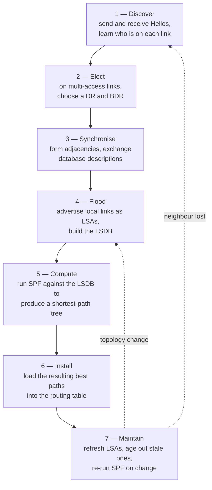

A router first uses the [[#Hello Protocol|Hello protocol]] to find neighbours. On multi-access segments it participates in a [[#Designated and Backup Designated Router|DR]] election. It then brings selected neighbours to a full [[#Neighbors and Adjacencies|adjacency]], during which the two routers synchronise their databases. Once synchronised, each router originates [[#Link-State Advertisements (LSAs)|LSAs]] describing its own links, and these flood through the [[#Areas|area]] until every router holds an identical [[#Link-State Database|LSDB]]. Each router then runs [[#SPF Calculation|SPF]] over that database, and the best paths are installed. From then on the protocol only reacts to change.

## Router ID

_A 32-bit identifier that uniquely names a router inside the OSPF domain._

Every router is identified by a Router ID (RID), written in dotted-decimal form like an IPv4 address. The RID names the router in every LSA it originates, breaks ties in DR election, and determines master/slave roles during database exchange. It must be unique across the domain — two routers sharing a RID will produce inconsistent databases and unstable [[Routing|routing]], and the symptom is usually an adjacency that never gets past ExStart.

### Selection Order

At process startup the RID is chosen by the first rule that applies:

|Priority|Source|
|---|---|
|1|Explicitly configured `router-id` under the OSPF process|
|2|Highest IPv4 address on any active loopback interface|
|3|Highest IPv4 address on any active non-loopback interface|

A loopback is preferred because it never goes down, so the RID stays stable regardless of physical link state. Configuring the RID explicitly is the recommended practice — it removes any dependence on interface addressing and makes the identifier predictable.

### Changing the Router ID

The RID is read only when the process starts. Adding or changing `router-id`, or bringing up a higher loopback, does not take effect on a running process.

> [!warning] Reset required Changing the Router ID requires `clear ip ospf process` (or a reload) to take hold. The reset tears down every adjacency and rebuilds the database, so it is disruptive — plan it accordingly.

## Packet Types

_The five message types OSPF uses, and what each one does._

Every OSPF packet begins with a common 24-byte header carrying the version, the packet type, the originating [[#Router ID|Router ID]], the area ID, a checksum, and the authentication fields. Because the area ID and authentication live in this shared header, every packet type is subject to the same [[#Parameters That Must Match|matching checks]].

|Type|Name|Purpose|
|---|---|---|
|1|Hello|Discover neighbours, confirm two-way reachability, act as keepalive, and elect the DR and BDR|
|2|Database Description (DD)|Describe the local database by listing LSA headers during Exchange|
|3|Link-State Request (LSR)|Ask a neighbour for the full copy of LSAs found to be missing or stale|
|4|Link-State Update (LSU)|Carry one or more complete LSAs, either in reply to an LSR or as flooding|
|5|Link-State Acknowledgment (LSAck)|Confirm receipt of LSAs, which is what makes flooding reliable|

Hellos are sent continuously for the life of the adjacency. The other four are used to build the adjacency and then only when something changes.

## Areas

_A hierarchical partition of the domain that limits how far link-state information floods._

An area is a logical grouping of routers and links identified by a 32-bit area ID, written either as a decimal number or in dotted-decimal form. Areas exist to scale the protocol: LSAs describing intra-area topology flood only within their area, so the database, the flooding scope, and the SPF computation are all bounded by area size rather than by the size of the whole network.

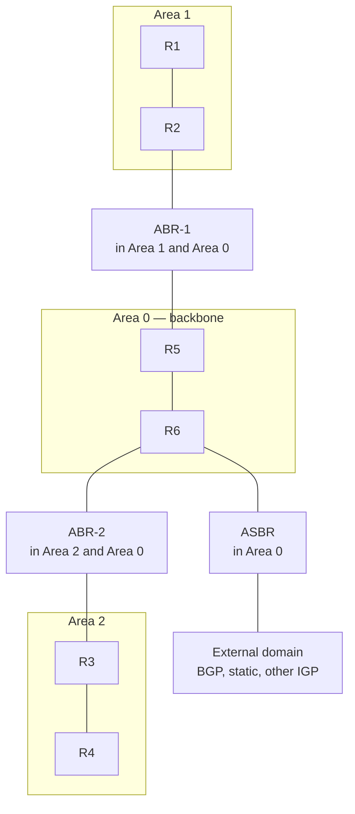

The trade-off is that routers in one area do not see the detailed topology of another — they receive only summarised reachability across area boundaries. This is what keeps large deployments tractable.

### Backbone Area

Area 0 is the backbone and is mandatory in any multi-area design. It is the transit core through which all inter-area traffic passes. Every other area must connect to the backbone, either directly through a router that sits in both areas or, as an exception, through a [[#Virtual Links|virtual link]] that tunnels the connection across an intermediate area.

> [!important] Why the backbone is central Inter-area routing in OSPF is a two-level hub-and-spoke: a route leaves its source area into area 0, crosses the backbone, and enters the destination area. There is no direct area-to-area path. This is why a partitioned or unreachable backbone breaks inter-area routing even when the areas themselves are healthy.

### Area Border Router (ABR)

An ABR is a router with interfaces in more than one area, at least one of which is the [[#Backbone Area|backbone]]. It maintains a separate database for each attached area and is the point at which inter-area summarisation happens. The ABR condenses the topology of one area into reachability advertisements and injects them into the others, so it is the boundary where detailed link-state gives way to summarised routes.

### Autonomous System Boundary Router (ASBR)

An ASBR is a router that injects routes from outside the OSPF domain — static routes, connected networks, or another routing protocol — into OSPF through redistribution. It originates external LSAs for those prefixes. A router can be both an ABR and an ASBR simultaneously. The distinction matters because external routes are flooded and preferred differently from internal ones, and because certain [[#Special Area Types|special area types]] restrict or forbid an ASBR.

### Virtual Links

A virtual link is a logical adjacency that carries backbone traffic across a non-backbone transit area, making two routers behave as though they had a direct link in area 0. It exists to repair one of two topologies that the [[#Area Design Rules|design rules]] otherwise forbid.

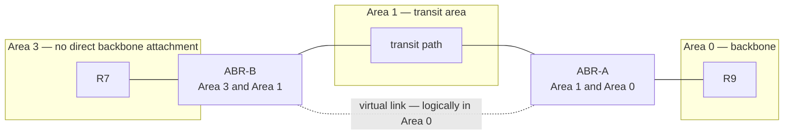

The two use cases are a remote area that cannot physically touch the backbone, and a backbone that has been severed into two halves and needs stitching back together across an adjacent area.

Constraints worth knowing before relying on one:

- It is configured on both endpoint ABRs, each referencing the other's [[#Router ID|Router ID]] and naming the transit area.
- Both endpoints must be ABRs, and the transit area must have full routing information — it cannot be a [[#Special Area Types|stub, totally stubby, or NSSA]] area.
- The transit area cannot be area 0 itself.
- The link is logically part of area 0, so its cost is the intra-area cost across the transit area, and it inherits area 0's authentication settings.
- Any timer or authentication mismatch between the endpoints prevents it forming, exactly as on a physical link.

> [!warning] A repair, not a design A virtual link makes an otherwise invalid topology work, but it hides that the design is broken and it fails silently the moment the transit area loses internal reachability. Treat it as a temporary fix during a migration, and prefer re-homing the area or building a real backbone link. Where a tunnel is genuinely needed, a GRE tunnel placed in area 0 is more explicit and easier to monitor.

### Area Design Rules

Three constraints govern a valid area topology:

- Every non-backbone area must touch the backbone. A virtual link is the sanctioned workaround when it cannot, but it is a repair, not a design goal.
- An area must be contiguous — it cannot be split into disconnected fragments that share an ID.
- The backbone itself should remain contiguous. If it is severed, a virtual link across a non-backbone area can stitch it back together.

## Neighbors and Adjacencies

_How two routers discover each other and progress to a synchronised database._

A neighbour is another OSPF router seen on a shared link. An adjacency is a neighbour relationship that has advanced to full database synchronisation. The two terms are not interchangeable — not every neighbour becomes an adjacency. On a multi-access segment, routers that are neither DR nor BDR remain neighbours of one another but never form a full adjacency between themselves.

### Hello Protocol

[[#Packet Types|Hello packets]] are sent periodically on every OSPF-enabled interface to discover neighbours, confirm two-way reachability, and act as a keepalive. A router lists the RIDs of all neighbours it has heard from inside its own Hello; seeing its own RID echoed back is how it confirms the link is bidirectional.

|Timer|Broadcast / Point-to-Point|NBMA / Point-to-Multipoint|
|---|---|---|
|Hello interval|10 s|30 s|
|Dead interval|40 s|120 s|

If no Hello is received from a neighbour within the dead interval, that neighbour is declared down and the adjacency is torn down. The defaults depend on the [[#Network Types|network type]] of the interface, and the dead interval is conventionally four times the Hello interval.

Hellos are sent to the multicast address 224.0.0.5 on network types that support multicast. On [[#Non-Broadcast Multi-Access (NBMA)|NBMA]] they must be unicast to statically configured neighbours instead.

### Parameters That Must Match

Two routers form an adjacency only if a specific set of fields agree. A mismatch in any of these prevents or breaks the relationship, and several of them fail silently — the routers simply never progress.

|Parameter|Carried in|Consequence of mismatch|
|---|---|---|
|Area ID|Common header|Neighbours in different areas ignore each other's Hellos|
|Hello and Dead intervals|Hello|Hellos are discarded; no neighbour is ever seen|
|Subnet and mask|Hello|On most network types the neighbours must share a subnet|
|Authentication type and key|Common header|Packets fail validation and are dropped|
|Stub / NSSA area flag|Hello options|The area-type flags must agree|
|MTU|Database Description|The adjacency stalls in ExStart/Exchange during database exchange|

Two things are deliberately absent from this list. The OSPF process ID is locally significant and need not match. The [[#Network Types|network type]] is not checked either, which is its own trap — see [[#Matching Network Types|matching network types]].

> [!warning] The MTU trap An MTU mismatch is a classic stuck adjacency. Hellos succeed and the neighbours reach the exchange phase, then hang, because a router refuses a Database Description packet that claims an MTU larger than its own interface accepts. The symptom is a relationship frozen at ExStart or Exchange rather than an obvious failure. `ip ospf mtu-ignore` suppresses the check and will bring the adjacency up, but it treats the symptom — an LSA too large for the smaller MTU will still be dropped, so fix the MTU itself wherever possible.

### Neighbor State Machine

Building an adjacency walks through an ordered set of states. Progress can stall at any step, and the state a stuck neighbour rests in is the primary diagnostic clue.

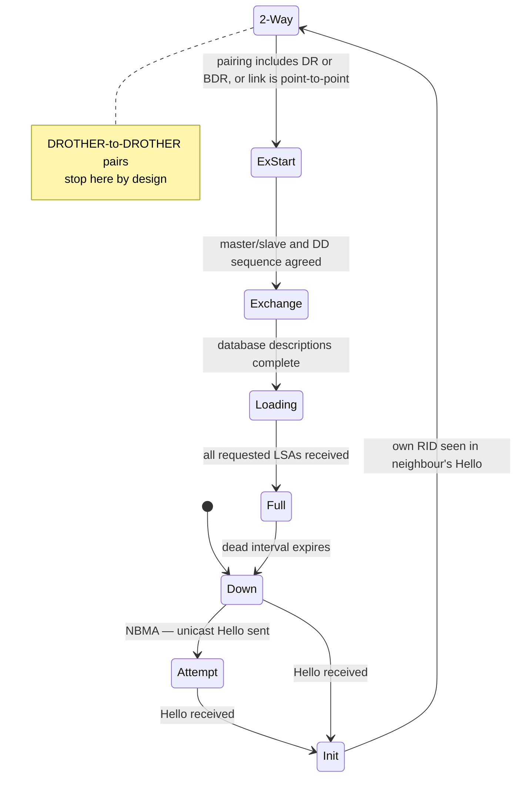

|State|Meaning|
|---|---|
|Down|No Hello has been received yet|
|Attempt|NBMA only — actively unicasting Hellos to a configured neighbour|
|Init|A Hello was received, but this router's RID was not yet listed in it|
|2-Way|Bidirectional communication confirmed; DR/BDR election occurs here|
|ExStart|Master/slave roles and the initial DD sequence number are negotiated|
|Exchange|Routers describe their databases to each other via DD packets|
|Loading|Missing LSAs are requested and delivered|
|Full|Databases are fully synchronised; the adjacency is complete|

Two states deserve emphasis. 2-Way is where a router decides whether to proceed at all: on a multi-access link, only pairings that include the DR or BDR advance beyond it, while DROTHER-to-DROTHER pairings deliberately stay at 2-Way. Full is the goal state — only Full adjacencies contribute to SPF and produce usable routing.

#### Database Exchange

The transition from 2-Way to Full is a defined conversation. Following it packet by packet makes the failure points obvious.

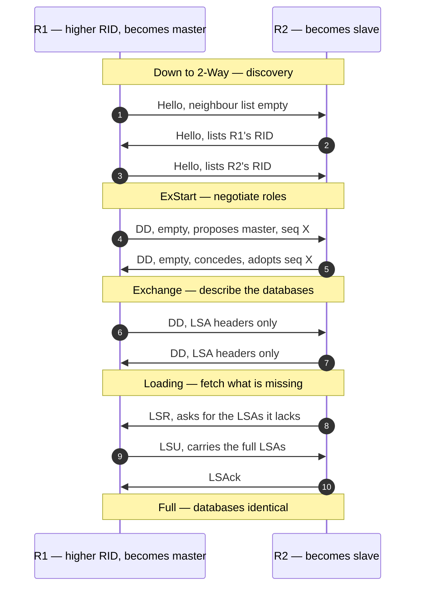

The router with the higher RID becomes master and controls the DD sequence numbers; the slave echoes them. Only LSA headers cross during Exchange, which is why the phase is cheap — the full contents are pulled selectively afterwards, and only for entries the receiver is actually missing or holds a staler copy of.

## Network Types

_The link model OSPF assumes, which sets its timers and whether it elects a DR._

OSPF behaves differently depending on the nature of the underlying link. The network type controls whether a DR is elected, which default Hello and Dead timers apply, and how neighbours are discovered.

|Network type|DR elected|Neighbour discovery|Hello / Dead|
|---|---|---|---|
|Broadcast|Yes|Automatic, multicast|10 s / 40 s|
|Point-to-point|No|Automatic, multicast|10 s / 40 s|
|NBMA|Yes|Manual `neighbor` statements|30 s / 120 s|
|Point-to-multipoint|No|Automatic, multicast|30 s / 120 s|
|Point-to-multipoint non-broadcast|No|Manual `neighbor` statements|30 s / 120 s|
|Loopback|No|None — no adjacencies|n/a|

### Broadcast

The default on Ethernet. OSPF assumes all routers on the segment can reach each other directly and can receive multicast, so neighbours are discovered automatically via multicast Hellos and a [[#Designated and Backup Designated Router|DR]] is elected to control flooding.

### Point-to-Point

The default on links with exactly two endpoints, such as a serial link or a routed sub-interface. Neighbours are discovered by multicast, no DR is elected — with only two routers a DR would serve no purpose — and adjacencies form directly. The subnet mask is not checked on this type, so two routers with mismatched masks can still adjoin.

### Non-Broadcast Multi-Access (NBMA)

A model for segments that connect many routers but cannot carry broadcast or multicast, such as classic Frame Relay or ATM. Because Hellos cannot be multicast, neighbours must be configured manually with the `neighbor` command, and a DR is still elected. It uses the longer 30 s / 120 s timers.

The DR requirement is the awkward part: the elected DR must have direct reachability to every other router on the segment, which in a hub-and-spoke cloud means the hub must win the election. Setting the spokes to priority 0 is the usual way to guarantee that.

### Point-to-Multipoint

Treats a hub-and-spoke topology as a collection of point-to-point links from the hub. No DR is elected, and OSPF advertises host routes to each spoke, which sidesteps the reachability problems NBMA can cause when spokes cannot talk to each other directly. It shares NBMA's 30 s / 120 s timers. A non-broadcast variant behaves the same way but requires manual neighbour statements.

### Loopback

A loopback interface is placed in a network type of its own. It forms no adjacencies and is advertised as a /32 host route regardless of the mask actually configured on it.

> [!note] Advertising a loopback with its real mask If a loopback carries a real prefix that other routers need — a summarised anycast address, for instance — the /32 behaviour is wrong. Setting `ip ospf network point-to-point` on the loopback makes OSPF advertise the configured mask instead.

### Matching Network Types

The network type is not in the list of [[#Parameters That Must Match|parameters that must match]], and that is a trap rather than a convenience. Two routers with different types on the same link can still form an adjacency whenever their timers happen to agree — broadcast on one end and point-to-point on the other both default to 10 s / 40 s, so the adjacency comes up and looks healthy.

What breaks is everything downstream. One side expects a [[#Type 2 — Network LSA|Network LSA]] describing the segment and the other never originates one, so the two databases describe the link differently, SPF disagrees, and routes are missing or intermittent. Always set the network type explicitly and identically on both ends of a link that is not plain Ethernet.

## Designated and Backup Designated Router

_A pair of routers elected on multi-access links to bound the number of adjacencies and centralise flooding._

On a broadcast or NBMA segment with n routers, forming a full mesh of adjacencies would require n(n-1)/2 relationships and an equal explosion of flooding. OSPF avoids this by electing a Designated Router (DR) and a Backup Designated Router (BDR). Every other router — a DROTHER — forms a full adjacency only with the DR and the BDR, reducing the count from quadratic to linear.

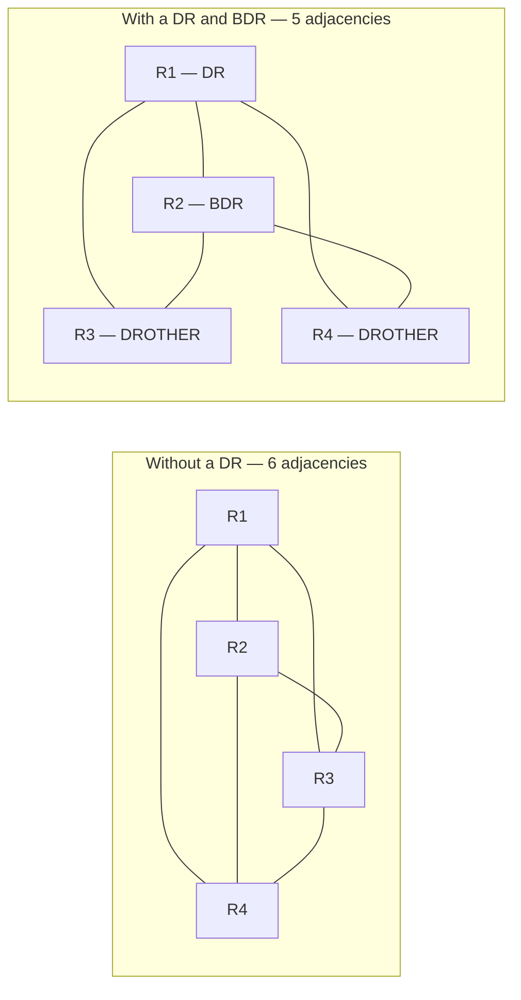

The saving grows with the segment: ten routers need forty-five adjacencies in a full mesh and seventeen with a DR and BDR.

### Election

The DR is chosen by highest OSPF interface priority; the RID breaks a tie. Priority is a per-interface value from 0 to 255, defaulting to 1, and a priority of 0 makes a router permanently ineligible — it will only ever be a DROTHER. The BDR is the runner-up.

The election happens once the interface has waited out a dead interval, so that every router on the segment has had a chance to announce itself before the roles are fixed.

> [!note] Non-preemptive by design The election does not preempt. Once a DR is established, a new router with a higher priority does not take over; it waits until the current DR fails. This prevents a churning election every time a better-configured router appears, but it also means the DR role often lands wherever the boot order put it rather than where you intended. Set priorities deliberately, and clear the process on the segment if you need the roles to move.

### Flooding Roles

The DR is the single point that collects updates from the segment and re-floods them to everyone, using two reserved multicast addresses.

|Address|Group|Used by|
|---|---|---|
|224.0.0.5|AllSPFRouters|All OSPF routers listen|
|224.0.0.6|AllDRouters|Only the DR and BDR listen|

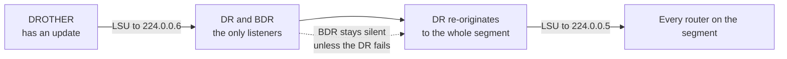

A DROTHER sends its updates to 224.0.0.6, so only the DR and BDR receive them. The DR then floods the update to 224.0.0.5 for the whole segment. The BDR listens silently and takes over instantly if the DR fails, without needing to rebuild adjacencies from scratch.

## Link-State Database

_The synchronised topology map that every router in an area holds and that SPF is computed against._

The LSDB is the collection of all LSAs a router has received. Within a single area, every router's database is identical — this synchronisation is what makes independent, consistent SPF computation possible. A router does not compute routes from what its neighbours tell it to use; it computes them from a shared map that it and every other router in the area agree on.

A router attached to several areas holds a separate database per area. That is why an [[#Area Border Router (ABR)|ABR]] is the natural place to summarise: it is the only device that can see both sides.

### Link-State Advertisements (LSAs)

An LSA is a single record in the database describing one piece of the topology — a router's links, a multi-access segment, or an external prefix. Each LSA carries the RID of its originator, a link-state ID, a sequence number, and an age. Different LSA types describe different things and flood with different scopes.

|Type|Name|Originated by|Flooding scope|
|---|---|---|---|
|1|Router|Every router|Its own area|
|2|Network|The DR of a multi-access segment|The segment's area|
|3|Summary|An ABR|Into other areas, blocked from totally stubby|
|4|ASBR Summary|An ABR|Into other areas, blocked from stub and NSSA|
|5|AS External|An ASBR|The whole domain, blocked from stub and NSSA|
|7|NSSA External|An ASBR inside an NSSA|That NSSA only, translated to Type 5 on exit|

#### Type 1 — Router LSA

Originated by every router, one per area it participates in. It lists the router's active interfaces, their cost, and the neighbours or networks reached through them. It also carries flags marking the originator as an [[#Area Border Router (ABR)|ABR]] or [[#Autonomous System Boundary Router (ASBR)|ASBR]], which is how other routers know a border exists. Type 1 LSAs flood only within their area and are the raw material SPF builds its tree from.

#### Type 2 — Network LSA

Originated by the [[#Designated and Backup Designated Router|DR]] for each multi-access segment that has more than one attached router. It lists every router on that segment, representing the segment as a node in the topology graph. Like Type 1, it floods only within the area. There is no Network LSA on point-to-point links, since there is no DR, and none on a multi-access segment where the DR is the only router present.

#### Type 3 — Summary (Inter-Area) LSA

Originated by an ABR to advertise a network from one area into another. It carries a prefix and a cost but not the underlying topology, which is why routers in one area see only reachability, not detail, for networks in another. Each ABR along the path regenerates the Type 3 rather than passing it through unchanged, adding its own cost as it goes. Type 3 LSAs cross area boundaries but are blocked from totally stubby areas.

#### Type 4 — ASBR Summary LSA

Also originated by an ABR, this advertises the location of an ASBR to routers in other areas. It exists so that routers far from the ASBR know how to reach it, which they need in order to use the external routes it originates. No Type 4 is generated inside the ASBR's own area, because routers there already learn of it from the ASBR flag in its [[#Type 1 — Router LSA|Router LSA]].

#### Type 5 — AS External LSA

Originated by an ASBR for each external prefix redistributed into OSPF. Unlike the intra-area and inter-area types, a Type 5 LSA floods throughout the entire [[Autonomous System|autonomous system]], crossing every area boundary — except that it is blocked from stub and NSSA areas. Its cost can be interpreted in two ways, described under [[#Route Preference Order|route preference]].

A Type 5 also carries a forwarding address. When it is 0.0.0.0, traffic is sent to the ASBR itself. When the ASBR's own next hop for that prefix sits on a network already running OSPF, the ASBR sets the forwarding address to that next hop instead, so other routers send traffic directly there rather than making an unnecessary detour through the ASBR.

#### Type 7 — NSSA External LSA

The stand-in for a Type 5 inside a not-so-stubby area, which forbids Type 5 but still needs a way to carry externals originated locally. An ASBR inside an NSSA originates Type 7 LSAs, and the NSSA's ABR translates them into Type 5 as they leave the area, so the rest of the domain sees ordinary externals. Where an NSSA has more than one ABR, the one with the highest RID performs the translation by default.

#### Other LSA Types

Rarely configured directly, but they appear in a database dump and are worth recognising.

|Type|Name|Note|
|---|---|---|
|6|Group Membership|Multicast OSPF. Deprecated and not implemented by Cisco|
|8|External Attributes|Defined for carrying BGP attributes across OSPF; effectively unused in OSPFv2. In OSPFv3 the number is reused for the Link LSA|
|9, 10, 11|Opaque|Generic containers with link-local, area, and domain scope respectively. Used by MPLS traffic engineering, Segment Routing, and graceful restart|

### Flooding

When a router originates or receives a changed LSA, it forwards a copy out of its other OSPF interfaces so the update propagates. Reliability is enforced with explicit acknowledgements: an LSA is retransmitted until an LSAck confirms it. A router only re-floods an LSA it considers newer than its own copy, which is what stops the process looping.

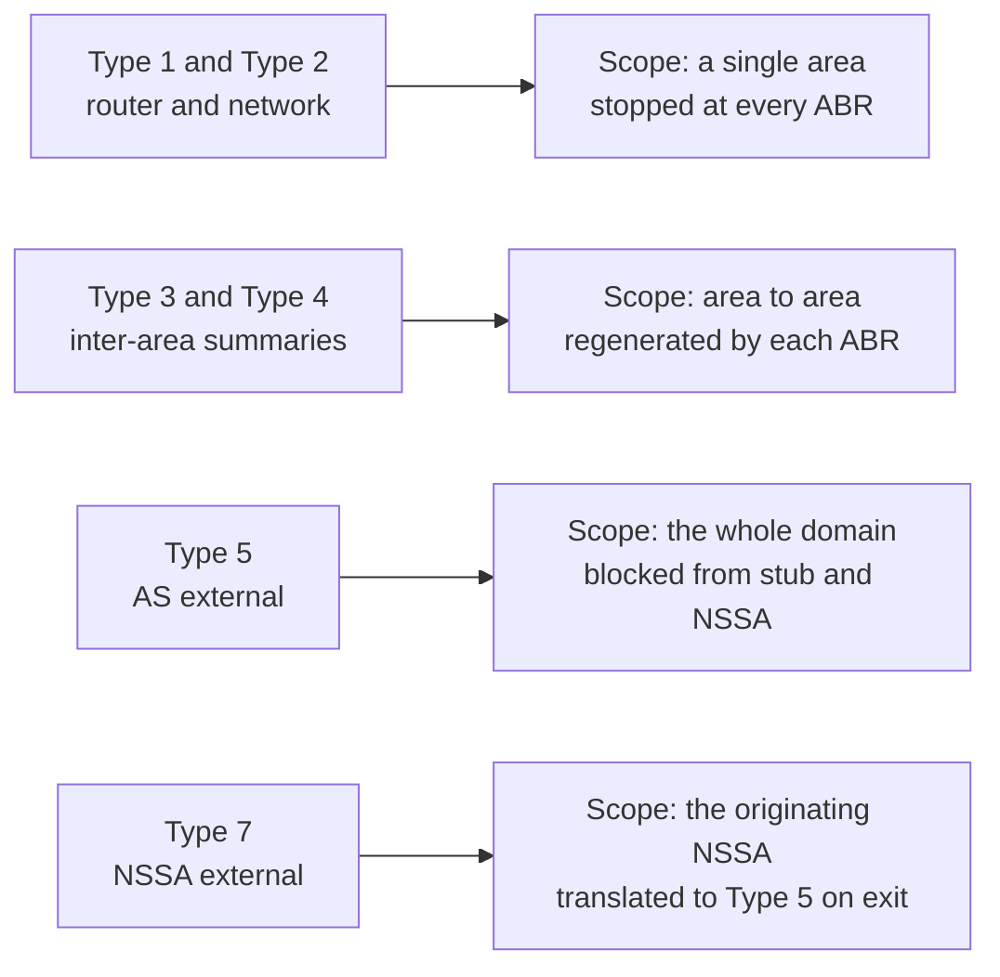

### Aging and Refresh

Each LSA carries an age that counts up from origination. To prove it is still current, the originating router re-floods it every 30 minutes (the LSRefresh interval), resetting the age. If an LSA reaches MaxAge (60 minutes) without a refresh — because its originator has gone — it is flushed from every database and the topology recomputed. A router can also flush an LSA deliberately by re-flooding it with the age set straight to MaxAge, which is how a withdrawn prefix is removed quickly rather than waiting an hour.

Sequence numbers, which increase with each new version, let routers distinguish a fresher LSA from a stale duplicate during flooding. When sequence numbers are equal, the higher checksum wins, and failing that the greater age.

## Metric and Path Selection

_How OSPF assigns a cost to each path and chooses between competing routes to the same destination._

### Cost Calculation

OSPF's metric is cost, and the cost of a path is the sum of the outbound interface costs along it. Each interface's cost is derived from its bandwidth:

```
cost = reference-bandwidth / interface-bandwidth
```

With the default reference bandwidth of 100 Mbps, this yields:

|Interface bandwidth|Default cost|
|---|---|
|1.544 Mbps (T1)|64|
|10 Mbps|10|
|100 Mbps|1|
|1 Gbps and above|1|

Cost is always at least 1, the result is rounded down, and it is computed on the outbound interface, so the cost of a route depends on the direction of travel. An interface cost can also be set directly, which overrides the bandwidth-derived value and is the cleaner way to influence path selection — changing the `bandwidth` statement to move traffic also affects QoS and EIGRP.

### Reference Bandwidth

The problem with the 100 Mbps default is visible in the table above: every interface at or above 100 Mbps collapses to a cost of 1, so OSPF cannot distinguish a Gigabit link from a 100-Gigabit one. Raising the reference bandwidth restores that granularity.

> [!warning] Must be consistent everywhere The reference bandwidth is a per-router setting, but it must be identical on every router in the domain. If one router uses a different value, the costs it computes are not comparable to its neighbours', and routing decisions become inconsistent. Set it once, network-wide, and size it above your fastest link.

### Route Preference Order

When more than one OSPF route to the same destination exists, cost is not the first tiebreaker — the route's type is. OSPF prefers a more specific type of route even if its cost is higher:

```
Intra-area (O)         most preferred
Inter-area (O IA)
External Type 1 (E1)
External Type 2 (E2)   least preferred
```

An intra-area route always wins over an inter-area route to the same prefix, and both win over any external. Only within the same type does the lower cost decide.

The two external flavours differ in how they count cost. An E1 route adds the internal cost to reach the ASBR to the external cost, so it reflects the full path. An E2 route — the default — carries only the external cost and ignores the internal distance to the ASBR; when two E2 routes tie on external cost, the internal cost to the ASBR is used as the tiebreaker after all. NSSA externals behave the same way, labelled N1 and N2.

> [!note] This ordering is internal to OSPF The preference order decides between OSPF routes only. Choosing between OSPF and another protocol offering the same prefix is done by administrative distance, and Cisco applies 110 to every OSPF route regardless of type — an OSPF E2 route and an OSPF intra-area route look identical to the routing table's distance comparison.

### Equal-Cost Multipath

When several paths to the same destination share both the same type and the same cost, OSPF installs all of them and traffic is load-shared across them. The number installed is capped by `maximum-paths`, typically four by default and adjustable up to a platform limit.

OSPF has no equal of EIGRP's unequal-cost load balancing — paths must tie exactly on cost to be used together. Getting several links to share load therefore means tuning their costs to match, which also means an unintended cost mismatch silently reduces a multipath group to a single active path.

## SPF Calculation

_The algorithm each router runs over the LSDB to turn the topology map into best paths._

### Dijkstra's Algorithm

Each router runs the shortest-path-first algorithm with itself as the root, walking the graph described by the Type 1 and Type 2 LSAs to build a shortest-path tree. Because every router in the area works from the same database but roots the tree at itself, each arrives at a consistent, loop-free set of best paths from its own perspective.

Inter-area and external destinations are not part of the tree. They are attached to it afterwards as leaves, using the cost to the advertising ABR or ASBR plus the cost carried in the Type 3, 4, 5, or 7 LSA. The finished result is installed into the routing table, subject to the type-based [[#Route Preference Order|preference order]].

A worked example — the same topology seen from R1:

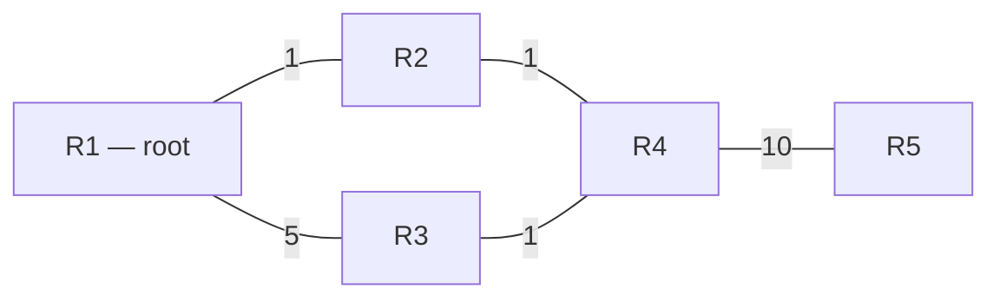

```
Shortest-path tree rooted at R1

R1
├── R2                cost 1
│   └── R4            cost 2      via R2, beating cost 6 via R3
│       └── R5        cost 12
└── R3                cost 5
```

R3 is reached directly at cost 5 even though it also sits one hop from R4, and R4 is reached through R2 because 1 + 1 beats 5 + 1. Run the same algorithm rooted at R3 and the tree looks entirely different, but no two trees ever disagree about a link — that shared view is what guarantees the result is loop-free.

### Full versus Partial SPF

Not every change forces a full recomputation. A change to the intra-area topology — a Type 1 or Type 2 LSA — requires a full SPF run, because the shape of the tree may have changed. A change to a summary or external route — a Type 3, 4, 5, or 7 LSA — only changes a leaf's reachability, not the tree itself, so OSPF performs a partial calculation that updates the affected routes without rebuilding the tree. Partial recomputation is far cheaper and is one reason OSPF scales.

This is also an argument for [[#Areas|areas]] in their own right: a flapping link inside area 1 forces a full SPF only on the routers in area 1. Everywhere else, the resulting Type 3 change is handled as a partial calculation.

### SPF Throttling

Running SPF on every individual LSA during a period of instability would be wasteful, so OSPF throttles it. A short initial delay batches the first burst of changes into one run; if changes keep arriving, the hold time between successive runs grows, up to a ceiling, then resets once the topology settles. This absorbs a storm of updates into a bounded number of computations while still reacting quickly to an isolated change.

```cisco
router ospf 1
 timers throttle spf 50 200 5000
```

The three values are the initial delay, the starting hold time, and the maximum hold time, in milliseconds. Defaults differ between platforms and releases, so check before assuming.

### LSA Throttling and Pacing

The same idea is applied to origination. LSA throttling limits how quickly a router will re-originate a changed LSA, so a flapping interface cannot generate a continuous stream of updates. LSA arrival sets the minimum interval at which a router will accept the same LSA from a neighbour, discarding anything faster as a duplicate. Flood pacing spaces out the transmission of queued LSAs so a large flood does not arrive as one burst.

```cisco
router ospf 1
 timers throttle lsa all 0 200 5000
 timers lsa arrival 100
 timers pacing flood 33
```

Throttling and pacing are complementary: throttling limits what a router produces, arrival limits what it accepts, pacing limits how fast it transmits. The exact keywords vary between IOS and IOS-XE releases, so confirm the syntax on the platform in front of you.

## Convergence and Resilience

_Mechanisms that shorten the time to detect a failure, or reduce the disruption caused by one._

### Fast Detection

The default 40-second dead interval is a long time to keep forwarding into a black hole. Two options shorten it.

```cisco
interface GigabitEthernet0/0
 ip ospf dead-interval minimal hello-multiplier 4
```

Fast Hellos set the dead interval to one second and send the given number of Hellos within it — four per second here. It works anywhere, but at the cost of more control-plane traffic and more sensitivity to transient CPU load.

```cisco
interface GigabitEthernet0/0
 bfd interval 300 min_rx 300 multiplier 3
 ip ospf bfd
```

Bidirectional Forwarding Detection is the better answer where it is supported. A lightweight, often hardware-offloaded session detects loss in well under a second and simply tells OSPF the neighbour is gone, keeping detection out of the OSPF process entirely. One BFD session can serve several protocols on the same link.

### Stub Router Advertisement

A router that is up but not ready to forward — still booting, still converging [[Border Gateway Protocol|BGP]] — should not attract transit traffic. Advertising itself as a stub router makes it set the metric on its transit links to the maximum, so SPF on every other router routes around it while still reaching networks directly attached to it.

```cisco
router ospf 1
 max-metric router-lsa on-startup 300
```

This is the standard remedy for the black hole that appears when a core router finishes OSPF convergence long before its BGP table is populated.

### Graceful Restart

Graceful restart, or NSF, lets a router with separated control and forwarding planes reload its OSPF process without tearing down forwarding. Neighbours that support it hold the adjacency and continue forwarding through the restarting router while it rebuilds its database, rather than reconverging around it and then back again. It requires support on the neighbours, which act as helpers.

## Special Area Types

_Restricted area variants that shrink the database by filtering the external and summary LSAs allowed to enter._

The [[#Area Border Router (ABR)|ABR]] can be configured to block certain LSA types from entering an area, replacing the detail with a default route. This reduces database size and SPF cost in areas that do not need full external visibility — typically stub, edge, or branch areas with a single exit. The backbone can never be a special area, and neither can a [[#Virtual Links|virtual link]] transit area.

|Area type|Blocks|Default route from ABR|Local ASBR allowed|
|---|---|---|---|
|Stub|Type 4, 5|Yes, as a Type 3|No|
|Totally stubby|Type 3, 4, 5|Yes, as a Type 3|No|
|NSSA|Type 4, 5|Optional, as a Type 7|Yes, as Type 7|
|Totally stubby NSSA|Type 3, 4, 5|Yes, as a Type 3|Yes, as Type 7|

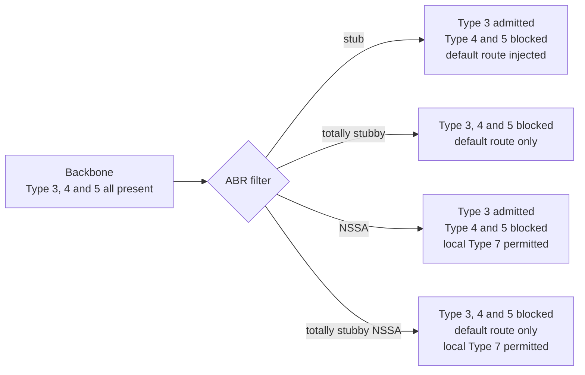

Every router in a special area must be configured with the same area type. The flag travels in the Hello options and is one of the [[#Parameters That Must Match|parameters that must match]], so a router left out of the configuration will simply never form an adjacency.

### Stub Area

A stub area blocks external ([[#Type 5 — AS External LSA|Type 5]]) LSAs, and with them the Type 4 LSAs that would locate an ASBR. Routers inside it still receive inter-area summaries, so they know how to reach other areas, but for anything external they rely on a default route the ABR injects as a Type 3. No ASBR may live inside a stub area, because that would require originating the very external LSAs the area forbids.

### Totally Stubby Area

A Cisco extension that goes further than a stub: it blocks Type 3 as well as Type 4 and Type 5. Routers inside see only their own area's topology plus a single default route for everything else — both inter-area and external destinations. This is the leanest possible database for an edge area with one way out.

It is also the least tolerant of a second exit. With every destination outside the area collapsed into one default, routers inside cannot tell which ABR is closer to a given prefix, so with two ABRs traffic goes to whichever is nearer by intra-area cost, which is not always the better exit.

### Not-So-Stubby Area (NSSA)

An NSSA is a stub area that makes one exception: it forbids externals from elsewhere (Type 5) but permits an ASBR inside the area to originate its own externals. Those are carried as [[#Type 7 — NSSA External LSA|Type 7]] LSAs and translated to Type 5 by the ABR on the way out. This solves the case where a stub-like area nonetheless needs to redistribute a few local external routes — a branch with its own static routes to advertise, for instance.

The default route is optional here rather than automatic, because an NSSA may legitimately have its own path out. It has to be requested explicitly on the ABR.

### Totally Stubby NSSA

The combination of the two ideas: it blocks Type 3, 4, and 5 like a totally stubby area, so inter-area and external destinations are reached only through the ABR's default route, yet it still allows a local ASBR to originate Type 7 externals. It is the right choice for an edge area that needs both a minimal database and the ability to inject its own external prefixes.

## Route Summarization and Filtering

_Aggregating or suppressing prefixes at an area or domain boundary._

Both happen only at boundary routers, and only they can do it — there is no way to summarise or filter in the middle of an area, because intra-area topology floods in full and every router must hold an identical copy of it. Acting at the boundary shrinks databases downstream and, just as importantly, hides the flap of an individual component prefix behind a stable advertisement.

### Inter-Area Summarization

Configured on an [[#Area Border Router (ABR)|ABR]], this aggregates the intra-area prefixes of one area into a single Type 3 advertisement injected into the others.

```cisco
router ospf 1
 area 1 range 10.1.0.0 255.255.0.0
```

The ABR advertises the summary as long as at least one component prefix is present, and suppresses the individual ones. Its cost is derived from the component routes — depending on release, either the lowest or the highest of them — and can be pinned with the `cost` keyword rather than left to inference. A change to a single component no longer ripples across area boundaries, which is a significant stability win in a large domain.

The ABR also installs a discard route for the summary pointing at Null0. This matters: without it, traffic for a part of the summarised range that does not actually exist would follow the summary to the ABR and then be forwarded back out along a default route, looping until the TTL expired.

### External Summarization

Configured on an [[#Autonomous System Boundary Router (ASBR)|ASBR]], this aggregates redistributed external prefixes into a single Type 5 advertisement at the point they enter OSPF.

```cisco
router ospf 1
 summary-address 172.16.0.0 255.255.0.0
```

It applies to the externals the ASBR originates, keeping the count of Type 5 LSAs — which flood domain-wide — under control. The two commands are not interchangeable: `area range` acts on inter-area summaries at an ABR, `summary-address` acts on externals at an ASBR.

### Inter-Area Filtering

Where summarisation aggregates, filtering suppresses. A prefix list applied to an area boundary drops matching Type 3 LSAs entirely, in either direction.

```cisco
ip prefix-list NO-LAB seq 5 deny 10.99.0.0/16 le 32
ip prefix-list NO-LAB seq 10 permit 0.0.0.0/0 le 32
!
router ospf 1
 area 1 filter-list prefix NO-LAB out
```

The direction is relative to the named area: `out` filters what leaves area 1 for the other areas, `in` filters what the ABR injects into area 1. This is the correct tool for hiding a range that must not be reachable from elsewhere. Filtering LSAs is distinct from a `distribute-list in`, which does not touch the database at all — it only prevents SPF's results from being installed locally, leaving neighbours unaware and the database intact.

## Default Route Origination

_Injecting a 0.0.0.0/0 route into OSPF from an ASBR._

An ASBR can advertise a default route to the rest of the domain, which is the standard way to hand off traffic for unknown destinations toward an internet edge.

```cisco
router ospf 1
 default-information originate metric 50 metric-type 1
```

By default the ASBR originates the default only if it already has one in its own routing table. Adding `always` forces it to advertise unconditionally, which is a deliberate override — useful when the upstream route is expected to be present but should be advertised regardless.

The default is carried as an external LSA and follows external cost semantics — it can be advertised as a Type 1 or Type 2 external, choosing whether receiving routers factor in the internal cost to reach the ASBR when there is more than one exit. With two internet edges, Type 1 is usually what you want, since it steers each router toward its nearer exit.

The defaults injected by a [[#Special Area Types|stub or totally stubby ABR]] are a separate mechanism. Those are Type 3 LSAs generated automatically by the area configuration and are not affected by `default-information originate`.

> [!warning] The unconditional-advertise pitfall Forcing a default route to be advertised without a real upstream path creates a black hole: routers across the domain send their unknown traffic toward an ASBR that has nowhere to forward it. Only advertise unconditionally when you are certain the ASBR genuinely has a working path to the destinations the default represents.

## Authentication

_Cryptographically validating OSPF packets so a rogue or misconfigured router cannot inject topology._

Without authentication, any device on a link can speak OSPF and poison the database. OSPFv2 defines three modes, applied per interface or across a whole area. Interface configuration overrides area configuration, and the mode and key must match on both ends of every link — a mismatch is silent, showing only as a neighbour that never appears.

### Null Authentication

The default — no authentication. Packets are accepted on the basis of the matching parameters alone, with no cryptographic check. Acceptable only where the link is otherwise trusted.

### Plaintext Authentication

A shared password is carried in the clear inside each packet. It defends against accidental misconfiguration — a neighbour with the wrong password will not adjoin — but offers no real security, since anyone who can capture a packet can read the password.

### Cryptographic Authentication

Each packet carries a keyed digest rather than the key itself, so the secret never crosses the wire. The receiver recomputes the digest and compares. Classic OSPFv2 uses an MD5 digest keyed with a shared secret and a key ID; modern implementations extend this to stronger HMAC-SHA algorithms via key chains, allowing hitless key rollover because a router accepts any valid key while sending with the current one. This is the mode to use on any link that is not physically trusted.

### OSPFv3 Authentication

[[#OSPFv3 for IPv6|OSPFv3]] originally carried no authentication fields of its own and relied on the IPv6 IPsec framework (AH or ESP) to protect its packets. A later extension added a native authentication trailer, bringing keyed-digest protection back into the protocol itself without depending on a separate IPsec configuration.

## OSPFv3 for IPv6

_The revision of OSPF for IPv6, and how it differs from OSPFv2._

OSPFv3 keeps the same core machinery — link-state flooding, areas, DR election, SPF — but reworks several mechanics for IPv6. The differences are worth knowing because habits from OSPFv2 do not all carry over.

- It runs over IPv6 as next header 89 and forms adjacencies using interface link-local addresses, not global ones. The next hop installed in the routing table is therefore a link-local address.
- Adjacency is per-link rather than per-subnet: two routers on the same link adjoin regardless of the IPv6 subnets configured, removing the same-subnet requirement that OSPFv2 enforces.
- Multiple OSPFv3 instances can share a link, distinguished by an instance ID carried in the packet header. The instance ID must match for two routers to adjoin.
- The [[#Router ID|Router ID]] is still a 32-bit dotted-decimal value and, with no IPv4 interfaces to borrow from, generally must be configured explicitly. A process with no RID and no IPv4 addresses will refuse to start.
- Addressing is separated from topology: Type 1 and Type 2 LSAs no longer carry prefixes at all, so a change of address no longer forces a full SPF.
- It can carry both IPv4 and IPv6 through an address-family model, letting one OSPFv3 process route both protocols.
- Multicast uses FF02::5 (AllSPFRouters) and FF02::6 (AllDRouters) in place of the IPv4 224.0.0.5 and 224.0.0.6.

### LSA Types in OSPFv3

|Type|Name|Relationship to OSPFv2|
|---|---|---|
|1|Router|Same role, but carries no prefixes|
|2|Network|Same role, but carries no prefixes|
|3|Inter-Area Prefix|Renamed Type 3 Summary|
|4|Inter-Area Router|Renamed Type 4 ASBR Summary|
|5|AS External|Unchanged in role|
|7|NSSA|Unchanged in role|
|8|Link|New. Link-local scope; advertises an interface's addresses to neighbours on that link|
|9|Intra-Area Prefix|New. Carries the prefixes associated with a router or a segment|

Types 8 and 9 are where the prefixes went. Separating them from the topology LSAs is what allows an address change to trigger only a partial recalculation.

## Configuration

_Bringing OSPF up on a Cisco IOS router, from process creation to per-interface tuning._

### Enabling the Process

OSPF starts with a process created under a locally significant process ID. The ID identifies the instance on this router only — it need not match on neighbours.

```cisco
router ospf 1
 router-id 10.0.0.1
```

Setting the [[#Router ID|router-id]] explicitly here is strongly preferred over letting it be derived from an interface.

### Advertising Interfaces

There are two ways to bring an interface into OSPF, and they are equivalent in effect.

The traditional method matches interfaces by address using a wildcard (inverse) mask under the process, assigning each to an area:

```cisco
router ospf 1
 network 10.0.0.0 0.0.0.255 area 0
 network 10.1.0.0 0.0.0.255 area 1
```

The interface method configures the area directly on the interface, which is clearer and avoids wildcard arithmetic:

```cisco
interface GigabitEthernet0/0
 ip ospf 1 area 0
```

Neither statement advertises a network as such — both simply enable OSPF on the interfaces they match. The prefix reaches the database because the interface is then described in that router's [[#Type 1 — Router LSA|Router LSA]].

### Passive Interfaces

A passive interface still has its subnet advertised into OSPF, but stops sending and processing Hellos, so it forms no adjacencies. This is correct for any interface facing endpoints rather than other routers — it advertises the network without exposing OSPF to hosts.

```cisco
router ospf 1
 passive-interface default
 no passive-interface GigabitEthernet0/0
```

Making all interfaces passive by default and then re-enabling only the router-facing ones is the safer pattern — it fails closed.

### Tuning Cost and Reference Bandwidth

Raise the [[#Reference Bandwidth|reference bandwidth]] domain-wide so high-speed links are distinguished, and override an individual interface [[#Cost Calculation|cost]] where the bandwidth-derived value is wrong:

```cisco
router ospf 1
 auto-cost reference-bandwidth 100000
!
interface GigabitEthernet0/0
 ip ospf cost 20
```

The reference bandwidth is given in Mbps, so 100000 is 100 Gbps.

### DR Priority and Timers

Influence the [[#Designated and Backup Designated Router|DR]] election with per-interface priority, and match [[#Hello Protocol|Hello]] timers where a non-default network type or design demands it:

```cisco
interface GigabitEthernet0/0
 ip ospf network broadcast
 ip ospf priority 100
 ip ospf hello-interval 10
 ip ospf dead-interval 40
```

A priority of 0 removes the interface from the election entirely. Setting the [[#Network Types|network type]] explicitly, as shown, avoids the mismatch described under [[#Matching Network Types|matching network types]].

### Special Area and Authentication

Declare a [[#Special Area Types|special area type]] on every router in that area — the flag must agree for adjacencies to form — and enable [[#Authentication|authentication]] on the links that need it:

```cisco
router ospf 1
 area 1 stub
 area 1 stub no-summary
!
interface GigabitEthernet0/0
 ip ospf authentication message-digest
 ip ospf message-digest-key 1 md5 <secret>
```

`no-summary` on the ABR turns a stub into a totally stubby area; it is configured only on the ABR, while `area 1 stub` is needed on every router in the area. The NSSA equivalents follow the same pattern:

```cisco
router ospf 1
 area 2 nssa
 area 2 nssa default-information-originate no-summary
```

### Summarization and Default Route

```cisco
router ospf 1
 area 1 range 10.1.0.0 255.255.0.0
 summary-address 172.16.0.0 255.255.0.0
 default-information originate metric-type 1
```

The first is configured on an [[#Area Border Router (ABR)|ABR]], the second and third on an [[#Autonomous System Boundary Router (ASBR)|ASBR]].

### Configuring a Virtual Link

Configured on both endpoint ABRs, each naming the transit area and the far end's Router ID:

```cisco
! on ABR-A, RID 10.0.0.1
router ospf 1
 area 1 virtual-link 10.0.0.3
!
! on ABR-B, RID 10.0.0.3
router ospf 1
 area 1 virtual-link 10.0.0.1
```

See [[#Virtual Links|virtual links]] for the constraints — in particular that area 1 here cannot be a stub or NSSA.

### Configuring OSPFv3

The traditional form enables the process per interface, as with OSPFv2:

```cisco
ipv6 unicast-routing
!
ipv6 router ospf 1
 router-id 10.0.0.1
!
interface GigabitEthernet0/0
 ipv6 ospf 1 area 0
```

The address-family form is the modern equivalent and lets one process carry both IPv4 and IPv6:

```cisco
router ospfv3 1
 router-id 10.0.0.1
 address-family ipv6 unicast
  exit-address-family
!
interface GigabitEthernet0/0
 ospfv3 1 ipv6 area 0
```

## Verification and Troubleshooting

_The commands that expose OSPF's state, and the failures they most often reveal._

### Process and Interfaces

```cisco
show ip ospf
show ip ospf interface brief
show ip ospf interface GigabitEthernet0/0
```

The first confirms the [[#Router ID|Router ID]], the reference bandwidth, whether this router is an ABR or ASBR, and which areas it holds. The second reports each interface's area, cost, state, and DR/BDR, and is the fastest way to confirm an interface is in the expected area. The detailed form adds the network type, timers, and authentication mode — the three things most worth checking when an adjacency will not form.

### Neighbours and Adjacencies

```cisco
show ip ospf neighbor
show ip ospf neighbor detail
```

Lists every neighbour and its [[#Neighbor State Machine|state]]. A healthy multi-access segment shows Full with the DR and BDR and 2-Way between DROTHERs; anything else points at where the adjacency stalled.

### Database

```cisco
show ip ospf database
show ip ospf database router adv-router 10.0.0.1
show ip ospf database external
```

Shows the [[#Link-State Database|LSDB]] broken down by LSA type. Comparing the database across routers in an area confirms whether they have actually synchronised, and the presence or absence of specific LSA types confirms whether a [[#Special Area Types|special area]] is filtering as intended.

### Borders and Virtual Links

```cisco
show ip ospf border-routers
show ip ospf virtual-links
```

The first lists the ABRs and ASBRs this router knows how to reach and at what cost, which is the quickest way to explain a missing external route. The second reports the state of any [[#Virtual Links|virtual link]] and the transit area cost it is running over.

### Routes

```cisco
show ip route ospf
```

Displays the OSPF routes installed in the routing table, tagged by type — O for intra-area, O IA for inter-area, and E1/E2 or N1/N2 for externals — which makes the [[#Route Preference Order|preference order]] visible in practice.

### Debugging

```cisco
debug ip ospf adj
debug ip ospf hello
debug ip ospf events
```

`debug ip ospf adj` is the one that earns its keep: it narrates the [[#Database Exchange|database exchange]] and names the reason an adjacency was rejected, including MTU and authentication failures that are otherwise silent. Use it on a specific interface where possible, and be aware that `debug ip ospf hello` on a busy router is noisy enough to be its own problem.

### Diagnostic Flow

The neighbour state is the entry point for almost every OSPF fault.

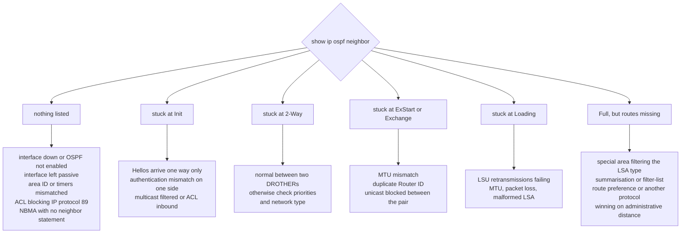

### Common Failure Points

Most OSPF problems reduce to a small set of causes, and knowing them turns troubleshooting into a checklist:

- Mismatched Hello or Dead timers, or mismatched area ID — the neighbour never leaves Down or Init.
- Mismatched MTU — the neighbour freezes at ExStart or Exchange.
- Duplicate Router IDs — the same symptom as an MTU mismatch, and easily confused with it.
- Mismatched authentication — packets are dropped and no neighbour appears.
- A missing or misconfigured network type — no DR is elected where one is expected, or the two ends describe the link differently and routes go missing despite a Full adjacency.
- An interface left non-passive toward endpoints, or passive toward a router — either exposes OSPF to hosts or silently prevents a legitimate adjacency.
- Inconsistent reference bandwidth — adjacencies form but path selection is subtly wrong.
- An area-type flag configured on some routers in the area but not others — adjacencies fail only on the routers that disagree.
- A partitioned backbone — areas are individually healthy but inter-area routing fails.