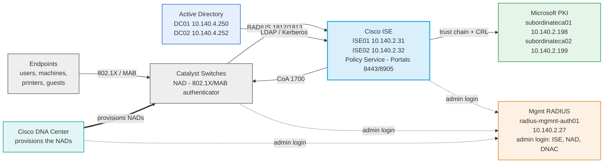

---
categories:
  - "[[Networking]]"
  - "[[Security]]"
topic@networking:
  - "[[2 - Categories/Topics/Networking/Cisco ISE|Cisco ISE]]"
topic@security:
  - "[[NAC]]"
tags:
  - project
  - nac
  - cisco
  - scor/sise
  - ccnp
  - tech_doc
  - PBA
  - Networking
  - Security
icon: SiCisco
iconColor: "#1BA0D7"
last_update: 2026-07-09
---


Cisco Identity Services Engine (ISE) is an <strong>identity-based network access control</strong> and <strong>policy enforcement system</strong>. It functions as a common policy engine that enables <mark style="background: #FFF3A3A6;">endpoint access control </mark>and <mark style="background: #BBFABBA6;">network device administration</mark> for enterprises.

## Deployment Architecture

Cisco ISE sits between the network access devices and the identity and PKI infrastructure. The switches send RADIUS authentication requests to ISE; ISE evaluates them against [[#External Identity Sources - Active Directory|Active Directory]] and the certificate trust chain, then returns an authorization result — a VLAN, a [[#Downloadable ACLs|dACL]], or a URL redirect — and can push changes mid-session through [[#Change of Authorization (CoA)|CoA]]. The same nodes host the portal that [[#Redirect_Guest_Wired|Central Web Authentication]] redirects guests to.



The Policy Service is provided by two ISE nodes, ISE01 (10.140.2.31) and ISE02 (10.140.2.32). They terminate RADIUS for 802.1X and MAB on ports 1812/1813, send Change of Authorization on UDP 1700, and host the guest portal (8443) and posture/client-provisioning services (8905) — the ports permitted to them in the [[#Pre-Auth|Pre-Auth]] DACL. CoA runs on UDP 1700 — the Cisco default for both the switch's [[PBA - NAC - Network Access Devices#Dynamic Authorization (CoA)|dynamic-author]] listener and the CoA port in the ISE network device entry; RFC 5176 registers 3799, but the deployed switch configuration sets no port override. Run as a pair they provide redundancy: a switch that lists both in its [[PBA - NAC - Network Access Devices#RADIUS Server Configuration|ISESERV group]] fails over automatically if one node is unreachable. In a two-node deployment the Administration (PAN) and Monitoring (MnT) personas normally run on this same primary/secondary pair; confirm the exact persona assignment against the live system.

Administrative login is handled separately from endpoint NAC. A management RADIUS target, radius-mgmnt-auth01 at 10.140.2.27 — the switch's [[PBA - NAC - Network Access Devices#RADIUS Server Configuration|RADSERV group]] — authenticates CLI and HTTPS administrator logins to ISE, the NADs, and Cisco DNA Center, returning [[#cisco-av-pair|shell:priv-lvl]] for the privilege level. This path is independent of the Policy Service Nodes above; whether 10.140.2.27 is a dedicated ISE node or a separate server is not captured here.

The surrounding infrastructure ISE operates within:

- Active Directory — the external identity store ISE is joined to; domain controllers <strong>DC01</strong> (10.140.4.250) and <strong>DC02</strong> (10.140.4.252) answer LDAP and Kerberos identity and group lookups.
- Microsoft PKI — subordinate CAs <strong>subordinateca01</strong> (10.140.2.198) and <strong>subordinateca02</strong> (10.140.2.199), beneath a root CA, issue the [[PBA - NAC - Microsoft Servers#EAP Authentication Certificate|EAP]] and client/machine certificates; ISE trusts the CA chain and checks the CRL during EAP-TLS and TEAP.
- Network Access Devices — the Catalyst switches are ISE's RADIUS clients for endpoint access; the switch side is documented in [[PBA - NAC - Network Access Devices#802.1X Global Settings|the NAD note]].
- Cisco DNA Center — the network controller that provisions and rolls out the NADs (pushing their configuration); its own administrator access is authenticated by the management RADIUS above.

## Identity Management

Identity Management manages all identities for ISE, from ISE GUI admins to users that have to authenticate to ISE.

![[Pasted image 20260508100508.png]]

### Identities

Cisco ISE includes a built-in internal identity store that supports a limited number of locally defined user accounts, commonly referred to as <strong>internal users</strong> or <strong>network access users</strong>.

Within the Identities section, administrators can configure local user accounts serving one of two purposes: logging into the ISE GUI, or authenticating for network access.

This internal store is particularly useful for granting temporary or contractor access to the wireless network without provisioning accounts in the company's primary identity store.

Each internal user account can be associated with a user identity group, which defines the type and role of the account being created.

![[Pasted image 20260508105029.png]]

![[Pasted image 20260508105040.png]]

### Groups

Endpoint and User Groups can be used as attributes in Policy Sets.

![[Pasted image 20260508105117.png]]

#### Endpoint Identity Groups

![[Pasted image 20260513164133.png]]

Endpoint Identity Groups store information about all the endpoint devices that connect to the network infrastructure; they can also be filled through a CSV import.

Beyond static import, they can be populated dynamically by the ISE Profiler, which classifies endpoints from attributes its probes collect — RADIUS accounting, DHCP options, CDP/LLDP neighbor data sent inline by [[PBA - NAC - Network Access Devices#Device Sensor — Endpoint Profiling|Device Sensor]], and the MAC OUI — and files each endpoint into the matching group. This is how devices such as printers are placed in a Printers group that MAB authorization can then match on.

![[Pasted image 20260508105729.png]]

![[Pasted image 20260508105738.png]]

For new CSV import template use the <strong>Generate a Template</strong> function or use this template:

```csv
MACAddress,EndPointPolicy,IdentityGroup,PortalUser.GuestType,Description,PortalUser.Location,PortalUser.GuestStatus,StaticAssignment,User-Name,DeviceRegistrationStatus,PortalUser.CreationType,AUPAccepted,PortalUser.EmailAddress,PortalUser.PhoneNumber,FirstName,ip,Device Type,host-name,StaticGroupAssignment,MDMEnrolled,MDMOSVersion,PortalUser.LastName,PortalUser.GuestSponsor,EmailAddress,PortalUser,PortalUser.FirstName,BYODRegistration,MDMServerName,LastName,MDMServerID,Location

60:18:95:30:CA:DB,,Printers,,,,,,,,,,,,,,,,,,,,,,,,,,,,
```

##### PBA_Blacklist

All MAC Addresses that must be denied access to the network are put in this Endpoint Group.

##### PBA_Printers

All Printers MAC Addresses; child groups distribute the MAC Addresses by location. The Printers MAC Addresses can be obtained from the ARP table in the core switches/routers, and they can be imported with the CSV.

##### PBA_Whitelist

MAC Addresses that must be whitelisted. Used in the [[#MAB Access]] authorization policy.

#### User Identity Groups

![[Pasted image 20260508110112.png]]

The User Identity Group accepts only Internal Users. User Identity Groups let you group these locally-defined accounts so that authorization policies can match on group membership instead of individual users; users authenticated through Active Directory are grouped by their AD groups instead.

### External Identity Sources

External Identity Sources can leverage existing external identity store for network authentication.

![[Pasted image 20260508100508.png]]

#### External Identity Sources - Certificate Authentication Profile

The Certificate Authentication Profile (CAP) tells ISE which field of the client certificate to read as the identity — in this deployment the Subject Alternative Name (SAN), taking the UPN for users and the DNS name for machines. Before the CAP maps a certificate to an identity, ISE validates the presented certificate against the CA chain held in its [[PBA - NAC - Microsoft Servers#Trusted Certificates|Trusted Certificates]] store and confirms it has not been revoked through the [[PBA - NAC - Microsoft Servers#CRL Revocation List|CRL]]; the CA that must be trusted is the one that signed both the [[PBA - NAC - Microsoft Servers#EAP Authentication Certificate|EAP Authentication Certificate]] and the client certificates. The CAP can also perform a binary comparison, matching the presented certificate byte-for-byte against the copy stored in the account's userCertificate attribute in Active Directory. See the matching [[PBA - NAC - Microsoft Servers#Certificate Authentication Profile|Certificate Authentication Profile]] on the Microsoft side.

#### External Identity Sources - Active Directory

Microsoft’s Active Directory (AD) is a highly available distributed database deployment.

![[Example AD Forest.png]]

It follows the X.500 hierarchical structure, similar to the DNS tree; AD is very tightly coupled with DNS and requires it to function normally.

AD leverages AD domains, which are groupings of users and machine accounts, permissions, and policies.

AD domains belong to an AD forest, which is a collection of domains with trust relationships between them.

---

To join Cisco ISE to an AD domain, the AD user account used to perform the join needs to have the permissions:

- to Search AD (to see if the ISE machine account already exists)
- to add Workstation to Domain (if it does not already exist)
- to set Attributes on the New Machine Account

To join an AD Domain go to <strong>Administration > Identity Management > External Identity Sources > Active Directory</strong>, add the domain and join it with an account holding these permissions (commonly a domain admin, though delegated rights are sufficient).

![[Pasted image 20260508113216.png]]

The Allowed Domains tab sets the scope for identity extraction — which domains of the forest ISE authenticates against; here everything is allowed.

![[Pasted image 20260508113401.png]]

In this section it's possible to retrieve groups from Active Directory and use them as attributes for Policy Sets ![[Pasted image 20260508113546.png]]

### Identity Source Sequences

An Identity Source Sequence (ISS) checks a series of identity sources from top to bottom, enabling a single authentication rule to check several identity sources instead of just one. The sequence also selects the Certificate Authentication Profile used for certificate-based authentications.

![[Pasted image 20260508113927.png]]

In the Publiacqua deployment the ISS is Publiacqua_ISS which has [[#External Identity Sources - Certificate Authentication Profile|EAP_PBA]] as CAP and only [[#External Identity Sources - Active Directory|Publiacqua_AD]] in its list.

![[Pasted image 20260508113958.png]]

## Admin Access

ISE GUI permissions are configured in Admin Access for each group or type of users. ISE controls administrative access through role-based access control (RBAC): it ships with predefined admin groups (such as Super Admin, Read-Only Admin, and Helpdesk Admin), and an RBAC policy pairs an admin group with a Menu Access permission — which parts of the GUI that group can see — and a Data Access permission — which objects and logs it can read or modify. Administrators can be authenticated against the internal admin store or an external source such as Active Directory.

![[Pasted image 20260508114440.png]]

### Admin Access - Authorization

#### Admin Access - Authorization - Permissions

##### Menu Access

Menu Access List is used to set which menu section is allowed and which is not.

If you want to allow only a specific section of a submenu — for example showing only <strong>Groups</strong> while hiding <strong>Identities</strong>, <strong>External Identity Source</strong>, and the others under the menu <strong>Identity Management</strong> — you have to show <strong>Identity Management</strong>, save, then go back and hide the disallowed menu sections manually.

![[Pasted image 20260508114835.png]]

##### Data Access

The Data Access List is used to configure which data a user is allowed to see or to modify. These changes impact the type of log one can see, so if you want to limit data access it's best to put them in Read Only instead of No Access.

![[Pasted image 20260508115415.png]]

#### Admin Access - Authorization - RBAC Policy

In this section you use the permissions set in Menu Access and Data Access to configure the RBAC policy for Admin Groups.

![[Pasted image 20260511145530.png]]

### Admin Access - Administrators

#### Admin Access - Administrators - Admin Groups

In Admin Groups, you can configure the groups for which you can build an RBAC Policy around.

![[Pasted image 20260511145958.png]]

![[Pasted image 20260511150013.png]]

## Network Resources

<strong>Network Resources</strong> is where <strong>Network Access Devices</strong> (<strong>NAD</strong>) are managed; a NAD is the point of access for an endpoint and the main enforcement point for the policies set by the ISE server. Common NAD types include the following:

- Wired Ethernet switch
- Wireless LAN controller (WLC)
- Cisco Adaptive Security Appliance (ASA)
- Cisco Firepower device
- Load balancer
- Software application that uses ISE for AAA

### Network Devices Profiles

ISE supports third-party NADs through the use of network device profiles. The NAD profiles are configured to define the capabilities and attributes of these third-party devices.

![[Pasted image 20260505104543.png]]

![[Pasted image 20260505104601.png]]

In a Cisco-dominant environment the default network device profile for Cisco is enough.

#### Authentication/Authorization

![[Pasted image 20260505110156.png]]

![[Pasted image 20260505110209.png]]

It’s possible to set the conditions for which, based on the attributes received in the RADIUS request, the packet is considered a Wired, Wireless, MAB, or 802.1X connection.

##### Flow Type Conditions

Enter the <strong>attributes</strong> and <strong>values</strong> that your device vendor uses for the network flow types in the <strong>Flow Type Conditions</strong>:

- Wired MAB
- Wireless MAB
- Wired 802.1X
- Wireless 802.1X
- Wired Web Authentication
- Wireless Web Authentication

This is necessary for ISE to detect the right flow type for your device according to the attributes it uses.

###### Cisco

![[Pasted image 20260513100654.png]]

Cisco uses the <strong>attribute</strong> and <strong>value</strong> pair:

- Radius:NAS-Port-Type = <strong>Ethernet</strong> for wired flows
    
- Radius:NAS-Port-Type = <strong>Wireless - IEEE 802.11</strong> for wireless flows
    
- Radius:Service-Type = <strong>Call Check</strong> for MAB access
    
- Radius:Service-Type = <strong>Framed</strong> for 802.1X access
    
- Radius:Service-Type = <strong>Login</strong> for Web Portal access
    

###### ArubaWireless

![[Pasted image 20260513105840.png]]

<strong>Aruba Networks</strong> views all wireless access as a user initiating a standard data session. Because of this, the Aruba controller sends the exact same generic `Service-Type` for both authentication methods.

Radius:NAS-Port-Type = <strong>Wireless - IEEE 802.11</strong> for wireless flows

Radius:User-Name = <strong>Radius:Calling-Station-ID</strong> for MAB access

Radius:Service-Type = <strong>Login</strong> for all wireless

##### Attribute Aliasing

<mark style="background: #FF5582A6;"><strong>Attribute Aliasing</strong> allows a <strong>NAD Profile</strong> to map vendor-specific attributes to a common attribute so that policy rules can use the friendly name</mark>. It simplifies attribute selection, reduces the number of authentication/authorization policy rules required for different vendor devices, and is potentially less error prone. <mark style="background: #ADCCFFA6;">For example, the Wireless SSID involved in a flow could be included in the <strong>Airespace-Wlan-ID</strong>, <strong>Aruba-ESSID-Name</strong>, or <strong>Called-Station-ID</strong> depending on the type of NAD involved</mark>. They can all be aliased to <strong>SSID</strong>.

##### Host Lookup

<strong>Host Lookup</strong> allows you to define which attributes and protocols your device uses for MAB. Different (non-Cisco) vendors populate the RADIUS Calling-Station-ID and password attributes differently while doing a MAB authentication. For Cisco NADs doing MAB, enabling the Process Host Lookup option is sufficient.

#### Permissions

![[Pasted image 20260505111657.png]]

This section defines which <mark style="background: #FFB86CA6;">attributes your device uses for setting a VLAN or ACL</mark>. <mark style="background: #FFF3A3A6;">They may be IETF standard attributes or vendor specific</mark>. These are usually published in your device’s Admin Guide.

For the VLAN permission, you can specify a single RADIUS attribute (e.g. Aruba-User-VLAN).

For the ACL permission, you can specify a single RADIUS attribute, to be used for setting a named ACL on NADs relevant to the current NAD profile.

#### Change of Authorization (CoA)

![[Pasted image 20260505112153.png]]

This section allows you to define what CoA capabilities your device has. Refer to your device documentation for information – look for references to terms like “<strong>RFC 5176</strong>”, “<strong>Change of Authorization</strong>” or “<strong>CoA</strong>”. On the switch, CoA is enabled by the [[PBA - NAC - Network Access Devices#Dynamic Authorization (CoA)|`dynamic-author`]] configuration.

Most non-Cisco devices with RFC 5176 support will support “Push” and “Disconnect”, but not Re-authenticate, so if unsure try enabling the two checkboxes marked “RFC 5176”.

<mark style="background: #ABF7F7A6;">While RFC 5176 defines the types of CoA requests, the required attributes in the requests vary from device to device</mark>. Some devices are very particular about attributes sent in the CoA request.

If your CoA requests are getting a CoA ‘NAK’ back from the device, check some of the following tips:

- Some require the RADIUS User-Name attribute from the access-request to be included in CoA requests
- Some do not accept both Calling-Station-ID and Acct-Session-ID sent in the same request (send one)
- Some do not accept other vendors VSAs in a request
- Some devices can be configured to expect (or not) Event-Timestamp and the CoA configuration above must match

#### URL Redirect

This section defines the device’s URL Redirect capabilities. URL redirection is necessary for complex flows like Guest, BYOD and Posture. It needs to be capable of redirecting to an ISE portal, i.e. local web auth is not sufficient.

There are two general types of URL redirect found on devices; <strong>static</strong> and <strong>dynamic</strong>.

Static means a URL has to be configured into the device (manually). It does not support being told where to redirect dynamically via a RADIUS attribute. Typically, you copy and paste the ISE portal URL into the device’s configuration.

The other type is <strong>dynamic URL</strong> – this is where <mark style="background: #FF5582A6;">ISE can use a RADIUS attribute to tell the device where to redirect to dynamically</mark>. It is not necessary to manually configure the device.

The <strong>Parameter Names</strong> are arguments passed by the device in the redirect URL. ISE needs to be told the names of these parameters so it can extract them correctly from the URL. <mark style="background: #BBFABBA6;">It uses them to identify the client and session, as well as the original URL the client was trying to get to so that it can redirect it</mark>.

### Network Devices Groups

![[Pasted image 20260505125347.png]]

Network Device Groups can be set to define NAD attributes that will be used in policy sets; the hierarchy is arbitrary — whatever grouping is useful. Here there are Device Types and Locations.

### Network Devices

![[Pasted image 20260505125643.png]]

To add a NAD, navigate to <strong>Administration > Network Resources > Network Devices</strong> and click <strong>Add</strong>.

They can be configured with Network Device Profile, Model Name, Software Version or with the attributes set in the Network Device Groups.

The network device is added to ISE as an object.

The object has a shared secret key for RADIUS, TACACS authentication settings, SNMP community strings, and TrustSec configuration. The RADIUS shared secret key must match the configured key on the NAD exactly. The matching switch-side configuration is documented in [[PBA - NAC - Network Access Devices#RADIUS Server Configuration|the NAD note]].

Each NAD object must be configured with one or more IP addresses. Each NAD can be assigned to one NDG of each type: one Location group, one Device Type group, and one of each manually created top-level NDG.

![[Pasted image 20260505125842.png]]

The SNMP Settings section is where the SNMP community for the NAD is configured, ISE uses this to query the NAD for profiling attributes such as CDP and LLDP cache information. The SNMP setting should be configured only for devices that do not use the device sensor to send ISE profiling data within RADIUS accounting packets; on Cisco switches inline profiling is provided by [[PBA - NAC - Network Access Devices#Device Sensor — Endpoint Profiling|Device Sensor]] and is preferred over SNMP polling.

The NADs can be imported with a CSV.

## Policy

The Policy section defines the Policy Sets, Dictionaries, Conditions, and Results.

### Dictionaries

Cisco ISE dictionary attributes are pre-defined or custom RADIUS and system-level parameters used to create policy conditions, such as device type, user group, or location, for authentication and authorization.

These parameters are built on System and Vendor-Specific Attributes:

- <strong>IETF RADIUS Attributes:</strong> The default base, defined by the Internet Engineering Task Force.
- <strong>System-Defined Dictionaries:</strong> Read-only dictionaries populated during installation, covering core system data and network protocols.
- <strong>Vendor-Specific Attributes (VSAs):</strong> Dictionaries for specific hardware vendors, which can be imported or created, often used to define RADIUS Vendor-Specific Attributes.
- <strong>External Identity Sources:</strong> Dictionaries generated by LDAP or Active Directory, allowing ISE to use directory groups and attributes in policy creation.
- <strong>User-Defined Dictionaries:</strong> Custom attributes managed via the GUI, often used for profiling or specific endpoint data.

These attributes, found in <strong>Policy > Policy Elements > Dictionaries</strong>, allow network admins to build granular policies.

#### Radius Dictionary

![[Pasted image 20260513115115.png]]

##### NAS-Port-Type

![[Pasted image 20260513115848.png]]

Radius Attribute that indicates the port type. Common values are:

- <strong>Wireless - IEEE 802.11 (Value 19):</strong> Sent by Wireless LAN Controllers (WLCs) when a user connects via Wi-Fi.
- <strong>Ethernet (Value 15):</strong> Sent by a network switch when a user plugs directly into a physical wall port.
- <strong>Virtual (Value 5):</strong> Typically indicates an incoming VPN connection or an administrator initiating an SSH session.
- <strong>Async (Value 0):</strong> Used almost exclusively when an administrator connects directly to a switch via a physical Console port.

##### Service-Type

![[Pasted image 20260513120458.png]]

Service-Type is a RADIUS attribute (Attribute 6) that defines the nature of the network access request being made, allowing ISE to understand how a user or device is trying to connect.

Common Service-Type values:

- <strong>Framed (Value: 2)</strong>: Indicates standard network access control (NAC) sessions, such as Wired or Wireless 802.1X and VPN connections.
- <strong>Login (Value: 1)</strong>: Indicates terminal/shell access. It is typically present when an administrator logs into the Command Line Interface (CLI) of a switch, router, or firewall.
- <strong>Call Check (Value: 10)</strong>: Used specifically for MAC Authentication Bypass (MAB). It informs ISE that the device is authenticating strictly via its hardware MAC address without user credentials.
- <strong>Outbound (Value: 5)</strong>: Requests access to outgoing devices; rarely used in enterprise network access.

For the switch to send this data it needs to be configured with `radius-server attribute 6 on-for-login-auth`. The switch-side configuration is covered in [[PBA - NAC - Network Access Devices#Service-Type (Attribute 6)|the NAD note]].

##### Called-Station-ID

![[Pasted image 20260513121704.png]]

This attribute identifies the <strong>infrastructure access point</strong> or <strong>port where the endpoint is physically or logically connecting</strong>.

The contents change drastically depending on whether the connection is <strong>Wired</strong> or <strong>Wireless</strong>:

###### Wireless Networks

It transmits the MAC address of the Access Point's radio (BSSID) combined with the name of the Wi-Fi network (SSID).

- <strong>Format:</strong> `AA-BB-CC-DD-EE-FF:Corporate-Wi-Fi` or `Corporate-Wi-Fi` (depending on configuration).
- <strong>Why it is notable in ISE:</strong> This allows you to write specific rules based on the Wi-Fi network name. You can create a policy rule stating: _If `Radius.Called-Station-ID ENDS_WITH :Guest-Wi-Fi`, push the Guest web-portal redirect._

###### Wired Networks

It traditionally transmits the MAC address of the switch port where the Ethernet cable is plugged in.

- <strong>Format:</strong> Typically the MAC address of the switch interface.

##### Calling-Station-ID

![[Pasted image 20260513121938.png]]

This attribute identifies the <strong>endpoint device</strong> that is requesting access to the network.

- <strong>What it contains:</strong> In almost all modern enterprise networks (Wired, Wireless, and VPN), it transmits the <strong>MAC address</strong> of the client machine, smartphone, or IoT device.
- <strong>Format:</strong> The format depends on the brand of your network switch or wireless controller. Common formats include:
    - `aa-bb-cc-dd-ee-ff`
    - `aabb.ccdd.eeff`
    - `AA:BB:CC:DD:EE:FF`
- <strong>Why it is notable in ISE:</strong>
    - <strong>MAC Authentication Bypass (MAB):</strong> For headless devices like printers or security cameras, ISE copies the MAC address from this attribute and checks it against the internal endpoint database.
    - <strong>Device Profiling:</strong> The ISE Profiler evaluates this MAC address vendor prefix (OUI) to help determine if the device is an Apple iPhone, a Windows workstation, or an IP phone.

##### Dynamic VLAN Assignment Attributes

For a network switch to accept a dynamic VLAN assignment from Cisco ISE, it must receive three IETF tunnel attributes in the [[#Authorization Profiles|Authorization Profile]]. The switch accepts and applies them via [[PBA - NAC - Network Access Devices#`aaa authorization network default group ISESERV`|`aaa authorization network`]].

<strong>`Tunnel-Private-Group-ID` (RADIUS Attribute 81)</strong> is a standard IETF attribute used as an <strong>Authorization Result</strong> to dynamically assign a user or device to a specific <strong>VLAN</strong> upon successful authentication.

![[Pasted image 20260513152509.png]]

<strong>Tunnel-Type (RADIUS Attribute 64)</strong> is an industry-standard IETF attribute used during the authorization phase to specify the <strong>tunneling protocol or virtualization method</strong> that a network device must apply to a user's session. <strong>VLAN (Value: 13)</strong> is by far the most common value used in Cisco ISE. It instructs the switch to dynamically shift the physical access port into a specific VLAN ID.

![[Pasted image 20260513153658.png]]

<strong>Tunnel-Medium-Type (RADIUS Attribute 65)</strong> is an industry-standard IETF attribute used during authorization to tell the network device the <strong>specific transport medium protocol</strong> running over the virtual tunnel. <strong>802 (Value: 6)</strong> is the most heavily used value in modern enterprise deployments. It indicates standard IEEE 802 networks, which includes all campus Ethernet switches (802.3) and enterprise Wireless LANs (802.11). <strong>IPv4 (Value: 1):</strong> Used in Layer 3 tunneling architectures where packets travel natively over an IP backbone.

![[Pasted image 20260513153903.png]]

#### Cisco Dictionary

![[Pasted image 20260513115229.png]]

##### cisco-av-pair

![[Pasted image 20260513122119.png]]

In Cisco ISE, `cisco-av-pair` is a Vendor-Specific Attribute (VSA) classified under the <strong>RADIUS > Cisco</strong> dictionary (Vendor ID: `9`, Sub-ID: `1`)

Common uses:

<strong>Central Web Authentication (CWA)</strong> and Guest Portals: When an unknown device connects to the network, ISE uses two specific AV pairs to tell the switch to intercept the user's web browser traffic and redirect them to a login portal:

- <strong>url-redirect</strong>: Tells the switch exactly where the ISE Guest or Hotspot portal is hosted. `cisco-av-pair = url-redirect=https://guestportal1.publiacqua.it:port/portal/gateway?sessionId=SessionIdValue&portal=4f145223-7d12-411b-a511-92abfafef0d8&action=cwa`. Here `:port` is the ISE portal port, 8443 in this deployment.
    
- <strong>url-redirect-acl</strong>: Specifies the name of the local Access Control List (ACL) pre-configured on the switch that defines what traffic should be redirected versus allowed (e.g., allow DNS and DHCP, but redirect HTTP). `cisco-av-pair = url-redirect-acl=ACL_GUEST_REDIRECT`. On the switch this is [[PBA - NAC - Network Access Devices#Redirect ACL — `ACL_GUEST_REDIRECT`|ACL_GUEST_REDIRECT]].
    

<strong>Network Controller Access Control (Role-Based Access)</strong>: When managing logins to Cisco fabric platforms like Cisco DNA Center (Catalyst Center) or Cisco APIC (ACI) via RADIUS, ISE passes the exact user roles through an AV pair:

Cisco DNA Center / Catalyst Center Login: `cisco-av-pair = ROLE=SUPER-ADMIN-ROLE`

Cisco APIC / ACI Fabric Login: `cisco-av-pair = shell:domains=all/admin/`

<strong>Administrative Privilege Levels</strong> (Switch CLI via RADIUS): If you are using RADIUS (instead of TACACS+) to secure administrative command-line access to Cisco switches and firewalls, you must use an AV pair to drop the administrator directly into privileged EXEC mode (`enable`): <strong>shell:priv-lvl</strong>: Grants immediate execution privileges. `cisco-av-pair = shell:priv-lvl=15`

#### Network Access Dictionary

##### UseCase

![[Pasted image 20260514153230.png]]

`NetworkAccess:UseCase` is an internal system enumeration attribute used to track the contextual state of an endpoint's session.

When this attribute evaluates to `Guest Flow` (the condition `NetworkAccess:UseCase EQUALS Guest Flow`), it explicitly means that <strong>the endpoint has successfully completed web authentication (WebAuth) via an ISE guest portal and is now executing a post-portal network re-authorization</strong>.

### Conditions

Cisco ISE policy conditions are rule-based elements (attributes, operators, values) used to define network access, profiling, posture, and guest services. They enable granular control, allowing policies based on user identity, device type, location, or time. Conditions can be Simple (one attribute) or Compound (combined using AND/OR) and are managed within the Conditions Studio.

#### Library Conditions

Cisco ISE <strong>library conditions</strong> are pre-configured, reusable policy elements found under <strong>Policy > Policy Elements > Conditions</strong>. They allow administrators to define complex logic once (e.g., specific device types, time ranges, or location attributes) and reuse them across multiple authorization policies, simplifying policy management and reducing errors.

![[Pasted image 20260512150602.png]]

##### EAPs

The EAPs condition checks if the client request is using one of these [[#Allowed Protocols|EAP protocols]]. The EAP protocols inside the condition are PEAP, EAP-TLS, and TEAP; admin users must authenticate with one of these.

![[Pasted image 20260514110551.png]]

##### ID_Admin_User

Users in the AD group [[#External Identity Sources - Active Directory|InfrastructureAdmin]].

![[Pasted image 20260514112106.png]]

##### ID_Domain_User

Check if the user is in the AD group [[#External Identity Sources - Active Directory|Utenti_Publiacqua]].

![[Pasted image 20260514111525.png]]

##### Blacklist

MAC Addresses in [[#PBA_Blacklist|PBA_Blacklist]].

![[Pasted image 20260514114124.png]]

##### Whitelist

MAC Addresses in [[#PBA_Whitelist|PBA_Whitelist]].

##### Authentication Passed

Check if the AuthenticationStatus is Passed

![[Pasted image 20260514110848.png]]

##### Authentication Failed

Check if the AuthenticationStatus is Failed

![[Pasted image 20260514111110.png]]

##### TEAP_Machine

This condition will match if the client using TEAP protocol has the [[PBA - NAC - Microsoft Servers#Domain Computer Certificate|machine certificate]] pass the authentication but fail the [[PBA - NAC - Microsoft Servers#Domain Users Certificate|user certificate]] authentication.

![[Pasted image 20260514111237.png]]

##### Not_TEAP

This condition matches when the machine certificate authenticates outside TEAP — plain EAP-TLS rather than TEAP with inner EAP-TLS. [[#RDP Access]] uses it to grant full access to always-on machines that authenticate with only the computer certificate, instead of the limited [[#Machine Access]] result.

![[Pasted image 20260514113635.png]]

##### Admin Authorizations

Admin Authorizations conditions check that the client user is in [[#ID_Admin_User]] and that the EAP protocol they use satisfies the [[#EAPs]] conditions.

![[Pasted image 20260529114616.png]]

##### Client Authorizations

Client Authorizations conditions check if the client user is [[#ID_Domain_User]] and if the EAP protocol they use is PEAP or TEAP. Domain users should normally use TEAP, with PEAP only in rare cases.

![[Pasted image 20260514140414.png]]

##### Guest_Flow

The condition is hit when the session's [[#UseCase|NetworkAccess:UseCase]] attribute equals Guest Flow — the endpoint has completed web authentication on the guest portal and is executing the post-portal re-authorization.

When this attribute evaluates to `Guest Flow` (formatted as `NetworkAccess:UseCase = GuestFlow`), it explicitly means that <strong>the endpoint has successfully completed web authentication (WebAuth) via an ISE guest portal and is now executing a post-portal network re-authorization</strong>.

![[Pasted image 20260514155208.png]]

#### Smart Conditions

Cisco ISE smart conditions are pre-defined, intelligent policy building blocks designed to simplify policy rule creation by abstracting complex RADIUS attribute-value pairs into human-readable, usable logic.

These RADIUS attribute-value pairs are mapped from [[#Authentication/Authorization|Network Device Profiles]]

![[Pasted image 20260512145913.png]]

![[Pasted image 20260512150521.png]]

### Policy Sets

![[Pasted image 20260512103918.png]]

<strong>Policy Sets</strong> are high-level containers that group authentication and authorization rules into manageable logical buckets. Instead of managing one giant list of rules, policy sets allow you to organize network access by use case, such as separating Wired, Wireless, VPN, or Guest access.

Each policy set functions as a "rule book" evaluated from the top down. Once a request matches a policy set's top-level conditions, ISE evaluates the internal policies in this order:

- <strong>Top-Level Condition</strong>: The "gatekeeper" that determines if a request belongs in that specific set. If the request is Wireless, Wired, from a specific location, time etc.
- <strong>[[#Allowed Protocols|Allowed Protocols]]</strong>: Defines which protocols (like PAP, CHAP, or EAP-TLS) are permitted for the initial connection.
- <strong>Authentication Policy</strong>: Verifies the identity of the user or device using identity sources like Active Directory or internal databases.
- <strong>Authorization Policy</strong>: Grants specific permissions—such as VLAN assignment, Security Group Tags (SGTs), or [[#Downloadable ACLs|Downloadable ACLs]] (dACLs)—based on the user's role or device posture.

The Top-Level Conditions in this deployment are <strong>Wired</strong>, <strong>Wired_Monitor</strong>, <strong>Wireless</strong> and <strong>DNAC</strong>; they distribute the client requests based on the type of connection (Wired or Wireless) and whether the Device Type is a DNAC-server.

![[Pasted image 20260512152559.png]]

The <strong>Wired_Monitor</strong> Top-Level Condition is used temporarily in Cisco ISE monitoring deployments alongside the <strong>Network Access Device</strong> command [[PBA - NAC - Network Access Devices#Access-Session Behavior|`no access-session closed`]] to gather visibility data without restricting network access.

In this deployment model, the system only generates ACCEPT or DENY responses, and DENY results are not enforced by the open port, so clients maintain uninterrupted connectivity.

Because Cisco ISE functions strictly as an information-gathering tool in this phase, authorization profiles must not apply Downloadable ACLs or VLAN changes, as these active policies cannot be ignored and will directly disrupt user network access.

The active deployment logic is:

- Top Rule Condition = Wired, Wireless or DNAC
- Allowed Protocol
- Authentication Policy
    - Condition = MAB or 802.1X
    - Identity Store = [[#Endpoint Identity Groups|Internal Endpoints]] for MAB or [[#Identity Source Sequences|Publiacqua_ISS]] for 802.1X.
- Authorization Policy
    - Is computer in Blacklist?
    - Is user an Admin?
    - Is User not logged on?
    - Is Client a normal Domain User with Domain Computer?
    - Is the Client a PC that must be always accessible in RDP?
    - Is the computer in Whitelist?
    - Guest Redirect

#### Authentication Policy

![[Pasted image 20260512154735.png]]

An authentication policy is a set of rules and criteria used to verify the identity of a user or device before they are allowed access to a system. In Cisco ISE, it specifically determines how a connection request should be identified and where to look up their credentials (like [[#External Identity Sources - Active Directory|Active Directory]] or an [[#User Identity Groups|internal database]])

There are three predefined policies:

##### MAB (MAC Authentication Bypass)

<strong>MAC Authentication Bypass (MAB)</strong> is a fallback network access control method that uses a device's <strong>MAC address</strong> to grant or deny access. It is primarily used for "headless" devices that cannot run an 802.1X supplicant, such as printers, IP phones, cameras, and IoT equipment.

When a device connects to a switch port configured for 802.1X/MAB, the following process typically occurs:

1. <strong>Detection</strong>: The switch initially tries to authenticate the device via 802.1X.
2. <strong>Fallback</strong>: If the device fails to respond to 802.1X requests (usually after a timeout), the switch "falls back" to MAB.
3. <strong>RADIUS Request</strong>: The switch sends a RADIUS Access-Request to Cisco ISE, using the device's MAC address as both the username and password.
4. <strong>ISE Decision</strong>: ISE checks the MAC address against all MAC addresses in the [[#Endpoint Identity Groups|Internal Endpoints]] database or performs <strong>Profiling</strong> to identify the device type.
5. <strong>Authorization</strong>: Based on your configured <strong>Policy Sets</strong>, ISE sends back a RADIUS Access-Accept with specific permissions, such as a VLAN assignment or a Downloadable ACL (dACL).

In the current deployment, even if the MAB check fails, ISE allows the authentication request to continue to the authorization policies, where they will be met with the [[#Guest Redirect|Guest Redirect]] authorization policy. The switch-side fallback from 802.1X to MAB is handled by [[PBA - NAC - Network Access Devices#IBNS 2.0 Policy Engine — `ISE-NAC-POLICY`|the IBNS 2.0 policy]].

The condition for MAB is the [[#Smart Conditions|predefined Wired_MAB]].

##### Dot1X (802.1X)

Dot1X (802.1X) should be the most used/default authentication policy.

It's the authentication policy where the client has a supplicant ([[PBA - NAC - Microsoft Servers#Group Policy Management|Windows Native Supplicant]]) that uses an [[#Extensible Authentication Protocols|EAP]] protocol to authenticate itself to the ISE server.

The condition for the request to hit this authentication policy is the predefined [[#Smart Conditions|Wired_802.1X]] and it checks the user identity in the Identity Store [[#Identity Source Sequences|Publiacqua_ISS]]. If the user is found in the ISS, it is authenticated and the request is passed for authorization policy check. If it's not found in the Identity Store, it is also passed for authorization policy check, though it will probably hit the [[#Guest Redirect]] policy.

##### Default

The Default authentication policy is a catch-all type of policy, set to deny all requests. It's usually used for requests that the policies before this one could not catch. In this deployment it shouldn't be hit at all.

#### Authorization Policy

Authorization Policies decide which [[#Authorization Profiles]] the client gets.

![[Pasted image 20260514115226.png]]

Authorization policies are evaluated top-down with first match: the client gets the authorization profile of the first policy it hits.

##### Deny Access

The first authorization policy checks the [[#Blacklist]] condition — whether the client MAC address is in the [[#PBA_Blacklist|PBA_Blacklist]] Endpoint Identity Group. If the MAC is found there ISE rejects the request; if not, the policy is not hit and ISE checks the following policy.

##### Admin Access

Admin Access allows all users in the admin AD group to get the [[#Vlan_850_Lan_Admin|authorization profile for the VLAN Admin]], which is set to VLAN 850. The authorization profile is configured in the same way as the one for [[#Vlan_802_Lan_Client|VLAN 802]] except for the VLAN ID.

The condition to hit this policy is that [[#EAPs|the client must use an EAP protocol]], [[#ID_Admin_User|the user must be in the Admin group]] and [[#Authentication Passed|the authentication result is a pass]].

The authorization profile only assigns the Admin VLAN; the actual admin permissions come from the network and security configuration applied to that VLAN.

##### Machine Access

The Machine Access is an authorization policy created for situations where the [[PBA - NAC - Microsoft Servers#Domain Users Certificate|User Certificate]] is not available:

- User is not logged on to the domain computer
- New user needs to access a domain computer
- Problems with the user certificate.

In these cases the Machine Access policy gives the client limited connectivity to DNS, DHCP, the Domain Controllers, and the Certificate Authority, enough to refresh GPOs and enroll the user certificate.

The conditions to hit Machine Access are [[#TEAP_Machine]] and [[#Authentication Passed]]. The authorization profile it provides is [[#Pre-Auth-profile]].

##### Client Access

The Client Access is the default policy for Publiacqua Domain Users. When this policy is hit the user gets access to VLAN 802 which is the LAN Client.

The conditions to hit this policy are [[#Client Authorizations]] and [[#Authentication Passed]].

The Authorization Profile is [[#Vlan_802_Lan_Client]].

##### RDP Access

The RDP Access authorization policy is used for computers that must be accessible most of the time through RDP but are not servers. The [[#Pre-Auth|Machine Access DACL]] is too limited, so there is a specific policy that gives access to VLAN 802.

The hit conditions are EAP-TLS machine certificate, [[#Not_TEAP]], and [[#Authentication Passed]].

The Authorization Profile is [[#Vlan_802_Lan_Client]].

##### MAB Access

MAB Access is for computers or devices that, for various reasons, don't have a supplicant to send 802.1X authentication packets. At the moment the authorization profile for this access is also VLAN 802.

The hit conditions are [[#Smart Conditions|Wired_MAB]], [[#Whitelist]] and [[#Authentication Passed]].

The Authorization Profile is [[#Vlan_802_Lan_Client]].

##### Guest Access

The Guest Access is used together with [[#Guest Redirect]] and it will be hit only if the client user authenticates to [[#Guest Redirect]].

The hit condition is [[#Guest_Flow]]. The Authorization Profile is [[#Vlan_805_WiFi_Guest]], which assigns VLAN 805; it has the same configuration as [[#Vlan_802_Lan_Client|VLAN 802]] except for the VLAN ID.

##### Guest Redirect

The Guest Redirect authorization policy is the catch-all for all devices and users not authorized/authenticated and for guest users.

The hit conditions include [[#Authentication Failed]], [[#Smart Conditions|Wired_MAB]] or [[#Smart Conditions|Wired_802.1X]]. The Authorization Profile is [[#Redirect_Guest_Wired]]. When the guest completes the portal login, ISE issues a CoA that makes the switch re-authorize the session; the new request carries the [[#UseCase|Guest Flow]] attribute, hits [[#Guest Access]], and the client gets Internet access.

### Results

#### Policy - Results - Authentication

Authentication Results are the objects produced by the authentication stage. Once a policy set's top-level condition matches, ISE checks the Allowed Protocols before looking up the identity; a request using a protocol not on the list is rejected.

##### Allowed Protocols

After the conditions are matched in a top-level rule, ISE determines what authentication protocols are permitted for that policy set.

<strong>Policy > Policy Elements > Results > Authentication > Allowed Protocols</strong>

In the current deployment:

![[Screenshot 2026-05-12 at 11-06-37 Identity Services Engine.png]]

- Process Host Lookup for MAB Access
- EAP-TLS for Admin Users who use macOS and for RDP Access
- PEAP MSCHAPv2 for occasional clients
- PEAP EAP-TLS for Admin Users with non-domain computers
- TEAP for default Domain Users

The allowed protocols definition:

###### Extensible Authentication Protocols

- <strong>PAP</strong>: With <strong>Password Authentication Protocol</strong> (<strong>PAP</strong>), the username is sent in plaintext and the password is only obfuscated by the RADIUS shared-secret mechanism, not strongly encrypted.
    
- <strong>CHAP</strong>: With <strong>Challenge Handshake Authentication Protocol</strong> (<strong>CHAP</strong>), the client proves it knows the password by returning a hash of it combined with a challenge sent from the server, so the password itself never crosses the wire. CHAP is not often used with network access.
    
- <strong>Extensible Authentication Protocol (EAP) types</strong>: <strong>EAP</strong> is an authentication framework that provides for the transport and use of identity credentials. EAP encapsulates the usernames, passwords, and certificates that a client is sending for purposes of authentication. There are many different EAP types, each with benefits and downsides. (802.1X defines EAP over LAN.)
    
    - <strong>EAP-MD5</strong>: EAP-MD5 uses a Message Digest algorithm to hide the credentials in a hash. The hash is sent to the server, where it is compared to a local hash to see if the credentials are accurate. EAP-MD5 does not have a mechanism for mutual authentication. This means the server is validating the client, but the client does not authenticate the server. EAP-MD5 is common on some IP phones, and it is also possible for some switches to send MAB requests within EAP-MD5.
    - <strong>EAP-TLS</strong>: This EAP type uses TLS (Transport Layer Security) to provide secure identity transactions. EAP-TLS is considered universally supported across many different operating systems and mobile devices. EAP-TLS uses X.509 certificates and provides the ability to support mutual authentication, where the client must trust the server’s certificate and vice versa. It is considered among the most secure EAP types because password capture is not an option; the endpoint must have the private key.
- <strong>Tunneled EAP types</strong>: The previous EAP types transmit credentials immediately. These following EAP types form encrypted secure tunnels first and then transmit the credentials within the tunnel
    
    - <strong>PEAP</strong>: <strong>Protected EAP</strong> (<strong>PEAP</strong>), is an EAP tunnel type. PEAP forms an encrypted TLS tunnel between the client and server using the X.509 certificate on the server in much the same way an SSL tunnel is established between a web browser and a secure website. After the tunnel has been formed, PEAP uses another EAP type as an “inner method” to authenticate the client using EAP within the outer tunnel. PEAP supports the following inner methods:
        - <strong>EAP MSCHAPv2</strong>: Using this inner method, the client’s credentials are sent to the server encrypted within an MS-CHAPv2 session. It allows for simple transmission of username and password or even computer name and computer password to the RADIUS server, which authenticates them to Active Directory.
        - <strong>EAP-GTC</strong>: <strong>EAP-Generic Token Card</strong> (<strong>GTC</strong>) is an inner method created by Cisco as an alternative to MS-CHAPv2 that allows generic authentications to virtually any identity store, including one-time-password (OTP) token servers, LDAP, Novell eDirectory, and more.
        - <strong>EAP-TLS</strong>: PEAP is capable of using EAP-TLS as an inner method. EAP-TLS adds an additional layer of security by tunneling the EAP authentication.
    - <strong>EAP-FAST</strong>: <strong>Flexible Authentication via Secure Tunneling (FAST)</strong> is very similar to PEAP. Cisco created FAST as an alternative to PEAP that allows for faster re-authentication and supports faster wireless roaming. FAST forms a TLS outer tunnel and then transmits the client credentials within that TLS tunnel. Where FAST differs from the PEAP is in the ability to use Protected Access Credentials (PACs). A PAC can be thought of as a secure cookie that is stored locally on the host as proof of a successful authentication. The Windows native supplicant does not support EAP-FAST. Instead, the AnyConnect (now Cisco Secure Client) software with the Network Access Manager (NAM) module can be installed on endpoints running Windows Vista and later. NAM acts as the supplicant for the endpoint, which allows Windows to support a range of new EAP options. EAP-FAST supports the following inner methods:
        - <strong>EAP MSCHAPv2</strong>
        - <strong>EAP-GTC</strong>
        - <strong>EAP-TLS</strong>
        - <strong>EAP chaining with EAP-FASTv2</strong>: Windows AnyConnect NAM software. As an enhancement to EAP-FAST, a differentiation was made <strong>to have both a user credential and a machine credential authenticated</strong>. These credentials can be certificates or username and password. This provides ISE administrators the ability to validate that a machine is an authenticated domain computer and to validate the credentials of the user. EAP chaining makes it possible for multiple credentials to be authenticated within a single EAP transaction.
    - <strong>EAP-TTLS</strong>: It encapsulates a TLS session by using a handshake phase and a data phase. During the handshake, the server authenticates itself to the client or they both mutually authenticate using standard TLS. The server can then use that established tunnel to authenticate the client. Versions of Windows prior to Windows 8 do not support EAP-TTLS natively. However, Microsoft has included native supplicant support in Windows 8 and later. The EAP inner methods that are accepted with EAP-TTLS include PAP, CHAP, MS-CHAPv1, MS-CHAPv2, and EAP-MD5.
    - <strong>TEAP</strong>: The Tunnel Extensible Authentication Protocol (RFC 7170) is the IETF-standardized successor to the tunneled methods above: it establishes a mutually authenticated TLS tunnel and runs inner EAP methods — EAP-TLS or EAP-MSCHAPv2 on Windows — inside it. Its EAP chaining authenticates the machine and the user credentials within a single EAP session, and ISE exposes the outcome in the NetworkAccess:EapChainingResult attribute (for example "User and machine both succeeded", or "User failed and machine succeeded", which is what [[#TEAP_Machine]] matches). Unlike EAP-FAST, chaining needs no extra client software: the Windows native supplicant supports TEAP from Windows 10 2004, and ISE supports it from release 2.7. This is why TEAP is the default protocol for domain users in this deployment; the supplicant side is pushed by the [[PBA - NAC - Microsoft Servers#TEAP|TEAP GPO]].

#### Policy - Results - Authorization

Authorization Results are the results for each authorization policy.

##### Authorization Profiles

Authorization Profiles are reusable policy objects that define the specific access permissions, such as VLANs, Downloadable ACLs (dACLs), or security group tags, granted to a user or device after successful authentication and passing the authorization policy.

![[Pasted image 20260512122923.png]]

###### Pre-Auth-profile

![[Pasted image 20260512124255.png]]

The Pre-Auth-Profile is used by the [[#Machine Access]] Authorization Policy.

It sends an ACCESS_ACCEPT with the DACL [[#Pre-Auth|Pre-Auth]] that limits network access to DNS, DHCP, the Domain Controllers, the Certificate Authority, and the ISE nodes.

The scenarios that lead a client here, and the ACL entries themselves, are documented under the [[#Pre-Auth]] DACL below.

###### Vlan_850_Lan_Admin

![[Pasted image 20260529141341.png]]

Vlan_850_Lan_Admin is the Authorization Profile for most admin users. It sends the admin VLAN and the re-authentication timer.

- <strong>Access Type = ACCESS_ACCEPT</strong> : Authentication status is a pass
- [[#Dynamic VLAN Assignment Attributes|Tunnel-Private-Group-ID]] = 1:850 : VLAN 850
- [[#Dynamic VLAN Assignment Attributes|Tunnel-Type = 1:13]] : This specifies the tunneling protocol being used. In this context, value 13 explicitly tells the device that the "tunnel" is a Virtual LAN (VLAN).
- [[#Dynamic VLAN Assignment Attributes|Tunnel-Medium-Type = 1:6]] : This indicates the transport medium. Value 6 represents IEEE 802, which includes Ethernet and wireless media.

###### Vlan_802_Lan_Client

![[Pasted image 20260512142840.png]]

Vlan_802_Lan_Client should be the default Authorization Profile for most domain users. It sends the VLAN for clients and the re-authentication timer.

- <strong>Access Type = ACCESS_ACCEPT</strong> : Authentication status is a pass
- [[#Dynamic VLAN Assignment Attributes|Tunnel-Private-Group-ID]] = 1:802 : VLAN 802
- [[#Dynamic VLAN Assignment Attributes|Tunnel-Type = 1:13]] : This specifies the tunneling protocol being used. In this context, value 13 explicitly tells the device that the "tunnel" is a Virtual LAN (VLAN).
- [[#Dynamic VLAN Assignment Attributes|Tunnel-Medium-Type = 1:6]] : This indicates the transport medium. Value 6 represents IEEE 802, which includes Ethernet and wireless media.

###### Vlan_805_WiFi_Guest

![[Pasted image 20260529141544.png]]

Vlan_805_WiFi_Guest is the Authorization Profile for guest users. It sends the guest VLAN and the re-authentication timer.

- <strong>Access Type = ACCESS_ACCEPT</strong> : Authentication status is a pass
- [[#Dynamic VLAN Assignment Attributes|Tunnel-Private-Group-ID]] = 1:805 : VLAN 805
- [[#Dynamic VLAN Assignment Attributes|Tunnel-Type = 1:13]] : This specifies the tunneling protocol being used. In this context, value 13 explicitly tells the device that the "tunnel" is a Virtual LAN (VLAN).
- [[#Dynamic VLAN Assignment Attributes|Tunnel-Medium-Type = 1:6]] : This indicates the transport medium. Value 6 represents IEEE 802, which includes Ethernet and wireless media.

###### Redirect_Guest_Wired

![[Pasted image 20260512143139.png]]

The Redirect_Guest_Wired is the first Authorization Profile for guest users; it sends a redirection URL to the CWA guest portal.

- <strong>Access Type = ACCESS_ACCEPT</strong> : Authentication status is a pass
- [[#Dynamic VLAN Assignment Attributes|Tunnel-Private-Group-ID = 1:805]] : Put the client in VLAN 805
- [[#Dynamic VLAN Assignment Attributes|Tunnel-Type = 1:13]] : This specifies the tunneling protocol being used. In this context, value 13 explicitly tells the device that the "tunnel" is a Virtual LAN (VLAN).
- [[#Dynamic VLAN Assignment Attributes|Tunnel-Medium-Type = 1:6]] : This indicates the transport medium. Value 6 represents IEEE 802, which includes Ethernet and wireless media.
- [[#cisco-av-pair|cisco-av-pair = url-redirect-acl=ACL_GUEST_REDIRECT]] : This indicates which local access list the client must use.
- [[#cisco-av-pair|cisco-av-pair = url-redirect=https://guestportal1.publiacqua.it:port/portal/gateway?sessionId=SessionIdValue&portal=4f145223-7d12-411b-a511-92abfafef0d8&action=cwa]] : The redirect guest portal from the CWA
- <strong>Session-Timeout = 43200</strong> : The maximum session length, 43200 seconds (12 hours)
- <strong>Termination-Action = Default</strong> : When the timer of Session-Timeout runs out, kick the user off and make them start over
- <strong>Idle-Timeout = 7200</strong> : Tells the switch or WLC to disconnect the user if their device is completely silent for 2 hours
- <strong>cisco-av-pair = subscriber:service-name=Guest_Redirect</strong> : This tells the switch to activate the local service-template [[PBA - NAC - Network Access Devices#Service Template — `Guest_Redirect`|Guest_Redirect]], in this deployment the Guest_Redirect service-template is empty. It's used to make the switch match <strong>class-map type control subscriber match-all AAA-DOWN_GUEST_USER</strong>.

##### Downloadable ACLs

They are Access Lists that are configured on the ISE server and applied dynamically, per session, on the NAD. In the Access-Accept ISE sends only the dACL's name (as a cisco-av-pair ACS:CiscoSecure-Defined-ACL); the switch then downloads the entries with a follow-up RADIUS request and installs them on the authenticated port. Every entry is written with source `any` because the switch substitutes the endpoint's IP address as the source when applying the ACL — which is also why [[PBA - NAC - Network Access Devices#IP Device Tracking — Global|device tracking]] must be working: without a learned IP binding the dACL cannot be applied.

![[Pasted image 20260512124736.png]]

###### Pre-Auth

This DACL is used for computers that have authenticated with machine certificate but not with user certificate for various reasons:

- The user is not logged on, so the user certificate is not available
- A user change is in progress
- The user does not have a certificate enrolled
- etc.

In these cases the DACL allows the connection to the Domain Controllers and the Certificate Authority (and DNS/DHCP) for GPO refresh and user-certificate enrollment.

DC01 and DC02 = 10.140.4.250 and 10.140.4.252

subordinateca01 and subordinateca02 = 10.140.2.198 and 10.140.2.199

ISE01 and ISE02 (the ISE Policy Service Nodes) = 10.140.2.31 and 10.140.2.32, reached on 8443 (guest portal) and 8905 (posture and client provisioning)

```text
permit udp any any eq bootps
permit udp any any eq bootpc
permit udp any any eq domain
permit tcp any any eq domain
permit icmp any any

permit udp any host 10.140.4.250 eq 123
permit tcp any host 10.140.4.250 eq 88
permit udp any host 10.140.4.250 eq 88
permit tcp any host 10.140.4.250 eq 135
permit tcp any host 10.140.4.250 eq 389
permit udp any host 10.140.4.250 eq 389
permit tcp any host 10.140.4.250 eq 464
permit udp any host 10.140.4.250 eq 464
permit tcp any host 10.140.4.250 eq 636
permit tcp any host 10.140.4.250 eq 3268
permit tcp any host 10.140.4.250 eq 445
permit tcp any host 10.140.4.250 range 49152 65535

permit udp any host 10.140.4.252 eq 123
permit tcp any host 10.140.4.252 eq 88
permit udp any host 10.140.4.252 eq 88
permit tcp any host 10.140.4.252 eq 135
permit tcp any host 10.140.4.252 eq 389
permit udp any host 10.140.4.252 eq 389
permit udp any host 10.140.4.252 eq 464
permit tcp any host 10.140.4.252 eq 464
permit tcp any host 10.140.4.252 eq 636
permit tcp any host 10.140.4.252 eq 3268
permit tcp any host 10.140.4.252 eq 445
permit tcp any host 10.140.4.252 range 49152 65535


permit tcp any host 10.140.2.198 eq 135
permit tcp any host 10.140.2.198 eq 80
permit tcp any host 10.140.2.198 eq 443
permit tcp any host 10.140.2.198 range 49152 65535

permit tcp any host 10.140.2.199 eq 135
permit tcp any host 10.140.2.199 eq 80
permit tcp any host 10.140.2.199 eq 443
permit tcp any host 10.140.2.199 range 49152 65535

permit tcp any host 10.140.2.31 eq 8443
permit tcp any host 10.140.2.31 eq 8905
permit tcp any host 10.140.2.31 eq 443
permit tcp any host 10.140.2.32 eq 8443
permit tcp any host 10.140.2.32 eq 8905
permit tcp any host 10.140.2.32 eq 443
deny ip any any
```

## Live Logs

RADIUS Live Logs, under Operations > RADIUS > Live Logs, show in near real time every authentication and authorization ISE has processed. Each row carries the timestamp, the status (green for a passed request, red for a failed one), the identity and the endpoint MAC, the [[#Network Devices|Network Device]] the request came from, the matched policy set, and the [[#Authorization Profiles|Authorization Profile]] that was returned — and, for a failure, the failure reason. Opening the details report on a row shows the full step-by-step evaluation: the identity source that was queried, the EAP method used, every attribute received from the switch, and every attribute ISE sent back. This is the first place to look when an endpoint fails authentication or lands in the wrong VLAN.

The Live Sessions view lists the sessions that are currently active and lets you issue a [[#Change of Authorization (CoA)|CoA]] — a re-authentication or a disconnect — against a specific session. Live Logs and Live Sessions are served by the Monitoring (MnT) persona; for retention beyond the live window the same data is available under the Operations reports.