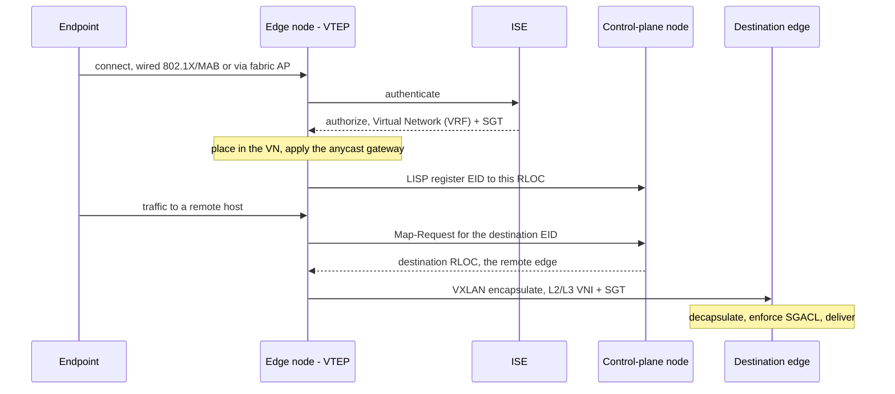
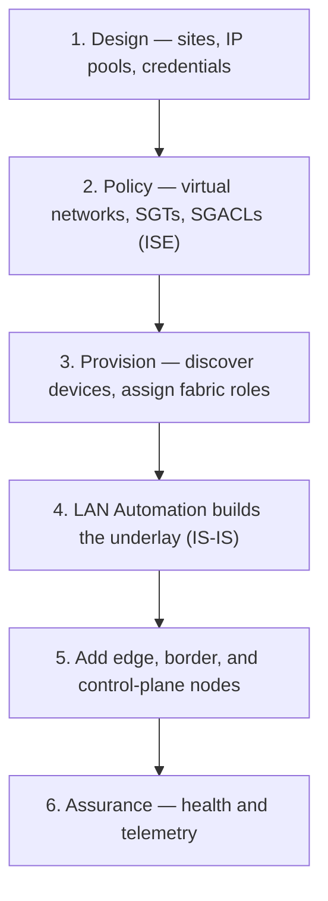
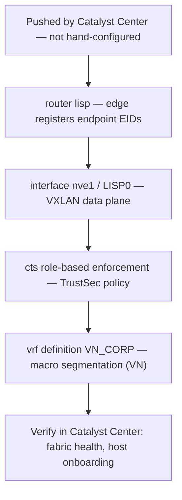

---
categories:
  - "[[Networking]]"
topic@networking:
  - "[[Networking General]]"
tags:
  - category/networking/networking_general
icon: FasNetworkWired
iconColor:
last_update:
aliases:
  - Software-Defined Access
---
Cisco SD-Access (Software-Defined Access) is Cisco's intent-based networking solution for the campus. It turns the access network into an automated fabric: a routed [[#Underlay|underlay]] carrying a virtual [[#Overlay|overlay]] in which policy is defined by identity rather than by IP address. Instead of configuring [[VLANs]] and access lists box by box, an operator expresses intent in a controller and the fabric is provisioned to match. SD-Access is built from three cooperating planes — a [[LISP#Core Namespaces|LISP]] control plane, a [[VXLAN#VXLAN Encapsulation|VXLAN]] data plane, and a [[TrustSec#Security Group Tag (SGT)|Cisco TrustSec]] policy plane — managed by Cisco Catalyst Center and Cisco ISE. This note is the hub for the fabric: it explains the underlay and overlay, the three planes, the device roles, the segmentation model, [[Wireless|wireless]] integration, how a host is onboarded, and how sites are joined together.

## What SD-Access Is

_An automated campus fabric that separates security policy from the physical topology._

[[Campus Design#Hierarchical Layers|Traditional campus networks]] bind policy to addressing: VLANs define reach and IP access lists define who may talk to whom, all configured device by device. SD-Access replaces that with a controller-driven fabric where endpoints are grouped by role and policy is written between groups. Two management systems sit above the network devices: Cisco Catalyst Center provides design, automation, and assurance, while Cisco ISE provides identity and policy. The switches, routers, and wireless controllers underneath take on fabric roles and forward traffic.

## Underlay and Overlay

_A stable routed foundation carries a virtual, policy-rich network on top of it._

### Underlay

The physical network — every link routed, no spanning tree, all paths active through equal-cost multipath. Its only responsibility is plain IP reachability between fabric nodes. It can be an existing network (bring-your-own) or built automatically by Catalyst Center LAN Automation, which provisions the devices and runs IS-IS as the underlay [[Routing|routing]] protocol.

### Overlay

The fabric itself: [[VXLAN#Underlay, Overlay, and Fabric|VXLAN tunnels]] between fabric nodes that form the virtual networks endpoints actually live in. The underlay never sees endpoint addresses because they are hidden inside the encapsulation.

## The Three Planes

_SD-Access splits control, forwarding, and policy so each can be handled by the technology best suited to it._

```
Policy plane    TrustSec  — classify endpoints into SGTs, enforce with SGACLs
Control plane   LISP      — map endpoint identity (EID) to location (RLOC)
Data plane      VXLAN     — encapsulate and carry the frame, plus VNI and SGT
                ───────────────────────────────────────────────────────────
Underlay        routed IP network (IS-IS) — VTEP-to-VTEP reachability only
```

### Control Plane — LISP

The control-plane node runs the [[LISP#LISP in Cisco SD-Access|LISP]] Map-Server and Map-Resolver. Edge nodes register the endpoints they serve, and the control-plane node keeps the host-tracking database that maps every endpoint identity (EID) to the locator (RLOC) of the edge node behind it.

### Data Plane — VXLAN

Traffic between fabric nodes is [[VXLAN#VXLAN in Cisco SD-Access|VXLAN]]-encapsulated across the underlay. The VXLAN header carries the VNI that identifies the segment and the SGT that carries policy, so both segmentation and group membership travel with every packet.

### Policy Plane — TrustSec

Endpoints are classified into groups tagged with an [[TrustSec#The Three Pillars|SGT]], and enforcement is done with SGACLs based on source and destination group. Because policy is expressed between groups, it is independent of the addressing plan and follows the endpoint anywhere in the fabric.

|Plane|Technology|Job|
|---|---|---|
|Control|LISP|Map EID (identity) to RLOC (location)|
|Data|VXLAN|Encapsulate frames over the underlay; carry VNI and SGT|
|Policy|TrustSec|Classify into SGTs; enforce with SGACLs|

## Fabric Roles

_A fabric site is built from a small set of device roles._

### Control-Plane Node

Runs the LISP Map-Server and Map-Resolver and holds the host-tracking database of EID-to-RLOC bindings. It is the fabric's location directory.

### Edge Node

The access-layer switch where endpoints connect — the fabric's VXLAN tunnel endpoint. It provides the [[#Anycast Gateway|anycast gateway]], acts as the authentication relay to ISE, and registers connected endpoints with the control-plane node.

### Border Node

The gateway between the fabric and everything outside it. A border can be internal (to known routes such as the data center), external (to unknown routes such as the internet or WAN), or both — sometimes called an anywhere border.

### Intermediate Node

A pure underlay router that forwards IP between fabric nodes. It carries fabric traffic but holds no fabric role of its own.

### Fabric WLC and Access Points

Bring wireless clients into the same fabric and policy. The details are in [[#SD-Access Wireless|SD-Access Wireless]] below.

### Extended Nodes and Fabric-in-a-Box

Extended nodes stretch the fabric into non-carpeted spaces — factory floors, outdoor areas, IoT — without those devices being full fabric nodes. Fabric-in-a-Box collapses the control-plane, border, and edge roles onto a single switch or stack for small sites.

|Role|Function|
|---|---|
|Control-plane node|LISP Map-Server / Map-Resolver; host-tracking database|
|Edge node|Access-layer VTEP; anycast gateway; authentication relay; registers endpoints|
|Border node|Gateway out of the fabric; internal, external, or anywhere|
|Intermediate node|Underlay router between fabric nodes; not a fabric role|
|Fabric WLC and APs|Integrate wireless; APs encapsulate client traffic in VXLAN to the edge|
|Extended node / Fabric-in-a-Box|Reach IoT spaces; collapse roles onto one device for small sites|

```
                 Control-Plane Node  (LISP Map-Server / Resolver)
                            │
   Border Node ───────── underlay fabric (IS-IS) ───────── Border Node
    (to DC / WAN)                  │                         (to internet)
                          Intermediate nodes
                          │        │        │
                      Edge Node  Edge Node  Edge Node    (VTEP + anycast GW)
                          │        │         │
                      endpoints  endpoints  AP → wireless clients
```

## Segmentation Model

_Two tiers of segmentation, one for whole domains and one for groups inside a domain._

### Macro Segmentation — Virtual Networks

A virtual network (VN) is a [[VRF]] carried by its own Layer 3 VNI. Different VNs are completely isolated — traffic cannot pass between them inside the fabric, and any communication must go through an explicit policy point such as a firewall or a fusion router that leaks routes between VRFs. Macro segmentation keeps entire domains apart, for example corporate versus guest versus building-management systems.

### Micro Segmentation — Security Groups

Within a single VN, [[TrustSec#Micro Segmentation|SGTs and SGACLs]] control which groups may talk to which. This gives granular separation — an IoT camera group denied access to a server group in the same VN — without any change to subnets or VLANs.

## Anycast Gateway

_One default-gateway address shared by every edge node, so an endpoint keeps its gateway no matter where it connects._

The default gateway for a subnet is configured as a switched virtual interface with the same IP address and the same MAC address on every [[#Edge Node|edge node]] in the fabric. Because the gateway is identical everywhere, it is always local to whichever edge a host attaches to, and a host can move between edge nodes without changing its gateway or losing its session. This is what makes seamless mobility across the fabric possible, working with LISP re-registration behind the scenes, and it removes the need for the [[High Availability#First-Hop Redundancy Protocols|first-hop redundancy protocols]] a traditional campus uses for gateway redundancy.

## SD-Access Wireless

_Fabric-integrated wireless pushes the data plane to the edge instead of tunneling it back to the controller._

In a traditional wireless design, access points tunnel all client data back to the WLC over CAPWAP. In fabric-enabled wireless, the access point instead encapsulates client traffic in VXLAN to its local fabric edge node, so wireless data enters the fabric at the edge just like wired traffic and receives the same VN and SGT policy. The WLC handles control-plane functions only — CAPWAP control, client authentication, and registering wireless clients with the LISP control-plane node.

```
Traditional CAPWAP                 SD-Access fabric wireless
client → AP ═CAPWAP═► WLC          client → AP ═VXLAN═► Fabric Edge → fabric
 (all client data to the WLC)      WLC does control only (CAPWAP, auth, LISP)
```

## Host Onboarding Flow

_How an endpoint gets identity, policy, and connectivity the moment it joins._



```
1. Endpoint connects to an edge node
2. Edge node relays 802.1X / MAB authentication to ISE
3. ISE returns a Virtual Network (VRF) and an SGT for the session
4. Edge node applies the anycast gateway and registers the EID with the control-plane node
5. Traffic is VXLAN-encapsulated (VNI + SGT) and routed to the destination RLOC
6. The egress edge or border enforces the SGACL, then decapsulates to the endpoint
```

The sequence shows the three planes cooperating: TrustSec classifies (steps 2–3), LISP locates (step 4), VXLAN forwards (step 5), and TrustSec enforces (step 6).

## Cisco Catalyst Center

_The controller that designs, provisions, and assures the whole fabric from one place._

Cisco Catalyst Center, formerly Cisco DNA Center, is the automation and assurance engine of SD-Access. Its work is organized into four workflows.

|Workflow|What it does|
|---|---|
|Design|Site hierarchy, IP address pools, device credentials and profiles|
|Policy|Virtual networks, security groups, SGACLs; integrates with ISE|
|Provision|Push devices into fabric roles; LAN Automation builds the underlay with IS-IS|
|Assurance|Telemetry, health scores, analytics, and guided troubleshooting|

## Multi-Site — Fabric Domains and Transit

_Joining fabric sites while preserving the segmentation defined inside them._

A fabric site is a single fabric with its own control-plane, border, and edge nodes; a fabric domain is a collection of sites. Sites are joined by a transit, of which there are two kinds:

- SD-Access transit — a native VXLAN overlay between sites that preserves the VN and SGT segmentation end to end, auto-configured by Catalyst Center. Policy stays intact across the domain.
- IP-based transit — sites connect over a traditional IP or [[Catalyst SD-WAN#Relationship to SD-Access|WAN]] network. Segmentation must be re-mapped at the border, for example with VRF-lite and SGT propagation over SXP or inline tagging, because the transit itself does not carry the fabric encapsulation.

## Benefits

_Why a fabric instead of a traditional campus._

SD-Access replaces manual, per-device configuration with controller-driven automation, so the network is provisioned consistently and quickly. It delivers both tiers of segmentation — macro isolation between virtual networks and micro segmentation between groups — without the VLAN and ACL sprawl of the old model. The anycast gateway and LISP give endpoints seamless mobility, wired and wireless share one policy model, and Catalyst Center assurance turns telemetry into health and troubleshooting. Above all, policy is tied to identity rather than to addresses, so it follows the user or device anywhere in the fabric.

## Provisioning

_SD-Access is built in Catalyst Center through four workflows, not by hand; the controller pushes the LISP, VXLAN, and TrustSec constructs to each device._

### High-Level Workflow



### CLI Companion

_Catalyst Center generates this; a fabric edge ends up with roughly these constructs._


