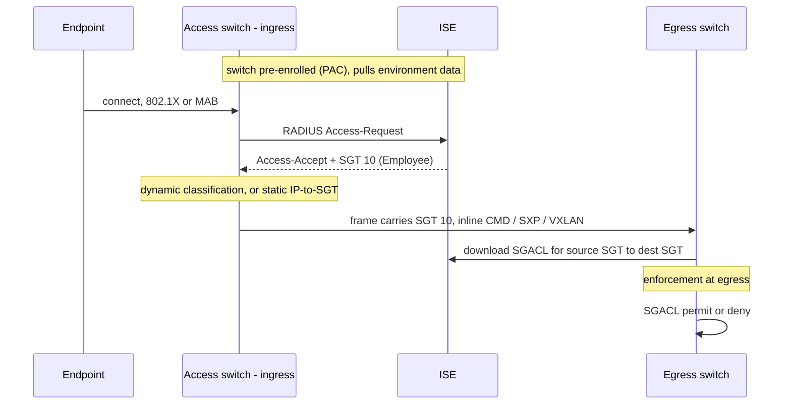
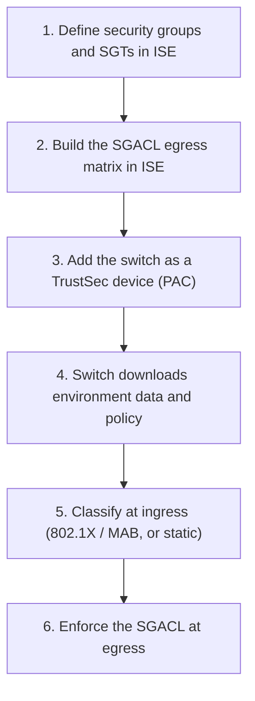
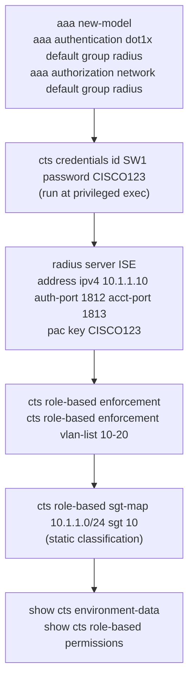

---
categories:
  - "[[Networking]]"
topic@networking:
  - "[[Networking General]]"
tags:
  - category/networking/networking_general
icon: FasNetworkWired
iconColor:
last_update:
---
Cisco TrustSec is a software-defined segmentation architecture that enforces security policy based on the role of a user or device rather than its IP address. Each source is tagged with a [[#Security Group Tag (SGT)|Security Group Tag]] that represents its group, that tag travels with the traffic across the network, and policy is written between groups instead of between subnets. The result is segmentation that is independent of addressing and topology — the policy follows the endpoint wherever it connects. TrustSec operates in three steps: [[#Classification — Assigning the SGT|classification]], [[#Propagation — Carrying the SGT|propagation]], and [[#Enforcement — Applying Policy|enforcement]], all orchestrated by [[#Cisco ISE — The Policy Engine|Cisco ISE]]. For the ENCOR exam, TrustSec is the policy plane of Cisco SD-Access, layered on the [[LISP#Core Namespaces|LISP]] control plane and the [[VXLAN#VXLAN Encapsulation|VXLAN]] data plane. This note covers the SGT, the three pillars, the policy matrix, the role of ISE, and how it all fits the fabric.

## Why TrustSec — Policy Without IP Addresses

_Traditional ACLs bind policy to addresses and topology; TrustSec binds it to identity, so the policy stops depending on where a host sits._

Classic segmentation is built from [[VLANs]] and IP access lists. Every rule references subnets, so the policy is tied to the addressing plan and the topology: renumber a subnet, move a server, or add a site, and the ACLs have to be rewritten. In a large network this produces sprawling, brittle access lists that are hard to audit and easy to break. TrustSec removes the dependency by classifying traffic into groups and writing policy between those groups. A device joins a group and inherits its policy; it can move anywhere and keep it.

## Security Group Tag (SGT)

_A 16-bit tag representing the role or group of the traffic source, carried with the traffic so enforcement never has to reason about IP addresses._

The SGT is a 16-bit value — up to roughly 65,000 groups — assigned to a security group such as Employee, Contractor, IoT, Server, or Quarantine. It identifies what the source is, not where it is. Every enforcement decision is made by comparing the source SGT against the destination SGT, so the same policy applies no matter which subnet or VLAN the endpoints happen to be in.

## The Three Pillars

_Classification assigns the tag, propagation carries it, and enforcement acts on it._



```
Classification  ──►  Propagation  ──►  Enforcement
 assign the SGT       carry the SGT      act on the SGT
 (ISE auth or         (inline CMD,       (SGACL: source SGT
  static binding)      SXP, or VXLAN)     × destination SGT)
```

### Classification — Assigning the SGT

_Deciding which group a packet belongs to, either dynamically at authentication or statically by binding._

Dynamic classification happens at authentication: when an endpoint passes 802.1X, MAB, or web authentication, ISE returns an SGT in the authorization result alongside any VLAN or downloadable ACL, and the endpoint's session carries that tag. Static classification binds an SGT to an IP address, subnet, VLAN, switch port, or Layer 3 interface, configured on the device or in ISE — used for servers, data-center subnets, and anything that does not authenticate.

|Type|How the SGT is assigned|Typical use|
|---|---|---|
|Dynamic|ISE returns the SGT in the 802.1X / MAB / web-auth authorization result|Users and devices that authenticate|
|Static|SGT bound to an IP, subnet, VLAN, port, or Layer 3 interface on the device or in ISE|Servers, data-center subnets, unauthenticated segments|

### Propagation — Carrying the SGT

_Getting the tag from where it was assigned to where it will be enforced._

#### Inline Tagging

The SGT is embedded directly in the Layer 2 frame, in a Cisco Meta Data (CMD) field added to the Ethernet header, and carried hop by hop. This is the native method: fast and stateless, but every hop must be hardware that understands the CMD field.

#### SXP — SGT Exchange Protocol

When a hop cannot tag inline, SXP carries the mapping out-of-band instead of in the frame. It runs over TCP port 64999 between two roles — a speaker that advertises IP-to-SGT bindings and a listener that receives them — so a downstream enforcement device can learn an endpoint's SGT even across devices that do not support native tagging.

#### SGT in the VXLAN Header

Inside an SD-Access fabric the SGT rides in the [[VXLAN#Policy Plane — Cisco TrustSec|VXLAN header]], which reserves 16 bits for it. Propagation is then built into the data plane end to end, with no separate tagging or SXP session required across the fabric.

|Method|How the SGT travels|When used|
|---|---|---|
|Inline tagging|Embedded in the Cisco Meta Data (CMD) field of the Layer 2 frame, hop by hop|Hardware that supports native tagging on every hop|
|SXP|IP-to-SGT bindings sent over TCP 64999, speaker to listener|Hops that cannot tag inline|
|VXLAN header|SGT carried in the VXLAN header across the fabric|Cisco SD-Access|

> [!note] TrustSec and MACsec are independent
> Links can be encrypted hop by hop with MACsec (802.1AE), and TrustSec often accompanies it, but SGT propagation and MACsec encryption are separate functions — the CMD field carries the tag whether or not the link is encrypted.

### Enforcement — Applying Policy

_At the egress point, the source and destination SGTs select a rule that permits or denies the traffic._

Enforcement is done with a Security Group ACL (SGACL). The enforcing device takes the source SGT and looks it up against the destination SGT; the matching cell is an SGACL that permits or denies per protocol and port. Enforcement is applied on egress — closest to the destination — and the rules are downloaded from ISE. Cisco firewalls (ASA and FTD) can enforce the same group model as security-group firewall rules.

```
        Destination SGT
              │
Source SGT ───┼──►  SGACL cell  ──►  permit / deny (per protocol and port)
              │
   evaluated at the egress enforcement point
```

## The Egress Policy Matrix

_ISE expresses the entire segmentation policy as a grid: source groups down one axis, destination groups along the other, an SGACL in each cell._

Rather than scattered access lists, the whole policy lives in one matrix. Each cell holds the SGACL applied when traffic flows from that source group to that destination group; a default rule (usually permit or deny) covers any pair with no explicit cell.

```
                 Dst →  │ Employee │ Server │  IoT   │
   Src ↓                │   (10)   │  (50)  │  (30)  │
   ──────────────────── ┼──────────┼────────┼────────┤
   Employee   (10)      │  permit  │ SGACL  │  deny  │
   Contractor (20)      │  deny    │ SGACL  │  deny  │
   IoT        (30)      │  deny    │ deny   │ permit │
```

Reading the matrix is the fastest way to reason about TrustSec: pick the source row and the destination column, and the cell is the policy.

## Cisco ISE — The Policy Engine

_ISE is where groups, tags, the matrix, and the SGACLs are defined, and the source every network device pulls policy from._

Security groups and their SGTs are created in ISE, the [[#The Egress Policy Matrix|egress matrix]] and its SGACLs are authored there, and network devices retrieve what they need from it:

- Environment data — the list of SGTs and their names, so a device knows the groups that exist.
- Policy download — the SGACLs relevant to the SGTs a given enforcement device handles.
- Dynamic assignment — the SGT handed back in RADIUS authorization, with Change of Authorization (CoA) used to update a live session.

Devices establish a TrustSec trust relationship with ISE before they can pull this policy, keeping distribution authenticated and consistent across the campus, data center, and WAN.

## TrustSec in Cisco SD-Access

_The policy plane of the [[SD-Access#The Three Planes|fabric]], riding on the LISP control plane and the VXLAN data plane._

```
Policy plane    Cisco TrustSec — classify into SGTs, enforce with SGACLs
Control plane   LISP — EID-to-RLOC mapping
Data plane      VXLAN — carries the frame and the SGT
```

SD-Access uses two complementary layers of segmentation.

### Macro Segmentation

Separate virtual networks, each a [[VRF]] carried by its own Layer 3 [[LISP#Instance IDs and Segmentation|LISP instance and VXLAN VNI]]. Traffic cannot cross between virtual networks without passing through an explicit policy point such as a firewall — complete isolation, for keeping whole domains apart (for example corporate versus building-management systems).

### Micro Segmentation

SGTs and SGACLs operating inside a single virtual network. Endpoints in the same VN are still separated by group policy, so within one network an IoT camera group can be denied access to a server group without any VLAN or subnet change. Classification happens at the fabric edge from the ISE authorization result, the tag travels in the VXLAN header, and enforcement is applied at the egress edge or border.

## Benefits

_Segmentation that is centralized, address-independent, and mobile._

Because policy is written between groups, it no longer depends on the addressing plan or the topology, and it follows a user or device to any port in the network. Micro-segmentation becomes possible without redesigning subnets or VLANs, and the number of access lists collapses — one group-based policy replaces many IP-based ACLs. Policy is authored once in ISE and enforced consistently everywhere, and scaling is simply a matter of placing a device in the right group, whereupon it inherits the policy automatically.

## Configuration

_The policy lives in ISE; each switch is enrolled, pulls the policy, classifies at ingress, and enforces SGACLs at egress._

### High-Level Workflow



### CLI Companion

_Cisco IOS-XE switch side (ISE holds the groups and matrix)._


