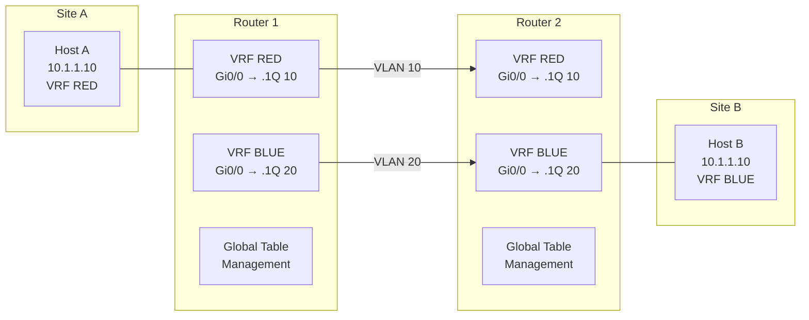
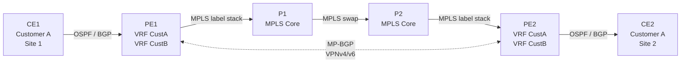

---
categories:
  - "[[Networking]]"
topic@networking:
  - "[[Networking General]]"
tags:
  - category/networking/networking_general
icon: FasNetworkWired
iconColor:
last_update:
---
Virtual Routing and Forwarding (VRF) is a technology that allows multiple independent routing table instances to coexist on a single physical router. Each [[#VRF Instance|VRF instance]] maintains its own forwarding table, its own set of interfaces, and its own routing protocol adjacencies, completely isolated from every other instance on the same device. This makes it possible to carry traffic for multiple tenants, security zones, or logical networks over a shared physical infrastructure without any cross-contamination of routes or data.

## Theoretical Foundation

At its core, VRF is a virtualization technique applied to the routing and forwarding plane of a network device. A traditional router has one routing table and one forwarding table (the RIB and the FIB, respectively). VRF breaks this assumption by creating multiple parallel RIBs and FIBs, each scoped to a named instance. The result is that two customers — or two departments, or two security zones — can use identical IP address spaces without conflict, because each address exists in a separate, invisible namespace.

### Routing Table Isolation

The fundamental principle behind VRF is isolation. When an interface is assigned to a [[#VRF Instance|VRF instance]], all traffic entering or leaving that interface is looked up exclusively in that instance's routing table. The router does not consult the [[#Global Routing Table|global table]] or any other VRF table during the lookup. This means:

- A packet arriving on an interface in VRF BLUE can never be forwarded to an interface in VRF RED, unless the administrator explicitly enables [[#Route Leaking|route leaking]] between the two.
- Two interfaces in different VRFs can hold the same IP address (for example, 10.0.0.1/24 in VRF BLUE and 10.0.0.1/24 in VRF RED) with no conflict.
- Routing protocols running inside a VRF form adjacencies only with other routers reachable within that same VRF context.

This isolation is enforced in hardware on modern platforms. The Forwarding Information Base (FIB) is partitioned per VRF, so the data-plane lookup is as strict as the control-plane separation.

### Global Routing Table

Every router always has a default routing instance that exists even when no VRFs are configured. This is called the global routing table (sometimes referred to as the default VRF or the global VRF). Interfaces that are not explicitly placed into a named VRF belong to this global table.

In a service provider MPLS backbone, the global table typically carries the provider's own infrastructure routes — loopbacks, link addresses, and the IGP that underpins label distribution. In an enterprise using [[#VRF-Lite|VRF-Lite]], the global table may carry shared services such as DNS, NTP, and management.

> [!important] Moving an interface into a VRF removes all its IP configuration. Any IP address, routing protocol membership, and related settings on that interface are stripped the moment the `vrf forwarding` (or `vrf member`) command is applied. The interface must be reconfigured afterward. This is by design — the address now lives in a different namespace and must be explicitly re-stated in that context.

## VRF Components

A VRF instance is built from several elements that together define its identity, its scope, and how it exchanges routes with the rest of the network.

### VRF Instance

The VRF instance is the named container. In Cisco IOS/IOS-XE, a VRF instance is created with `vrf definition <name>` (modern syntax) or `ip vrf <name>` (legacy syntax). Each instance holds:

- A name, unique on the local device.
- One or more [[#Address Family|address families]] (IPv4, IPv6, or both).
- A [[#Route Distinguisher|Route Distinguisher]], required when the VRF participates in [[#MPLS L3VPN|MPLS L3VPN]].
- One or more [[#Route Target|Route Targets]], which control route import and export in MPLS environments.
- A per-VRF RIB and FIB.
- The set of interfaces assigned to this VRF.
- Per-VRF routing process instances or address-family contexts.

In [[#VRF-Lite|VRF-Lite]] deployments, the Route Distinguisher and Route Target are often omitted because there is no MP-BGP route exchange. The VRF still provides full routing table isolation locally, but route distribution between sites is handled hop by hop with per-VRF routing adjacencies rather than through an MPLS backbone.

### Route Distinguisher

The Route Distinguisher (RD) is an 8-byte value prepended to every IPv4 or IPv6 prefix inside a VRF to make it globally unique within the [[#MPLS L3VPN|MPLS L3VPN]] control plane. The combination of the RD and the IP prefix forms a VPNv4 (or VPNv6) address, which is what [[#MP-BGP Route Exchange|MP-BGP]] actually carries.

The RD does not influence forwarding decisions and it does not determine which VRF a route belongs to — that is the job of the [[#Route Target|Route Target]]. The RD exists solely to prevent ambiguity when two customers use the same IP prefix (for example, 10.0.0.0/8) and both prefixes must travel through the same BGP table on a PE router.

RD formats:

|Type|Format|Example|Description|
|---|---|---|---|
|Type 0|ASN:nn|65000:1|2-byte ASN followed by a 4-byte number|
|Type 1|IP:nn|192.168.1.1:1|IPv4 address followed by a 2-byte number|
|Type 2|4-byte-ASN:nn|65000.100:1|4-byte ASN followed by a 2-byte number|

A common convention is to use the PE router's loopback address as the IP portion (Type 1) or the provider's ASN as the first field (Type 0), with a sequential number per VRF. This makes RDs unique per PE per VRF, which simplifies troubleshooting because every VPNv4 prefix in the BGP table can be traced back to the PE that originated it.

> [!note] Unique RDs per PE vs. shared RDs. Some designs assign the same RD to the same VRF on every PE (for example, 65000:100 everywhere for VRF CustomerA). This works but loses the ability to distinguish the originating PE from the VPNv4 prefix alone. Using unique RDs per PE (for example, 10.0.0.1:100 on PE1, 10.0.0.2:100 on PE2) preserves that traceability and is the recommended practice.

### Route Target

The Route Target (RT) is a BGP Extended Community attribute that controls which routes are imported into and exported from a [[#VRF Instance|VRF instance]]. While the [[#Route Distinguisher|RD]] provides uniqueness, the RT provides policy.

When a PE router exports a VPNv4 route into MP-BGP, it attaches one or more export RTs. When another PE receives that route, it checks the attached RTs against the import RT list of each local VRF. If there is a match, the route is imported into that VRF's routing table.

This import/export mechanism is what makes complex topologies possible:

- Full-mesh VPN: every site in the VPN exports and imports the same RT (for example, export 65000:100, import 65000:100).
- Hub-and-spoke: spoke sites export an RT that only the hub imports (spoke export 65000:101, hub import 65000:101). The hub exports a different RT that all spokes import (hub export 65000:100, spokes import 65000:100). Spokes never see each other's routes directly.
- Extranet / shared services: a shared-services VRF exports an RT that multiple customer VRFs import, giving them reachability to the shared resources without giving them reachability to each other.
- [[#Route Leaking|Route leaking]]: selective RT import between VRFs on the same PE achieves controlled inter-VRF communication.

RT format is identical to the RD format (ASN:nn or IP:nn), but the two values serve completely different purposes and should not be confused.

### Address Family

A VRF instance can carry IPv4 routes, IPv6 routes, or both. In the modern `vrf definition` syntax, each address family is configured explicitly inside the VRF block:

```cisco
vrf definition CUSTOMER_A
 rd 65000:100
 !
 address-family ipv4
  route-target export 65000:100
  route-target import 65000:100
 exit-address-family
 !
 address-family ipv6
  route-target export 65000:600
  route-target import 65000:600
 exit-address-family
```

The [[#Route Distinguisher|RD]] is configured at the VRF level. The [[#Route Target|Route Targets]] are configured per address family, because a VRF might use different RTs for its IPv4 and IPv6 route exchange.

In the legacy `ip vrf` syntax, only IPv4 was supported. Migrating to `vrf definition` is necessary to support dual-stack VRFs.

## VRF-Lite

VRF-Lite is VRF without MPLS. It provides [[#Routing Table Isolation|routing table isolation]] on a single router or across a chain of routers using per-VRF sub-interfaces and per-VRF routing adjacencies, but it does not use label switching, [[#Route Distinguisher|Route Distinguishers]], or [[#Route Target|Route Targets]] to distribute routes across a core. Each hop in the path must be explicitly configured to carry the VRF.

### How VRF-Lite Works

In a VRF-Lite design, every router in the path maintains a separate [[#VRF Instance|VRF instance]] for each isolated network. Trunk links between routers are divided into 802.1Q sub-interfaces, one per VRF, each assigned to its respective VRF. A routing protocol (or static routes) runs independently on each sub-interface, forming adjacencies only within that VRF.



Both hosts use the same IP address 10.1.1.10, but they live in separate VRFs and can never reach each other. Each VRF's traffic crosses the trunk in its own VLAN.

### When to Use VRF-Lite

VRF-Lite is the right choice when:

- The network is small enough that per-hop VRF configuration is manageable (campus, data center, branch).
- MPLS is not deployed or not justified.
- The goal is segmentation — separating management traffic from user traffic, isolating guest access, or creating distinct security zones on shared hardware.
- Overlapping IP address space must be supported between tenants on shared infrastructure.

The tradeoff is scalability. Every intermediate router must carry every VRF and every per-VRF sub-interface and routing adjacency. In an [[#MPLS L3VPN|MPLS L3VPN]], only the PE routers need VRF awareness; the core P routers forward labeled packets without any VRF knowledge.

### VRF-Lite Configuration

A minimal VRF-Lite setup on two routers connected by a trunk:

Router 1:

```cisco
vrf definition RED
 address-family ipv4
 exit-address-family
!
vrf definition BLUE
 address-family ipv4
 exit-address-family
!
interface GigabitEthernet0/0
 no ip address
 no shutdown
!
interface GigabitEthernet0/0.10
 encapsulation dot1Q 10
 vrf forwarding RED
 ip address 172.16.0.1 255.255.255.252
!
interface GigabitEthernet0/0.20
 encapsulation dot1Q 20
 vrf forwarding BLUE
 ip address 172.16.1.1 255.255.255.252
!
router ospf 10 vrf RED
 network 172.16.0.0 0.0.0.3 area 0
!
router ospf 20 vrf BLUE
 network 172.16.1.0 0.0.0.3 area 0
```

Router 2 mirrors the same structure with its own addresses. Each OSPF process is scoped to its VRF — process 10 forms an adjacency only with the VRF RED peer, process 20 only with VRF BLUE.

> [!tip] The `vrf forwarding` command must be applied before the `ip address` command. If the interface already has an address, applying `vrf forwarding` strips it, and the address must be re-entered.

## MPLS L3VPN

MPLS Layer 3 VPN is the service provider architecture that combines VRF with MPLS label switching and [[#MP-BGP Route Exchange|MP-BGP]] to deliver scalable, any-to-any IP VPN services. It is defined in RFC 4364 (originally RFC 2547bis).

In an MPLS L3VPN, customer routes never appear in the provider core. The PE routers hold [[#VRF Instance|VRF instances]] for each customer and exchange VPNv4/VPNv6 routes with each other over MP-BGP. The P (Provider) routers in the core forward traffic purely based on MPLS labels, with no knowledge of customer addressing.

### Architecture and Roles

_The three device roles in an MPLS L3VPN topology and what each one is responsible for._

|Role|Full Name|Function|
|---|---|---|
|CE|Customer Edge|The customer's router. Peers with the PE using a standard routing protocol (OSPF, EIGRP, BGP, static). Has no knowledge of MPLS or VRF.|
|PE|Provider Edge|The provider's edge router. Maintains a [[#VRF Instance|
|P|Provider Core|Forwards MPLS-labeled packets. Runs the IGP and LDP/RSVP-TE for label distribution. Has no customer routes, no VRFs, and no BGP.|



### Label Stack

In an MPLS L3VPN, packets crossing the core carry a two-label stack:

- The outer label (transport label) is assigned by LDP or RSVP-TE. It guides the packet hop by hop across the P routers to the egress PE's loopback. P routers swap this label at each hop and never look beneath it.
- The inner label (VPN label) is assigned by the egress PE during the [[#MP-BGP Route Exchange|MP-BGP]] route exchange. It tells the egress PE which VRF the packet belongs to. The egress PE pops both labels (or uses Penultimate Hop Popping for the outer label) and performs an IP lookup in the correct VRF to forward the packet to the CE.

This two-label architecture is the reason the P routers need no VRF awareness. They only process the outer label; the inner label is opaque to them.

### MP-BGP Route Exchange

Multi-Protocol BGP (MP-BGP) is the control plane that distributes customer routes between PE routers in an MPLS L3VPN. Standard BGP carries only IPv4 unicast routes. MP-BGP extends this with additional address families, the relevant ones being:

- VPNv4 (AFI 1, SAFI 128): carries IPv4 prefixes prepended with a [[#Route Distinguisher|Route Distinguisher]], plus [[#Route Target|Route Target]] extended communities and the VPN label.
- VPNv6 (AFI 2, SAFI 128): the same for IPv6 prefixes.

When a PE learns a customer route from its CE (via [[#PE-CE Routing|PE-CE routing]]), it converts it into a VPNv4 route by prepending the RD, attaches the export RT, assigns a VPN label, sets its own loopback as the BGP next-hop, and advertises it to all other PEs in the VPNv4 address family.

The receiving PE checks the RT against each local VRF's import list. On a match, the route is installed into that VRF's routing table, and the BGP next-hop and VPN label are stored for forwarding.

In large networks, Route Reflectors (RRs) are placed in the core to avoid a full mesh of iBGP sessions between PEs. The RRs reflect VPNv4/VPNv6 routes between PEs. RRs themselves do not need VRFs — they carry VPNv4 routes in BGP but never install them into a forwarding table.

### PE-CE Routing

The routing protocol between a PE and a CE is a standard IP routing protocol running inside the context of a VRF. Common choices:

|Protocol|Notes|
|---|---|
|eBGP|Most scalable. Each customer site is a separate AS (or uses `as-override` / `allowas-in`). Supports policy, communities, and clean mutual redistribution is not needed.|
|OSPF|Commonly used in enterprise-to-provider hand-offs. The PE runs a per-VRF OSPF process. LSA translation (Type 3/5/7 to BGP and back) is handled by the PE with sham-links if backdoor links exist.|
|EIGRP|Cisco proprietary. The PE runs a per-VRF EIGRP AS. Metric is preserved through the MPLS core using extended communities.|
|Static|Simplest. Works well for single-homed sites. The PE points a per-VRF static route at the CE's address.|
|RIPv2|Legacy. Still supported but rarely chosen for new designs.|

The PE redistributes CE-learned routes into MP-BGP VPNv4 for transport to remote PEs, and redistributes received VPNv4 routes back into the PE-CE protocol toward the local CE. This redistribution is automatic for BGP (it is the same process), but must be explicitly configured for OSPF, EIGRP, and static.

## Route Leaking

Route leaking is the controlled sharing of routes between two [[#VRF Instance|VRF instances]] that would otherwise be completely isolated. It breaks the default [[#Routing Table Isolation|isolation]] in a deliberate, policy-controlled way to provide reachability to shared resources (DNS, authentication servers, internet gateways) without collapsing the VRFs into a flat network.

### Route Leaking with Route Targets

In an [[#MPLS L3VPN|MPLS L3VPN]] environment, route leaking is achieved through [[#Route Target|Route Target]] import/export policy. A shared-services VRF exports its routes with an RT that multiple customer VRFs are configured to import. The customer VRFs export their return routes with an RT that the shared-services VRF imports. The MP-BGP process handles the actual route installation.

Example: a shared-services VRF exports RT 65000:999. Customer VRF A imports RT 65000:999 in addition to its own 65000:100. The shared-services VRF imports RT 65000:100 (and 65000:200 for Customer B, and so on) to learn the return paths.

### Route Leaking with Static Routes or BGP

In a [[#VRF-Lite|VRF-Lite]] environment without MP-BGP, route leaking can be done through:

- Per-VRF static routes pointing to a next-hop in another VRF using the `global` keyword or specifying the target VRF.
- BGP with `import` and `export` route-maps applied to `vrf` address families on the same router, even without MPLS. This method uses the same RT mechanism locally.
- Policy-Based Routing in combination with VRF selection (`ip policy route-map` with `set ip vrf`).

```cisco
ip route vrf RED 10.100.0.0 255.255.255.0 10.200.0.1 global
```

This static route exists in VRF RED's routing table but resolves its next-hop 10.200.0.1 in the [[#Global Routing Table|global table]]. Traffic matching this route exits VRF RED and enters the global forwarding plane.

> [!warning] Route leaking defeats isolation. Every leaked route is a potential path between domains that were separated for a reason. Always use the most restrictive prefix match possible and apply access control lists on the shared-services interfaces to limit what traffic can actually cross.

## VRF-Aware Services

When a router runs VRF, every service on that router that needs to send or receive IP traffic must be told which VRF context to operate in. A service that is not VRF-aware defaults to the [[#Global Routing Table|global table]], which means it cannot reach — or be reached by — hosts inside a VRF.

### VRF-Aware DHCP

The DHCP relay or server process must specify the VRF so that it sources and receives DHCP traffic in the correct routing context.

```cisco
ip dhcp relay information trust-all
!
interface GigabitEthernet0/1.10
 vrf forwarding RED
 ip address 10.10.10.1 255.255.255.0
 ip helper-address vrf SERVICES 10.200.0.50
```

The `ip helper-address vrf SERVICES 10.200.0.50` command tells the relay to forward DHCP requests received on this VRF RED interface to the DHCP server at 10.200.0.50, which is reachable in VRF SERVICES. The relay bridges the two VRF contexts for DHCP traffic.

### VRF-Aware DNS

DNS lookups initiated by the router itself (for example, resolving hostnames typed in the CLI) default to the [[#Global Routing Table|global table]]. To direct them through a specific VRF:

```cisco
ip name-server vrf MGMT 10.140.4.250
```

This is relevant when the management DNS server is reachable only inside a management VRF.

### VRF-Aware SNMP

SNMP traps and polls must be sourced from the correct VRF to reach the monitoring infrastructure:

```cisco
snmp-server host 10.140.2.24 vrf MGMT version 2c publiacqua
```

### VRF-Aware AAA and RADIUS

RADIUS authentication and accounting traffic must travel in the VRF where the RADIUS server is reachable:

```cisco
aaa group server radius RADSERV
 server name radius-mgmnt-auth01
 ip vrf forwarding MGMT
 ip radius source-interface Vlan800
```

The `ip vrf forwarding MGMT` command inside the RADIUS server group tells the router to source all RADIUS packets through VRF MGMT. Without this, RADIUS traffic would be sent through the global table and never reach the server.

### VRF-Aware NTP

```cisco
ntp server vrf MGMT 172.20.129.65 prefer
ntp source Vlan800
```

The NTP process is directed to resolve and reach the NTP server through VRF MGMT.

### VRF-Aware Static Routing

Static routes in a VRF are specified with the `vrf` keyword:

```cisco
ip route vrf RED 0.0.0.0 0.0.0.0 172.16.0.2
```

This default route exists only in VRF RED's routing table and has no effect on any other VRF or the global table.

### VRF-Aware Syslog

Logging traffic must be sourced from the VRF where the syslog collector is reachable:

```cisco
logging host 10.140.2.181 vrf MGMT
logging source-interface Vlan800
```

Without the `vrf` keyword, logging messages are sourced in the [[#Global Routing Table|global table]]. If the syslog server lives in a management VRF, those messages will never arrive.

> [!note] Operational commands such as `ping` and `traceroute` also require the VRF context. Using `ping vrf RED 10.1.1.10` ensures the lookup happens in VRF RED's table. Without the `vrf` keyword, the router looks in the global table and may reach a different host or nothing at all. See [[#Connectivity Tests|Connectivity Tests]] for details.

## Configuration on Cisco IOS-XE

_Covers the modern `vrf definition` syntax used on IOS-XE platforms. The legacy `ip vrf` syntax is shown for reference where it differs._

### `vrf definition` vs `ip vrf`

|Aspect|`ip vrf` (Legacy)|`vrf definition` (Modern)|
|---|---|---|
|Address families|IPv4 only|IPv4 and IPv6|
|Interface binding|`ip vrf forwarding <name>`|`vrf forwarding <name>`|
|RD/RT placement|Directly under `ip vrf`|RD under `vrf definition`, RT under each `address-family`|
|Availability|IOS 12.x and later|IOS-XE 3.x / IOS 15.x and later|

The two syntaxes are mutually exclusive for a given VRF name on the same device. Migrating from `ip vrf` to `vrf definition` requires removing the old VRF (which strips all interface bindings) and recreating it in the new syntax.

### Creating a VRF Instance

The full syntax including [[#Route Distinguisher|RD]] and [[#Route Target|Route Targets]] is shown in the [[#Address Family|Address Family]] section. In a [[#VRF-Lite|VRF-Lite]] deployment, where there is no MP-BGP route exchange, the RD and RT lines can be omitted entirely:

```cisco
vrf definition MGMT
 !
 address-family ipv4
 exit-address-family
 !
 address-family ipv6
 exit-address-family
```

This is the pattern seen in the management VRF configuration (`Mgmt-vrf`) commonly pushed by Cisco DNA Center to access switches. The [[#Address Family|address-family]] blocks are still required — they tell the router which protocol families the VRF participates in — even when no RD or RT is needed.

### Assigning Interfaces

```cisco
interface GigabitEthernet0/1
 vrf forwarding CUSTOMER_A
 ip address 10.1.1.1 255.255.255.0
 no shutdown
```

For trunk links carrying multiple VRFs, use 802.1Q sub-interfaces:

```cisco
interface GigabitEthernet0/0.100
 encapsulation dot1Q 100
 vrf forwarding CUSTOMER_A
 ip address 172.16.0.1 255.255.255.252
!
interface GigabitEthernet0/0.200
 encapsulation dot1Q 200
 vrf forwarding CUSTOMER_B
 ip address 172.16.1.1 255.255.255.252
```

### Routing Protocol Configuration

Each routing protocol that must operate inside a VRF is configured with a VRF-specific context.

#### OSPF per VRF

```cisco
router ospf 10 vrf CUSTOMER_A
 router-id 10.0.0.1
 network 10.1.1.0 0.0.0.255 area 0
 network 172.16.0.0 0.0.0.3 area 0
```

A separate OSPF process ID is used per VRF. The `vrf` keyword scopes the entire process to that VRF's interfaces and routing table.

#### EIGRP per VRF

```cisco
router eigrp NAMED_INSTANCE
 !
 address-family ipv4 vrf CUSTOMER_A autonomous-system 100
  network 10.1.1.0 0.0.0.255
  network 172.16.0.0 0.0.0.3
 exit-address-family
```

Named EIGRP uses the `address-family` block with the `vrf` keyword to isolate the instance.

#### BGP per VRF

For [[#MPLS L3VPN|MPLS L3VPN]], the VRF is configured as an address-family under the single BGP process:

```cisco
router bgp 65000
 !
 address-family vpnv4
  neighbor 10.0.0.2 activate
  neighbor 10.0.0.2 send-community extended
 exit-address-family
 !
 address-family ipv4 vrf CUSTOMER_A
  neighbor 192.168.1.2 remote-as 65001
  neighbor 192.168.1.2 activate
 exit-address-family
```

The `address-family vpnv4` section handles MP-BGP toward the remote PE (or Route Reflector). The `address-family ipv4 vrf CUSTOMER_A` section handles the [[#PE-CE Routing|PE-CE]] eBGP session with the customer.

For VRF-Lite with BGP (no MPLS), the same `address-family ipv4 vrf` block is used, but the `vpnv4` family and remote PE peering are not needed.

## Verification and Troubleshooting

_Commands to verify VRF configuration and diagnose routing or forwarding issues._

### Show VRF

```cisco
show vrf
show vrf detail CUSTOMER_A
show vrf CUSTOMER_A
```

`show vrf` lists all configured VRF instances, their RDs, the associated interfaces, and the address families enabled. `show vrf detail` adds the Route Targets and import/export maps.

### Per-VRF Routing Table

```cisco
show ip route vrf CUSTOMER_A
show ipv6 route vrf CUSTOMER_A
```

Displays the RIB for the specified VRF. This is the most common troubleshooting starting point — if a destination is missing from this table, the VRF cannot forward to it.

### Per-VRF BGP Table

```cisco
show ip bgp vpnv4 vrf CUSTOMER_A
show ip bgp vpnv4 all
```

The first command shows VPNv4 routes installed in a specific VRF. The second shows all VPNv4 routes across all VRFs, which is useful for verifying that the Route Distinguisher and Route Target import/export is working as expected.

### Per-VRF CEF Table

```cisco
show ip cef vrf CUSTOMER_A
show ip cef vrf CUSTOMER_A 10.1.1.0/24 detail
```

Shows the Forwarding Information Base (FIB) entries for the VRF. The `detail` option reveals the outgoing label stack (in [[#MPLS L3VPN|MPLS]] environments), next-hop resolution, and the originating protocol.

### Connectivity Tests

```cisco
ping vrf CUSTOMER_A 10.1.1.10 source 172.16.0.1
traceroute vrf CUSTOMER_A 10.1.1.10 source 172.16.0.1
```

Always specify both the VRF and the source address. Without the source, the router may pick an address from an unintended interface.

### Interface VRF Membership

```cisco
show ip interface brief | include CUSTOMER_A
show vrf CUSTOMER_A
```

Confirms which interfaces are assigned to the VRF. If an interface is missing, its routes will not appear in the VRF's routing table.

### MPLS Label Verification

```cisco
show mpls forwarding-table vrf CUSTOMER_A
show ip bgp vpnv4 vrf CUSTOMER_A labels
```

Verifies the [[#Label Stack|label bindings]] for VPN routes. The first command shows what labels the local router imposes or swaps; the second shows the VPN labels received from remote PEs.

### Common Issues

|Symptom|Likely Cause|
|---|---|
|Route missing from VRF table|Interface not assigned to VRF, or routing protocol not configured in the VRF context|
|Interface lost its IP after VRF assignment|Expected behavior — IP must be reconfigured after `vrf forwarding`|
|Ping from router fails but host-to-host works|Ping not specifying `vrf` keyword — defaults to global table|
|Routes not arriving from remote PE|RT mismatch between export and import, or MP-BGP session down|
|VRF-aware service unreachable|Service not configured with VRF context (RADIUS, NTP, SNMP, etc.)|
|Overlapping addresses cause confusion|Correct by design — verify which VRF context you are operating in|

## Use Cases

### Management VRF

Isolating device management traffic (SSH, SNMP, RADIUS, NTP, syslog) into a dedicated VRF so that it travels a separate path from production data. This prevents management access from being affected by production routing changes and limits the blast radius if the management network is compromised. This is the pattern behind the `Mgmt-vrf` definition commonly seen in Cisco IOS-XE switches managed by DNA Center.

### Multi-Tenancy

The original and most common use case for VRF. A service provider or a shared data center uses VRF (typically with [[#MPLS L3VPN|MPLS L3VPN]]) to offer dedicated, isolated network services to multiple customers over a single physical infrastructure. Each customer gets its own routing table, its own address space, and guaranteed separation from every other customer.

### Network Segmentation and Security Zones

In enterprise networks, VRF is used to enforce security boundaries without deploying physically separate networks. A campus might place corporate users, IoT devices, guest access, and operational technology into separate VRFs. Firewalls or shared-services VRFs with [[#Route Leaking|route leaking]] control what traffic can cross between zones.

### Dual Internet and Multihoming

Organizations with multiple ISP connections can use VRF to maintain separate routing tables per ISP connection, preventing routing asymmetry and allowing policy-based path selection per traffic class.

### Lab and Test Environments

VRF allows a production router to carry an isolated lab or test topology alongside production traffic. The lab VRF can use any addressing it needs — including addresses that overlap with production — without risk of interference.