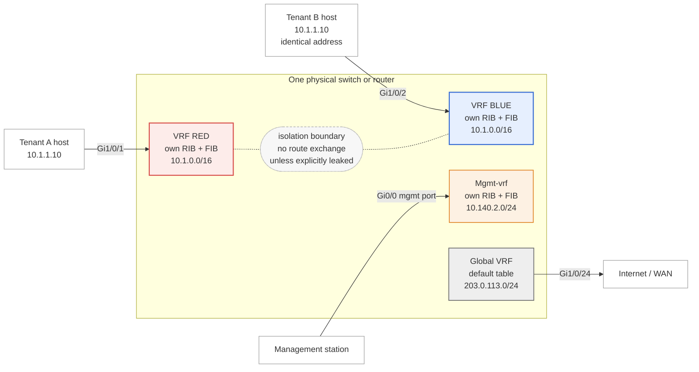
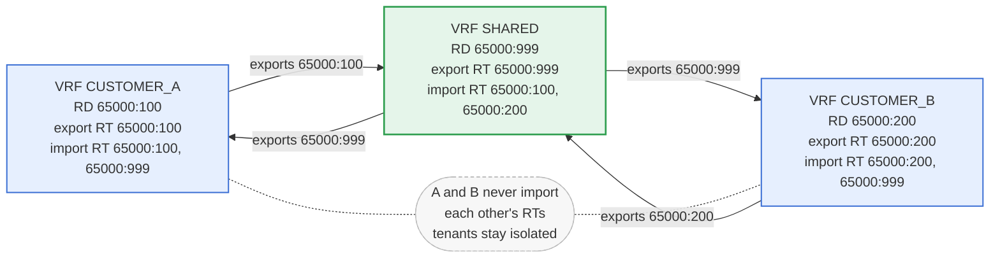

---
categories:
  - "[[Networking]]"
topic@networking:
  - "[[Networking General]]"
tags:
  - encor/routing
  - category/networking/networking_general
icon: FasNetworkWired
iconColor:
last_update: 2026-07-21
---
Virtual Routing and Forwarding (VRF) is a Layer 3 virtualization technology that lets a single physical router or switch maintain several independent routing and forwarding tables at the same time. Each table behaves like a separate virtual router: interfaces assigned to one VRF reach only the destinations known to that VRF, and address space may overlap freely between VRFs because their tables never mix. VRF is the construct beneath MPLS Layer 3 VPNs, but it is equally useful on its own — as [[#VRF-Lite]] — for tenant separation, management-plane isolation, and keeping otherwise-conflicting networks apart on shared hardware.

## Concept

VRF virtualizes the routing and forwarding plane of a device the way a hypervisor virtualizes a server. One box runs many logical routers, each with its own routing table, its own forwarding table, and its own set of interfaces. A packet that arrives on an interface belonging to a given VRF is routed only against that VRF's table; it has no visibility into any other VRF unless an explicit leak is configured.

Because each VRF carries a completely separate table, two VRFs can use the same IP prefix — even the exact same address on different interfaces — without conflict. The device keeps them apart by context, not by address.



Three things in that picture define the model. Each VRF owns a distinct pair of tables, so the same prefix `10.1.0.0/16` exists twice with no conflict. Each interface belongs to exactly one VRF, and that binding is what selects the routing context for arriving traffic. Nothing crosses between the boxes — including to and from the global table — without an [[#Route Leaking|explicit leak]].

### Isolation Model

The separation a VRF provides is control-plane and data-plane isolation at Layer 3:

- Control plane: routing protocols run per VRF and populate that VRF's routing table — its [[#Routing Information Base|RIB]] — and no other's. Routes learned in one VRF are never advertised into another unless leaked deliberately.
- Data plane: the forwarding table maintained by CEF — the [[#Forwarding Information Base|FIB]] — is built per VRF, so the longest-prefix-match lookup that selects an egress interface is scoped to the VRF the ingress interface belongs to.

> [!note] VRF is Layer 3, not Layer 2 A VRF separates routing tables. It does not create broadcast domains or segment a switch's Layer 2 forwarding — that is what a VLAN does. The two are complementary: a VLAN's SVI is an interface, and that interface can be placed into a VRF, binding the segment's gateway to a particular Layer 3 context.

### Comparison to VLANs

VLANs and VRFs are frequently confused because both "segment the network," but they operate at different layers and solve different problems.

|Aspect|VLAN|VRF|
|---|---|---|
|Layer|2 — broadcast-domain segmentation|3 — routing-table segmentation|
|Separates|MAC-learning and broadcast domains|Routing and forwarding tables|
|Overlapping IPs|Not addressed — a VLAN carries one subnet|Fully supported across VRFs|
|Boundary object|Switchport / trunk|Interface-to-VRF binding|
|Typical scope|Within a switched segment|Across routed hops|

A common design uses both together: each VLAN has an SVI, and each SVI is [[#Interface Association|placed into the VRF]] that owns that tenant or zone. The VLAN keeps the Layer 2 domains apart; the VRF keeps their routing apart.

### Use Cases

VRF is deployed wherever a single device must serve multiple routing contexts that should not see each other:

- Overlapping address space: mergers, acquisitions, or multi-customer environments where the same RFC 1918 ranges appear more than once. Each occupant gets a VRF, so `10.0.0.0/8` in tenant A never collides with `10.0.0.0/8` in tenant B.
- Multi-tenancy: a shared aggregation or data-center switch that routes for several independent tenants, each confined to its own VRF.
- Management-plane isolation: keeping device management traffic in a dedicated VRF so it stays reachable even when the production routing table is unstable, and so production traffic can never reach the management interface. This is the role of the [[#Management VRF|management VRF]].
- Path and security isolation: separating zones such as guest, corporate, IoT, or PCI into distinct routing tables so traffic cannot cross between them without passing through a controlled inspection point.
- MPLS Layer 3 VPN: within a service-provider or large-enterprise core, each customer VPN is a VRF on the provider-edge routers, carried across the backbone by MP-BGP and MPLS. This is the [[#MPLS L3VPN VRF|MPLS L3VPN]] model.

## Core Components

A VRF is more than an empty table; several elements define it and control how it behaves.

### Per-VRF Routing and Forwarding Tables

The heart of a VRF is its own pair of tables. Where a device without VRFs has a single global routing table and a single forwarding table, a VRF-enabled device has one of each per VRF, plus the global pair.

#### Routing Information Base

The RIB is the control-plane routing table — the collection of best routes chosen from all sources (connected, static, and dynamic protocols) for that VRF. Each VRF builds its RIB independently; a route present in one VRF's RIB is invisible to another. `show ip route vrf <name>` displays a single VRF's RIB.

#### Forwarding Information Base

The FIB is the data-plane table CEF derives from the RIB and uses to actually switch packets. Like the RIB, it is maintained per VRF. When a packet enters on an interface [[#Interface Binding|bound to a VRF]], the egress lookup is performed in that VRF's FIB. `show ip cef vrf <name>` displays it.

### Interface Association

Every Layer 3 interface belongs to exactly one VRF. If no VRF is configured on the interface, it belongs to the [[#The Global VRF|global VRF]]. Assigning an interface to a VRF is what places that link — and any addresses, routes, and neighbors reachable through it — inside the VRF's context.

Assigning or moving an interface into a VRF removes any IP address already configured on it, because the address belonged to the previous context. The address must be re-applied after the VRF binding. This is a frequent source of "my config disappeared" surprises.

> [!warning] Order of operations Bind the interface to the VRF first, then configure the IP address. Doing it the other way, or moving an interface between VRFs, silently clears the existing address.

### The Global VRF

The global — or default — VRF is the ordinary routing table the device has always had: the one that exists before any VRF is defined and that owns every interface not explicitly placed elsewhere. It is unnamed, so commands without a `vrf` keyword operate on it (`show ip route`, `ping`, and so on). Traffic in the global VRF and traffic in a named VRF are isolated from each other exactly as two named VRFs are; the global table is not a parent that named VRFs can see into.

### Address Families

A modern VRF can carry more than one protocol. Under the multiprotocol VRF definition, an address-family sub-mode enables and scopes each protocol independently — typically IPv4 and IPv6. Policy such as route-target import and export is applied per address-family, so a VRF can, for example, leak IPv4 routes under one policy and IPv6 under another, or not at all.

### Route Distinguisher

A Route Distinguisher (RD) is a 64-bit value prepended to an IPv4 or IPv6 prefix to make it globally unique. Because overlapping VRFs may both hold, say, `10.1.1.0/24`, those identical prefixes must be disambiguated before they can be carried together across a shared MP-BGP backbone. The RD turns `10.1.1.0/24` into a unique VPNv4 route such as `65000:1:10.1.1.0/24`.

Key points:

- The RD exists purely for uniqueness. It is not a policy tool and does not by itself decide which VRF imports a route — that is the [[#Route Target|route target]]'s job.
- It is written in a standard format, most commonly `ASN:nn` or `IP-address:nn` (for example `65000:100`).
- In VRF-Lite, where routes are never carried in MP-BGP, the RD has no forwarding role. It is not strictly required to define a VRF or bind interfaces under the multiprotocol syntax, though the legacy `ip vrf` form did require one before the VRF became usable, and BGP requires one before a VRF address-family can be configured. Many operators set it regardless, for consistency.

### Route Target

A Route Target (RT) is an extended BGP community attached to VPN routes that controls route leaking between VRFs. Each VRF has an export policy — the RTs stamped onto routes it advertises — and an import policy — the RTs it will accept into its table, both configured per [[#Address Families|address-family]]. A route advertised with RT `65000:100` is imported by every VRF configured to import `65000:100`, which may be one VRF, several, or itself.

|Policy|Meaning|
|---|---|
|export|Tag this VRF's routes with the listed RT(s) as they are advertised.|
|import|Accept routes carrying the listed RT(s) into this VRF.|
|both|Shorthand for export and import of the same RT.|

Route Targets are how selective connectivity is built. A common "shared services" VRF can export an RT that every tenant imports — so all tenants reach shared servers — while tenants use distinct RTs among themselves and therefore stay mutually isolated.

## VRF Types

The same underlying construct appears in a few distinct deployment models.

### VRF-Lite

VRF-Lite is VRF without MPLS. The device maintains multiple routing tables and forwards between VRFs' interfaces locally, but it does not use MP-BGP or MPLS labels to carry VRF routes across a backbone. Where the separation must extend to a neighboring device, each VRF is trunked to that neighbor on its own sub-interface or VLAN, and a separate routing adjacency is run per VRF — effectively one logical link per VRF.

VRF-Lite is the common enterprise case: it delivers isolation and overlapping-address support on ordinary Layer 3 switches and routers with no MPLS control plane. Its cost is that end-to-end separation across many hops requires per-VRF links and per-VRF routing instances at every hop, which scales poorly compared with MPLS.

### MPLS L3VPN VRF

In an MPLS Layer 3 VPN, VRFs live on the provider-edge (PE) routers and are carried across the core by MP-BGP — advertising VPNv4/VPNv6 routes stamped with an [[#Route Distinguisher|RD]] and RT — and by MPLS, which labels the traffic so the core can forward it without holding per-VRF state. This is the model VRF was originally designed for, and where the RD and RT do real work. The mechanics are covered in [[#Relationship to MPLS L3VPN|Relationship to MPLS L3VPN]].

### Management VRF

A management VRF is a VRF dedicated to device management, isolating management traffic from production routing. Cisco IOS-XE platforms ship with a predefined VRF named `Mgmt-vrf` bound to the dedicated management Ethernet port (for example `GigabitEthernet0/0`), so that management reachability does not depend on the production routing table and production traffic can never egress the management port.

Placing management on this VRF means the services that use it must be made VRF-aware — SSH, SNMP, syslog, NTP, TACACS, and the rest all need to know which VRF to use, as covered under [[#VRF-Aware Services|VRF-Aware Services]]. In this project's switch baseline the management VRF is defined exactly this way; see the `Mgmt-vrf` block in [[PBA - NAC - Network Access Devices#General Configuration|the NAD configuration]].

## Forwarding Behavior

How a device actually moves a packet once VRFs are in play comes down to three things: which VRF the ingress interface belongs to, [[#Scoped Route Lookup|a lookup scoped to that VRF]], and any configured leaking that lets a lookup cross a VRF boundary.

### Interface Binding

The ingress interface determines the VRF context for a packet. Because every interface belongs to exactly one VRF, the moment a frame is received the device knows which routing context applies. There is no per-packet tag on ordinary VRF-Lite links selecting the VRF — the binding of the physical or logical interface to the VRF is the selector. On a trunk carrying multiple VRFs, each VLAN or sub-interface is a separate logical interface, each bound to its own VRF.

### Scoped Route Lookup

Once the ingress VRF is known, the destination lookup happens in that VRF's FIB. The best-matching prefix there selects the egress interface and next hop. If the destination is not present in that VRF's table, the packet is dropped — or sent to that VRF's default route, if one exists. It is never silently resolved from another VRF's table or from the global table.

```
Packet in on Gi0/1 (bound to VRF RED)
        │
        ▼
Lookup destination in VRF RED's FIB only
        │
        ├── match found → forward out egress interface
        └── no match    → drop (or RED's own default route)

The global table and VRF BLUE are never consulted.
```

### Route Leaking

Route leaking is the deliberate act of making selected routes from one VRF available in another, creating controlled connectivity between contexts that are otherwise isolated. It is required for patterns such as shared services, a common internet edge, or a monitoring segment reachable from many tenants. Leaking is always explicit — there is no accidental cross-VRF forwarding.

#### Route-Target Leaking

The scalable method uses MP-BGP import and export policies. Routes are exported from a source VRF stamped with a route target, and any VRF whose import policy accepts that RT installs them. This works even without an MPLS core: route-target import and export under a VRF address-family, together with a running BGP process, leaks between local VRFs on the same box. It is policy-driven and scales to many VRFs and prefixes.

The canonical pattern is shared services — one VRF holding DNS, NTP, or monitoring that every tenant must reach, while the tenants remain isolated from each other:



Connectivity is defined entirely by which RTs each VRF imports. Because neither tenant imports the other's RT, adding a third tenant changes nothing for the first two — the reason this scales where per-pair static leaking does not.

#### Import and Export Maps

Route targets are all-or-nothing: every route a VRF exports carries the RT, and every route carrying an imported RT is installed. An import map or export map attaches a route-map filter so only selected prefixes actually cross the boundary.

```cisco
vrf definition SHARED
 address-family ipv4
  export map ONLY-SERVERS
  import map TENANT-SUMMARIES
 exit-address-family
```

This matters for a shared-services VRF that should expose only its server subnet rather than its entire table, and for tenants that should receive a summary instead of every internal prefix. Without a map, a leak is as broad as the RT policy allows.

#### Static Route Leaking

For small, fixed requirements, a static route can point across VRFs. A route in one VRF names a next hop or interface that resides in another VRF, using the `global` keyword or an inter-VRF next-hop form. It is simple and needs no BGP, but every leaked prefix is a manual entry in both directions, so it does not scale and is easy to get subtly wrong — a missing return route is the classic mistake.

> [!tip] Leak in both directions Connectivity is bidirectional only if both VRFs can resolve the other's prefixes. Leaking A→B without B→A gives one-way reachability and asymmetric failures. Always account for the return path.

#### Inter-VRF Traffic via an External Firewall

Route leaking creates connectivity but inspects nothing. Where inter-VRF traffic must be controlled rather than merely permitted, the common enterprise design routes it out to a firewall and back — each VRF presents an interface, sub-interface, or VLAN to the firewall, and the firewall routes between them under policy.

```
VRF CUSTOMER_A ──┐                    ┌── inspection
                 ├──► Firewall ◄──────┤   logging
VRF CUSTOMER_B ──┘   routes between   └── policy enforcement
                     the VRFs
```

|Approach|Strengths|Costs|
|---|---|---|
|Route leaking|No extra hop, line-rate, simple for known flows|No inspection, logging, or policy beyond the prefix itself|
|Firewall hairpin|Full inspection, logging, and stateful policy between contexts|Extra latency, firewall bandwidth becomes the ceiling, a new failure domain|

The two are frequently combined: leak the low-risk shared-services routes directly, and hairpin anything crossing a security zone boundary.

## Configuration

The following builds a VRF from definition through interface assignment, routing, and leaking, using Cisco IOS / IOS-XE syntax.

### Legacy and Multiprotocol Syntax

Two configuration styles exist. Modern software uses the multiprotocol form; the legacy form is IPv4-only and deprecated.

|Aspect|Legacy|Multiprotocol|
|---|---|---|
|Global command|`ip vrf NAME`|`vrf definition NAME`|
|Protocols|IPv4 only|IPv4 and IPv6 via address-families|
|Interface binding|`ip vrf forwarding NAME`|`vrf forwarding NAME`|
|Status|Deprecated|Current|

```cisco
! Legacy (IPv4 only) — avoid on new deployments
ip vrf RED
 rd 65000:1
 route-target export 65000:1
 route-target import 65000:1

! Multiprotocol — preferred
vrf definition RED
 rd 65000:1
 address-family ipv4
  route-target export 65000:1
  route-target import 65000:1
 exit-address-family
 address-family ipv6
 exit-address-family
```

> [!note] Migration IOS-XE can convert legacy `ip vrf` VRFs to the multiprotocol model, but the two syntaxes should not be mixed for the same VRF. New configuration should use `vrf definition` exclusively. The `Mgmt-vrf` blocks in the example NAD note use exactly this multiprotocol form, with both address-families declared.

### Defining a VRF

```cisco
vrf definition CUSTOMER_A
 description Tenant A routing instance
 rd 65000:100
 address-family ipv4
  route-target export 65000:100
  route-target import 65000:100
 exit-address-family
```

|Line|Effect|
|---|---|
|`vrf definition CUSTOMER_A`|Creates the VRF and enters its configuration. The name is locally significant.|
|`rd 65000:100`|Sets the route distinguisher used for uniqueness across MP-BGP.|
|`address-family ipv4`|Enters IPv4 configuration for this VRF.|
|`route-target export/import 65000:100`|Defines the leak policy — here, a self-contained VRF that imports and exports only its own RT.|

### Assigning an Interface

```cisco
interface GigabitEthernet0/1
 vrf forwarding CUSTOMER_A
 ip address 10.1.1.1 255.255.255.0
```

The `vrf forwarding` line must come before `ip address`. If an address already exists when the VRF is applied, it is removed and must be re-entered — which is why the binding is always configured first.

### Static Routes

A static route inside a VRF names the VRF explicitly:

```cisco
ip route vrf CUSTOMER_A 0.0.0.0 0.0.0.0 10.1.1.254
```

Without the `vrf CUSTOMER_A` keyword the route lands in the global VRF and has no effect on CUSTOMER_A traffic.

### Dynamic Routing

Routing protocols are made VRF-aware either through an address-family (BGP, named-mode EIGRP) or through a per-VRF process (OSPF).

#### OSPF

Each VRF runs a separate OSPF process tied to the VRF:

```cisco
router ospf 10 vrf CUSTOMER_A
 network 10.1.1.0 0.0.0.255 area 0
```

#### EIGRP

Named-mode EIGRP uses an address-family per VRF:

```cisco
router eigrp CORP
 address-family ipv4 vrf CUSTOMER_A autonomous-system 100
  network 10.1.1.0 0.0.0.255
 exit-address-family
```

#### BGP

BGP carries each VRF as an IPv4 address-family under one BGP process — which is also where MP-BGP VPNv4 and route leaking hook in:

```cisco
router bgp 65000
 address-family ipv4 vrf CUSTOMER_A
  redistribute connected
  neighbor 10.1.1.2 remote-as 65100
  neighbor 10.1.1.2 activate
 exit-address-family
```

### Configuring Route Leaking

Selective leaking between two local VRFs via route targets — here a shared-services VRF reachable by a tenant:

```cisco
vrf definition SHARED
 rd 65000:999
 address-family ipv4
  route-target export 65000:999
  route-target import 65000:100      ! also import the tenant's routes
 exit-address-family

vrf definition CUSTOMER_A
 rd 65000:100
 address-family ipv4
  route-target export 65000:100
  route-target import 65000:100
  route-target import 65000:999      ! import the shared-services routes
 exit-address-family
```

A BGP process must be running for route-target import and export to take effect locally, even without an MPLS core. For one-off requirements, [[#Static Route Leaking|static leaking]] is the alternative:

```cisco
! Reach a host that lives in the global table from within a VRF
ip route vrf CUSTOMER_A 192.0.2.10 255.255.255.255 203.0.113.1 global
```

The trailing `global` keyword tells the switch to resolve the named next hop in the global table rather than in CUSTOMER_A.

## VRF-Aware Services

Once management or infrastructure interfaces live in a VRF, the services that use them must be told which VRF to operate in. A service left in the global VRF cannot reach a server that is only routable inside a named VRF, and vice versa. This is the most common operational friction after introducing a management VRF.

### Management Sessions

Interactive management is sourced from the VRF that owns the management interface:

```cisco
! Outbound SSH from within a VRF
ssh -vrf Mgmt-vrf 10.140.2.10
```

Inbound VTY sessions are reachable through whichever VRF the connecting interface belongs to. For device-initiated sessions, the relevant `source-interface` command should point at a VRF-bound interface so the traffic originates in the correct context.

### Reachability Testing

Diagnostics must specify the VRF or they run in the global table and appear to fail:

```cisco
ping vrf CUSTOMER_A 10.1.1.254
traceroute vrf Mgmt-vrf 10.140.2.10
```

> [!warning] "It's down" — but you pinged the wrong VRF A `ping` with no `vrf` keyword tests the global VRF. If the destination lives in a named VRF, the test fails even though the path is healthy. Always include the VRF when troubleshooting VRF-scoped reachability.

### Control-Plane Services

Each infrastructure service has a VRF-aware form. Typical management-plane services and how they are scoped:

|Service|VRF-aware configuration|
|---|---|
|SNMP|`snmp-server host <ip> vrf <name> ...`|
|Syslog|`logging host <ip> vrf <name>`|
|NTP|`ntp server vrf <name> <ip>`|
|TACACS+ / RADIUS|Server group with `ip vrf forwarding <name>` and a VRF-bound source-interface|
|DNS|`ip domain lookup vrf <name>` and `ip name-server vrf <name> <ip>`|
|TFTP / FTP / HTTP client|`ip <proto> source-interface <vrf-bound-interface>`|

Each of these otherwise defaults to the global VRF. Omitting the VRF is why, for example, syslog silently stops when the logging host is reachable only through the management VRF.

### NAT

NAT is VRF-aware, which is what allows tenants with overlapping address space to share a single internet edge. Each VRF's private addresses are translated into unique global addresses before the traffic leaves, so the overlap that is harmless inside the VRFs does not follow the traffic outward.

```cisco
ip nat inside source list TENANT_A_NETS pool PUBLIC_A vrf CUSTOMER_A overload
!
interface GigabitEthernet0/1
 vrf forwarding CUSTOMER_A
 ip nat inside
!
interface GigabitEthernet0/0
 ip nat outside
```

The `vrf` keyword scopes the translation to one VRF's traffic. Without it, translations from different VRFs share one context and overlapping inside addresses collide in the translation table.

### First-Hop Redundancy

HSRP, VRRP, and GLBP run per VRF because they are configured on an interface, and that interface already belongs to a VRF. Two switches sharing a gateway for a tenant VLAN must have that SVI in the same VRF on both, or the peers never see each other's hellos.

```cisco
interface Vlan802
 vrf forwarding CUSTOMER_A
 ip address 10.1.2.2 255.255.255.0
 standby 1 ip 10.1.2.1
 standby 1 priority 110
 standby 1 preempt
```

Group numbers are scoped to the interface, so the same group ID can be reused in different VRFs on the same switch without conflict.

### DHCP Relay Across VRFs

When DHCP clients sit in one VRF and the DHCP server in another — commonly the global or a shared-services VRF — the relay must bridge the two:

```cisco
interface Vlan802
 vrf forwarding CUSTOMER_A
 ip address 10.1.2.1 255.255.255.0
 ip helper-address global 10.140.4.10
```

The `global` keyword on the helper tells the relay to forward the client's request into the global VRF where the server lives, and to return the reply to the client's VRF. A named VRF can be used the same way with `ip helper-address vrf <name> <ip>`. Without the keyword, the relay looks for the server only inside the client's own VRF.

## Relationship to MPLS L3VPN

VRF is the customer-facing half of an MPLS Layer 3 VPN. Seeing the split clarifies why the RD and RT exist at all.

In an MPLS L3VPN:

- Each customer site connects to a provider-edge (PE) router. The PE holds one VRF per customer and runs a routing protocol, or statics, with the customer-edge (CE) device inside that VRF.
- The PE takes the customer's IPv4 routes, prepends the route distinguisher to form unique VPNv4 routes, tags them with a route target, and advertises them to other PEs over MP-BGP.
- Remote PEs import those VPNv4 routes into the matching VRF according to their route-target import policy, then strip the RD back to plain IPv4 toward their own CEs.
- The provider core (P routers) forwards purely on MPLS labels and holds no customer routes — an outer label reaches the egress PE, and an inner VPN label identifies the target VRF.

```mermaid
flowchart LR
    CEA["CE-A<br/>customer site A<br/>10.1.0.0/16"]
    PE1["PE1<br/>VRF CUSTOMER_A<br/>RD 65000:100"]
    CORE["P routers<br/>MPLS core<br/>label switching only<br/>holds no customer routes"]
    PE2["PE2<br/>VRF CUSTOMER_A<br/>RD 65000:100"]
    CEB["CE-B<br/>customer site B<br/>10.2.0.0/16"]

    CEA -->|"plain IPv4<br/>eBGP, OSPF or static"| PE1
    PE1 -->|"VPNv4 route:<br/>RD + prefix, tagged RT<br/>via MP-BGP"| CORE
    CORE -->|"forwards on labels:<br/>outer = egress PE<br/>inner = target VRF"| PE2
    PE2 -->|"RD stripped<br/>plain IPv4"| CEB

    classDef ce fill:#ffffff,stroke:#999999,stroke-width:1px;
    classDef pe fill:#d9effb,stroke:#049fd9,stroke-width:2px;
    classDef core fill:#eeeeee,stroke:#6b6b6b,stroke-width:1.5px;
    class CEA,CEB ce;
    class PE1,PE2 pe;
    class CORE core;
```



VRF-Lite is exactly this picture with the MPLS and MP-BGP middle removed: the VRFs and per-VRF routing remain, but separation is carried hop-by-hop on per-VRF links instead of by labels, so the RD and RT lose their forwarding role.

## Design Considerations

### Naming and Numbering Conventions

VRF names are locally significant and case-sensitive, so `CUSTOMER_A` and `customer_a` are different VRFs. Consistency across devices is what makes a deployment maintainable, since nothing in the protocol enforces it.

|Element|Convention|Must match across devices?|
|---|---|---|
|VRF name|Meaningful and identical everywhere the VRF exists — the tenant, zone, or function it serves|No, but inconsistency is a persistent source of error|
|Route distinguisher|A scheme such as `ASN:tenant-id`, or `ASN:site-id` when per-PE uniqueness is wanted|No — the RD only needs to make prefixes unique|
|Route target|A scheme such as `ASN:tenant-id`, allocated centrally|Yes — import and export values must correspond, or leaking silently fails|

The RD and RT are frequently set to the same value for simple deployments, which is convenient but obscures their different roles. Allocating them from a documented plan pays off as soon as shared services or selective leaking appear.

### Scalability and Platform Limits

A VRF is not free. Each one consumes resources that are finite and platform-specific:

- Table memory: every VRF holds its own RIB and FIB. Many VRFs each carrying a full table multiply memory consumption accordingly.
- Hardware forwarding entries: on switches, per-VRF routes occupy TCAM. The supported VRF count and total route capacity depend on the platform's SDM template or equivalent, and exhausting TCAM causes routes to be punted to software with a severe performance penalty.
- Control-plane load: a separate routing protocol instance per VRF means separate adjacencies, timers, and SPF or DUAL computations, all competing for the same CPU.
- Licensing: on some platforms the number of usable VRFs, or VRF support at all, is tied to the feature licence.

A per-VRF route limit protects the device from one context exhausting shared resources:

```cisco
vrf definition CUSTOMER_A
 address-family ipv4
  maximum routes 10000 80
 exit-address-family
```

This caps the VRF at 10000 routes and logs a warning at 80 percent. Without a limit, a misbehaving tenant or a redistribution mistake in one VRF can starve every other VRF on the box.

### Choosing Between VRF and the Alternatives

VRF is one of several separation tools, and picking the wrong one produces either a weak boundary or unnecessary complexity.

|Requirement|Appropriate tool|
|---|---|
|Separate broadcast domains within a switched segment|VLAN|
|Separate routing tables, overlapping address space, one device|VRF|
|Policy, inspection, and logging between segments|Firewall, optionally with [[#Inter-VRF Traffic via an External Firewall|
|Strong isolation with independent failure domains|Physically separate devices|
|Scalable multi-site tenant separation over a shared core|MPLS L3VPN or a VXLAN/EVPN fabric|

> [!warning] A VRF is not a security boundary against device compromise VRFs isolate routing tables, not the device itself. They share one control plane, one operating system, and one management context. An attacker with administrative access to the device can leak between VRFs at will, and a control-plane vulnerability affects all of them at once. Use VRFs to prevent unintended routing between contexts, and firewalls or separate hardware where an adversarial boundary is required.

### Operational Caveats

- Removing a VRF from an interface, or deleting the VRF, drops the IP address on every interface bound to it and tears down any routing adjacencies in that context. Deleting a VRF is a service-affecting change.
- Renaming a VRF is not supported in place; it means creating the new VRF, moving interfaces, and removing the old one.
- Moving an interface between VRFs clears its address for the same reason a fresh binding does — plan the re-application into the change.
- VRF-aware services must be revisited whenever an interface moves contexts, since a `source-interface` that no longer sits in the expected VRF silently breaks the service rather than reporting an error.

## Verification and Troubleshooting

### Inspecting VRFs

```cisco
show vrf                            ! list VRFs, RDs, and assigned interfaces
show vrf detail <name>             ! full detail including RT import/export
show ip route vrf <name>           ! the VRF's RIB
show ip cef vrf <name> <prefix>    ! the VRF's FIB entry for a prefix
show ip interface brief            ! confirm which interfaces sit in which VRF
show ip protocols vrf <name>       ! routing-protocol state per VRF
show bgp vpnv4 unicast all         ! VPNv4 routes with RD/RT (MPLS L3VPN)
```

### Common Failure Modes

| Symptom                                             | Likely cause                                                                                                 |
| --------------------------------------------------- | ------------------------------------------------------------------------------------------------------------ |
| Interface lost its IP after config                  | Address cleared when the interface was bound to a VRF; re-apply it after the binding.                        |
| `ping` fails but the link is up                     | Test ran in the global VRF; add the `vrf` keyword.                                                           |
| Static route has no effect                          | `ip route` created in the global VRF instead of `ip route vrf <name>`.                                       |
| Routes will not leak between VRFs                   | No BGP process running, or import/export RTs do not match — and often the return direction was never leaked. |
| Some leaked routes arrive, others do not            | An import or export map is filtering them; check the referenced route-map.                                   |
| Syslog / SNMP / NTP silent                          | Service left in the global VRF while the server is reachable only through the management VRF.                |
| Overlapping addresses still collide                 | Interfaces not actually placed in separate VRFs, so both prefixes landed in the same table.                  |
| HSRP/VRRP peers never see each other                | The SVI is in different VRFs on the two switches, or in the global VRF on one of them.                       |
| DHCP clients get no address                         | Relay is looking for the server inside the client's VRF; add `global` or `vrf <name>` to the helper.         |
| Routes present but forwarding is slow or CPU spikes | Hardware forwarding capacity exceeded, pushing per-VRF routes into software.                                 |