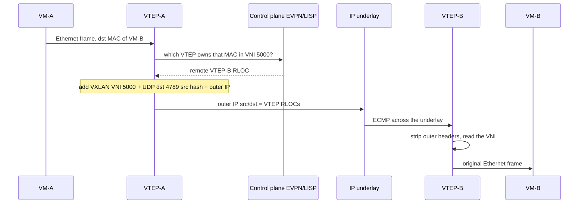
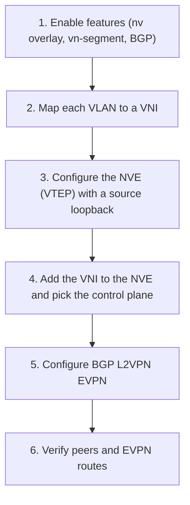
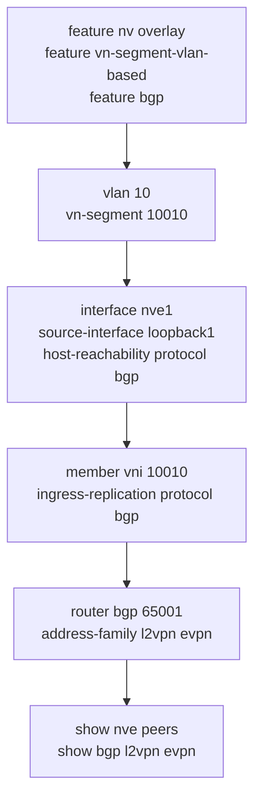

---
categories:
  - "[[Networking]]"
topic@networking:
  - "[[Networking General]]"
tags:
  - category/networking/networking_general
icon: FasNetworkWired
iconColor:
last_update:
---
VXLAN (Virtual eXtensible LAN, RFC 7348) is an overlay technology that carries Layer 2 Ethernet frames inside UDP so they can cross a routed Layer 3 network. It wraps the original frame in outer IP, UDP, and VXLAN headers — a scheme known as MAC-in-UDP — so that two endpoints in the same virtual segment behave as if they share a switch even when many routed hops separate them. For the ENCOR exam, the important lens is that VXLAN is the data-plane encapsulation of the Cisco SD-Access campus fabric, paired with a LISP control plane and a Cisco TrustSec policy plane. The same encapsulation is used in data-center spine-leaf fabrics, where the control plane is usually [[#BGP EVPN\|BGP EVPN]] instead. This note covers why VXLAN exists, how a frame is encapsulated, what a [[#VXLAN Tunnel Endpoint\|VTEP]] does, how endpoints are learned, and how the three planes fit together in SD-Access.

## Why VXLAN Exists

_VXLAN removes three limits that plain VLANs impose on large and virtualized networks._

### VLAN Scale Ceiling

The 802.1Q VLAN ID is 12 bits, which allows only 4094 usable segments. In a large multi-tenant data center or a service-provider environment, thousands of tenants can exhaust that space quickly. The VXLAN Network Identifier is 24 bits, raising the ceiling to roughly sixteen million segments.

### Layer 2 Trapped Behind Layer 3

A VLAN is a Layer 2 construct; it cannot cross a router. To place two hosts in the same subnet on opposite sides of a routed core, the Layer 2 domain has to be physically stretched, which is fragile and hard to scale. VXLAN tunnels the Layer 2 frame inside IP, so the same segment can span anything the underlay can reach — different racks, pods, or sites — without extending the physical Layer 2.

### Oversized Layer 2 Domains

Stretched VLANs mean large spanning-tree domains: half the links blocked, slow convergence, and broadcast storms that reach every host. VXLAN pushes forwarding onto a routed underlay where every link is active through equal-cost multipath, and confines each Layer 2 segment to the overlay.

|Aspect|VLAN|VXLAN|
|---|---|---|
|Identifier|12-bit VLAN ID|24-bit [[#VXLAN Network Identifier\|VNI]]|
|Usable segments|4094|~16 million|
|Transport|Layer 2 only|Layer 2 frames carried over Layer 3|
|Reach|Confined to the Layer 2 domain|Anywhere the IP underlay reaches|
|Loop handling|Spanning tree|Routed underlay with ECMP; no STP in the core|
|Header added|802.1Q tag (4 bytes)|MAC-in-UDP (50 bytes)|

## Underlay, Overlay, and Fabric

_VXLAN builds a virtual network on top of a physical one; the two are named separately because they are managed separately._

### Underlay

The physical, routed IP network — switches, routers, and their links — that provides plain reachability between tunnel endpoints. In a data center this is typically a spine-leaf topology running an IGP such as OSPF or IS-IS. The underlay knows nothing about tenants or segments; it only has to route packets between VTEP IP addresses, and it uses ECMP so all links carry traffic.

### Overlay

The set of virtual Layer 2 (and Layer 3) networks built with VXLAN tunnels that ride on top of the underlay. Endpoints live in the overlay; the underlay never sees their real MAC or IP addresses because those are hidden inside the encapsulation.

### Fabric

Underlay plus overlay plus a control plane, managed as one system. Cisco SD-Access is a fabric: a routed underlay, a VXLAN overlay, and a LISP control plane, provisioned and operated together through Catalyst Center.

```
Overlay    VTEP-A ═══════ VXLAN tunnel ═══════ VTEP-B     virtual L2 over L3
             │                                    │
Underlay   Leaf ──── Spine ════ Spine ──── Leaf          routed IP + ECMP (IGP)
```

## VXLAN Encapsulation

_MAC-in-UDP: the original Ethernet frame is wrapped, unchanged, inside outer IP, UDP, and VXLAN headers for transport across the [[#Underlay\|underlay]]._

### Packet Format

The ingress VTEP takes the endpoint's original Layer 2 frame and prepends four outer headers. The inner frame is carried verbatim, so the receiving endpoint sees exactly what was sent.

```
Original Layer 2 frame from the endpoint
┌───────────────────────────────────────────────┐
│  Inner Eth │ Inner IP │ Payload                │
└───────────────────────────────────────────────┘
                    │  ingress VTEP encapsulates
                    ▼
┌──────────┬──────────┬──────────┬────────┬──────────────────────┐
│ Outer Eth│ Outer IP │ Outer UDP│ VXLAN  │  Original L2 frame    │
│          │ VTEP→VTEP│ dst 4789 │ (VNI)  │  (unchanged)          │
└──────────┴──────────┴──────────┴────────┴──────────────────────┘
    14 B       20 B        8 B       8 B     = 50 bytes of overhead
```

Two details matter for how the underlay treats the packet:

- Outer IP source and destination are the ingress and egress VTEP addresses, so the underlay routes VTEP-to-VTEP and never sees the inner addresses.
- Outer UDP destination is 4789 (the IANA-assigned VXLAN port). The UDP source port is a hash of the inner packet, which gives the underlay entropy to spread flows across ECMP paths.

The 8-byte VXLAN header itself is mostly reserved; its job is to carry the VNI and a flag that marks the VNI as valid.

```
 0                   1                   2                   3
┌─┬─┬─┬─┬─┬─┬─┬─┬───────────────────────────────────────────────┐
│R│R│R│R│I│R│R│R│                Reserved (24)                   │
├─────────────────────────────────────────────┬─────────────────┤
│           VNI — VXLAN Network Id (24)         │  Reserved (8)   │
└─────────────────────────────────────────────┴─────────────────┘
   I = 1  →  the VNI field is valid
```

> [!note] Where SD-Access hides the SGT
> Cisco SD-Access uses a variant called VXLAN-GPO (Group Policy Option) that repurposes 16 of those reserved bits to carry a Scalable Group Tag. That is what lets the fabric enforce group-based policy in the data plane — covered under [[#Policy Plane — Cisco TrustSec\|Cisco TrustSec]].

### VXLAN Network Identifier

_The 24-bit VNI is the segment label — the VXLAN equivalent of a VLAN ID, but vastly larger._

Every VXLAN segment is identified by a VNI carried in every encapsulated packet. It comes in two forms:

- Layer 2 VNI — mapped one-to-one with a VLAN, extending that broadcast domain across the fabric (VLAN-to-VNI).
- Layer 3 VNI — mapped to a VRF, providing routed, per-tenant separation across the fabric (VRF-to-VNI).

The Layer 2 VNI stretches a subnet; the Layer 3 VNI carries routed traffic between subnets while keeping tenants isolated. In SD-Access terms, separate Layer 3 VNIs are the basis of macro segmentation (virtual networks), while the SGT provides micro segmentation within a virtual network.

### MTU Considerations

_The 50-byte overhead means the underlay must carry larger frames or traffic will fragment._

Encapsulation adds 50 bytes for IPv4 (70 for IPv6). If the underlay still uses a 1500-byte MTU, a full-size inner frame no longer fits, forcing fragmentation or drops that are painful to troubleshoot.

> [!warning] Raise the underlay MTU
> Increase the underlay MTU to absorb the overhead — at least ~1554 bytes for IPv4, though jumbo frames (9000) are the common choice in data-center and fabric designs. This is a frequent root cause of intermittent overlay failures.

## VXLAN Tunnel Endpoint

_The VTEP is the device that encapsulates and decapsulates VXLAN — the edge of the [[#Overlay\|overlay]] and the only place that understands the VNI._



A VTEP has one foot in each network: an underlay IP address that other VTEPs route to, and a set of local segments (VNIs) whose endpoints it serves. When a local endpoint sends a frame, its VTEP looks up the destination, adds the outer headers with itself as source and the remote VTEP as destination, and hands the packet to the underlay. The remote VTEP strips the headers and delivers the original frame.

```
endpoint ─► [ ingress VTEP ]  encap  ═══ underlay routes VTEP→VTEP ═══  decap  [ egress VTEP ] ─► endpoint
             adds outer IP/UDP/VXLAN                                    removes outer headers
```

VTEPs come in two forms:

- Hardware VTEP — a physical switch, such as a data-center leaf or an SD-Access fabric edge node, doing encapsulation in ASIC.
- Software VTEP — implemented in a host's [[Hypervisors#Virtual Switch\|virtual switch]], for example [[Hypervisors#Open vSwitch\|Open vSwitch]] or VMware NSX, encapsulating overlay traffic before it leaves the server.

## Control Plane — Learning Remote Endpoints

_Encapsulation answers how a frame travels; the control plane answers the prior question — which remote VTEP holds the destination endpoint._

### Flood-and-Learn with Multicast

The original RFC 7348 method has no separate control plane. Each VNI is mapped to an IP multicast group in the underlay. Broadcast, unknown-unicast, and multicast (BUM) traffic is sent to that group so every VTEP in the segment receives it, and VTEPs learn remote MAC-to-VTEP bindings by observing the traffic they decapsulate. It works, but it requires multicast in the underlay and floods to learn, so it scales poorly.

### Ingress Replication

A refinement that removes the multicast requirement. Instead of one multicast copy, the ingress VTEP sends a separate unicast copy of BUM traffic to each remote VTEP in the segment (head-end replication). The underlay stays unicast-only, but the replication cost on the source grows with the number of VTEPs.

### BGP EVPN

The modern data-center control plane. MP-BGP with the Layer 2 VPN EVPN address family distributes MAC and IP-to-VTEP reachability between VTEPs before any traffic flows, so unknown-unicast flooding and much of ARP are eliminated. This is the standard control plane for Nexus spine-leaf VXLAN fabrics.

### LISP

The control plane used by Cisco SD-Access. [[LISP#Core Namespaces|LISP]] separates an endpoint's identity (EID) from its location (RLOC, the VTEP address) and resolves one to the other on demand through a mapping database, rather than flooding to discover it — the subject of the next section.

|Method|How endpoints are learned|BUM handling|Typical context|
|---|---|---|---|
|Flood-and-learn|Data-plane learning|IP multicast group per VNI|Legacy VXLAN|
|Ingress replication|Data-plane learning|Unicast copy to each remote VTEP|Underlays without multicast|
|BGP EVPN|Control-plane advertisement of MAC/IP|Reduced flooding, ARP suppression|Data-center spine-leaf|
|LISP|On-demand EID-to-RLOC mapping|Per fabric design|Cisco SD-Access campus|

## VXLAN in Cisco SD-Access

_ENCOR's primary VXLAN context: the [[SD-Access#The Three Planes|campus fabric]] separates forwarding into three cooperating planes._

Cisco SD-Access decomposes the fabric into a control plane (LISP), a data plane (VXLAN), and a policy plane (Cisco TrustSec). Keeping them separate is what lets the fabric move an endpoint anywhere, forward its traffic over a routed underlay, and still enforce the same security policy.

### Control Plane — LISP

LISP maintains the host-to-location database. Fabric edge nodes register the endpoints they serve (EIDs) together with their own locator (RLOC) into a control-plane node that runs the LISP Map-Server and Map-Resolver. When one edge node needs to reach an endpoint it does not know, it queries the map system — much like DNS resolving a name — learns the destination RLOC, and encapsulates toward it. This on-demand model avoids flooding and scales to large campuses.

### Data Plane — VXLAN

Once LISP has supplied the destination RLOC, the edge node encapsulates the frame in VXLAN and sends it across the underlay. The [[#VXLAN Network Identifier\|VNI]] carries the segment: a Layer 2 VNI to extend a VLAN, or a Layer 3 VNI bound to a VRF for routed tenant separation.

### Policy Plane — Cisco TrustSec

Segmentation is enforced with [[TrustSec#Security Group Tag (SGT)|Scalable Group Tags]] rather than IP ACLs. Endpoints are classified into groups, and the fabric carries the group membership as an SGT inside the VXLAN header — SD-Access replaces 16 reserved header bits to transport up to roughly 64,000 tags. Because the tag rides in the data plane, policy follows the user anywhere in the fabric.

- Macro segmentation — separate virtual networks (VRFs / Layer 3 VNIs) that cannot talk without going through a policy point. Complete isolation.
- Micro segmentation — SGT-based rules inside a single virtual network, controlling which groups may talk to which.

### Fabric Roles

|Role|Function|
|---|---|
|Fabric edge node|The [[#VXLAN Tunnel Endpoint\|VTEP]] that connects endpoints; encapsulates and decapsulates VXLAN and applies the SGT|
|Fabric border node|Connects the fabric to the outside — other domains, the WAN, the data center, or shared services|
|Fabric control-plane node|Runs the LISP Map-Server / Map-Resolver and holds the host-to-location database|
|Intermediate node|A pure underlay router forwarding IP between VTEPs, with no fabric role of its own|
|Fabric WLC and access points|Bring wireless clients into the same fabric and the same policy|

```
             Control-Plane Node  (LISP Map-Server / Map-Resolver)
                         │   host-to-location (EID→RLOC) database
        ┌────────────────┼────────────────┐
     Border Node       Spine …          (underlay: IS-IS)
        │                │                │
     Edge Node ───── Edge Node ───── Edge Node        VTEPs (VXLAN + SGT)
        │                │                │
     endpoint         endpoint         endpoint
```

## VXLAN Among Overlay Options

_VXLAN is the de facto overlay, but it is one of several MAC-in-IP encapsulations._

VXLAN won broad multi-vendor adoption, which is why it anchors both SD-Access and most data-center fabrics. Other overlays exist and appear occasionally: NVGRE wraps the frame in GRE rather than UDP; GENEVE is a newer, extensible successor that carries flexible option fields and is favored by some SDN platforms; OTV was Cisco's earlier data-center interconnect for stretching Layer 2 between sites; and MPLS L2VPN and VPLS solve the same Layer 2 extension problem in service-provider cores.

> [!tip] For the exam, anchor on the SD-Access mapping
> If you remember one thing, remember the three planes: LISP is the control plane, VXLAN is the data plane, Cisco TrustSec is the policy plane. Most SD-Access questions resolve to knowing which plane owns which job.

## Configuration

_Building an EVPN-VXLAN fabric on NX-OS: enable the features, map VLANs to VNIs, create the VTEP, and run BGP EVPN as the control plane._

### High-Level Workflow



### CLI Companion

_Cisco NX-OS, BGP EVPN control plane (ingress replication shown)._


