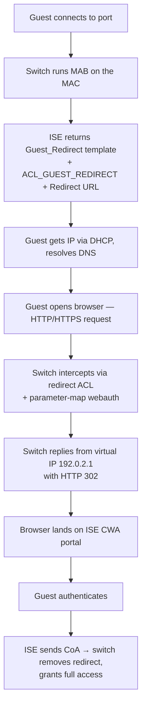
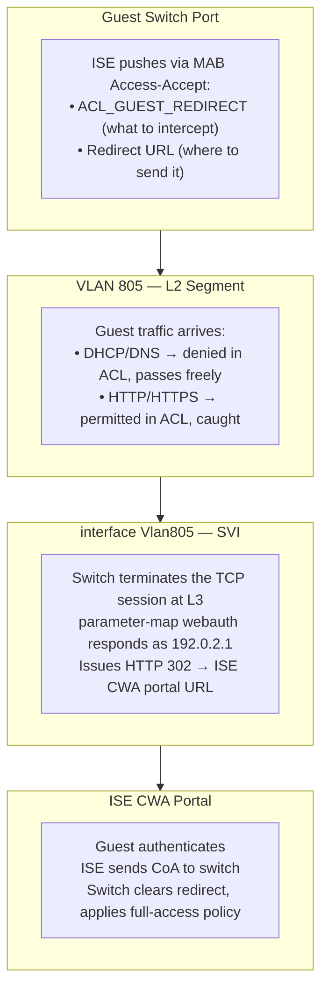

---
tags:
  - networking
  - cisco
  - ise
  - cwa
  - guest-access
---


# Cisco ISE — Centralized Web Authentication (CWA) Guest Configuration

> [!info] What this covers The full guest redirect flow using Cisco **Centralized Web Authentication (CWA)**. In this model the switch does **not** host the login page — it intercepts the guest's web traffic and hands the session off to the ISE Guest Portal.

## End-to-End Flow



> [!warning] AAA failure If ISE becomes unreachable while a guest session is active, the policy clears the session and applies **`Critical_Access`** in its place. See [[#Failure Behavior]].

---

## Components

Four distinct pieces must all be in place. Each handles a different layer of the redirect mechanism — none of them works in isolation.

|Component|Layer|Role|
|---|---|---|
|`VLAN 805`|L2|Isolates guest traffic from production|
|`ACL_GUEST_REDIRECT`|L3|Identifies which traffic to intercept|
|`interface Vlan805` SVI|L3|Gives the switch an IP presence on the guest subnet so it can terminate TCP connections|
|`parameter-map type webauth`|Application|Defines the virtual IP and executes the redirect|

The ACL identifies traffic to catch, the SVI gives the switch somewhere to terminate it, and the parameter map decides what to do with it.

---

## VLAN 805 — Guest Segment

```cisco
vlan 805
 name LAN-GUEST-ACCESS
```

VLAN 805 is the Layer 2 segment dedicated to unauthenticated guest traffic. All guest-connected switch ports are placed into this VLAN before authentication completes. It isolates guest traffic from production at L2 and forms the boundary within which the entire CWA redirect flow takes place.

---

## ACL_GUEST_REDIRECT — Traffic Selector

```cisco
ip access-list extended ACL_GUEST_REDIRECT
 10 deny   udp any any eq domain
 20 deny   udp any any eq bootps
 30 deny   ip  any host 10.140.2.31
 40 deny   ip  any host 10.140.2.32
 50 permit tcp any any eq www
 60 permit tcp any any eq 443
```

### Inverted Logic

> [!important] Read this first A redirect ACL is **not** a packet filter. Its verbs are inverted relative to a normal ACL:
> 
> - `permit` → **intercept** this traffic and redirect it to the virtual IP
> - `deny` → **let this pass freely**, no redirect

So `deny udp any any eq domain` doesn't block DNS — it _allows_ DNS through without interception.

### Line-by-Line

|Line|Rule|Reason|
|---|---|---|
|`10`|Don't redirect DNS|DNS must flow freely so the guest can resolve hostnames. Without it, the browser never resolves an address to connect to and the redirect flow never starts.|
|`20`|Don't redirect DHCP|DHCP must flow freely so the guest gets an IP. The entire redirect flow depends on the guest having a valid IP first.|
|`30`|Don't redirect traffic to ISE PSN 1|After the switch issues an HTTP 302, the browser follows the redirect to the ISE portal URL. That follow-up traffic must **not** be intercepted again — exempting ISE prevents a redirect loop.|
|`40`|Don't redirect traffic to ISE PSN 2|Same reason as line 30, for the second PSN. Both nodes must be exempt so the portal reaches ISE directly regardless of which PSN handles the session.|
|`50`|Redirect HTTP|HTTP matches here and is intercepted by `parameter-map webauth`. The switch hijacks the connection and points the guest at the CWA portal via virtual IP `192.0.2.1`.|
|`60`|Redirect HTTPS|Same interception as HTTP. Requires `intercept-https-enable` in the parameter map so guests starting on HTTPS URLs are still caught.|

### Why Order Matters

The ACL is evaluated top-down, first-match wins. Infrastructure exemptions must appear before the HTTP/HTTPS redirect entries so those flows bypass interception before the broader web matches occur.

> [!note] About strict ordering Strictly speaking, a DNS packet would still match a DNS-specific `deny` line regardless of position, because the HTTP/HTTPS lines are TCP-specific. But placing exemptions first is still correct practice — it reflects intent, ensures specific rules take precedence over broader ones, and makes the policy easier to audit.

### How ISE Delivers This ACL

This ACL is **not** statically applied to the switch port. ISE pushes it dynamically as part of the `Guest_Redirect` service template when the switch runs MAB on an unknown MAC. The Access-Accept response contains both the ACL name and a redirect URL, and the switch applies both to the port for the duration of the session.

---

## WebAuth Parameter Map — Redirect Engine

```cisco
parameter-map type webauth global
 type webauth
 virtual-ip ipv4 192.0.2.1
 intercept-https-enable
```

The redirect ACL identifies **which** traffic to catch. The parameter map decides **what to do with it**.

### `type webauth`

Sets the authentication mode. In CWA this tells the switch to act as a proxy interceptor rather than host its own login page — the switch catches the traffic and hands it off to the ISE portal URL.

### `virtual-ip ipv4 192.0.2.1`

Once the switch has terminated the guest's TCP session at the [[#Guest Intercept SVI — Layer 3 Presence|Vlan805 SVI]], the virtual IP is what makes the browser follow the redirect. The switch impersonates this address as the source of the HTTP 302 response:

```
Guest's TCP session is now open to the switch (intercepted at the SVI)
        ↓
Guest sends:  GET / HTTP/1.1
              Host: google.com
        ↓
Switch responds as 192.0.2.1 with:
              HTTP/1.1 302 Found
              Location: https://<ISE-PSN>/portal/...
        ↓
Browser follows the 302 → ISE CWA portal
        ↓
TCP session to the switch closes
```

Without the virtual IP, the switch would have no consistent identity to send the redirect from. The TCP termination at the SVI gets the switch into the conversation; the virtual IP is what it speaks _as_ once it's there.

> [!tip] Why this specific IP? `192.0.2.1` comes from the **TEST-NET-1** range defined in [RFC 5737](https://datatracker.ietf.org/doc/html/rfc5737). The `192.0.2.0/24` block is reserved and guaranteed never to be a routable destination on a real network — there is zero risk of conflict with an actual host. Using a real IP here would risk redirecting traffic to an unintended destination.

### `intercept-https-enable`

Without this, only HTTP (port 80) is intercepted. Since modern browsers default to HTTPS, this is effectively mandatory. When enabled:

```
Guest opens https://google.com
        ↓
Switch receives the TCP SYN on port 443
        ↓
Switch intercepts before TLS negotiation completes
        ↓
Switch injects a captive-portal redirect response instead
        ↓
Browser follows the redirect → ISE CWA portal
```

> [!warning] Expect a TLS warning The switch does not present a valid certificate for the destination site — it intercepts the TCP flow before TLS can establish and returns a redirect at that point. The guest may see a certificate warning, or modern operating systems may handle it transparently via captive-portal detection (CNA on iOS/macOS, the captive-portal helper on Android/Windows). Exact behaviour varies by platform and OS version.

### Scope

The parameter map is configured **globally** on the switch. It applies to any port that receives a redirect instruction from ISE, so it only needs to be defined once regardless of how many guest ports are active.

---

## Guest Intercept SVI — Layer 3 Presence

```cisco
interface Vlan805
 description GUEST-INTERCEPT-SVI
 ip address <IP-ADDRESS> <SUBNET-MASK>
 no shutdown
```

### What It Does

The SVI gives the switch a **Layer 3 presence on the guest subnet**, which is what makes TCP interception physically possible.

When a guest sends an HTTP request, the switch needs to terminate that TCP connection — it must act as an IP endpoint and send back a response. To do that, it needs an IP address reachable from the guest subnet. The Vlan805 SVI provides exactly that. Without it, the switch is only a Layer 2 forwarder on that VLAN — it can move frames but cannot participate in IP conversations, and therefore cannot intercept TCP sessions.

Concretely, without CWA, a normal TCP handshake goes straight to the destination:

```
Guest SYN  ───────────────────────────→  google.com
Guest      ←─────────────────────────── SYN-ACK (google.com)
Guest ACK  ───────────────────────────→  google.com
TCP session established with google.com
```

With CWA, the switch intercepts the SYN and completes the handshake itself, using the SVI as its L3 endpoint — the guest ends up with a TCP session open to the **switch**, not to Google:

```
Guest SYN  ───────────────────────────→  google.com (intended)
Guest      ←─────────────────────────── SYN-ACK (handled by the switch)
Guest ACK  ───────────────────────────→  switch
TCP session established with the SWITCH, not google.com
```

From here the [[#WebAuth Parameter Map — Redirect Engine|webauth engine]] takes over and issues the HTTP 302 redirect to the ISE portal as `192.0.2.1`.

> [!note] Exact source-IP behavior The platform-specific details of _which_ IP appears as the source of the SYN-ACK can vary (some implementations transparently spoof the original destination's address). What matters conceptually is that the switch — not the real destination — handles the handshake, made possible by the SVI's L3 presence on the guest subnet.

### What Breaks Without It

```
No SVI on VLAN 805
        ↓
Switch has no L3 presence on the guest subnet
        ↓
parameter-map webauth has no interface to receive intercepted traffic
        ↓
Virtual IP 192.0.2.1 has no path to respond from
        ↓
Guest traffic passes through unintercepted — redirect never fires
```

### SVI IP vs. Virtual IP

||SVI IP|Virtual IP (`192.0.2.1`)|
|---|---|---|
|**What it is**|Real IP assigned to the switch on VLAN 805|Spoofed IP used in the HTTP 302 response|
|**Who sees it**|Used internally for L3 processing|Seen by the guest's browser in the redirect|
|**Purpose**|Lets the switch terminate TCP sessions on the guest subnet|Triggers the browser to follow the redirect to the ISE portal|

The SVI is the **mechanism**. The virtual IP is the **disguise**.

---

## How It All Fits Together



---

## Failure Behavior

If AAA connectivity to ISE is lost while a guest session is active:

- The active guest session is cleared.
- The switch applies the `Critical_Access` policy to the port instead.
- This prevents uncontrolled access during an ISE outage while keeping the port functional under a fallback policy.

---

## Configuration Summary

```cisco
! VLAN
vlan 805
 name LAN-GUEST-ACCESS

! Redirect ACL
ip access-list extended ACL_GUEST_REDIRECT
 10 deny   udp any any eq domain
 20 deny   udp any any eq bootps
 30 deny   ip  any host 10.140.2.31
 40 deny   ip  any host 10.140.2.32
 50 permit tcp any any eq www
 60 permit tcp any any eq 443

! Intercept SVI
interface Vlan805
 description GUEST-INTERCEPT-SVI
 ip address <IP-ADDRESS> <SUBNET-MASK>
 no shutdown

! WebAuth Parameter Map
parameter-map type webauth global
 type webauth
 virtual-ip ipv4 192.0.2.1
 intercept-https-enable
```