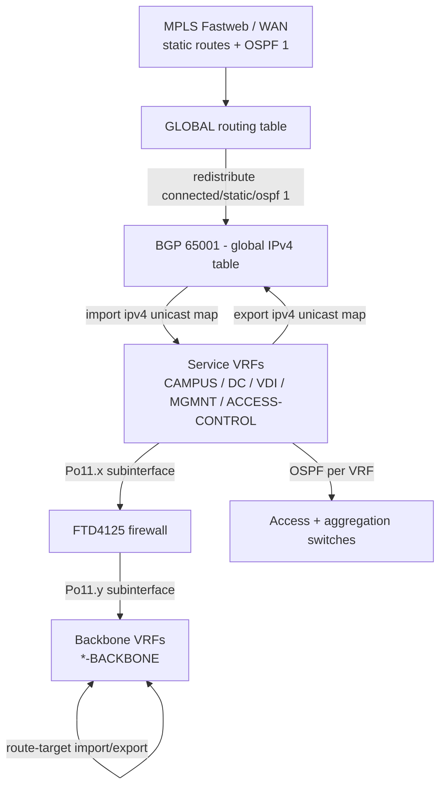

# VM90-IP-CORE1 - How the VRFs Talk to Each Other

This vault explains the routing design of **VM90-IP-CORE1**, the IP core router of the Publiacqua data centre. It is written for someone who has **never worked with BGP or VRFs before**, and builds up from first principles.

Read the notes in order. Each one assumes only what came before it.

---

## The whole design in one paragraph

The router is split into about a dozen **separate routing tables** (VRFs), one per security zone: campus, data centre, VDI, management, access control, guest wifi. By default these zones cannot see each other at all - that is the point. Where they *do* need to see each other, the router uses **BGP as an internal conveyor belt** to copy individual routes from one table to another. Which routes get copied is controlled by **route-targets** (between VRFs), **communities** (between a VRF and the global table), and **route tags** (to stop routes going round in circles). Zone-to-zone traffic is deliberately forced through an **FTD4125 firewall**, and a second set of VRFs called `*-BACKBONE` exists purely to give the firewall a routing table on the far side of each zone.

> [!important] The single most surprising fact
> `router bgp 65001` on this box has **zero neighbours**. BGP is never used to talk to another router here. It is used only as a local mechanism for moving routes between routing tables inside the same chassis. If you go looking for BGP peers, you will not find any, and that is correct.

---

## Big picture

- **Vertical axis (Global to VRF)**: shared destinations - the WAN, internet, management servers. Controlled by [[04 - Global Leaking and Communities|import/export maps and communities]].
- **Horizontal axis (VRF to VRF)**: zone-to-zone traffic. It **never** takes a shortcut inside the router. It goes out to the firewall and comes back. Controlled by [[03 - Service and Backbone VRFs|route-targets between the Backbone VRFs]].

---

## Notes in this vault

| # | Note | What it covers |
|---|---|---|
| 01 | [[01 - Primer - VRF RD RT and BGP]] | Every concept from zero: VRF, RD, route-target, redistribution, route-map, prefix-list, community, tag |
| 02 | [[02 - VRF Inventory]] | Every VRF on the box, its RD/RT, its OSPF process, whether it is alive or dead |
| 03 | [[03 - Service and Backbone VRFs]] | The two-layer design and the firewall hairpin. Who can reach whom |
| 04 | [[04 - Global Leaking and Communities]] | How routes move between the global table and a VRF, and the community numbering scheme |
| 05 | [[05 - Tags 80 and 800]] | The loop-prevention machinery. Why tags exist and what breaks without them |
| 06 | [[06 - Worked Examples]] | Five end-to-end traces, including "can CAMPUS reach TCI?" |
| 07 | [[07 - Command Reference]] | Every command used in this config, decoded line by line |
| 08 | [[08 - Findings and Cleanup]] | Bugs, contradictions and dead config found while writing this |
| 09 | [[09 - Verification Playbook]] | What to type on the box to prove any of the above |

---

## Suggested study order

1. Read [[01 - Primer - VRF RD RT and BGP]] end to end. Do not skip it even if you know OSPF well - the route-map implicit-deny rule and the community-to-tag translation are where people get lost.
2. Skim [[02 - VRF Inventory]] to get the names into your head.
3. Read [[03 - Service and Backbone VRFs]] and draw the firewall hairpin yourself on paper.
4. Read [[04 - Global Leaking and Communities]] and [[05 - Tags 80 and 800]] together - they are two halves of the same idea.
5. Work through [[06 - Worked Examples]] with the config open next to you.
6. Use [[07 - Command Reference]] as a dictionary, not as reading material.
7. Read [[08 - Findings and Cleanup]] before you change anything.

---

## Conventions used in these notes

- Secrets from the config (type 7 keys, enable secrets, RADIUS keys, certificates) are **not reproduced** here. They appear as `<hidden>`.
- `65001:64` style notation is used for route-targets. Communities in the config are written as raw 32-bit decimals; the conversion table is in [[01 - Primer - VRF RD RT and BGP#Decoding the community numbers]].
- "Service VRF" means a zone-facing VRF such as `IT-VRF-CAMPUS`. "Backbone VRF" means its `*-BACKBONE` twin.
- Anything marked > [!warning] or > [!danger] is a real finding, cross-referenced in [[08 - Findings and Cleanup]].

> [!caution] Before you change anything
> This documentation was produced by reading a `show run` snapshot dated 2026-07-29. It describes **intent as written in the config**, not observed behaviour. Confirm with the commands in [[09 - Verification Playbook]] before acting, and make changes reversible (`configure replace` + `reload in 10`).
