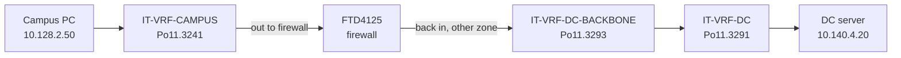

---
categories:
  - "[[Networking]]"
topic@networking:
  - "[[Networking General]]"
title: Service VRFs and Backbone VRFs - the firewall hairpin
tags:
  - network/cisco
  - vrf
  - firewall
  - design
  - category/networking/networking_general
up: "[[00 - MOC - VM90-IP-CORE1 Routing]]"
icon: FasNetworkWired
iconColor:
last_update: 2026-09-21
---

# Service VRFs and Backbone VRFs

This is the central idea of the whole design. If you understand this note, the rest is detail.

---

## The problem it solves

The security requirement is: **campus traffic must not reach data-centre servers without passing the firewall.**

A router is very good at *not* forwarding between VRFs. But it is also very good at forwarding between them the instant you leak a route - and a leaked route is a direct, un-inspected path. So leaking `IT-VRF-CAMPUS` ↔ `IT-VRF-DC` directly would quietly bypass the firewall.

The solution used here: **give every zone two VRFs**, one on each side of the firewall.

---

## The hairpin



The packet leaves the router into the firewall and comes back in. That is the "hairpin". The router never short-circuits it, because **no route-target links a service VRF to another service VRF**. Every service VRF imports only its own RT.

> [!important] Read this twice
> `IT-VRF-CAMPUS` imports **only** `65001:20`, its own. So does `IT-VRF-DC` with `65001:23`. There is no route-target anywhere in the config that would let one service VRF import another's routes. Inter-VRF policy lives entirely in the **BACKBONE** layer.

---

## The subinterface pairs on Port-channel11

`Port-channel11` goes to `VM90-DC-L2-AGGR1/2` and from there to the FTD4125. Every zone gets two VLANs on it - a service one and a backbone one, in consecutive-ish numbering:

| Zone | Service VRF subif | Service IP | Backbone VRF subif | Backbone IP |
|---|---|---|---|---|
| ACCESS-CONTROL | `Po11.3261` | `10.142.2.1/30` | `Po11.3263` | `10.142.2.5/30` |
| CAMPUS | `Po11.3241` | `10.142.2.33/30` | `Po11.3243` | `10.142.2.37/30` |
| DC | `Po11.3291` | `10.142.2.65/30` | `Po11.3293` | `10.142.2.69/30` |
| MGMNT | `Po11.3281` | `10.142.2.97/30` | `Po11.3283` | `10.142.2.101/30` |
| VDI | `Po11.3221` | `10.142.2.129/30` | `Po11.3223` | `10.142.2.133/30` |
| WIFIGUEST | `Po11.3251` | `10.142.2.161/30` | `Po11.3253` | `10.142.2.165/30` |
| TEST-A | `Po11.3900` | `10.142.26.17/30` | `Po11.3950` | `10.142.26.21/30` |
| TEST-B | `Po11.3903` | `10.142.26.25/30` | `Po11.3953` | `10.142.26.29/30` |

Notice the tidy `10.142.2.x/30` addressing: each zone gets a /27-ish slot and the backbone link is always the service link + 4.

A typical pair, decoded:

```cisco
interface Port-channel11.3241
 description OSPF-CAMPUS-FTD4125-BACK:L3_Peering:Po4.3241
 encapsulation dot1Q 3241              ! VLAN tag on the trunk
 vrf forwarding IT-VRF-CAMPUS          ! this leg is the SERVICE side
 ip address 10.142.2.33 255.255.255.252
 no ip redirects
 no ip proxy-arp
 ip ospf authentication-key 7 <hidden>
 ip ospf network point-to-point        ! skip DR/BDR election on a /30
 ip ospf bfd                           ! sub-second failure detection
 ip ospf 4 area 0.0.0.0                ! join OSPF process 4 = CAMPUS
!
interface Port-channel11.3243
 encapsulation dot1Q 3243
 vrf forwarding IT-VRF-CAMPUS-BACKBONE ! this leg is the BACKBONE side
 ip address 10.142.2.37 255.255.255.252
 ip ospf 64 area 0.0.0.0               ! OSPF process 64 = CAMPUS-BACKBONE
```

Same firewall, same port-channel, two VLANs, two routing tables.

---

## What each layer advertises

### Service VRF (e.g. `IT-VRF-CAMPUS`, OSPF 4)

- **Down to the aggregation switches**: campus subnets, plus a default route (`default-information originate`), plus whatever leaked in from global.
- **To the firewall on `Po11.3241`**: the campus subnets. This tells the firewall "campus lives behind this interface".

```cisco
router ospf 4 vrf IT-VRF-CAMPUS
 capability vrf-lite
 area 0.0.0.0 authentication
 redistribute static
 redistribute bgp 65001 route-map SET-TAG-TO-GLOBAL-COMMUNITY
 network 10.142.24.108 0.0.0.3 area 0.0.0.0
 default-information originate
 bfd all-interfaces
```

### Backbone VRF (e.g. `IT-VRF-CAMPUS-BACKBONE`, OSPF 64)

- **Learns** from the firewall on `Po11.3243` the subnets the firewall can reach in other zones.
- **Advertises** to the firewall on `Po11.3243` the subnets it imported from *other* backbone VRFs, so the firewall knows where to send return traffic.

```cisco
router ospf 64 vrf IT-VRF-CAMPUS-BACKBONE
 capability vrf-lite
 area 0.0.0.0 authentication
 redistribute bgp 65001 route-map TAG-LEAKED-SUBNETS-CAMPUS
 passive-interface default              ! speak to nobody...
 no passive-interface Port-channel11.3243   ! ...except the firewall
 bfd all-interfaces
```

`passive-interface default` + one exception is a nice safety belt: this OSPF process can only ever form an adjacency with the firewall, even if someone accidentally puts another interface into process 64.

---

## Where the zone-to-zone policy actually lives

In the **route-target import list of each backbone VRF**. Nowhere else. Reading those lists *is* reading the security policy.

```cisco
vrf definition IT-VRF-WIFIGUEST-BACKBONE
 rd 65001:65
 route-target export 65001:65
 route-target import 65001:65
 address-family ipv4
  route-target import 65001:69        ! DC only. Nothing else.
 exit-address-family
```

### The full matrix

Rows = the VRF doing the importing. Columns = whose routes it gets.

| Importer ↓ / Source → | CAMPUS-BB `:64` | VDI-BB `:62` | AC-BB `:66` | MGMNT-BB `:68` | DC-BB `:69` | WIFI-BB `:65` |
|---|---|---|---|---|---|---|
| **CAMPUS-BB** `:64` | self | ✅ | ✅ | ✅ | ✅ | ❌ |
| **VDI-BB** `:62` | ✅ | self | ✅ | ✅ | ✅ | ❌ |
| **AC-BB** `:66` | ✅ | ✅ | self | ❌ | ✅ | ❌ |
| **MGMNT-BB** `:68` | ✅ | ✅ | ❌ | self | ✅ | ❌ |
| **DC-BB** `:69` | ✅ | ✅ | ✅ | ✅ | self | ✅ |
| **WIFI-BB** `:65` | ❌ | ❌ | ❌ | ❌ | ✅ | self |

Read in plain language:

- **DC is the hub.** Every zone can exchange routes with DC-BACKBONE. That makes sense - the servers are in DC.
- **Guest wifi is a spoke off DC only.** Guests get no route to campus, VDI, management or access control.
- **Access-control and management are deliberately separated** from each other at this layer. (But see the contradiction flagged in [[04 - Global Leaking and Communities]] and [[08 - Findings and Cleanup]] - they *do* leak to each other through the global table.)
- The matrix is **symmetric**: wherever A imports B, B imports A. Good. An asymmetric entry would produce one-way routing and very confusing troubleshooting.
- **TEST-A-BB `:93` ↔ TEST-B-BB `:94`** form their own isolated two-node version of the same pattern.

> [!tip] How to change zone-to-zone policy
> To let, say, MGMNT reach ACCESS-CONTROL through the firewall, you add **two** lines and nothing else:
> ```cisco
> vrf definition IT-VRF-MGMNT-BACKBONE
>  address-family ipv4
>   route-target import 65001:66
> !
> vrf definition IT-VRF-ACCESS-CONTROL-BACKBONE
>  address-family ipv4
>   route-target import 65001:68
> ```
> Always in pairs. A single-sided import gives you routes one way and a blackhole the other way. The firewall policy still has to permit the flow separately - the route-target only makes the path *possible*.

---

## Why importing routes is not transitive

A reasonable worry: `DC-BB` imports `65001:65` (guest wifi) **and** `CAMPUS-BB` imports `65001:69` (DC). Does campus therefore end up learning guest routes through DC?

**No**, for two independent reasons:

1. **Route-target import does not re-stamp.** When DC-BB imports a guest route, that route still carries only `65001:65` as its export RT. CAMPUS-BB is looking for `65001:69`, so it does not match.
2. **The tag guard blocks the second hop.** Imported routes get pushed into DC-BB's OSPF 69 with **tag 80**, and DC-BB's BGP redistribution refuses anything tagged 80:
   ```cisco
   address-family ipv4 vrf IT-VRF-DC-BACKBONE
    redistribute ospf 69 match internal external 1 external 2 route-map NO-RED-TAG-TO-LEAK
   !
   route-map NO-RED-TAG-TO-LEAK deny 5
    match tag 800 80
   ```

Full detail in [[05 - Tags 80 and 800]].

---

## What the backbone VRFs deliberately do *not* do

```cisco
address-family ipv4 vrf IT-VRF-CAMPUS-BACKBONE
 redistribute ospf 64 match internal external 1 external 2 route-map NO-RED-TAG-TO-LEAK
exit-address-family
```

That is the whole block. No `redistribute connected`, no `redistribute static`, no import/export map to global. A backbone VRF is a pure relay for what the firewall tells it. Compare with a service VRF, which redistributes connected and static as well because it owns real subnets.

---

## Next

→ [[04 - Global Leaking and Communities]] for the other axis: VRF ↔ global table.
