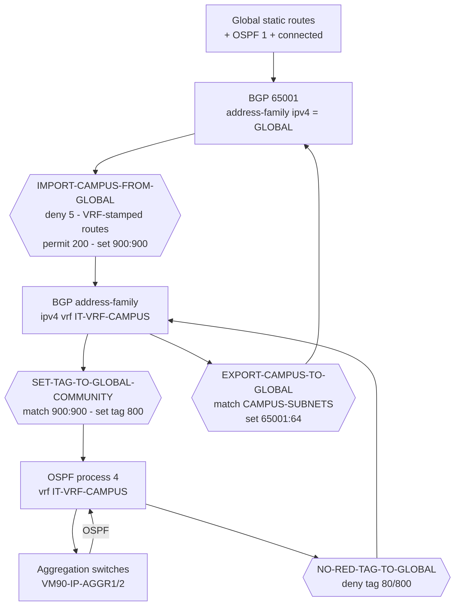

---
categories:
  - "[[Networking]]"
topic@networking:
  - "[[Networking General]]"
title: Global table leaking and the community scheme
tags:
  - network/cisco
  - bgp
  - community
  - route-leaking
  - category/networking/networking_general
up: "[[00 - MOC - VM90-IP-CORE1 Routing]]"
icon: FasNetworkWired
iconColor:
last_update: 2026-09-21
---

# Global table leaking and the community scheme

The [[03 - Service and Backbone VRFs|previous note]] covered the *horizontal* axis (VRF ↔ VRF, through the firewall). This note covers the *vertical* axis: **VRF ↔ global table**, which happens entirely inside the router with no firewall involved.

---

## What lives in the global table

The global table holds everything that is not in a VRF:

- The WAN uplinks: `Po10.3500` toward the Fastweb MPLS cloud, `Po10.3701/3703` to the WAN routers, `Po10.3742/3743` to the cloud-exit routers.
- About 40 `ip route` statics pointing at `10.142.96.85` (tracked by `track 4`) and `10.142.100.18` (tracked by `track 5`) - remote sites, partner networks, `172.16.x`, `10.243.0.0/16`, and so on.
- OSPF process 1, which peers with the WAN routers and the external switch.

These are **shared destinations**. Every zone needs some of them. Rather than duplicating 40 static routes into 5 VRFs, they are written once in global and leaked.

---

## The two commands that do the leaking

```cisco
vrf definition IT-VRF-CAMPUS
 rd 65001:20
 route-target export 65001:20
 route-target import 65001:20
 !
 address-family ipv4
  import ipv4 unicast map IMPORT-CAMPUS-FROM-GLOBAL   ! global  --> CAMPUS
  export ipv4 unicast map EXPORT-CAMPUS-TO-GLOBAL     ! CAMPUS --> global
 exit-address-family
```

| Command | Direction | Route-map decides |
|---|---|---|
| `import ipv4 unicast map <RM>` | global table → this VRF | which global routes this VRF is allowed to see |
| `export ipv4 unicast map <RM>` | this VRF → global table | which of my routes the rest of the world may see |

> [!note] This only works because of the global BGP address-family
> ```cisco
> router bgp 65001
>  address-family ipv4
>   redistribute connected
>   redistribute static
>   redistribute ospf 1 match internal external 1 external 2
> ```
> The import feature pulls from the **global BGP table**, not from the global RIB directly. If those three `redistribute` lines were removed, every VRF would instantly lose all its leaked global routes. They are load-bearing.

> [!warning] Default prefix limit
> The syntax is `import ipv4 unicast [limit] map NAME`. With no explicit limit, IOS applies a default cap (1000 prefixes) on how many routes may be imported. No limit is configured here. If the global table ever grows past that, imports stop silently for the excess. Worth checking with `show vrf detail | include Import` and adding an explicit value.

---

## The community scheme - a "return address" on every route

The risk with a shared global table is obvious: if CAMPUS exports its routes to global, and DC imports everything from global, then **DC has just learned campus routes without the firewall** - the exact thing the backbone design was built to prevent.

The fix: stamp every route exported from a VRF with a community identifying its source VRF, then have each VRF **refuse** routes carrying any of those source stamps.

### Step 1 - stamp on the way out

| VRF | Export route-map | Prefix filter | Community set | Readable |
|---|---|---|---|---|
| CAMPUS | `EXPORT-CAMPUS-TO-GLOBAL` | `CAMPUS-SUBNETS` (11 entries) | `4259905600` | `65001:64` |
| DC | `EXPORT-DC-TO-GLOBAL` | `DC-SUBNETS` (~60 entries) | `4259905605` | `65001:69` |
| MGMNT | `EXPORT-MGMNT-TO-GLOBAL` | `MGMT-SUBNETS` (3 entries) | `4259905604` | `65001:68` |
| ACCESS-CONTROL | `EXPORT-ACCESS-CONTROL-TO-GLOBAL` | ⚠️ **none - everything** | `4259905602` | `65001:66` |
| VDI | `EXPORT-VDI-TO-GLOBAL` | ⚠️ **none - everything** | `4259905598` | `65001:62` |
| TEST-A | `TEST-A-TO-GLOBAL-BGP` | none | `4259905629` | `65001:93` |
| TEST-B | `TEST-B-TO-GLOBAL-BGP` | none | `4259905630` | `65001:94` |

```cisco
route-map EXPORT-CAMPUS-TO-GLOBAL permit 10
 match ip address prefix-list CAMPUS-SUBNETS
 set community 4259905600
```

Only the 11 prefixes in `CAMPUS-SUBNETS` leave CAMPUS. Everything else hits the invisible implicit deny and stays inside the VRF.

```cisco
route-map EXPORT-VDI-TO-GLOBAL permit 10
 set community 4259905598
```

No `match` line means **every route in the VDI BGP table goes to global**, including transit /30s and anything VDI learned from elsewhere. Same for ACCESS-CONTROL. That is an inconsistency, flagged in [[08 - Findings and Cleanup]].

### Step 2 - refuse on the way in

```cisco
route-map IMPORT-CAMPUS-FROM-GLOBAL deny 5
 match community FROM-GLOBAL-TO-CAMPUS
!
route-map IMPORT-CAMPUS-FROM-GLOBAL permit 200
 set community 58983300
```

- **seq 5** - if the route carries a "born in a VRF" stamp, throw it away. This is the segmentation enforcement.
- **seq 200** - everything else (i.e. genuine global routes: WAN, statics, internet) is accepted, and re-stamped `58983300` = `900:900` meaning **"this route came from Global"**.

The community-list feeding seq 5:

```cisco
ip community-list expanded FROM-GLOBAL-TO-CAMPUS permit 4259905602   ! block ACCESS-CONTROL
ip community-list expanded FROM-GLOBAL-TO-CAMPUS permit 4259905600   ! block CAMPUS (itself!)
ip community-list expanded FROM-GLOBAL-TO-CAMPUS permit 4259905604   ! block MGMNT
ip community-list expanded FROM-GLOBAL-TO-CAMPUS permit 4259905598   ! block VDI
ip community-list expanded FROM-GLOBAL-TO-CAMPUS permit 4259905605   ! block DC
```

> [!question] Why does CAMPUS block its own stamp?
> Because CAMPUS exported those prefixes to global a moment ago. Without the self-block, CAMPUS would immediately re-import its own routes from global - a loop, and one that could install a worse path over the real one. Every VRF blocking its own community is the anti-echo rule.

### Step 3 - the `900:900` stamp becomes tag 800

The `set community 58983300` on seq 200 is not decoration. It is the input to the next stage:

```cisco
ip community-list expanded GLOBAL-COMMUNITY permit 58983300
!
route-map SET-TAG-TO-GLOBAL-COMMUNITY permit 10
 description Tag 800 per tutte le subnet importate da Global
 match community GLOBAL-COMMUNITY
 set tag 800
```

...used by every service VRF's OSPF process to push global routes down to the aggregation switches. Covered fully in [[05 - Tags 80 and 800]].

> [!warning] `set community` without `additive` overwrites
> Seq 200 **replaces** whatever communities the route was carrying. That is fine here because the only surviving routes are genuine global ones. But if anyone ever adds a community-based policy upstream, it will be silently erased at this point. `set community 58983300 additive` would preserve it.

---

## The deny matrix - who blocks whom

Rows = importing VRF. ✅ = correctly blocked. ❌ = **not blocked, route gets through**.

| Importing VRF ↓ | Blocks CAMPUS `:64` | VDI `:62` | AC `:66` | MGMNT `:68` | DC `:69` |
|---|---|---|---|---|---|
| **CAMPUS** | ✅ (self) | ✅ | ✅ | ✅ | ✅ |
| **DC** | ✅ | ✅ | ✅ | ✅ | ✅ (self) |
| **VDI** | ✅ | ✅ (self) | ⚠️ typo | ✅ | ✅ |
| **MGMNT** | ✅ | ✅ | ❌ **missing** | ✅ (self) | ✅ |
| **ACCESS-CONTROL** | ✅ | ✅ | ⚠️ typo (self) | ❌ **missing** | ✅ |
| **TEST-A** | – | – | – | – | – (blocks `:93` self and `:94`) |
| **TEST-B** | – | – | – | – | – (blocks `:94` self and `:93`) |

Three problems fall out of this table:

> [!danger] Finding 1 - the typo
> ```cisco
> ip community-list expanded FROM-GLOBAL-TO-ACCESS-CONTROL permit 4249905602
> ip community-list expanded FROM-GLOBAL-TO-VDI permit 4249905602
> ```
> `4249905602` should be `4259905602`. One digit. `4259905602` = `65001:66` (ACCESS-CONTROL); `4249905602` = `64848:27074`, a community nothing ever sets. Effect: **VDI does not block access-control routes**, and **ACCESS-CONTROL does not block its own** (re-import echo). Everywhere else in the config the value is written correctly, so this is a transcription slip, not intent.

> [!danger] Finding 2 - ACCESS-CONTROL ↔ MGMNT leak through global
> `FROM-GLOBAL-TO-ACCESS-CONTROL` has no entry for `4259905604` (MGMNT), and `FROM-GLOBAL-TO-MGMNT` has no entry for `4259905602` (AC). So management routes reach access-control and vice versa - **bypassing the firewall entirely**.
>
> This directly contradicts the backbone layer, where `AC-BB` deliberately does **not** import `65001:68` and `MGMNT-BB` deliberately does **not** import `65001:66` (see the matrix in [[03 - Service and Backbone VRFs]]). Someone decided those two zones should not talk; the global-leak filters did not get the memo.

> [!warning] Finding 3 - unfiltered exports amplify the above
> Because `EXPORT-VDI-TO-GLOBAL` and `EXPORT-ACCESS-CONTROL-TO-GLOBAL` have no prefix-list, the leaks above are not limited to a curated subnet list - they carry the whole VRF table.

All three are written up with suggested fixes in [[08 - Findings and Cleanup]].

---

## Complete picture of one service VRF



The two diamond-shaped filters on the **left** move routes *into* the VRF and mark them. The two on the **right** move routes *out of* the VRF and stop the marked ones from going back.

---

## Next

→ [[05 - Tags 80 and 800]] for the marking system that makes the loop above safe.
