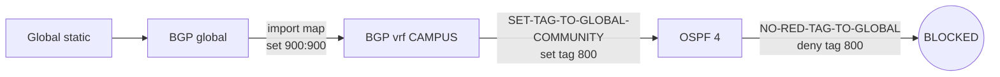

# Tags 80 and 800 - how loops are prevented

Every VRF on this box runs **two** routing processes that redistribute into each other:

```
OSPF n  <--redistribute-->  BGP 65001 address-family ipv4 vrf X
```

Mutual redistribution is the classic way to build a routing loop. The whole tag system exists to make it safe.

---

## What a tag is

A 32-bit number carried on a route. OSPF external LSAs have a dedicated tag field, and it survives being redistributed from BGP into OSPF and back. It is a note the router writes to itself: *"do not re-process this one."*

Two values are used on this router:

| Tag | Meaning | Set by | Where |
|---|---|---|---|
| **800** | "This route was born in the **global** table and leaked into a service VRF" | `SET-TAG-TO-GLOBAL-COMMUNITY` | service VRF OSPF processes |
| **80** | "This route was **leaked in from another backbone VRF**" | `TAG-LEAKED-SUBNETS-*` | backbone VRF OSPF processes |

Both are then blocked on the return trip by the guard route-maps.

---

## The four guard route-maps

All four do the same thing. They differ only in name and sequence numbers:

```cisco
route-map NO-RED-TAG-TO-GLOBAL deny 5
 match tag 800 80
!
route-map NO-RED-TAG-TO-GLOBAL permit 200
!
route-map NO-RED-TAG-TO-LEAK deny 5
 match tag 800 80
!
route-map NO-RED-TAG-TO-LEAK permit 200
!
route-map NO-RED-TAG-80 deny 10
 match tag 80 800
!
route-map NO-RED-TAG-80 permit 200
!
route-map NO-RED-TAG-800 deny 10
 match tag 800 80
!
route-map NO-RED-TAG-800 permit 200
```

Read as: *"if the route is tagged 80 or 800, drop it; otherwise let it through."*

| Route-map | Applied to |
|---|---|
| `NO-RED-TAG-TO-GLOBAL` | `redistribute ospf n` in the **service** VRFs (CAMPUS, DC, VDI, MGMNT, ACCESS-CONTROL) |
| `NO-RED-TAG-TO-LEAK` | `redistribute ospf n` in the **backbone** VRFs (62, 64, 65, 66, 68, 69) |
| `NO-RED-TAG-80` | `redistribute ospf 91/92` in VRF-TEST-A / B |
| `NO-RED-TAG-800` | `redistribute ospf 93/94` in TEST-A/B-BACKBONE |

> [!note] Four identical route-maps
> `match tag 800 80` and `match tag 80 800` are the same thing - the order of values in a `match tag` list is irrelevant. These four could be a single route-map. Harmless, but it is four places to update if the tag scheme changes. Listed in [[08 - Findings and Cleanup]].

---

## Cycle 1 - a global route entering CAMPUS

Take `10.122.32.0/19`, one of the tracked statics in the global table.

```cisco
ip route 10.122.32.0 255.255.224.0 10.142.96.85 track 4
```

| # | Step | Config that does it | Route state |
|---|---|---|---|
| 1 | Static sits in the global RIB | `ip route ... track 4` | plain static |
| 2 | Copied into global BGP | `address-family ipv4 / redistribute static` | in BGP, no community |
| 3 | Imported into CAMPUS | `import ipv4 unicast map IMPORT-CAMPUS-FROM-GLOBAL` | passes seq 5 (no VRF stamp), hits seq 200 → **community `900:900`** |
| 4 | Pushed into CAMPUS OSPF | `router ospf 4 / redistribute bgp 65001 route-map SET-TAG-TO-GLOBAL-COMMUNITY` | matches `GLOBAL-COMMUNITY` → **tag 800**, becomes an OSPF E2 LSA |
| 5 | Aggregation switches learn it | OSPF flooding | E2, tag 800 |
| 6 | **Return trip attempted** | `address-family ipv4 vrf IT-VRF-CAMPUS / redistribute ospf 4 ... route-map NO-RED-TAG-TO-GLOBAL` | `deny 5 match tag 800` → 🛑 **dropped** |

Without step 6 the route would go back into CAMPUS BGP, then be exported to global via `EXPORT-CAMPUS-TO-GLOBAL`, arriving in global as a VRF-originated route competing with the real static. Step 6 stops it.



---

## Cycle 2 - a leaked route inside the backbone layer

Take a campus subnet the firewall advertises into `IT-VRF-CAMPUS-BACKBONE`.

| # | Step | Config | Route state |
|---|---|---|---|
| 1 | FTD advertises it on `Po11.3243` | OSPF 64 adjacency | OSPF route, **no tag** |
| 2 | Into CAMPUS-BB BGP | `address-family ipv4 vrf IT-VRF-CAMPUS-BACKBONE / redistribute ospf 64 ... route-map NO-RED-TAG-TO-LEAK` | no tag → passes seq 200 → in BGP with **export RT `65001:64`** |
| 3 | DC-BB imports it | `vrf definition IT-VRF-DC-BACKBONE / route-target import 65001:64` | now in DC-BB's BGP table |
| 4 | Into DC-BB OSPF | `router ospf 69 / redistribute bgp 65001 route-map TAG-LEAKED-SUBNETS-DC` | **tag 80** applied |
| 5 | Advertised to FTD on `Po11.3293` | OSPF 69 | E2, tag 80 |
| 6 | **Return trip attempted** | `address-family ipv4 vrf IT-VRF-DC-BACKBONE / redistribute ospf 69 ... route-map NO-RED-TAG-TO-LEAK` | `deny 5 match tag 80` → 🛑 **dropped** |

Step 6 is what makes route-target import **non-transitive** in practice. Without it, a route imported into DC-BB would be re-exported with RT `65001:69`, and every VRF importing `:69` would pick it up - the whole matrix would collapse into any-to-any.

---

## The `TAG-LEAKED-SUBNETS-*` family

One per backbone VRF:

```cisco
route-map TAG-LEAKED-SUBNETS-CAMPUS permit 10
 match ip address prefix-list LEAKED-VRF-CAMPUS
 set tag 80
```

| Route-map | Prefix-list | What it actually permits |
|---|---|---|
| `TAG-LEAKED-SUBNETS-CAMPUS` | `LEAKED-VRF-CAMPUS` | `0.0.0.0/0 le 32` = **everything** |
| `TAG-LEAKED-SUBNETS-DC` | `LEAKED-VRF-DC` | everything |
| `TAG-LEAKED-SUBNETS-VDI` | `LEAKED-VRF-VDI` | everything |
| `TAG-LEAKED-SUBNETS-MGMNT` | `LEAKED-VRF-MGMNT` | everything |
| `TAG-LEAKED-SUBNETS-ACCESS-CONTROL` | `LEAKED-VRF-ACCESS-CONTROL` | everything |
| `TAG-LEAKED-SUBNETS-WIFI-GUEST` | `LEAKED-VRF-WIFI-GUEST` | ⭐ **only six /32 host routes** |
| `TAG-LEAKED-SUBNETS-A-B` | *(no match clause)* | everything |

So five of them are pass-through placeholders whose only job is to apply tag 80. One of them - guest wifi - is a real filter:

```cisco
ip prefix-list LEAKED-VRF-WIFI-GUEST seq 10 permit 10.140.2.8/32
ip prefix-list LEAKED-VRF-WIFI-GUEST seq 20 permit 10.140.2.31/32
ip prefix-list LEAKED-VRF-WIFI-GUEST seq 30 permit 10.140.2.32/32
ip prefix-list LEAKED-VRF-WIFI-GUEST seq 45 permit 10.140.2.37/32
ip prefix-list LEAKED-VRF-WIFI-GUEST seq 50 permit 10.140.10.102/32
ip prefix-list LEAKED-VRF-WIFI-GUEST seq 60 permit 10.140.10.103/32
```

Six individual servers. Everything else hits the implicit deny and never reaches the guest side of the firewall. See the walkthrough in [[06 - Worked Examples]].

> [!tip] This is the right place to tighten policy
> Turning `0.0.0.0/0 le 32` into a curated list in `LEAKED-VRF-CAMPUS` etc. would restrict which subnets each zone can see, without touching route-targets. Changing the prefix-list is also easier to roll back than changing RTs.

---

## The most important implicit deny in the config

```cisco
route-map SET-TAG-TO-GLOBAL-COMMUNITY permit 10
 description Tag 800 per tutte le subnet importate da Global
 match community GLOBAL-COMMUNITY
 set tag 800
```

There is **no seq 20**. So this route-map means:

> "Redistribute BGP into this VRF's OSPF **only if** the route carries community `900:900`. Everything else is discarded."

That is not sloppiness - it is the third loop guard. Without it, the VRF's own routes (which arrive in BGP via `redistribute connected` / `redistribute static` / `redistribute ospf n`) would be redistributed straight back into the same OSPF process they came from.

> [!danger] Do not "fix" this by adding a catch-all
> Adding `route-map SET-TAG-TO-GLOBAL-COMMUNITY permit 20` would immediately create an OSPF→BGP→OSPF feedback loop in all five service VRFs. There is an unused route-map in the config, `SET-TAG-TO-TEST-A`, which has exactly that catch-all `permit 20`. It is not applied anywhere. Leave it that way.

---

## Where the guard is missing

The global table does mutual redistribution too:

```cisco
router ospf 1
 redistribute static route-map VRFGLOBAL-REDISTRIBUTE-STATIC-TO-OSPF
 redistribute bgp 65001                        ! <-- no route-map
!
router bgp 65001
 address-family ipv4
  redistribute ospf 1 match internal external 1 external 2   ! <-- no route-map
```

Both directions, no tag filter, no prefix filter.

> [!danger] Finding - unguarded mutual redistribution in global
> Everything a VRF exports to global (`EXPORT-*-TO-GLOBAL`) lands in global BGP and is then flooded into the global OSPF 1 domain unfiltered. It then comes back into BGP via `redistribute ospf 1`. On a single router this tends to settle (OSPF's AD of 110 beats locally-originated BGP's 200) rather than loop forever, but it means:
> - the OSPF 1 domain carries every leaked VRF prefix as an E2,
> - VRF subnet changes churn the global OSPF database,
> - nothing stops an accidental export from propagating to the WAN.
>
> The fix follows the pattern already used everywhere else: tag on the way in, deny on the way out. Detailed in [[08 - Findings and Cleanup]].

---

## Summary card

| | Service VRF | Backbone VRF | Global |
|---|---|---|---|
| Tag applied on BGP→OSPF | **800** (only for `900:900` routes) | **80** (all, or filtered for wifi) | none |
| Guard on OSPF→BGP | `NO-RED-TAG-TO-GLOBAL` | `NO-RED-TAG-TO-LEAK` | ⚠️ **none** |
| Third guard | implicit deny in `SET-TAG-TO-GLOBAL-COMMUNITY` | implicit deny in `TAG-LEAKED-SUBNETS-*` | – |

---

## Next

→ [[06 - Worked Examples]] to walk all of this end to end.
